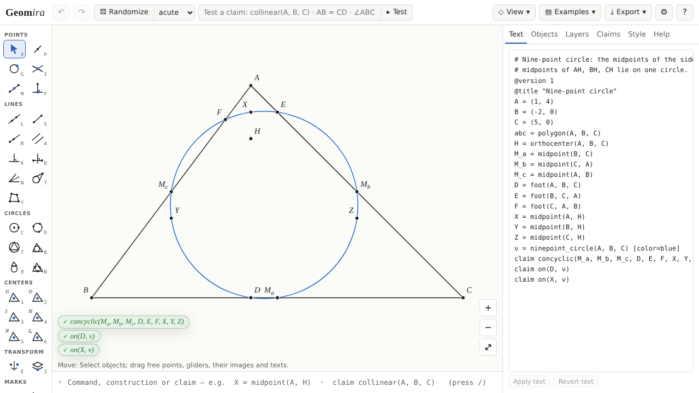

# Geomira

Dynamic geometry for olympiad geometry (IMO, ISL, national olympiads): build a figure with the
mouse or in a short text language, drag it, test claims about it on many random figures, and
export it for an AoPS post or a handout.

**Open it:** <https://youseng.github.io/geomira/> · about page:
<https://youseng.github.io/geomira/about.html>



## Features

- **The text is the figure.** Every figure is a short text (`M_a = midpoint(B, C)`,
  `claim concyclic(M_a, M_b, M_c, D, E, F)`), edited in the Text panel or one line at a time in
  the command line; a share link holds the whole text and opens the same figure again.
- **Tools in groups** (points, lines, circles, triangle centres, transformations, marks,
  measures and claims), each with a one-key shortcut: click A, B, C for the circumcentre,
  incentre, orthocentre, centroid, nine-point centre, excentre, or the circumcircle, incircle,
  excircle and nine-point circle; intersections and tangents ask which of two points you mean
  and write a selector that keeps that choice when the figure moves.
- **Honest about degeneracy.** An object that cannot be constructed is shown as undefined with
  its reason (“the circles are apart”), never drawn as garbage, and a point never jumps.
- **Claims with three values.** Each claim has a live pill for the current figure (true, false,
  or undefined with the reason). **Test** checks it on 200 nearby figures and says what was
  checked, e.g. “Holds in this configuration (local test, n = 200, exact over Q)”, with its seed;
  **Test globally** samples the whole declared configuration (`assume acute(A, B, C)`) and
  reports orientation- or configuration-dependent claims with an example figure.
- **Exact arithmetic.** Constructions also run over the rationals and modulo a large prime, so
  many claims are checked exactly rather than to a tolerance.
- **Transformations and layers.** Reflections, rotations, homotheties, translations and spiral
  similarities; a layer can hold the image of another layer and follows it.
- **Randomize** draws a new figure of the same construction with an acute, obtuse or right
  triangle (or any), through the claim tester's own sampler.
- **Colours by name** (`color=red`, `blue`, `green`, `orange`, `purple`, `grey`, …) in
  Geomdraw's palette, the same on the canvas and in every export; hex colours as written.
  Polygons are outlines unless they are coloured.
- **Exports** of what you see: SVG, PNG (with the figure's text inside), TikZ, and Asymptote,
  constructive where possible, with an AoPS form that uses `olympiad.asy`.
- **On a phone** too: a tool strip, the panels as a drawer, pan, pinch and drag by touch.

## An Asymptote export

The Euler line example (`examples/euler-line.geo`, without its comments and second claim):

```text
A = (1, 4)
B = (-2, 0)
C = (5, 0)
abc = polygon(A, B, C)
O = circumcenter(A, B, C)
G = centroid(A, B, C)
H = orthocenter(A, B, C)
e = line(O, H) [color=red, dash=dashed]
claim collinear(O, G, H) [name=euler]
```

exports (Export → Asymptote, standalone) as a file that compiles with `asy` on its own. Its
objects are built from each other, not written as coordinates (helper functions such as
`gm_circumcenter` are defined at the top of the file; an excerpt):

```asy
pair A = (1, 4);
pair B = (-2, 0);
pair C = (5, 0);
path abc = A--B--C--cycle;
pair O = gm_circumcenter(A, B, C);
pair G = gm_centroid(A, B, C);
pair H = gm_orthocenter(A, B, C);
gmline e = gm_line(O, H);

draw(abc, gmc0 + linewidth(1.125));
draw(gm_path(e), gmc1 + linewidth(1.125) + linetype(new real[] {6.75, 5.25}, false));
gm_dot(A, 0.04375, gmc0, 1);
label("$A$", (1.07955, 4.07955), (1, 1), gmc0); // label of A
```

CI compiles every example's TikZ and Asymptote and checks Asymptote's coordinates against
Geomira's own values.

## Development

The specification is [docs/SPEC.md](docs/SPEC.md); progress is in
[docs/STATUS.md](docs/STATUS.md); decisions are in [docs/adr/](docs/adr/); project rules are in
[CLAUDE.md](CLAUDE.md); the language is described in [docs/language.md](docs/language.md).

```sh
pnpm install
pnpm verify   # typecheck + lint + depcruise + rules + test
pnpm build    # apps/web → apps/web/dist
pnpm e2e      # Playwright against the built app
```

Add `?dev=1` to the address for the developer readouts (object counts, frame timing).

Geomira is free software under the MIT licence ([LICENSE](LICENSE)).
