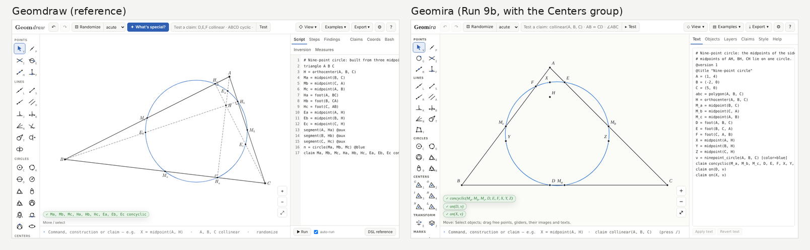
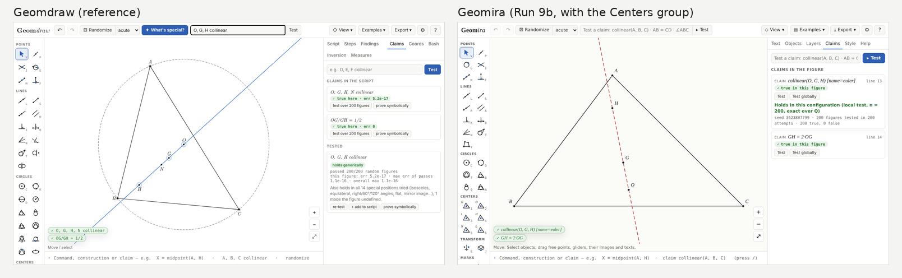
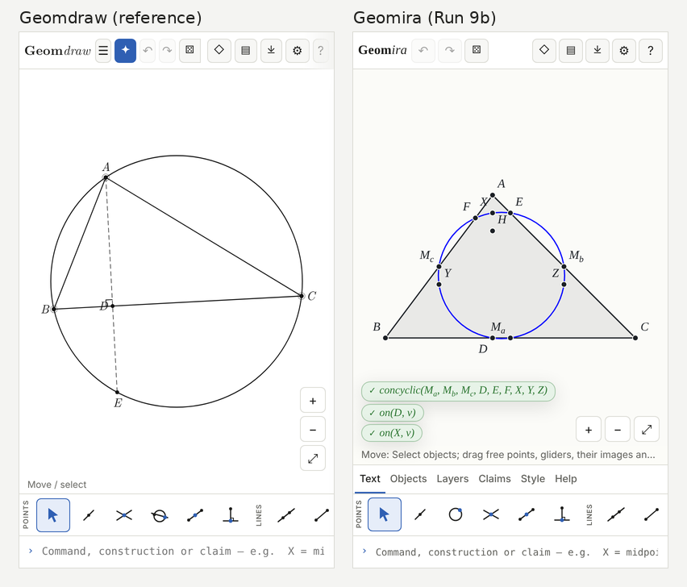

# STATUS

## Run 16a: ideal points, projective maps, cross ratios: NOT ACCEPTED (CI and the nightly are green; awaiting the maintainer)

Decisions: [ADR-0040](adr/0040-ideal-points-and-projective-maps.md). SPEC §1, §4, §6.2, §10.1 and
§18 (E2, E3, E8) are updated to match. PR: https://github.com/youseng/geomira/pull/26 (branch
claude/run-16a-ideal-point-epfqc8) against main. Base: main = a9753c0. The add-only guard compares
with `run-17b`. The maintainer chose, when asked during the run: "collinear" takes points at
infinity, "concurrent" stays affine, and the finder never uses points at infinity as candidates.
No conic work: circles under projective maps are Undefined ("… a conic, which is not an object
until Run 16b").

### Done (each item → the test file that proves it)

1. IdealPoint (SPEC §18 E8, ADR-0040 decisions 1–6):
   - The meet of two parallel full lines is the ideal point (the first line's direction and flag).
     Parallel segments and rays stay Undefined; coincident lines stay Undefined.
   - E2: every overload of every tool, with an ideal point in each point position, is either
     declared or Undefined with a reason naming infinity (kind safety).
   - Declared in: `line(P, X∞)` (the parallel through P), `line(X∞, Y∞)` (Undefined: the line at
     infinity), `apply` (similarity, projective; a Möbius map with a pole gives Undefined),
     `harmonic_conjugate`, `projective`, and the `collinear` claim.
   - Not drawn: the Objects panel and the scene show "at infinity, direction θ°", every export
     lists a warning, and it is not draggable.
   - Tests: `packages/kernel/test/ideal-points.test.ts`, `kernel/test/degenerate.test.ts` (with
     `helpers/degenerate-projective.ts`), `claims/test/kinds-projective.test.ts` (collinear with
     ideal points), `editor/test/projective-layer.test.ts` (panel), `export/test/ideal-points.test.ts`
     (scene and all six export formats).
2. TransformData 'projective' (3×3) and 'composite' (Möbius and projective factors):
   - compose, inverse and apply on every kind, with one compute per tool. Exact over Q and mod p
     (L3), and compose/inverse/apply laws (L13).
   - A point on the line sent to infinity becomes an ideal point. A segment crossing it becomes
     two rays (`outside`), and ranges are mapped as projective arcs.
   - Circles → Undefined ("… a conic …: Run 16b"). Polygons crossing → Undefined, segment marks →
     Undefined, angle marks are mapped (no longer right angles).
   - Tests: `kernel/test/laws/l3-projective.test.ts`, `kernel/test/laws/l13-projective.test.ts`,
     `helpers/degenerate-projective.ts` (the apply cases), and `helpers/projective-properties.ts`
     (spread into `tools.property.test.ts`).
3. Constructors:
   - `projective(A, B, C, D, A′, B′, C′, D′)`: no three collinear, else Undefined with the reason.
   - `send_to_infinity(l)`: the chart (t, s) ↦ (t/s, 1/s) in the frame of l, an involution.
     ADR-0040 decision 12 states why this chart and why drags are continuous.
   - Full checklist (registry, degenerate cases, properties, theorem tests, `numeric` export,
     generated docs): `kernel/test/registry.test.ts`, `degenerate-projective.ts`,
     `projective-properties.ts`, `theorems-projective.test.ts`, docs/tools.md.
4. The derived layer `@layer inf = image(send_to_infinity(l), main)`:
   - Views and drag-through through f⁻¹ = f.
   - A cursor whose preimage is at infinity is refused ("the preimage under f is a point at
     infinity"). Images of points of l are ideal points; images of ideal points are points of l.
   - Tests: `editor/test/projective-layer.test.ts`, `kernel/test/ideal-points.test.ts`.
5. Claims `cross_ratio(A, B, C, D) = k` and `harmonic(A, B; C, D)` (four collinear or concyclic
   points: the complex cross ratio), and `cross_ratio_lines` and `harmonic_lines` (four
   concurrent lines):
   - Field-generic, on the polynomial whitelist (L12, L17).
   - Notation: `harmonic(A, B; C, D)` and `cross_ratio(A, B, C, D) = k`; four line arguments
     build the line kinds.
   - Invariance under projective maps is a corpus entry ("a projective map keeps the cross
     ratio") and a theorem test.
   - Tests: `claims/test/kinds-projective.test.ts`, `claims/test/helpers/corpus-true-projective.ts`
     (true, false and degenerate entries, run by the L12 and L17 laws),
     `lang/test/cross-ratio-notation.test.ts`.
6. Tool `harmonic_conjugate(A, B, C)`, with a line form `harmonic_conjugate(a, b, c)`:
   - C the midpoint → the ideal point of AB. C at infinity in AB's direction → the midpoint.
     C = A or C = B → Undefined.
   - Symmetric in A ↔ B (ADR-0029, 'value'). Guarantees: harmonic and collinear.
   - Full checklist: `degenerate-projective.ts` (HARMONIC_CASES), `projective-properties.ts`,
     `kernel/test/construction-key.test.ts`, `discovery/test/guarantees-hold.test.ts`,
     `theorems-projective.test.ts`.
7. Theorem tests, in `kernel/test/theorems-projective.test.ts` (FloatField, and exactly over Q;
   200 figures each):
   - cross-ratio invariance under `projective` and under `send_to_infinity`;
   - Desargues with AB ∥ A′B′ (the axis is parallel to AB);
   - Pappus with two pairs of cross-joins parallel (the third pair is parallel too);
   - the complete quadrilateral's harmonic division (also equal to `harmonic_conjugate`);
   - Brokard (the polar of P is EF, and the centre is the orthocenter of PEF);
   - the cyclic quadrilateral with the tangents at A and C meeting on BD is harmonic, and the
     tangents at B and D then meet on AC;
   - projecting a harmonic quadruple of a circle from a point of it onto a line keeps it harmonic.
     Desargues and Pappus in general position were already in the corpus.
8. Discovery:
   - The new kinds join "What is special?" through the claim-kind registry (symmetries, finder
     hints; cross_ratio with a free k is not searched).
   - Projective maps keep incidence and cross ratios (transport), and send_to_infinity records
     the image of the line at infinity as map data.
   - New knowledge rules: image lines, the inversion harmonic rule, and sections of a pencil.
   - Results:
     - A projective layer reports nothing.
     - The complete quadrilateral reports (A, C; P, X) = −1 alone; its pencil from F is listed
       under it.
     - The harmonic quadrilateral on a circle reports (A, C; B, D) = −1.
     - Each rule has a false neighbour.
   - Tests: `discovery/test/projective-facts.test.ts`, and `trivial-facts.test.ts` (the inversion
     rule).
9. Every existing example and fixture evaluates identically: all 20 figures (examples/,
   tests/fixtures/export, the language's migration fixtures) were summarised on a9753c0 (values,
   drawn and unavailable objects, claim badges, local verdicts). `editor/test/figure-baseline.test.ts`
   compares them with the summaries now: no difference.

Visible differences elsewhere (none in any example or fixture):

- `intersect` of two parallel lines shows "at infinity, direction θ°" instead of "undefined:
  parallel lines".
- Its dependents say "X is a point at infinity: <tool> does not take one" instead of "X is
  undefined".
- `collinear(…)` on such a point is true or false instead of undefined.
- Exports list "X is a point at infinity (direction θ°): not drawn" instead of "X is undefined in
  this figure (parallel lines): not drawn".
- docs/tools.md has the new tools and the "takes the line at infinity onto l" map datum, and
  docs/language.md has the new claims.

### Not done

- The GUI intersection tool still refuses two parallel lines: it builds points it can show. The
  text (and any tool taking a line) builds the ideal point. See Uncertain.
- A pole at infinity (`pole(l, c)` with l through the centre) stays Undefined; it could now be
  an ideal point, but no item of this run asked for it.
- Two shards are under the 75 % per-shard target (the gate is per package, and all four packages
  pass): kernel-b at 68.39 % (proj-lines.ts and proj-apply.ts: the range and polygon cases of
  projective apply) and the discovery catch-all at 73.03 % (the three new rule files). The kernel
  package went from 97.95 % to 93.03 %. More targeted tests for those files would raise both.

### Known bugs

- None known. Found and fixed during the run, each with a test:
  - `harmonic_conjugate` called with argument lists its signatures reject answered with a
    degeneracy reason instead of "received arguments it does not accept"
    (`kernel/test/tools-circles.direct.test.ts`).
  - A find job in `projective-facts.test.ts` exceeded CI's 5 s default timeout; it now has
    ADR-0039's 120 s.

### Uncertain

- **send_to_infinity's chart and orientation** (ADR-0040 decision 12): the normalisation (origin
  p, unit |d|, the side of l by rot90(d)) is a choice, not mathematics. A projective map sending a
  line to infinity cannot commute with a mirror symmetry of that line, so under a mirrored figure
  the image is the mirrored image followed by a reflection (congruent figures; claims invariant
  under isometries keep their truth). If the maintainer prefers another chart, only
  projective-tools.ts changes.
- **"NDG: on the circle"** (the brief, for concyclic cross ratios) is handled as a CONDITION: an
  NDG item must be non-zero, and "on one circle" is an equation. A claim on four points on neither
  a line nor a circle is false, never silently true.
- **The ideal-point representative under 'value' symmetry**: `harmonic_conjugate(A, B, M)` and
  `harmonic_conjugate(B, A, M)` give ideal points with directions B − A and A − B (the same point,
  opposite representatives). Equal as points; a line built from them has opposite direction.
- **The GUI intersection tool** refuses parallel lines (see Not done); whether it should build
  the ideal point is a UI decision for the maintainer.
- **A frozen test name kept**: "parallel(C, AB) never meets AB" (tools.property.test.ts) now
  asserts that the meet is the ideal point. Its name is kept, since renaming would be a further
  modification.

### Changed frozen tests

All listed with their reasons in ADR-0040 decision 22, and every commit that changes one cites
ADR-0040.

| file                                                     | change                                                                                             |
| -------------------------------------------------------- | -------------------------------------------------------------------------------------------------- |
| `packages/kernel/test/degenerate.test.ts`                | 3 lines: "parallel lines → Undefined" becomes "→ their ideal point"; cases added                   |
| `packages/kernel/test/tools.property.test.ts`            | 2 lines: the meet is the ideal point (not chiral), not Undefined; properties added                 |
| `packages/kernel/test/helpers/degenerate-transforms.ts`  | 1 line: the Undefined fixture point uses coincident lines; narrowing lines added                   |
| `packages/kernel/test/helpers/degenerate-mobius.ts`      | 1 line: narrows `h.t.type === 'mobius'` first                                                      |
| `packages/kernel/test/laws/l13-compose-collapse.test.ts` | 3 lines: the Möbius fields read through a `vs` constant after narrowing                            |
| `packages/kernel/test/derived.test.ts`                   | 1 line: an Undefined meet uses line(B, A) instead of a parallel line                               |
| `packages/kernel/test/image-kinds.test.ts`               | 1 line: the applied kinds gain `ideal_point`                                                       |
| `packages/claims/test/eval-claim.test.ts`                | 1 line: an Undefined object is intersect(l, l), not the meet of parallels                          |
| `packages/claims/test/helpers/corpus-degenerate.ts`      | 1 line: collinear(midpoint(X, A), A, C); the old claim (false projectively) joins the false corpus |
| `packages/claims/test/screen.test.ts`                    | 1 line: collinear(A, B, X∞ of AB) is true (was undefined)                                          |
| `packages/discovery/test/find.test.ts`                   | 1 line: the kinds not searched add cross_ratio and cross_ratio_lines                               |
| `packages/lang/test/triangle-existing.test.ts`           | 1 line: an Undefined vertex uses coincident lines (an ideal vertex has its own test)               |
| `docs/adr/0009-grammar.md` (tested verbatim)             | the claim rule gains the cross-ratio notation and `;`                                              |

Lines added only: claims `exports.test.ts`, `corpus-false.ts`, `corpus-true.ts`, `kinds.test.ts`;
discovery `guarantees-hold.test.ts`; kernel `construction-key.test.ts`, `exports.test.ts`,
`helpers/degenerate.ts`, `helpers/fuzz-circles.ts`, `helpers/similarity-gen.ts`,
`inverse-range.test.ts`, `radical.test.ts`, `registry.test.ts`.

### Acceptance command output

#### Local (`pnpm verify` on the commit before the STATUS update; typecheck, lint and depcruise passed)

```
✔ no dependency violations found (802 modules, 4572 dependencies cruised)
ok   tolerance: 1114 files scanned, 0 violation(s)
ok   file-length: 1114 files scanned, 0 violation(s)
ok   test-count: 3875 tests, floor 3693, 0 violation(s)
ok   disabled-tests: 1114 files scanned, 0 violation(s)
ok   add-only: frozen tests compared with run-17b, 0 violation(s)
ok   forbidden-words: 1114 files scanned, 0 violation(s)
 Test Files  422 passed (422)
      Tests  3875 passed (3875)
All files          |   96.68 |    90.64 |   99.23 |   98.34 |
```

Theorem tests (`kernel/test/theorems-projective.test.ts`, local):

```
a projective map keeps the cross ratio of four collinear points: float 196 hold, 4 ill-conditioned; rational 200 hold
send_to_infinity(l) keeps the cross ratio of four collinear points: float 194 hold, 6 ill-conditioned; rational 200 hold
Desargues with AB ∥ A′B′: float 200 hold; rational 200 hold
Pappus with P₁Q₂ ∥ P₂Q₁ and P₂Q₃ ∥ P₃Q₂: float 196 hold, 4 ill-conditioned; rational 200 hold
the complete quadrilateral: float 195 hold, 5 ill-conditioned; rational 200 hold
Brokard: float 190 hold, 10 ill-conditioned; rational 200 hold
the tangents at A and C meet on BD: float 197 hold, 3 ill-conditioned; rational 200 hold
projecting a harmonic quadruple of a circle from a point of it: float 192 hold, 8 ill-conditioned; rational 200 hold
```

L3 (local): `L3 projective images: 1831 defined + 1169 Undefined agree, 0 not exact, 0 excluded (band); mod p 964`.

#### CI on GitHub

On cebd9bb:

- ci (push) https://github.com/youseng/geomira/actions/runs/40637072522: success. The verify step
  (typecheck, lint, depcruise, rules with the floor 3875, tests) passed; end-to-end 125 passed,
  with ADR-0037's gate:

  ```
  main thread during find on 150 objects without workers: {"objects":150,"tasks":2091,"seconds":7.9,"longest":[26.7,16.3,13,12,11.8],"over16":2,"longTasks":[]}
  ```

- ci (pull request) https://github.com/youseng/geomira/actions/runs/40637078888: success.
- deploy https://github.com/youseng/geomira/actions/runs/40637072724: success.
- tex https://github.com/youseng/geomira/actions/runs/40637072497 (push) and
  https://github.com/youseng/geomira/actions/runs/40637078834 (pull request): success.
- Earlier heads: 2067a1f failed one test on CI (a find job past the 5 s default timeout; fixed in
  1668528), and the nightly on 1668528 stopped in Stryker's initial test run (the float Brokard
  theorem at law scale 0.25; fixed in cebd9bb).

- nightly https://github.com/youseng/geomira/actions/runs/40637076823 (dispatch, incremental, on
  cebd9bb): success; the test job (NIGHTLY=1) and every mutation shard passed, and the gate:

```
num mutation gate: 93.47% (730 detected, 51 undetected; threshold 80%): pass
kernel mutation gate: 93.03% (2748 detected, 206 undetected; threshold 75%): pass
claims mutation gate: 85.43% (2334 detected, 398 undetected; threshold 75%): pass
discovery mutation gate: 80.92% (2879 detected, 679 undetected; threshold 75%): pass
kernel-a mutation score: 86.67% (273 detected, 42 undetected; target 75%, gated from v1.1)
kernel-b mutation score: 68.39% (212 detected, 98 undetected; target 75%, gated from v1.1)
kernel-c mutation score: 95.56% (280 detected, 13 undetected; target 75%, gated from v1.1)
kernel-d mutation score: 97.26% (284 detected, 8 undetected; target 75%, gated from v1.1)
kernel-e mutation score: 98.99% (197 detected, 2 undetected; target 75%, gated from v1.1)
kernel-f mutation score: 99.59% (241 detected, 1 undetected; target 75%, gated from v1.1)
kernel-g mutation score: 99.37% (313 detected, 2 undetected; target 75%, gated from v1.1)
kernel-i mutation score: 94.90% (279 detected, 15 undetected; target 75%, gated from v1.1)
kernel-j mutation score: 100.00% (117 detected, 0 undetected; 4 mutants outside the shard not counted; target 75%, gated from v1.1)
kernel-k mutation score: 91.10% (215 detected, 21 undetected; 143 mutants outside the shard not counted; target 75%, gated from v1.1)
kernel-h mutation score: 98.83% (337 detected, 4 undetected; target 75%, gated from v1.1)
claims mutation score: 85.43% (2334 detected, 398 undetected; target 75%, gated from v1.1)
discovery-a mutation score: 90.09% (209 detected, 23 undetected; target 75%, gated from v1.1)
discovery-b mutation score: 91.34% (485 detected, 46 undetected; target 75%, gated from v1.1)
discovery-c mutation score: 77.38% (787 detected, 230 undetected; target 75%, gated from v1.1)
discovery-d mutation score: 81.82% (450 detected, 100 undetected; target 75%, gated from v1.1)
discovery-e mutation score: 84.33% (382 detected, 71 undetected; target 75%, gated from v1.1)
discovery mutation score: 73.03% (566 detected, 209 undetected; 851 mutants outside the shard not counted; target 75%, gated from v1.1)
```

Stryker minutes per shard (this run; tests changed in every package, so most shards ran without
reusable results): num 0, kernel-a 18, b 7, c 15, d 31, e 10, f 3, g 5, h 7, i 38, j 2, k 5,
claims 37, discovery-a 35, discovery-b 77, discovery-c 66, discovery-d 77, discovery-e 68,
discovery (catch-all) 47. Every shard is under the 100-minute limit.

### Requests

- No new runtime dependencies. The test-count floor is raised to 3875 (docs/test-count.txt).
- Mutation shards (ADR-0040 decision 19):
  - No source file of discovery-d changed. The three new discovery files are in the catch-all
    `discovery` shard (56 minutes cold before this run); with them it took 47 minutes on this
    branch.
  - discovery-b and discovery-d took 77 minutes each, discovery-e 68 and discovery-c 66: tests
    changed in the package, so their results were not reused. A run after the merge reuses them.
    If one nears 100 minutes, split it. That changes `scripts/mutation-discovery.test.ts`
    (frozen), so it needs an ADR.

---

## Maintainer request: trivial facts in What is special?: ACCEPTED (2026-10-27)

Not a kit run (no tag). Decisions: [ADR-0039](adr/0039-no-trivial-facts-in-what-is-special.md)
(amends ADR-0035 decisions 6, 7, 11, 12 and SPEC §6.1). PR: https://github.com/youseng/geomira/pull/25
(branch ccr-74881050-rsktgq) against main. Base: main = 385ada7 (Run 17 merged, ACCEPTED below);
the add-only guard compares with `run-17`. The maintainer chose (question during the work) that
collinear(A, I, I_a, M) in the incenter figure is a construction fact (I and I_a are declared on
bisector(B, A, C), M on line AI): it is shown once, as the maximal set, under the construction
facts.

### Done (each item → the test file that proves it)

- Case 1 (images under a map): the inversion and reflection figures report nothing; equal(A, A*),
  collinear(O, B, B*), concyclic(B, B*, C, C*), C*D* = CD, … are construction facts →
  `packages/discovery/test/trivial-facts.test.ts` (case 1).
- Case 2 (consequences): the incenter–excenter figure reports only the class
  MB = MC = MI = MI_a (three links); collinear(A, I, I_a, M) is one construction fact; the
  inscribed angles (∡AMC = ∡ABC, ∡ACM = ∡ABM) and the base angles (∡IBM = ∡AIB, ∡ICM = ∡AIC)
  are hidden: angle chasing over the bisectors and the circumcircle derives them from the
  construction alone, so they are listed under the construction facts; what follows from the
  class (II_a = 2·IM) is listed under it, with its parents → trivial-facts.test.ts (case 2).
- Case 3 (one fact per configuration): the nine-point figure reports ONE concyclic fact of the
  nine points, then the class M_aK_a = M_bK_b = M_cK_c (its three diameters); no subset, no
  pairwise equal lengths → trivial-facts.test.ts (case 3, full list).
- More maps (the request's "try some examples"): rotation by 90°, homothety with ratio 2, a
  spiral similarity and the inversion of a line and a circle report nothing; the
  incenter–excenter figure inverted in circle(M, B) reports I = I* and I_a = I_a* (I and I_a lie
  on the circle: the lemma) → trivial-facts.test.ts ("more maps").
- Map facts as registry data (`Signature.map`, `Signature.imageOf`; kernel/map-facts.ts;
  docs/tools.md "As a map") → `packages/kernel/test/map-facts.test.ts`, kernel exports test.
- The knowledge (closure rules, angle lattice, transport) → `knowledge-rules.test.ts` (each rule
  with a false neighbour it must not derive), `lattice.test.ts`.
- Groups and classes → `group.test.ts`; the listing → `consequences.test.ts`; Add as claim for a
  class (one batch, one undo) and an n-ary claim → `packages/editor/test/discovery-groups.test.ts`;
  the class text → `apps/web/test/discovery-facts.test.ts`.
- Soundness property tests → `packages/discovery/test/derivations.test.ts`: on ten figures every
  hidden fact holds (evaluated; the local test on a sample), every consequence's parents are the
  shown facts up to it, and no candidate the screen calls false, no false mutant of a hidden fact
  and no claim of the false corpus is ever derived.
- The existing find tests (Euler line first, exact over Q, caps, determinism, commands at every
  step, corpora, lemma tags) pass; four frozen lines changed (below).

Manual examples (seed 1, default budget; Run 17's count in brackets, measured on `run-17`):

| Figure                                                                    | Reported now                                               | Run 17            |
| ------------------------------------------------------------------------- | ---------------------------------------------------------- | ----------------- |
| inversion in w                                                            | nothing                                                    | 57                |
| reflection in AB                                                          | nothing                                                    | 50                |
| incenter–excenter                                                         | MB = MC = MI = MI_a                                        | 60                |
| nine-point                                                                | the nine-point circle; M_aK_a = M_bK_b = M_cK_c            | 60                |
| rotation by 90° / homothety 2 / spiral / inversion of a line and a circle | nothing                                                    | 25 / 53 / 22 / 29 |
| incenter–excenter inverted in circle(M, B)                                | I = I*, I_a = I_a*                                         | 60                |
| triangle centres (find.test.ts)                                           | 8 (Euler line, 2:1 ratios, AH = 2·OM_a, …)                 | 31                |
| 150 objects (ADR-0037's figure)                                           | 10 (P_8 = P_121 first: the coincidence explains its class) | 50                |

### Not done

- The rules are incomplete by nature: a trivial fact no rule reaches is still reported (e.g. on
  the synthetic 150-object figure, an undirected-angle class at P_21 whose links follow from a
  collinearity only on the same side). Each new rule must be a theorem with a property test.

### Known bugs

- None found. (During the work: a class rebuilt after a failed check could carry the first
  class's key, so the listing took the failed member as its part; reproduced by
  derivations.test.ts on the nine-point figure, fixed in confirm.ts/find.ts with `unitOf`.)

### Uncertain

- None on mathematics. Rules used, all standard: midline theorem, Thales, isosceles base angles,
  inscribed angles, bisectors mod 180° (internal and external alike), similar triangles P X X*
  about the centre of a direct similarity, ∡OXY = ∡X*Y*O under an inversion.

### Changed frozen tests

| file                                   | change                                                                                                                                                   |
| -------------------------------------- | -------------------------------------------------------------------------------------------------------------------------------------------------------- |
| `packages/discovery/test/find.test.ts` | 4 lines (ADR-0039 decision 10): `toBeGreaterThan(10)` → `toBeGreaterThanOrEqual(8)`; the small-budget check `results: 2` → `1` with its two expectations |
| `packages/kernel/test/exports.test.ts` | lines added only (`./map-facts`)                                                                                                                         |
| `scripts/mutation-discovery.test.ts`   | 3 lines (ADR-0039 decision 11): six discovery shards (ids and parents lists), the catch-all checked as the last shard                                    |

### Acceptance command output

#### Local (`pnpm verify` on af4ec62, the final commit)

```
✔ no dependency violations found (773 modules, 4373 dependencies cruised)
ok   tolerance: 1084 files scanned, 0 violation(s)
ok   file-length: 1084 files scanned, 0 violation(s)
ok   test-count: 3693 tests, floor 3609, 0 violation(s)
ok   disabled-tests: 1084 files scanned, 0 violation(s)
ok   add-only: frozen tests compared with run-17, 0 violation(s)
ok   forbidden-words: 1084 files scanned, 0 violation(s)
 Test Files  1 failed | 411 passed (412)
      Tests  1 failed | 3692 passed (3693)
```

The one local failure is `Test timed out in 5000ms` in a frozen claims test this request does
not touch (`packages/claims/test/sampler-local-10sigma.test.ts`, "four points on a circle", 5.6 s
under the container's load); alone it passes (`pnpm exec vitest run <file>`: 10 passed), as Run
17 recorded for the same file. CI's verify on the same commit passed every test (below).

#### CI on GitHub (af4ec62)

- ci (push) https://github.com/youseng/geomira/actions/runs/40554408018: success. Verify:
  `Test Files 412 passed (412)`, `Tests 3693 passed (3693)`, `All files | 96.85 | 90.78 | 99.16 | 98.44`;
  end-to-end 125 passed, with ADR-0037's gate (≤ 150 ms, under 1 % over 16 ms):

  ```
  main thread during find on 150 objects without workers: {"objects":150,"tasks":2981,"seconds":11.9,"longest":[41.8,22.2,20.4,16.5,16],"over16":5,"longTasks":[]}
  ```

  (On 241eebe this gate failed, 65 of 3,545 tasks over 16 ms, from the knowledge rebuilds in long
  steps; c47299a split them, see its commit.)

- ci (pull request) https://github.com/youseng/geomira/actions/runs/40554415076: success.
- deploy https://github.com/youseng/geomira/actions/runs/40554408005: success.
- tex https://github.com/youseng/geomira/actions/runs/40554415184: success.
- nightly https://github.com/youseng/geomira/actions/runs/40554417064 (dispatch): success, the
  gate (six discovery shards, ADR-0039 decision 11):

```
num mutation gate: 93.47% (730 detected, 51 undetected; threshold 80%): pass
kernel mutation gate: 97.95% (2391 detected, 50 undetected; threshold 75%): pass
claims mutation gate: 85.70% (2248 detected, 375 undetected; threshold 75%): pass
discovery mutation gate: 82.65% (2743 detected, 576 undetected; threshold 75%): pass
discovery-a mutation score: 89.69% (200 detected, 23 undetected; 387 mutants outside the shard not counted; target 75%, gated from v1.1)
discovery-b mutation score: 94.16% (500 detected, 31 undetected; target 75%, gated from v1.1)
discovery-c mutation score: 77.43% (782 detected, 228 undetected; target 75%, gated from v1.1)
discovery-d mutation score: 81.27% (447 detected, 103 undetected; target 75%, gated from v1.1)
discovery-e mutation score: 81.96% (359 detected, 79 undetected; target 75%, gated from v1.1)
discovery mutation score: 80.25% (455 detected, 112 undetected; 853 mutants outside the shard not counted; target 75%, gated from v1.1)
```

Shard times: discovery-a 1 min (its cache), discovery-b 12, discovery-c 35, discovery-d 78 (a cold
run: a new shard), discovery-e 69, discovery 56; num, kernel and claims unchanged (every shard
under 3 minutes). Earlier dispatches on this branch were cancelled by pushes (72fd001, 241eebe:
"no report"), and the one on c47299a ran out of time in its last shard (four shards), which this
layout fixes.

### Requests

- No new runtime dependencies. The test-count floor is raised to 3693 (docs/test-count.txt).
- Follow-up (nightly): discovery-d took 78 minutes cold (closure-merge, closure-maps,
  closure-mid: their mutants often loop until the timeout). Main's first nightly after the merge
  runs it cold again; if it nears 100 minutes, split closure-merge from the other two.

---

## Run 17: discovery (the finder, special positions, branch fixes): ACCEPTED (2026-10-27)

SPEC §1 (the finder, special-position hunting and branch-fix diagnosis leave Phase 2 for Run 17),
§2 (packages/discovery → kernel, claims, num; editor → discovery), §6.1 (Signature data includes
`guarantees`), §10.1 (claim kinds carry symmetries and finder hints; the claim-kind registry),
§16 ('find', 'hunt', 'branchFix'). Decisions: [ADR-0035](adr/0035-finder-and-special-positions.md)
(the finder: candidates, triviality filter, ranking, caps; special positions; lemma tags),
[ADR-0036](adr/0036-branch-fix-diagnosis.md) (branch-fix diagnosis),
[ADR-0037](adr/0037-find-on-150-objects-budget.md) (the maintainer's decision on the page's budget
for find on 150 objects), [ADR-0038](adr/0038-mutation-shards-within-the-limit.md) (every nightly
mutation shard within Stryker's time limit). PR: https://github.com/youseng/geomira/pull/24 (branch ccr-74881050-rsktgq) against main.

Base check: main = 0668422 (PR #23 = Run 14, ACCEPTED below); `git fetch --tags` brought `run-14`,
so the add-only guard compares with it ("add-only: frozen tests compared with run-14").

Run order (the maintainer's decisions, not a red base): Run 11 (beta triage) and Run 9b's
examples part stay skipped; Run 15 (the prover) is skipped; Run 17 runs before Run 16. Nothing of
Run 16 (conics, ideal points, cross-ratio, harmonic claims) or Run 18 is in this run, and nothing
refers to a prover, a 'prove' job, PolyFraction or a PROVED verdict. No contest problem was added.

Lockfile incident (this run): cbc6b14 and bee7c94 regenerated pnpm-lock.yaml with
`pnpm install --offline`, which resolves from the local store only and dropped every
platform-specific optional package (about 530 lines, e.g. @rollup/rollup-linux-x64-gnu), so CI's
vitest and the deploy build could not start (red on 94e4fd7 and 8fc01e6). 7d7999d restores main's
lockfile and re-resolves it with `pnpm install --lockfile-only` (18 lines added, only
packages/discovery). The container's pnpm configuration was checked: no `supportedArchitectures`,
no `optional=false`, no `--no-optional`; the cause was the `--offline` flag alone. Never use
`--offline` in this repository.

## Done (each item → the test file that proves it)

1. **ADRs and SPEC** (brief: ADRs): ADR-0035 (finder), ADR-0036 (branch-fix diagnosis); SPEC §1,
   §2, §6.1, §10.1, §16 updated in the same commit (1618d31), citing them. ADR-0037 (the
   maintainer's decision on the 150-object budget) amends ADR-0035 decision 15; SPEC §1 cites it.
2. **packages/discovery**, pure (no DOM, no framework, no module-level mutable state), → num,
   kernel, claims only; only apps/web's worker (and the page's runner) and the editor's apply step
   import it; dependency-cruiser and the exports tests updated → `scripts/depcruise.test.ts`,
   `packages/discovery/test/exports.test.ts`, `packages/discovery/test/index.test.ts`. Seeded RNG
   only; every result carries its seed → `packages/discovery/test/find.test.ts`,
   `hunt.test.ts`, `branch-fix.test.ts` (seed and determinism).
3. **Construction facts as registry data** (triviality from tools' guarantees, never names):
   `Signature.guarantees`, a guarantee table for every tool with definitional facts, the tool
   reference prints them → `packages/kernel/test/guarantees.test.ts` (no stale entry, every
   overload), `packages/discovery/test/guarantees-hold.test.ts` (each declared overload has a figure,
   and every guarantee holds there in the local test), `packages/kernel/test/docs.test.ts` (docs/tools.md).
4. **Generic over claim kinds**: the kinds are a registry value (`claimKindRegistry`) with
   symmetries and finder hints; the finder reads only the registry →
   `packages/claims/test/kind-registry.test.ts`, `claim-symmetry.test.ts` (truth and values kept under each symmetry),
   `kind-hints.test.ts`; a TEST-ONLY kind joins without finder changes →
   `packages/discovery/test/test-kind.test.ts` (an isosceles kind: searched, deduplicated by its
   symmetry, reported), `candidates.test.ts` (later kinds with a circle parameter, a rotation
   symmetry, a literal without hints).
5. **Candidates** (tuples per kind, deduplicated by argument symmetries in the style of ADR-0029;
   measure pairing for lengths and angles; undirected forms included and numeric only) →
   `packages/discovery/test/candidates.test.ts`, `ticking.test.ts` (the sliced index sort against
   a stable sort, a property).
6. **Cheap float screen, then the LOCAL test on survivors; only HOLDS IN THIS CONFIGURATION is
   reported, with the rungs used ("exact over Q, 200/200")** →
   `packages/claims/test/screen.test.ts`, `packages/discovery/test/find.test.ts` (the Euler line exact over Q; a
   coincidence of the figure rejected by the local test), `corpora.test.ts` (the degenerate corpus
   never yields a reported fact; no false claim is reported), `text.test.ts` (rung texts).
7. **Triviality filter** (the closure of construction facts; count shown, expandable) →
   `packages/discovery/test/closure.test.ts`, `rules.test.ts` (kind by kind, with near misses);
   "N construction facts hidden" → `apps/web/e2e/flows-discovery.spec.ts`.
8. **Ranking** (ADR-0035 decision 12) → `packages/discovery/test/find.test.ts`, `rank.test.ts`.
9. **Caps, every one visible** ("checked a of b candidates: budget", the test and result budgets,
   the time budget) → `packages/discovery/test/text.test.ts`, `find.test.ts`,
   `commands.test.ts` (stop at every step of every job says "stopped at the time budget").
10. **Special-position hunting** (free inputs of every kind; positions contradicting an `assume`
    line skipped; degenerate positions undefined; each a complete document; the current document
    never changed) → `packages/discovery/test/hunt.test.ts`, `hunt-inputs.test.ts` (line, angle and
    stereographic gliders, params, literal radii), `solve.test.ts`, `corpora.test.ts` (a true
    theorem never fails at a special position).
11. **Branch-fix diagnosis** (every assignment that makes the claim hold, cap 64 visible; order:
    nothing moves first, then one flip, later steps first; "what moves"; preview as a draft;
    one edit; reflection-equivariant selectors from the GUI choice) →
    `packages/discovery/test/branch-fix.test.ts`, `branch-sites.test.ts`, `branch-fix-moves.test.ts`,
    `packages/editor/test/discovery.test.ts` (Apply is one undoable edit),
    `apps/web/e2e/flows-discovery.spec.ts` (Preview leaves the text unchanged; Apply; one undo).
    Every written selector is verified (the GUI choice's too), and a definition that would be the
    same construction as another object is written only when nothing else picks the candidate:
    such a fix is still listed (it makes the claim hold) with "X would be the same construction as
    R: use R instead of X", and its Apply is disabled. The edit itself would be accepted, but it
    would leave two objects with one construction, which the language warns about and says to
    resolve by deleting one (ADR-0036 decisions 3 and 7) →
    `packages/discovery/test/branch-sites.test.ts`, `branch-fix.test.ts` (the
    circle ∩ circle flips report their repeats), `apps/web/test/branch-fix-text.test.ts`.
12. **Lemma tags** (Euler line, nine-point circle, Simson line, radical centre, Miquel point; a
    one-line hint each; no contest problem, no attribution) →
    `packages/discovery/test/lemmas.test.ts`, `lemmas-variants.test.ts` (forms and near misses).
13. **UI**: "What is special?" in the Claims panel; each fact with "Add as claim" (one undoable
    edit, shown in the text) and its objects ringed on the canvas on hover; "Special positions"
    with View (a draft scene) and Open as new figure; branch fixes under MIXED and
    ORIENTATION-DEPENDENT verdicts → `apps/web/e2e/flows-discovery.spec.ts`,
    `apps/web/test/render-highlight.test.ts` (the rings), `apps/web/test/discovery-runs.test.ts`
    (jobs, seeds, time budgets, stale results, the canvas snapshot).
14. **Worker jobs 'find', 'hunt', 'branchFix'** with progress, cancel and budgets, in the worker
    and in the time-sliced fallback (ADR-0030) → `apps/web/test/host-discovery.test.ts`,
    `packages/discovery/test/job.test.ts`, `commands.test.ts`; from the single file over file://
    → the find flow appended to `apps/web/e2e/file-url.spec.ts` (Chromium, Firefox, WebKit in CI).
15. **A 150-object figure on the page** (ADR-0037) → `apps/web/e2e/fallback-discovery.spec.ts`
    in its own Playwright project `measure-discovery`, which runs after `measure-fallback`
    (`apps/web/playwright.config.ts`): in one project the two measurements ran in parallel
    and the claim-test measurement (`fallback-long-task.spec.ts`, ≤ 16 ms) saw a 20 ms task;
    alone it measures 8–10 ms. The gate: the job completes on the page, no task over 150 ms,
    under 1 % of tasks over 16 ms; the numbers are logged. ADR-0030's strict 16 ms is waived for this job in
    Run 17 (Known bugs).
16. **Mutation**: `stryker.discovery.json`, four discovery shards (ADR-0038: one shard of 3,589
    mutants was on course for two hours, past Stryker's 100-minute limit), gated in the nightly
    at ≥ 75 % with num ≥ 80 %, kernel and claims ≥ 75 % → `scripts/mutation-gate.test.ts`,
    `scripts/mutation-shards.test.ts`, `scripts/mutation-discovery.test.ts` (the shards partition
    the config's files); scores below.
    **Base fix** (ADR-0038): main's nightly gate has been red since Run 14's merge
    (https://github.com/youseng/geomira/actions/runs/40413679232): kernel-j (map-ops.ts and
    inversion-tools.ts, 814 mutants) ran out of Stryker's 100 minutes at 78 % and never saved its
    incremental file. Its Run 14 files are now cut between their functions and their tool specs
    and spread over light shards (inversion-tools.ts to kernel-i and kernel-k, map-ops.ts to
    kernel-e and kernel-g); kernel-j keeps transforms.ts:133-265. There are still eleven kernel
    shards with the same parents. The discovery groups were rebalanced by measured time: on
    e33cf50 discovery-a took 81 minutes, 391 of its 542 mutants timeouts, so rules.ts and rank.ts
    moved to the two shards that took 17–18 minutes.
17. **Bugs found and fixed in this run, each with its test first**: the hunt's degeneracy check
    read the screen's probe values (every glider position was skipped) → `hunt-inputs.test.ts`;
    the triviality rule hid ∠ABC = ∠DEF for arms on the same lines (supplementary with one arm
    reversed) → `rules.test.ts`, `closure.test.ts`; a stop during ranking was ignored →
    `commands.test.ts`; a side midpoint on a drawn nine-point circle was not tagged →
    `lemmas-variants.test.ts`; a branch fix wrote one object's definition into another (two
    objects with one construction) where an equivalent selector existed, and never verified the
    GUI choice's selectors → `branch-sites.test.ts`; "what moves" judged a line's turn by the length band →
    `branch-fix-moves.test.ts`; steps of 50–140 ms on 150 objects → `ticking.test.ts` and the
    150-object measurement.

## Not done

- ADR-0030's ≤ 16 ms for every main-thread task during find on a 150-object figure without
  workers: waived by the maintainer for Run 17 (ADR-0037); see Known bugs.

CI on 4424eee was red (the e2e branch-fix flow): the test read the text panel before it showed
the applied edit (a read race; the trace's snapshot right after shows the edit applied, with
the language's warning that X and R were one construction). Fixed in the test (it waits for the
text), in the figure (R is built so the fix repeats nothing), and in the job (decision 7 above).
CI on a933455 was red for the same kind of race in the special-positions flow (the text read
right after "Open as new figure"); e33cf50 makes that flow and the Add-as-claim step wait for
the text panel before reading it.

## Known bugs

- **Find on 150 objects without workers: sporadic pauses of 27–72 ms** (ADR-0037). Reproduction:
  `pnpm --filter @geomira/web exec playwright test --project=measure-fallback fallback-discovery`
  (after `pnpm build`); the run logs `longest` and `over16`. Over six local runs the longest task
  was 27, 30, 39, 57, 66 and 72 ms, with a long task (≥ 50 ms) in three; about 13–35 of
  5,100–5,900 tasks are over 16 ms. They look like collector pauses from allocation churn (an
  inference from traces). Follow-up (ADR-0037 decision 4): a heap-allocation profile, less
  allocation in the screen, the candidate keys and the tuple copies, then the claim tester's
  steps and the slice loop's prediction.
- The measure pairing's wrap-around windows (`windows` in candidates.ts, for measures within the
  window of 0 or π) cannot be reached while flat measures within the same window are dropped as
  trivial; harmless, left as written.

## Uncertain

- None on mathematics. The five lemma tags are standard named results (Euler line; nine-point
  circle; Simson line; radical centre of three circles with non-collinear centres; Miquel point
  for points on the side lines); their hints say only that. A tag never decides whether a fact is
  reported.

## Changed frozen tests

Under ADR-0035 decision 17 and ADR-0038 decision 3 (commit messages cite them); `pnpm rules`
reports 0 violations against run-14:

| file                                          | change                                                                                                                                    |
| --------------------------------------------- | ----------------------------------------------------------------------------------------------------------------------------------------- |
| `scripts/depcruise.test.ts`                   | the package list and editor's line gain `discovery` (2 lines changed), discovery's line and its sample file added                         |
| `scripts/mutation-gate.test.ts`               | `3 + SHARDS.length` → `4 + …`; the three-entry pass list → four (2 lines changed)                                                         |
| `scripts/mutation-shards.test.ts`             | lines added for the discovery shards; one line changed (ADR-0038): "every file a shard names exists" also looks in packages/discovery/src |
| exports tests of kernel, claims, editor, lang | lines added only (new subpaths and names)                                                                                                 |
| `apps/web/e2e/file-url.spec.ts`               | one test appended (the find flow from file://)                                                                                            |

## Acceptance command output

### Local (`pnpm verify` on 8ec3cfd, the final code commit)

```
✔ no dependency violations found (749 modules, 4231 dependencies cruised)
ok   tolerance: 1058 files scanned, 0 violation(s)
ok   file-length: 1058 files scanned, 0 violation(s)
ok   test-count: 3609 tests, floor 3305, 0 violation(s)
ok   disabled-tests: 1058 files scanned, 0 violation(s)
ok   add-only: frozen tests compared with run-14, 0 violation(s)
ok   forbidden-words: 1058 files scanned, 0 violation(s)
 Test Files  2 failed | 401 passed (403)
      Tests  2 failed | 3607 passed (3609)
```

The two local failures were `Test timed out in 5000ms` in frozen tests that this run does not
change (`apps/web/test/laws/scene-laws.test.ts`, `packages/lang/test/display-notation.test.ts`),
with the container's load average at 3.5; both pass alone
(`pnpm exec vitest run <both files>`: 7 passed), and earlier local runs timed out in other frozen
tests the same way (`sampler-local-10sigma`), each passing alone. CI's verify on the same commit
passed every test (below), which is the source of truth.

### CI on GitHub (code head 8ec3cfd; the commit marking the run ACCEPTED changes only docs)

- ci (push) https://github.com/youseng/geomira/actions/runs/40493072277: success. Verify:

  ```
  ok   test-count: 3609 tests, floor 3305, 0 violation(s)
  ok   add-only: frozen tests compared with run-14, 0 violation(s)
   Test Files  403 passed (403)
        Tests  3609 passed (3609)
  All files          |   96.93 |    90.99 |   99.23 |   98.38 |
  ```

  End-to-end: 125 passed (Chromium, Firefox, WebKit, mobile, pages), including
  `flows-discovery.spec.ts` (3), the file:// find flow in `file-url.spec.ts`, and the
  measurement (ADR-0037's gate: ≤ 150 ms, under 1 % over 16 ms):

  ```
  main thread during find on 150 objects without workers: {"objects":150,"tasks":3792,"seconds":14.9,"longest":[17.9,17.6,16.1,15.9,15.9],"over16":3,"longTasks":[]}
  ```

- ci (pull request) https://github.com/youseng/geomira/actions/runs/40493077573: its verify step (3609 tests, the
  rules) and both builds passed on both attempts, but "Install Playwright browsers" (`playwright
install --with-deps`, apt from azure.archive.ubuntu.com at about 50 kB/s) ran into the job's
  40-minute limit both times, before any end-to-end test; the push run above, on the same commit
  and workflow, installed the browsers in 51 s and passed every end-to-end test. Not a failure of
  this run's code; the next commit's pull-request run is the check.
- deploy https://github.com/youseng/geomira/actions/runs/40493072020: success.
- tex https://github.com/youseng/geomira/actions/runs/40493077923: success.
- nightly https://github.com/youseng/geomira/actions/runs/40493078895 (dispatch): success (the
  test suite with NIGHTLY=1, every mutation shard, the gate):

```
num mutation gate: 93.47% (730 detected, 51 undetected; threshold 80%): pass
kernel mutation gate: 97.95% (2391 detected, 50 undetected; threshold 75%): pass
claims mutation gate: 85.70% (2248 detected, 375 undetected; threshold 75%): pass
discovery mutation gate: 85.25% (1682 detected, 291 undetected; threshold 75%): pass
num mutation score: 93.47% (730 detected, 51 undetected; target 80%, gated from v1.1)
kernel-a mutation score: 96.40% (241 detected, 9 undetected; target 75%, gated from v1.1)
kernel-b mutation score: 96.10% (148 detected, 6 undetected; target 75%, gated from v1.1)
kernel-c mutation score: 94.51% (241 detected, 14 undetected; target 75%, gated from v1.1)
kernel-d mutation score: 99.00% (198 detected, 2 undetected; target 75%, gated from v1.1)
kernel-e mutation score: 98.99% (197 detected, 2 undetected; target 75%, gated from v1.1)
kernel-f mutation score: 99.59% (241 detected, 1 undetected; target 75%, gated from v1.1)
kernel-g mutation score: 99.34% (301 detected, 2 undetected; target 75%, gated from v1.1)
kernel-i mutation score: 98.24% (167 detected, 3 undetected; target 75%, gated from v1.1)
kernel-j mutation score: 100.00% (117 detected, 0 undetected; 213 mutants outside the shard not counted; target 75%, gated from v1.1)
kernel-k mutation score: 97.14% (204 detected, 6 undetected; 143 mutants outside the shard not counted; target 75%, gated from v1.1)
kernel-h mutation score: 98.53% (336 detected, 5 undetected; target 75%, gated from v1.1)
claims mutation score: 85.70% (2248 detected, 375 undetected; target 75%, gated from v1.1)
discovery-a mutation score: 90.94% (271 detected, 27 undetected; 453 mutants outside the shard not counted; target 75%, gated from v1.1)
discovery-b mutation score: 93.26% (415 detected, 30 undetected; target 75%, gated from v1.1)
discovery-c mutation score: 81.75% (587 detected, 131 undetected; target 75%, gated from v1.1)
discovery mutation score: 79.88% (409 detected, 103 undetected; 910 mutants outside the shard not counted; target 75%, gated from v1.1)
```

Shard times (ADR-0038). Against main before this run, the scores are unchanged for num (93.47 %)
and claims (85.70 %); main's own gate has been red since Run 14's merge (kernel-j out of time,
https://github.com/youseng/geomira/actions/runs/40413679232), which this run fixes.

- Cold runs on e33cf50 (https://github.com/youseng/geomira/actions/runs/40479162163, gate
  passed, the first layout): kernel-j 91 min, discovery-a 81, discovery-b 55, discovery-c 18,
  discovery 17, kernel-k 16; every other shard under 3 minutes.
- On 8ec3cfd, which reuses those results and runs only the moved files: discovery 23.6 min
  (rank.ts new there), kernel-g 17.9 (map-ops.ts specs), discovery-c 8.1 (rules.ts), kernel-e
  4.1 (map-ops.ts functions); the others under 3 minutes. Estimated cold times of the final
  layout: kernel-j about 69 min (91 less map-ops.ts' 22), discovery-a about 52 (81 less
  rules.ts' 8 and rank.ts' 21), the last discovery shard about 38, every other shard under 30. These are estimates from the two
  runs, not a measured cold run (see Requests).
- The counted totals are the same before and after the move (kernel 2,441 mutants, discovery
  1,973), so no mutant dropped out of the gate.

Earlier nightlies on this branch: 40465577525 (4424eee) failed the gate because a push cancelled
its discovery and kernel-j shards (both were also on course to run out of time); dispatches
cancelled by a later push reported "no report", not a failure of the code.

## Requests

- Tag this run's merge as `run-17`, so the add-only guard freezes the new tests.
- The test-count floor is raised to 3609 (docs/test-count.txt).
- ADR-0037's follow-up (every task within 16 ms on 150 objects) needs a run of its own.
- Follow-up (nightly, ADR-0038): main's first nightly after a merge runs every mutation shard in
  full, because a branch's incremental caches are not visible to main. Shard sizes must
  therefore fit a cold run within Stryker's 100 minutes with margin, not only the branch's
  incremental runs. On e33cf50 the cold runs were kernel-j 91 min and discovery-a 81 min; both
  were spread further before acceptance, to an estimated 69 and 52 minutes (Acceptance command
  output). The first post-merge nightly on main is the first measured cold run of the final
  layout: check every shard's "Stryker took N min" line, and split any shard over about 70
  minutes. kernel-j is the one to watch: its range (transforms.ts:133-265) is fixed by the frozen
  `scripts/mutation-summary.test.ts`, so splitting it needs an ADR that changes that test.

---

## Run 14: inversion via Möbius transformations: ACCEPTED (2026-10-26)

SPEC §1 (inversion leaves "Phase 2, documented only"), §4 (`outside`), §6.2, §8.1, §18 E3/E5.
Decisions: [ADR-0032](adr/0032-mobius-inversion.md); the maintainer's extra item 6:
[ADR-0033](adr/0033-symmedian-point.md); the two presets the maintainer confirmed after the
first acceptance: [ADR-0034](adr/0034-feet-inversion-sqrt-bc2.md). PR: https://github.com/youseng/geomira/pull/23
(branch claude/exciting-dirac-h0mxvl) against main.

Base check: main = 8f5c147 (PR #22 = Run 13, ACCEPTED above). `git fetch --tags` brought
`run-13` = 8f5c147, so the add-only guard compares with it ("add-only: frozen tests compared
with run-13"). On 8f5c147 `pnpm install && pnpm verify` passed locally (3154 tests, exit 0), and
CI on main was green: ci https://github.com/youseng/geomira/actions/runs/40283299700, deploy
https://github.com/youseng/geomira/actions/runs/40283299598, tex
https://github.com/youseng/geomira/actions/runs/40283299720, nightly (push to main, mutation)
https://github.com/youseng/geomira/actions/runs/40283299751 and the scheduled nightly
https://github.com/youseng/geomira/actions/runs/40295998953, whose gate was:

```
num mutation gate: 93.47% (730 detected, 51 undetected; threshold 80%): pass
kernel mutation gate: 98.33% (1938 detected, 33 undetected; threshold 75%): pass
claims mutation gate: 85.79% (2011 detected, 333 undetected; threshold 75%): pass
```

Run 11 (beta triage) and Run 9b's examples part stay skipped by the maintainer's decision: not
a red base. No contest problem was added (docs/examples-source.md does not exist).

## Done (each item → the test file that proves it)

1. **ADR and SPEC** (item 1): [ADR-0032](adr/0032-mobius-inversion.md) records the Möbius
   design and that inversion leaves Phase 2; SPEC §1, §4 (Line `outside?`, Transform
   'mobius'), §6.2, §8.1, §18 E3/E5 updated in the same commit (9396020). Each preset's exact
   composition is written in ADR-0032 decision 4 before its code.
2. **TransformData 'mobius' {anti, a, b, c, d}** (decisions 1–3), compose and inverse of any
   pair (matrix product, adjugate), validity ad − bc ≠ 0 →
   `packages/kernel/test/laws/l13-mobius.test.ts` (involution apply∘apply = id, apply∘inverse =
   id, compose then apply = apply twice, as point sets; Float, Rational and mod p),
   `packages/kernel/test/helpers/degenerate-mobius.ts` (spread into `degenerate.test.ts`).
3. **Constructors and presets** (item 1): `inversion(c)`, `inversion(O, k)` (k < 0 = inversion
   then half turn; k = 0 → Undefined), and the presets as compositions only: `sqrt_bc`,
   `orthocenter_inversion`, `inversion_fixing`, `inversion_swap` → "the presets are
   compositions of registry tools" in `packages/kernel/test/mobius-kinds.test.ts` (each preset
   equals the composition built from the registry tools, entry by entry, in all three fields;
   no preset file contains a mapping formula); registry symmetries (sqrt_bc B ↔ C value,
   orthocenter_inversion any order value, inversion_swap A ↔ B value, checked; inversion and
   inversion_fixing none) → the samples added to `construction-key.test.ts`. `sqrt_bc2` and
   `feet_inversion`: item 13.
4. **apply on every kind, one compute<T>** (item 2; decisions 5–9): the centre →
   Undefined("… the center of inversion: its image is at infinity"); lines ↔ circles by kind
   at run time; segment → arc (Circle `arc`, ADR-0031); a segment ending at the centre → a ray;
   a segment through the centre → the two rays `outside`; the chirality of image lines →
   `packages/kernel/test/mobius-ranges.test.ts` (every range and arc through an inversion,
   exactly, point by point: more than 10 000 checks), `packages/kernel/test/mobius-kinds.test.ts`
   (chirality against actually mirrored figures, static kinds, a tangency at the centre, the
   inversion circle fixed), `packages/kernel/test/outside-range.test.ts` (the two rays in
   intersect, other, on, gliders, the drag map), the degenerate cases above.
5. **Exact runs over Rational and ModP (L3)** (item 3) → `packages/kernel/test/laws/l3-mobius.test.ts`
   (random Möbius chains of inversions, presets, compositions and similarities applied to
   points, lines, circles, segments, rays and arcs: Float agrees with Rational, mod p reduces the
   exact value; "1927 defined") and the registry-wide L3 (every new tool sampled; e.g.
   `inversion: 2192 defined`, `inversion_fixing: 2109`).
6. **Laws and theorems** (item 4) → `l13-mobius.test.ts` (involution), incidence and tangency
   preserved on fuzzed figures (`packages/kernel/test/theorems-inversion.test.ts`: 200/200
   exactly; in floats 196 hold and 4 are set aside as ill-conditioned, none fails), and the
   theorem tests in the same file (200/200 each, outputs below): √(bc) swaps B and C and maps
   the circumcircle to line BC; the orthocentre inversion maps the circumcircle to the
   nine-point circle and A to the foot of its altitude; Ptolemy through the inversion at A
   (`B*`, `C*`, `D*` collinear, AB·CD + AD·BC = AC·BD).
7. **Acceptance: under sqrt_bc(A, B, C) in a derived layer `B*` = C and `C*` = B** (local and
   global regimes; `B*` = B is false) → `packages/claims/test/mobius-claims.test.ts`.
8. **Acceptance: Playwright "derive an inverted layer, build in it, drag an image"** →
   `apps/web/e2e/flows-inversion.spec.ts` (Inversion tool → `f = inversion(w)`; Layer from
   transform → `@layer image = image(f, main)`; the centre's image listed as undefined with its
   reason; a midpoint built in the layer; dragging `C*` moves C to its preimage). Passed locally
   (Chromium) and in CI.
9. **Downstream consumers** (decisions 10–15): claims (the frame's `absolute` size argument,
   `on` and gliders on two rays) → `packages/claims/test/mobius-claims.test.ts`; scene (two rays
   drawn and hit as two pieces, placement, coincidence; the inversion circle and its points
   hidden as coincident, the centre unavailable) → `packages/scene/test/two-rays.test.ts`;
   export (no Asymptote variable for a Möbius map, images numeric, two rays in every format,
   arcs only) → `packages/export/test/inversion-export.test.ts` with
   `tests/fixtures/export/inversion.geo`; editor (GUI tools ⇧W, ⇧U, ⇧F; drag-through; chain
   scale |f′| at the source) → `packages/editor/test/inversion-tools.test.ts`; style card →
   `apps/web/test/style-card-inversion.test.ts`. docs/tools.md and docs/language.md regenerated
   from the registry.
10. **Maintainer request (not Run 14 scope): `symmedian_point(A, B, C)`**, the Lemoine point,
    own commit 0ed6541, [ADR-0033](adr/0033-symmedian-point.md): one compute<T>, exact over Q
    (a² : b² : c²), symmetry any order of A, B, C with the same value, degenerate cases as the
    other triangle centres, export 'numeric', GUI "Symmedian point" (⇧D) right after Symmedian
    → `packages/kernel/test/helpers/degenerate-symmedian-point.ts`,
    `packages/kernel/test/helpers/symmedian-point-properties.ts` (exact: equals
    isogonal(centroid) and lies on symmedian(A, B, C), (B, C, A), (C, A, B)),
    `packages/kernel/test/theorems-symmedian-point.test.ts`, the sample in
    `construction-key.test.ts`, `packages/editor/test/symmedian-point-tool.test.ts`; L3
    `symmedian_point: 2180 defined`.
11. **Bug found and fixed** (by L3 on the new Möbius images): `power(P, c)` lost every digit
    for a huge circle (|P − O|² − r² cancels when the circle is the cline through three nearly
    collinear points); it is now measured from the circle's anchor → failing test first,
    `packages/kernel/test/power-huge-circle.test.ts`, fix in the same commit (3c430b1).
12. **Mutation scope** (decision 18): the new files under `packages/kernel/src/transform/` are
    in stryker.kernel.json and in the eleven kernel shards (scripts/mutation-shards.ts) → the
    frozen shard tests pass unchanged; the nightly on this branch is under "Acceptance command
    output". Its first run (40317340317, all gates passed) left kernel-k at 41.27 %: the
    double-range verdicts of a Möbius map and `localScale` had no kernel test, and five checks
    were redundant. Killed by behaviour tests → `packages/kernel/test/mobius-mutation-kills.test.ts`
    (overflow, underflow and non-finite entries in floats, none over Q or mod p; |f′| with the
    conjugate of an anti map; apply on a string or number; the centre, ranges and arcs mod p; an
    arc whose ends are both the centre; rangeStatus's "ray" and "pair of rays"; inversion_swap
    with A = B); the redundant guards were removed (`mobiusProblem`'s entry check and `n > 0`,
    the Undefined guard before S₂, `den > 0` in `localScale`, the pole line of
    `containsPole`), each a no-op the tests show.
13. **feet_inversion and sqrt_bc2** (maintainer decision after the first acceptance,
    [ADR-0034](adr/0034-feet-inversion-sqrt-bc2.md), own commit): feet_inversion(A, B, C) =
    inversion(A, power(A, diameter_circle(B, C))), power AB⃗·AC⃗ (signed; a right angle at A,
    or A = B or A = C → Undefined with that reason); sqrt_bc2(A, B, C) =
    compose(reflect(bisector(B, A, C)), inversion(A, AB·AC/2)). Both compositions only, symmetry
    B ↔ C with the same value (checked), export 'numeric', GUI "Feet inversion" (`o`) and
    "√(bc/2) inversion" (`,`) after √(bc) inversion, docs regenerated →
    degenerate cases `packages/kernel/test/helpers/degenerate-presets.ts`; equal to their
    compositions in every field `packages/kernel/test/mobius-kinds.test.ts`; theorems
    `packages/kernel/test/theorems-inversion.test.ts` (feet_inversion over floats and exactly:
    `B*` = the foot from C, `C*` = the foot from B, `H*` = the foot from A, the circumcircle →
    line EF, line BC → circle AEF = the circle on diameter AH; sqrt_bc2 over floats and Heronian
    figures: `B*` = the midpoint of AC, `C*` = the midpoint of AB, the circumcircle → the midline
    through them, twice = the identity); properties `helpers/mobius-properties.ts`; L3
    (`feet_inversion: 2306 defined`, mod p 2306; `sqrt_bc2` radical like sqrt_bc); the samples in
    `construction-key.test.ts`; GUI `packages/editor/test/inversion-presets-tools.test.ts`.

## Not done

- No constructive Asymptote mapping for a Möbius map (Asymptote has no such `transform`); its
  images export as coordinates (ADR-0032 decision 15).
- Images of polygons and segment marks under a Möbius map are Undefined with a reason (a
  polygon's sides would become arcs; ADR-0032 decision 6).
- `releases/geomira.html` is not rebuilt (ADR-0030: on request).

## Known bugs

None open. Found and fixed: item 11. Unchanged: the open lists of docs/audit/2026-10-23.md §3.

Local only (this container): Playwright needs the Chromium build shim of Run 12 (outside the
repository); Firefox and WebKit run only in CI.

## Uncertain

- **inversion_swap(O, A, B)** is defined only when O lies on line AB (an inversion centred at O
  maps A onto ray OA); otherwise Undefined with that reason. Checked symmetric in A ↔ B.
- **The layer line names the map** (ADR-0032 decision 19): the brief's
  `image(inversion(w), main)` is written as `f = inversion(w)` and `@layer inv = image(f, main)`,
  because ADR-0009's grammar takes a transform name there; the language is unchanged.
- **The static kind 'mobius'** (decision 13): the v1 extension point (static kinds of
  `apply`) was not enough; this is the one kernel-core change the run needed beyond the
  transform files, recorded in the ADR as asked.
- **Equivalent mutants judged by hand** (not killed): the `assertNever` messages (mobius.ts
  twice, apply-map.ts twice, j-core.ts); `applyJ`'s cases for strings, numbers and transforms
  (S₁ refuses them first with the same reason); `poleTest`'s `||` as `&&` (a field without
  order gives 'none' for both signs); rangeStatus's `lo !== null && hi !== null` beside
  `outside` (an `outside` line always has both ends); inversion_swap's early return for an
  undefined diameter circle (the power step propagates the same reason; kept for clarity) and
  its helper line's `chiral` flag (unused by the incidence test); `run`'s reason for a tool
  that is not a preset part (unreachable: a bug); `arcStatus`'s "center of inversion" (the pole
  test of the arc's ends decides first in every case found); and, re-tested because the new
  feet_inversion theorem calls `foot`, the pre-existing `chiral: false` of foot(P, A, B)'s
  helper line in points.ts (footOn never reads the flag).
- The angle mark's image under an inversion is the mark of the images' tangents at the image
  vertex (conformality), with the arms swapped by the orientation reversal; a mark at the
  centre is Undefined.

## Changed frozen tests

Two frozen files modified under [ADR-0032](adr/0032-mobius-inversion.md) (commit 6a5cba1 cites
ADR-0032; type-level, equivalent for similarities):
`packages/kernel/test/inverse-range.test.ts` and `packages/kernel/test/laws/l13-model.test.ts`
(`Transform.t` became a union; details in the ADR's "Frozen tests changed" section). Lines only
added to frozen files: `registry.test.ts` (eight names), `radical.test.ts` (sqrt_bc,
sqrt_bc2), `construction-key.test.ts` (six samples), `degenerate.test.ts` and
`tools.property.test.ts` (imports and spreads), the kernel's `exports.test.ts` (two subpaths). `pnpm rules`:
"add-only: frozen tests compared with run-13, 0 violation(s)".

### Files changed outside packages/kernel/src/transform and the registry

The brief asked for none ideally. Each change below is a type switch the compiler listed, a
reader of the new `outside` flag, or registry data (GUI entries, icons); the reasons are in
ADR-0032 decisions 8, 11, 13 and 14.

- kernel core: `value.ts` (Mobius, `outside?`, static kind 'mobius'), `kinds.ts` (images under
  a maybe-Möbius map), `tool.ts` (Signature `absolute`), `similarity.ts` (keeps `outside`),
  `drag.ts` (inverse of a Möbius map), `docs.ts` (formatting), `glider.ts` (gliders on two
  rays), `tools/range.ts` (status on two rays), `tools/transforms.ts` → `tools/map-ops.ts`
  (compose, inverse, apply moved, the 400-line limit), `tools/index.ts` (registry),
  `tools/circle-measures.ts` (item 11's bug fix), `tools/conjugates.ts` (item 10),
  `package.json` (two subpaths).
- claims: `frame.ts` (`absolute`), `kinds-curves.ts` (`on` two rays), `sampler.ts` (gliders on
  two rays).
- scene: `types.ts`, `shapes.ts`, `display.ts`, `placement.ts`, `coincide.ts` (two rays).
- export: `asy-plan.ts`, `check.ts` (no Asymptote variable for a Möbius map or two rays).
- editor: `drag.ts` (`chainScale` = |f′| at the source: a type switch), and as registry data
  `tool-state.ts`, `tool-groups.ts`, `tools.ts`, `tools-inversion.ts`, `tools-v11.ts`.
- apps/web: `style-draft.ts` ('mobius' and "two rays"), `icons.tsx`, `icons-inversion.tsx`.
- scripts and config: `scripts/mutation-shards.ts`, `stryker.kernel.json`.

No editor logic changed besides `chainScale`'s type switch (the layer, view and drag machinery
reads the transform object unchanged).

## Acceptance command output

### Local (`pnpm verify`, on 143eb86, exit 0; de484e8 adds one assertion to an existing test)

```
✔ no dependency violations found (684 modules, 3762 dependencies cruised)
ok   add-only: frozen tests compared with run-13, 0 violation(s)
ok   disabled-tests: 979 files scanned, 0 violation(s)
ok   file-length: 979 files scanned, 0 violation(s)
ok   forbidden-words: 979 files scanned, 0 violation(s)
ok   test-count: 3305 tests, floor 3282, 0 violation(s)
ok   tolerance: 979 files scanned, 0 violation(s)
L3 Möbius images: 1787 defined + 493 Undefined agree, 716 not exact, 4 excluded (band); mod p 1006; [["circle",1143],["undefined",493],["text",227],["point",198],["angle_mark",194],["line",20],["line (two rays)",5]]
L3 feet_inversion: 2306 defined + 82 Undefined agree, 0 not exact, 12 excluded (band); mod p 2306
L3 inversion: 2192 defined + 200 Undefined agree, 0 not exact, 8 excluded (band); mod p 2192
L3 inversion_fixing: 2109 defined + 278 Undefined agree, 0 not exact, 13 excluded (band); mod p 2109
L3 inversion_swap: 215 defined + 2150 Undefined agree, 0 not exact, 35 excluded (band); mod p 250
L3 orthocenter_inversion: 1949 defined + 390 Undefined agree, 0 not exact, 61 excluded (band); mod p 1949
L3 sqrt_bc2: 352 defined + 7 Undefined agree, 2025 not exact, 16 excluded (band); mod p 0
L3 sqrt_bc: 379 defined + 5 Undefined agree, 1998 not exact, 18 excluded (band); mod p 0
L3 symmedian_point: 2180 defined + 180 Undefined agree, 0 not exact, 40 excluded (band); mod p 2180
theorem (float) Ptolemy through the inversion at A: 200 hold, 0 degenerate, 0 ill-conditioned
theorem (float) feet_inversion: 200 hold, 0 degenerate, 0 ill-conditioned
theorem (float) incidence and tangency are kept: 196 hold, 0 degenerate, 4 ill-conditioned
theorem (float) sqrt_bc2: 200 hold, 0 degenerate, 0 ill-conditioned
theorem (float) symmedian_point is isogonal(centroid) and lies on the three symmedians: 200 hold, 0 degenerate, 0 ill-conditioned
theorem (float) the orthocenter inversion maps the circumcircle to the nine-point circle, A to its foot: 200 hold, 0 degenerate, 0 ill-conditioned
theorem (float) the √(bc) map swaps B and C and maps the circumcircle to line BC: 200 hold, 0 degenerate, 0 ill-conditioned
theorem (heronian) sqrt_bc2: 200 hold, 0 degenerate, 0 ill-conditioned
theorem (heronian) the √(bc) map swaps B and C and maps the circumcircle to line BC: 200 hold, 0 degenerate, 0 ill-conditioned
theorem (rational) Ptolemy through the inversion at A: 200 hold, 0 degenerate, 0 ill-conditioned
theorem (rational) feet_inversion: 200 hold, 0 degenerate, 0 ill-conditioned
theorem (rational) incidence and tangency are kept: 200 hold, 0 degenerate, 0 ill-conditioned
theorem (rational) symmedian_point is isogonal(centroid) and lies on the three symmedians: 200 hold, 0 degenerate, 0 ill-conditioned
theorem (rational) the orthocenter inversion maps the circumcircle to the nine-point circle, A to its foot: 200 hold, 0 degenerate, 0 ill-conditioned
      Tests  3305 passed (3305)
 Test Files  369 passed (369)
Lines        : 98.32% ( 9793/9960 )
```

### Nightly on this branch (mutation gate, CI-blocking since ADR-0031)

Dispatch on de484e8: https://github.com/youseng/geomira/actions/runs/40341985091 (incremental):

```
num mutation gate: 93.47% (730 detected, 51 undetected; threshold 80%): pass
kernel mutation gate: 97.95% (2391 detected, 50 undetected; threshold 75%): pass
claims mutation gate: 85.75% (2034 detected, 338 undetected; threshold 75%): pass
num mutation score: 93.47% (730 detected, 51 undetected; target 80%, gated from v1.1)
kernel-a mutation score: 96.40% (241 detected, 9 undetected; target 75%, gated from v1.1)
kernel-b mutation score: 96.10% (148 detected, 6 undetected; target 75%, gated from v1.1)
kernel-c mutation score: 94.51% (241 detected, 14 undetected; target 75%, gated from v1.1)
kernel-d mutation score: 99.00% (198 detected, 2 undetected; target 75%, gated from v1.1)
kernel-e mutation score: 98.88% (176 detected, 2 undetected; target 75%, gated from v1.1)
kernel-f mutation score: 99.59% (241 detected, 1 undetected; target 75%, gated from v1.1)
kernel-g mutation score: 98.99% (196 detected, 2 undetected; target 75%, gated from v1.1)
kernel-i mutation score: 100.00% (82 detected, 0 undetected; target 75%, gated from v1.1)
kernel-j mutation score: 99.40% (497 detected, 3 undetected; 4 mutants outside the shard not counted; target 75%, gated from v1.1)
kernel-k mutation score: 85.37% (35 detected, 6 undetected; 143 mutants outside the shard not counted; target 75%, gated from v1.1)
kernel-h mutation score: 98.53% (336 detected, 5 undetected; target 75%, gated from v1.1)
claims mutation score: 85.75% (2034 detected, 338 undetected; target 75%, gated from v1.1)
```

Against main before this run (scheduled nightly 40295998953): num 93.47 %, kernel 98.33 %,
claims 85.79 %. The history of this branch's nightlies: the first dispatch
(https://github.com/youseng/geomira/actions/runs/40317340317, 24a9e94) passed the gate with
kernel-k at 41.27 % (Done item 12; kernel-j took about 80 minutes for its 730 new mutants);
f7592cd (https://github.com/youseng/geomira/actions/runs/40330537339) brought kernel-k to
85.37 %; 143eb86 (https://github.com/youseng/geomira/actions/runs/40338887012, ADR-0034) left
one new survivor in `mobiusProblem` (`re² − im²`, no test had a complex determinant), killed by
de484e8, and showed the pre-existing `foot` mutant listed under Uncertain. Every kernel-k
survivor left is an equivalent mutant listed there. Dispatches cancelled by a later push
reported "no report" for their shards, not a failure of the code.

### CI on GitHub (code head de484e8; the commit marking the run ACCEPTED changes only docs)

- ci (push) https://github.com/youseng/geomira/actions/runs/40341976203: success (verify, both
  builds, Playwright in Chromium, Firefox and WebKit, including `e2e/flows-inversion.spec.ts`).
- deploy https://github.com/youseng/geomira/actions/runs/40341976329: success (build and e2e;
  the Pages deploy and smoke run only on main).
- tex https://github.com/youseng/geomira/actions/runs/40341976108 (push) and
  https://github.com/youseng/geomira/actions/runs/40341984711 (pull request): success.
- nightly https://github.com/youseng/geomira/actions/runs/40341985091 (dispatch): success (the
  test suite with NIGHTLY=1, every mutation shard and the gate above).
- ci (pull request) https://github.com/youseng/geomira/actions/runs/40341984837: its verify
  step (typecheck, lint, depcruise, rules, every unit test) passed; the job then sat over 20
  minutes in `playwright install --with-deps` (the runner's apt mirror, as twice before on
  24a9e94; no test of ours had started). The docs commit's own PR run replaces it and is
  checked after the push.

On 24a9e94 the PR's ci verify and the deploy build were cancelled the same way at their time
limits and passed on one re-run (https://github.com/youseng/geomira/actions/runs/40317338161,
https://github.com/youseng/geomira/actions/runs/40317332814).

## Requests

- Tag this run's merge as `run-14`, so the add-only guard freezes the new tests.
- The GUI keys: every Shift letter is taken, so ADR-0034 put Feet inversion on `o` (the last
  free letter) and √(bc/2) inversion on `,`. The next GUI tool needs a key scheme (for example
  a second palette page or keys made optional, which is an editor change for its own ADR).
- The test-count floor is raised to 3305 (docs/test-count.txt).

---

## Run 13: v1.1 completion: ACCEPTED (2026-10-26)

SPEC §1 v1.1 (views UI, long-tail tools, mutation gates), §6.2, §8.3, §15, §17 L15. Decisions:
[ADR-0031](adr/0031-v11-completion.md). PR: this branch (claude/happy-einstein-n8z4sd) against main.

Base check: main = 8ff2d56 (PR #20 = Run 12, PR #21 = releases/geomira.html). Run 12 is ACCEPTED
above; `git fetch --tags` brought `run-12` = 8ff2d56, so the add-only guard compares with it
("add-only: frozen tests compared with run-12"). On 8ff2d56 `pnpm install && pnpm verify` passed
locally (337 files, 2978 tests, exit 0). Run 11 (beta triage) and Run 9b's examples part stay
skipped by the maintainer's decision (no beta reports; docs/examples-source.md does not exist):
not a red base.

The latest nightly on main before this run (run 40176673374, schedule, 8ff2d56,
https://github.com/youseng/geomira/actions/runs/40176673374), each shard's report scored with
`scripts/mutation-summary.ts` (incremental reports; only in-scope mutants counted):

```
num mutation score: 87.58% (684 detected, 97 undetected; target 80%, gated from v1.1)
claims mutation score: 83.83% (1965 detected, 379 undetected; target 75%, gated from v1.1)
kernel-a mutation score: 85.42% (41 detected, 7 undetected; target 75%, gated from v1.1)
kernel-b mutation score: 100.00% (18 detected, 0 undetected; target 75%, gated from v1.1)
kernel-c mutation score: 99.02% (203 detected, 2 undetected; target 75%, gated from v1.1)
kernel-d mutation score: 99.46% (185 detected, 1 undetected; target 75%, gated from v1.1)
kernel-e mutation score: 98.88% (176 detected, 2 undetected; target 75%, gated from v1.1)
kernel-f mutation score: 99.59% (241 detected, 1 undetected; target 75%, gated from v1.1)
kernel-g mutation score: 98.99% (196 detected, 2 undetected; target 75%, gated from v1.1)
kernel-h mutation score: 97.63% (329 detected, 8 undetected; target 75%, gated from v1.1)
kernel-i mutation score: 100.00% (82 detected, 0 undetected; target 75%, gated from v1.1)
kernel-j mutation score: 100.00% (31 detected, 0 undetected; 2 mutants outside the shard not counted; target 75%, gated from v1.1)
kernel-k mutation score: 100.00% (180 detected, 0 undetected; target 75%, gated from v1.1)
```

## Done (each item → the test file that proves it)

1. **The six v1.1 tools** (ADR-0031 decisions 1–6), each with one compute<T>, its registry
   entry and argument symmetry, its degenerate cases as tests, L3 (all six are exact over Q:
   `L3 spiral_center: 2398 defined`, `isogonal: 2190`, `symmedian: 2150`, `pole: 2070`,
   `radical_center: 1666`, `arc: 2141`), a 'numeric' export mapping and generated docs
   (docs/tools.md, docs/language.md):
   - degenerate cases → `packages/kernel/test/helpers/degenerate-v11.ts` (spread into
     `degenerate.test.ts`);
   - properties (exact over Q, symmedians also in floats) →
     `packages/kernel/test/helpers/v11-properties.ts` (spread into `tools.property.test.ts`);
   - theorems (float and exact/Heronian) → `packages/kernel/test/theorems-v11.test.ts`:
     isogonal(H) = O, isogonal(I) = I, the tangents at B and C meet on the A-symmedian at the
     pole of BC, the spiral center lies on circles ABX and CDX (X = AC ∩ BD), the radical
     center of the circles on the sides as diameters is H, the midpoint of arc BAC lies on the
     external bisector at A;
   - symmetries (same key, same exact value or figure) → `construction-key.test.ts` (samples
     added); the arc's mirror equivariance → `packages/kernel/test/arcs.test.ts`.
2. **Arcs are honoured by the tools that put a point on a curve** (decision 7: intersect,
   other, on, tangent_point, tangent_from; the carrier circle elsewhere) →
   `packages/kernel/test/arcs.test.ts`, the arc cases of `helpers/degenerate-v11.ts`.
3. **Every exporter draws only the arc** (SVG, TikZ, Asymptote, the PNG plan; style card
   attributes; the mirror image) → `packages/export/test/arc-tool.test.ts`; the style card
   treats an arc as a curve → `apps/web/test/style-card-arc.test.ts`.
4. **Building a transformation alone** (the maintainer's note; decisions 9–10): "Transformation
   only" on Reflect, Rotate, Translate, Homothety and Spiral (`f = reflect(l)`, …), and Apply
   transformation → `packages/editor/test/maps-and-v11-tools.test.ts`,
   `apps/web/e2e/flows-maps.spec.ts`.
5. **GUI tools over the six kernel tools** (decision 11: ⇧K arc, ⇧Y symmedian, ⇧I isogonal,
   ⇧Z spiral center, ⇧X radical center, ⇧E pole; ⇧G apply; keys checked unique) →
   `packages/editor/test/maps-and-v11-tools.test.ts`.
6. **Views UI** (decisions 12–17: save, switch, cycle with `]` / `[`, rename, delete; each one
   document edit; the canvas follows a switch) → `packages/kernel/test/view-rename.test.ts`,
   `packages/editor/test/views-ui.test.ts`, `packages/editor/test/keymap-views.test.ts`,
   `apps/web/e2e/flows-views.spec.ts`; from file:// (the single file) with reload and share link
   → the test appended to `apps/web/e2e/file-url.spec.ts`.
7. **Mutation gates** (decisions 18–21): `scripts/mutation-summary.ts --gate` and the
   `mutation-gate` job of nightly.yml → `scripts/mutation-gate.test.ts`; the new tool files'
   shards → `scripts/mutation-shards-v11.test.ts`. Survivors killed by behaviour tests →
   `packages/num/test/mutation-kills.test.ts`, `packages/num/test/precondition-reasons.test.ts`,
   `packages/kernel/test/mutation-kills.test.ts`, `packages/kernel/test/arcs.test.ts`,
   `packages/claims/test/mutation-kills.test.ts`, `packages/claims/test/mutation-kills-sampler.test.ts`.
   The full run (dispatch with `full`, every shard from scratch) and its gate:

```
num mutation gate: 93.85% (733 detected, 48 undetected; threshold 80%): pass
kernel mutation gate: 98.27% (1932 detected, 34 undetected; threshold 75%): pass
claims mutation gate: 85.40% (2000 detected, 342 undetected; threshold 75%): pass
num mutation score: 93.85% (733 detected, 48 undetected; target 80%, gated from v1.1)
kernel-a mutation score: 97.44% (190 detected, 5 undetected; target 75%, gated from v1.1)
kernel-b mutation score: 94.95% (94 detected, 5 undetected; target 75%, gated from v1.1)
kernel-c mutation score: 95.13% (215 detected, 11 undetected; target 75%, gated from v1.1)
kernel-d mutation score: 99.00% (198 detected, 2 undetected; target 75%, gated from v1.1)
kernel-e mutation score: 98.88% (176 detected, 2 undetected; target 75%, gated from v1.1)
kernel-f mutation score: 99.59% (241 detected, 1 undetected; target 75%, gated from v1.1)
kernel-g mutation score: 98.99% (196 detected, 2 undetected; target 75%, gated from v1.1)
kernel-i mutation score: 100.00% (82 detected, 0 undetected; target 75%, gated from v1.1)
kernel-j mutation score: 96.77% (30 detected, 1 undetected; target 75%, gated from v1.1)
kernel-k mutation score: 100.00% (175 detected, 0 undetected; target 75%, gated from v1.1)
kernel-h mutation score: 98.53% (335 detected, 5 undetected; target 75%, gated from v1.1)
claims mutation score: 85.40% (2000 detected, 342 undetected; target 75%, gated from v1.1)
```

8. **Bug found and fixed** (by L1 when the registry grew): `ninepoint_circle` threw "division by
   zero" in FloatField for a tiny triangle far from the origin (the medial triangle's cross
   product recomputed from rounded midpoints rounded to 0) →
   `packages/kernel/test/ninepoint-tiny.test.ts` (fails before the fix).

## Not done

- Nothing of the run's three items. The Pages site still does not link to the single file;
  `releases/geomira.html` is not rebuilt (ADR-0030: the maintainer refreshes it on request).
- No constructive Asymptote mapping for the six tools (they export their coordinates;
  ADR-0031 Alternatives).

## Known bugs

None found besides item 8 (fixed). Unchanged: the open lists of docs/audit/2026-10-23.md §3.

Local only (this container): ESLint, Prettier and `pnpm rules` read the subagents' git
worktrees under `.claude/worktrees/` while they existed (ESLint ran out of memory, rules read a
directory as a file); after they were removed `pnpm verify` passes. Playwright needs the Chromium
build shim of Run 12 here; Firefox and WebKit run only in CI.

## Uncertain

- symmedian(A, B, C) is the symmedian LINE from A (the point is isogonal(centroid)); SPEC names
  the tool only. ADR-0031 decision 3 says why; the maintainer may prefer the point.
- arc(A, B, C) names the arc by a point on it (not arc(c, P, Q) counter-clockwise), to stay
  reflection-equivariant (L16). A glider on an arc is clamped at the nearer end; the far point
  where both ends are equally far is Undefined.
- Equivalent mutants judged by hand (not killed): in arc.ts, the `assertNever` message, `case -1`
  folded into the band case and `>` vs `>=` on a nonzero cross product (same results); in
  arc-range.ts, the two `assertNever` messages and the fast path for circles without arcs.
- The `mutation-gate` job uses actions/download-artifact@v8 (the full run above shows it works).

## Changed frozen tests

None modified (`add-only: frozen tests compared with run-12, 0 violation(s)`). Lines added to
frozen files: `packages/kernel/test/registry.test.ts` (six names), `degenerate.test.ts` (the
table's new entries), `construction-key.test.ts` (a third circle, five samples),
`tools.property.test.ts` (the spread), `packages/editor/test/exports.test.ts` (`./views`),
`apps/web/e2e/file-url.spec.ts` (one test).

## Acceptance command output

### Local (`pnpm verify`, on 006fb8b; later commits change only docs)

```
✔ no dependency violations found (653 modules, 3531 dependencies cruised)
ok   tolerance: 942 files scanned, 0 violation(s)
ok   file-length: 942 files scanned, 0 violation(s)
ok   test-count: 3154 tests, floor 2978, 0 violation(s)
ok   disabled-tests: 942 files scanned, 0 violation(s)
ok   add-only: frozen tests compared with run-12, 0 violation(s)
ok   forbidden-words: 942 files scanned, 0 violation(s)
 Test Files  353 passed (353)
      Tests  3154 passed (3154)
Lines        : 98.27% ( 9482/9648 )
```

The test-count floor is now 3154. Playwright locally (Chromium): flows-maps 2, flows-views 1,
file-url (file-chromium) 5 passed.

### CI on GitHub

- ci https://github.com/youseng/geomira/actions/runs/40262200196 (2476118): success (verify,
  both builds, Playwright in Chromium, Firefox and WebKit).
- deploy https://github.com/youseng/geomira/actions/runs/40262200199 (2476118): success.
- tex https://github.com/youseng/geomira/actions/runs/40261615919 (006fb8b; 2476118 changes
  docs only): success.
- nightly, full mutation run with the gate: https://github.com/youseng/geomira/actions/runs/40262200358 (dispatch with `full`, 2476118): success; every shard from scratch (the longest, kernel-g, 46 min), the `mutation-gate` job passed with the report pasted under Done item 7 (num 93.85 %, kernel 98.27 %, claims 85.40 %, against 87.58 %, 85–100 % per shard and 83.83 % on main before).

The commit that marks this run ACCEPTED changes only docs/STATUS.md and docs/test-count.txt
(the raised floor); its own CI run is checked after the push.

## Requests

- Tag this run's merge as `run-13`, so the add-only guard freezes the new tests.
- Decide whether symmedian should also exist as the symmedian point (Uncertain above).

---

## Run 12: single-file offline build and PWA: ACCEPTED (2026-10-25)

SPEC §1 v1.1 and §16. Decisions: [ADR-0030](adr/0030-single-file-and-pwa.md).

Base check: main = eaf9d28 (PR #19 merged). Run 10 counts as accepted twice (its second audit is
the pre-beta review, PRs #17 and #18; see [docs/audit/2026-10-23.md](audit/2026-10-23.md) and the
sections below). **Run 11 (beta triage) is skipped by the maintainer's decision (2026-10-25):
there are no beta reports yet; this is not a red base.** Run 9b's examples part stays postponed
(docs/examples-source.md does not exist). On eaf9d28 `pnpm verify` passed locally (2932 tests),
and ci, deploy and nightly were green on GitHub (https://github.com/youseng/geomira/actions/runs/40164723583,
https://github.com/youseng/geomira/actions/runs/40164723589, https://github.com/youseng/geomira/actions/runs/40164723579).
The container's clone had no tags: `git fetch --tags` brought `run-10b`, which now points at
eaf9d28, so every test file of that commit is frozen; the add-only guard compares with it.

## Done (each item → the test file that proves it)

1. **Single-file build** (`pnpm build` → `apps/web/dist-single/index.html`, 856 kB, one file;
   CI uploads it as the artifact `geomira-single-file`). vite-plugin-singlefile inlines scripts
   and styles; the test worker is inlined (`?worker&inline` through `worker/spawn-inline.ts`);
   favicon as a data: URL, no manifest. → `apps/web/test/build-plugins.test.ts`;
   `apps/web/e2e/file-url.spec.ts` ("one file and nothing else": no request but the file and
   its data:/blob: URLs) in the projects file-chromium, file-firefox, file-webkit.
2. **Time-sliced fallback without workers** (≤ 16 ms; the page's budget is 8 ms): one slice loop
   for worker and page with a prediction of the next step; reports in their own tasks; fallback
   when there is no Worker, the constructor throws, or the worker fails or is silent before
   `ready`, with the jobs moved to the page. → `apps/web/test/slicer.test.ts`,
   `apps/web/test/host-fallback.test.ts`; e2e "without Web Workers the page runs the tests
   itself, with the same verdicts" in all three engines (`file-url.spec.ts`), and
   `apps/web/e2e/fallback-long-task.spec.ts` (Chromium trace from file:// without workers: every
   main-thread task ≤ 16 ms, no long task; CI measured a longest task of 8.3 ms).
3. **Playwright from file:// in Chromium, Firefox and WebKit**: open, draw (polygon tool),
   local test and the global test the assume line starts, export (SVG shown and downloaded,
   TikZ), share link opened in a new page → `apps/web/e2e/file-url.spec.ts` (4 tests × 3
   engines). In all three the tests ran in the inlined worker ("tests ran in: worker" for
   file-chromium, file-firefox and file-webkit in the deploy log below).
4. **Share link from a file** (bug found by item 3's design: Firefox's `location.origin` is
   "null" for file pages) → `apps/web/test/share-url.test.ts`, and the share test of
   `file-url.spec.ts`.
5. **PWA**: manifest and icons, a generated service worker (precache of every file of the build,
   content-hash version, navigations to index.html, old caches deleted), registration after load,
   offline after the first visit → `apps/web/test/service-worker.test.ts`,
   `apps/web/test/pwa.test.ts`, `apps/web/test/build-plugins.test.ts`,
   `apps/web/e2e/pwa.spec.ts` ("after the first visit the site opens and works offline": the
   test's own server stopped and the browser offline; reload, figure, local test in the cached
   worker, export, an unvisited address). Also passes under the Pages base path `/geomira/`
   (deploy's e2e).
6. **Version banner**: a new version waits; the banner names its build and this page's;
   Reload saves the figure and reloads into the new version; Later keeps the running one. Help's
   "About this copy" gives the build, offline status and where tests run; the debug report names
   the build. → `apps/web/test/pwa.test.ts`, `apps/web/test/about.test.ts`, `pwa.spec.ts` (banner,
   Reload, Later).
7. **The single file in the repository** (maintainer request after acceptance):
   `releases/geomira.html`, the build of 5f0ce3be (sha256 728059b7…4162), with
   `releases/README.md`; a snapshot, not checked against later code (ADR-0030 item 15).

## Not done

- Nothing of the run's four items. Run 13's scope (views UI, long-tail tools, mutation gates) is
  untouched.
- The Pages site does not link to the single file.

## Known bugs

None found in this run besides item 4 (fixed). Unchanged from earlier runs: the lists under
round 2 and the style card below.

Local only (this container): Playwright 1.56.1 expects Chromium build 1194, the container has
1243 (used through a path shim outside the repository; nothing was installed). On it the three
phone canvas baselines of `scene.spec.ts`, the pixel-ratio test of `flows-review.spec.ts` and the
drag-frame budget (app median 22 ms) fail, and fail identically on the unmodified base eaf9d28;
in CI (the reference) all pass.

## Uncertain

- The page's slice budget (8 ms) and the worker's start-up limit (5 s) are judgement calls. A
  slice can exceed the budget only by a single step longer than the recent ones (a figure whose
  one sample takes over 8 ms, i.e. far beyond SPEC §17's test budget of 7.5 ms per sample at 150
  objects).
- Whether every browser starts the inlined (blob:) worker from file:// depends on the browser's
  settings; Playwright's Chromium 141, Firefox 142 and WebKit 26 do. Where one refuses, the page
  runs the tests itself (tested in all three by removing `Worker`).
- The icons are rendered once from `public/icon.svg` with Chromium and committed as PNGs.

## Changed frozen tests

None. (`run-10b` = eaf9d28; `pnpm rules`: "add-only: frozen tests compared with run-10b, 0
violation(s)".) Not test files but configuration: `apps/web/playwright.config.ts` (new projects;
existing projects block service workers; `measure` matches only `long-task.spec`).

## Acceptance command output

### Local (`pnpm verify`, on b243645)

```
✔ no dependency violations found (630 modules, 3379 dependencies cruised)
ok   tolerance: 911 files scanned, 0 violation(s)
ok   file-length: 911 files scanned, 0 violation(s)
ok   test-count: 2978 tests, floor 2932, 0 violation(s)
ok   disabled-tests: 911 files scanned, 0 violation(s)
ok   add-only: frozen tests compared with run-10b, 0 violation(s)
ok   forbidden-words: 911 files scanned, 0 violation(s)
 Test Files  337 passed (337)
      Tests  2978 passed (2978)
```

The test-count floor is now 2978. Playwright locally (Chromium only): file-chromium 4 passed,
pwa 3 passed (3 runs each; also under `GEOMIRA_BASE=/geomira/` with pages), measure-fallback 1
passed (longest task 10.1 ms alone).

### CI on GitHub (b243645)

- ci https://github.com/youseng/geomira/actions/runs/40167536605: `verify` success (typecheck,
  lint, depcruise, rules, 2978 tests), build of the site and the single file, artifact
  `geomira-single-file`, Playwright with Chromium, Firefox and WebKit: **111 passed** (file-chromium,
  file-firefox, file-webkit 4 each; pwa 3; measure: longest task 6.6 ms; measure-drag: app median
  6.35 ms; measure-fallback: longest task 8.3 ms without workers).
- deploy https://github.com/youseng/geomira/actions/runs/40167536602: build under `/geomira/`
  (manifest link and sw.js checked), the same 111 e2e tests passed under the base path; "tests ran
  in: worker" for file-chromium, file-firefox and file-webkit.
- tex https://github.com/youseng/geomira/actions/runs/40167536651 and nightly
  https://github.com/youseng/geomira/actions/runs/40167536671: success.

The commit that marks this run ACCEPTED changes only docs/STATUS.md and docs/test-count.txt
(the raised floor); its own CI run is checked after the push.

## Requests

- **vite-plugin-singlefile 2.3.3** (devDependency of apps/web, exact; released 2026-04-17; it
  depends on micromatch). Authorised by the maintainer for this run as a development dependency;
  it ships nothing at runtime.
- Tag this run's merge as `run-12` (Run 11 skipped), so the add-only guard freezes the new tests.
- Decide whether the Pages site should link to the single file, and whether
  `releases/geomira.html` should be refreshed at every run (it is a hand-made snapshot).

---

## Run 10, audit 2 of 2: ACCEPTED (2026-10-25)

The maintainer counts the pre-beta bug review (round 1, PR #17; round 2 and the style card,
PR #18) as Run 10's second audit. Report: [docs/audit/2026-10-23.md](audit/2026-10-23.md),
including the Run 10 prompt items it did not cover. The sections below give the details; CI was
green on both PRs (links there). Run 9b's examples part stays postponed: docs/examples-source.md
does not exist yet (the maintainer's choice, 2026-10-25).

Tags: `run-10b` points at 5c97751 (PR #16, before the review). For the add-only guard to freeze
the review's tests, the maintainer moves it to de3aaf2 (PR #18's merge):
`git tag -f run-10b de3aaf2 && git push -f origin run-10b`. Not done here: moving a pushed tag
needs a force-push.

## Done (each item → the test file that proves it)

- The audit report → [docs/audit/2026-10-23.md](audit/2026-10-23.md); every fix's test is listed
  in the round sections below.

## Not done

- The Run 10 prompt items listed in the report's §2 as not covered (the full STATUS-vs-CI check,
  the mutation survivors, three hunt items).

## Known bugs

As in the round sections below (round 2 "Not done" and "Known bugs").

## Uncertain

None new.

## Changed frozen tests

None (documentation only).

## Acceptance command output

No code changed; `pnpm verify` and CI on de3aaf2 are those of PR #18 (below).

## Requests

- Move the `run-10b` tag to de3aaf2 (above).
- Run 11 needs beta reports in `docs/beta-reports/*.txt`.

---

## Style card and repeated constructions (maintainer request, 2026-10-23): ACCEPTED (2026-10-23)

Two changes the maintainer asked for after round 2, on the same branch (PR #18). Decisions:
[ADR-0029](adr/0029-style-card-and-repeated-constructions.md).

## Done (each item → the test file that proves it)

1. **The Style tab is replaced by a Geomdraw-style card**: right-click (or long-press) an object
   on the canvas, or its row in the Objects panel; colour swatches and a custom colour, point
   size or line width, opacity, label (show + text), visible, and More (dash, z, label angle and
   distance, noimage); the canvas previews the draft; Write to script makes one edit, Reset
   returns to the default style. → `apps/web/test/style-draft.test.ts`, `card-place.test.ts`,
   `gestures-hold.test.ts`, `long-press.test.ts`, `apps/web/e2e/style-popover.spec.ts`
   (desktop and mobile), the frozen `flows-persist.spec.ts` (changed, below).
2. **Per-object opacity** (`[opacity=0.5]`), in the language, the scene, the canvas and every
   export; documents without it export byte-identically. → `packages/lang/test/opacity.test.ts`,
   `packages/editor/test/style-opacity.test.ts`, `packages/scene/test/opacity.test.ts`,
   `apps/web/test/render-opacity.test.ts`, `packages/export/test/opacity.test.ts`; fixture
   `tests/fixtures/export/opacity.geo` for tex.yml.
3. **No repeated constructions**: `line(B, A)` after `line(A, B)`, a circle through the same
   three points in another order, `midpoint(B, A)`, an intersection with its curves swapped, and
   the other symmetries of ADR-0029 item 10. GUI tools reuse the existing object and say so; the
   command bar refuses the repeat; the text panel warns. →
   `packages/kernel/test/construction-key.test.ts` (every symmetry: same key and same value or
   figure), `packages/editor/test/same-construction.test.ts`,
   `packages/lang/test/same-construction.test.ts`, `apps/web/test/same-construction-web.test.ts`.

## Not done

- A repeat written in the text is a warning, not an error (ADR-0029 item 13: frozen language
  laws and an export fixture with deliberate repeats; older files must stay editable).
- Symmetries not declared yet: `angle(A, B, C) = angle(C, B, A)`, `area` of points,
  `other(a, b, P)`, `mark_segment`. Repeats nested inside another call are found only for
  symmetries that keep the value (`midpoint`, centres, …), not for lines or circles in another
  order.
- ADR-0009's GRAMMAR comment on style keys does not list `opacity` (docs/language.md does).

## Known bugs

As in round 2 below (rotate by a literal angle under mirroring; selector filters on an exact
boundary), and the low items of the list given to the maintainer: `pnpm rules` without tags,
the unnamed "together repairs every failure" wording, free points 0.3 apart, the typed `+90`,
multi-object delete, one history entry per keystroke in number fields (the card's sliders write
once, at Write to script), no delete on phones, no layer opacity control, the `evaluateFrom`
comment.

## Uncertain

- The card's ranges (point size 1–7, line width 0.4–5) and the 500 ms long-press are
  judgement calls.
- Commit 19f0bbd deletes StylePanel.tsx before 078ef00 adds the card: apps/web does not build at
  that one commit.

## Changed frozen tests

Compared with `run-10b`, under [ADR-0029](adr/0029-style-card-and-repeated-constructions.md):
`apps/web/e2e/flows-persist.spec.ts`, the Style-tab steps of one test now use the card (3 lines
changed or removed, 2 added; commit a8f76ea). Added lines only: `packages/kernel/test/exports.test.ts`,
`packages/lang/test/exports.test.ts`, `packages/lang/test/helpers/gen-doc.ts`,
`packages/editor/test/helpers/fuzz-commands.ts`.

## Acceptance command output

### Local (`pnpm verify`)

```
✔ no dependency violations found (620 modules, 3354 dependencies cruised)
ok   tolerance: 883 files scanned, 0 violation(s)
ok   file-length: 883 files scanned, 0 violation(s)
ok   test-count: 2932 tests, floor 2771, 0 violation(s)
ok   disabled-tests: 883 files scanned, 0 violation(s)
ok   add-only: frozen tests compared with run-10b, 0 violation(s)
ok   forbidden-words: 883 files scanned, 0 violation(s)
 Test Files  330 passed (330)
      Tests  2932 passed (2932)
```

The test-count floor is now 2932. Playwright (the card fixer's worktree): 92 passed, 3 failed,
the phone canvas baselines of `scene.spec.ts`, which fail the same way on the unmodified base
in this container.

### CI on GitHub (38d4bc8, PR #18)

- ci https://github.com/youseng/geomira/actions/runs/39978413556 and
  https://github.com/youseng/geomira/actions/runs/39978406176: `verify` (with `pnpm e2e`)
  success.
- tex https://github.com/youseng/geomira/actions/runs/39978413656: `compile` success (the new
  `big-arcs.geo`, `dashed-polygons.geo` and `opacity.geo` fixtures included).
- deploy https://github.com/youseng/geomira/actions/runs/39978406286: build success.

On 8adae1c the e2e test "a label typed in the style card is one edit" failed once in CI: it read
the text panel once, before the panel showed the edit (reproduced locally, 2 of 15). 38d4bc8
makes its three reads wait (`expectLines`); 30 of 30 pass. The commit that marks these sections
ACCEPTED changes only docs/STATUS.md.

## Requests

- Confirm the card's behaviour (draft + Write to script; closing discards) and whether a repeat
  in the text should become an error (it would need the frozen tests above changed).

---

## Pre-beta review, round 2: the medium bugs (maintainer request, 2026-10-23): ACCEPTED (2026-10-23)

After round 1 (below), the maintainer asked for every medium bug to be found, then for all of
them to be fixed. Six reviews (kernel, claims, lang, scene and export, editor, web) found about
thirty new defects, each reproduced by a script; with the ten medium bugs round 1 left open,
they were fixed by six parallel fixers, one area each, merged here. Every fix is its own
commit whose new test failed before it. Decisions: [ADR-0028](adr/0028-pre-beta-review-round-2.md).

Base check: main = 36851f9 (PR #17 merged; round 1's CI green, links below).

## Done (each item → the test file that proves it)

Test files are under the package's `test/` folder unless a path is given.

- **Lang** (ADR-0028 items 1–6): `a/2/3` is (a/2)/3 (high: silently wrong arithmetic) →
  `division-chain.test.ts`; `triangle ABC <type>` on existing points has the type →
  `triangle-existing.test.ts`; `length`/`distance` equalities are the length claim, other
  non-point `x = y` claims warn → `claim-equal-kinds.test.ts`,
  `packages/claims/test/check-arg-kinds.test.ts`; `dist(AB)`, `angle(ABC)` in claims and
  assumptions → `notation-spread.test.ts`; hints → `hints-operators.test.ts`; `circle(O, AB)`
  warns → `circle-run-warning.test.ts`; a line with an error applies nothing →
  `no-partial-lines.test.ts`; BOM → `bom.test.ts`; comment CRs, negation depth, non-BMP
  characters, the `@version` comment, a triangle line's comments → `comment-cr`,
  `negation-depth`, `non-bmp`, `migrate-version-comment`, `triangle-comments` (`.test.ts`).
- **Claims** (items 7–11): the random similarity only for figures it maps →
  `sampler-frame.test.ts` (∠BHC + ∠A = 180° with C = (2, 2√3) and `on(P, circle(O, 5))` now
  HOLD); invalid and rejected counts in verdicts → `verdict-invalid-counts.test.ts`,
  `verdict-rejected-counts.test.ts`; undefined figures in the flip test →
  `laws/l16-undefined.test.ts`; no probe names → `probe-name.test.ts`; mirroring named →
  `mirror-acceptance.test.ts`; badge and local test agree → `current-figure-seed.test.ts`;
  the (u : v) floor step → `noise-floor-stereo.test.ts`.
- **Kernel** (items 12–16): images of lines are lines → `image-kinds.test.ts`; computed gliders
  are not draggable → `drag-computed.test.ts` (kernel and editor); rule transformations →
  `rule-transform-kind.test.ts`; inverse range → `inverse-range.test.ts`; image order after a
  move → `image-placement-move.test.ts`.
- **Scene and export** (items 17–21): a tangency click builds the intersection →
  `packages/scene/test/hit-tangency.test.ts`, `packages/editor/test/point-tangency.test.ts`;
  points near a text → `hit-text-handle.test.ts`, `packages/editor/test/point-near-text.test.ts`;
  undrawable warnings and polygons → `undrawable-warnings.test.ts`,
  `packages/scene/test/placement-polygon.test.ts`; Asymptote curve accuracy →
  `asy-circle-accuracy.test.ts`, `arc-bezier.test.ts`; large TikZ arcs → `tikz-big-arc.test.ts`;
  segment-mark label → `segment-mark-label.test.ts`; text handle not exported →
  `text-handle.test.ts`; dashed polygons in Asymptote → `asy-dashed-polygon.test.ts`; PNG pHYs
  → `png-phys-order.test.ts`. New tex.yml fixtures: `big-arcs.geo`, `dashed-polygons.geo`.
- **Editor** (items 23–24): `claim-tool-repeats`, `claim-tool-order`, `glider-sides`,
  `glider-on-point`, `created-pick-refused`, `intersection-lines`, `tangent-coincidence`,
  `debug-log`, `keymap-backspace`, `share-percent`, `hidden-side-reuse`,
  `drag-text-scaled-image`, `drag-cancel-history`, `locked-layers-move-in`,
  `command-directives`, `tool-value-kept` (`.test.ts`).
- **Web and autosave** (items 22, 25–28): `packages/editor/test/autosave-example.test.ts`,
  `autosave-examples`, `autosave-flush`, `autosave-notify`, `examples-keys`,
  `test-runs-regime-docs`, `open-sample-fit`, `shortcut-targets`, `notice-refusal`,
  `gestures-escape`, `wheel-zoom`, `pixel-ratio`, `objects-pick` (`.test.ts`), and the new
  Playwright specs `flows-keyboard.spec.ts`, `flows-review.spec.ts`,
  `drawer-notice-mobile.spec.ts`.

## Not done

Kept because frozen tests pin the current behaviour (ADR-0028, Consequences):

- the intersection tool on `line(A, B)` and `line(A, C)` still builds a point on A
  (`packages/editor/test/machine.test.ts:238`, `geomdraw-tools.test.ts:215`);
- a cancelled drag restores the undo history exactly but still clears redo (the fuzz model);
- the debug log still keeps UI edits (they now leave first);
- the local verdict line omits rejected counts (`verdict-line-exact.test.ts`);
- a non-point `x = y` claim is a warning, not an error;
- label placement falls back to the first direction when every direction collides (Run 8b
  note C, `packages/scene/test/label-collision.test.ts:94`); a least-overlap version is ready if
  the maintainer wants it changed.

## Known bugs

- `rotate(X, O, θ)` with a literal θ is not equivariant under the global test's mirroring: with
  `assume` lines, a claim whose failures come from that orientation reads
  CONFIGURATION-DEPENDENT, not ORIENTATION-DEPENDENT (SPEC §10.5 lists only selectors as
  orientation-dependent).
- Selector filters (`same_side`, `between`, `on_arc`) give "ambiguous" when a candidate lies
  exactly on the dividing line, even when the other candidate decides (SPEC §7 as written).

## Uncertain

- TikZ arcs below 4000 bp may carry pgf's quarter-circle Bézier error (up to 2.7·10⁻⁴·r,
  about 0.05 px at 200 px); not checked (no TeX in this container).
- The new Asymptote syntax (explicit `..controls..` pieces, the per-edge `for` loop) was
  reviewed by hand only; tex.yml compiles it through the new fixtures.
- Decisions to confirm: ADR-0028 items 3 (warning, not error), 7 (the conservative similarity
  rule), 13 (computed gliders refused rather than moving their param), 15 (the inverse range),
  17 (0.5 px tangency) and 22 (the `example` origin).
- No mathematical fact or contest problem was used.

## Changed frozen tests

Compared with `run-10b`, under [ADR-0028](adr/0028-pre-beta-review-round-2.md):

- `packages/export/test/png-utf8.test.ts`, four lines (commit 2c0f4f1): the chunk order was
  the bug.
- `packages/export/test/__snapshots__/fixture-display/{snippet.tikz.tex,standalone.tex,standalone.asy,aops.asy}`,
  six deleted lines each (commit 8ad0bec): the text handle's speck.

## Acceptance command output

### Local, merged branch (`pnpm verify`)

```
✔ no dependency violations found (605 modules, 3270 dependencies cruised)
ok   tolerance: 859 files scanned, 0 violation(s)
ok   file-length: 859 files scanned, 0 violation(s)
ok   test-count: 2771 tests, floor 2471, 0 violation(s)
ok   disabled-tests: 859 files scanned, 0 violation(s)
ok   add-only: frozen tests compared with run-10b, 0 violation(s)
ok   forbidden-words: 859 files scanned, 0 violation(s)
 Test Files  317 passed (317)
      Tests  2771 passed (2771)
```

The test-count floor is now 2771. Playwright (web fixer's worktree, desktop and mobile): 77
passed and 3 failed, the three phone canvas baselines of `scene.spec.ts`, which fail the same way
on the unmodified main build in this container (label fonts; CI is the reference). CI: green
on PR #18 (links in the section above).

## Requests

- Confirm the decisions under Uncertain, and say which items under Not done should change their
  frozen tests.
- No runtime dependency was added.

---

## Pre-beta bug review (maintainer request, 2026-10-22): ACCEPTED (2026-10-23)

The maintainer asked for a comprehensive bug review before the beta, then for the most
serious findings to be fixed. The review covered every package and apps/web (seven parallel
reviews, each finding reproduced by a script); the eight findings that break "nothing silently
wrong" or crash the page are fixed here, each with a test that failed before its fix, in the
same commit. Decisions: [ADR-0027](adr/0027-pre-beta-review-fixes.md).

Base check: main = 5c97751 (PR #16 merged). `pnpm install && pnpm verify` on it: green, 2443
tests (the add-only guard needs the `run-*` tags; this container's clone had none until
`git fetch --tags`, see Known bugs).

## Done (each item → the test file that proves it)

1. **False undirected angle claims at the ends of θ's range** (ADR-0027 item 1):
   `angle(A, B, M) − angle(A, M, B) = 180` held over Q when the difference is −180°; sums of 0°
   and 360° likewise. → `packages/claims/test/angle-wrap.test.ts`.
2. **Claims in small figures judged relative to the figure** (item 2): a circle 2·10⁻⁶ of its
   radius off tangency held in a figure of size 0.01 and was false at size 1.
   → `packages/claims/test/small-figure-claims.test.ts`.
3. **Circles that nearly coincide** (item 3): `intersect(circle(A, B, C), circle(A, B, D))`
   with D 10⁻⁷ above C returned the common centre, on neither circle.
   → `packages/kernel/test/circles-nearly-coincide.test.ts`, a new degenerate case of
   `intersect` (`packages/kernel/test/degenerate.test.ts`, docs/tools.md regenerated).
4. **Drag-end rounding flipping a dependent** (item 4): rounding Q across l flipped
   `same_side(Q, l)` and X jumped 300 px. → `packages/editor/test/drag-rounding-dependents.test.ts`.
5. **The tangent tool's other(Q)** (item 5): a point at a touch point by coincidence was
   written as other(Q); the tangent became Undefined after any drag.
   → `packages/editor/test/choice-tangent-other.test.ts`.
6. **Asymptote near tangencies** (item 6): gm_lc / gm_cc ignored the kernel's band; a near
   tangency was exported 1.1·10⁻⁴ of the scale off. → `packages/export/test/asy-near-tangent.test.ts`,
   fixture `tests/fixtures/export/near-tangent.geo` (tex.yml compiles and checks it).
7. **A verdict shown on another claim after undo**: undo rolls back the id counter, so a new
   claim reused the undone claim's id and showed its "Holds … 200 true".
   → `apps/web/test/test-runs-claim-identity.test.ts`; confirmed in the built page with
   Playwright (the new claim's card has no verdict).
8. **Blank page with blocked storage**: reading `localStorage` throws when site data is
   blocked, and readSlots did it outside its try/catch. → `apps/web/test/persist-blocked.test.ts`;
   confirmed in the built page (an init script making the getter throw: the page renders).

## Not done

The review's other findings, not fixed in this round (each reproduced, see Known bugs).

## Known bugs

Medium:

- **The HOLDS text hides invalid figures** (`packages/claims/src/verdict.ts:196-199`,
  `:238-239`): HOLDS needs t ≥ N/2 and f = 0, and the text prints `t/valid`, so 100 true and
  100 undefined reads "100/100"; in a global run, orientation choices that make mirrored figures
  undefined (not false) give HOLDS ACROSS instead of ORIENTATION-DEPENDENT (L16).
- **Lines with an error are partly applied** (`packages/lang/src/build-defs.ts:194-209`,
  `build-geomdraw.ts:31-33`, `:117-121`; ADR-0009 decision 14): `triangle AAB` reports "the
  name A is already used" and still adds A, B and `polygon(A, A, B)`; `points A B` with A
  existing still adds B; `X, X = intersect(l, w)` still adds X.
- **Curves not drawable at the zoom are missing from exports without a warning**
  (`packages/export/src/{tikz,asy,svg,formats}.ts`; ADR-0023): `@viewport 0 0 20`,
  `O = (0, 1e16)`, `c = circle(O, (0, 0))`: `c` is listed undrawable, absent from the file,
  no warning. Polygon edges skip the check (`packages/scene/src/display.ts:86-96`).
- **A derived layer's transform can stop being one** (`packages/kernel/src/doc-edit.ts:272-285`;
  ADR-0007 decision 11): `s = homothety(O, 2)`, `t = s`, a layer image(t, main), then
  redefine `s` as a point: accepted, every image Undefined.
- **Autosave loses the last edit when another figure opens within 200 ms**
  (`apps/web/src/hooks.ts:84-97`): the pending save is cancelled, and nothing saves on pagehide.
- **Escape during a drag** (`apps/web/src/page.ts:115`, `gestures.ts:294,328`): the gesture
  keeps sending moves; notices "dragMove without a drag in progress".
- **TikZ arcs of screen radius about 21,800–32,768 px** exceed TeX's \maxdimen
  (`packages/export/src/tikz.ts:327`; inferred, not compiled here).
- **PNG pHYs after IDAT** (`packages/export/src/png.ts:113-119`): libpng readers ignore the dpi.
- **Trackpad pinch zooms the page too** (`apps/web/src/Board.tsx:193-200`, a passive wheel
  listener; not reproduced on a Mac here).
- **A UTF-8 BOM drops the first statement** (`packages/lang/src/parse.ts:31-34`).

Low: a hidden side segment is duplicated by a side click (`packages/editor/src/machine.ts:210`);
a text dragged through a scaled image is stored unrounded (`drag-edit.ts:62`); dragCancel with
a full history (500) loses the oldest entry (`drag-edit.ts:80`); a segment mark's label sits on
its first tick (`packages/scene/src/labels.ts:128`); `inverse` of a map with |a| ≈ 10⁻¹⁶⁰ is
Inexact (`packages/kernel/src/similarity.ts:114-120`); 50 nested negations print text that
does not re-parse (`packages/lang/src/parse-expr.ts:98`); a comment ending in `\r` breaks P2
(`parse.ts:33`); a migration would drop the `@version` line's comment (`migrate.ts:38`, latent);
non-BMP characters give two broken diagnostics (`lexer.ts:160`); the badge and the local test
use different seeds for the current figure (`packages/claims/src/job.ts:198`); the floor step
of `on(c, u, v)` is not normalised (`rungs.ts`, the perturbation); the canvas is not
re-rendered on a pixel-density change (`Board.tsx:41`); a refused pick in the Objects panel
shows no reason (`ObjectsPanel.tsx:31`); without the `run-*` tags (a clone without
`--tags`), `pnpm rules` reports "no run-* tag yet: nothing frozen" and passes instead of failing.

Local environment (as before): `sampler-local-10sigma.test.ts` can time out under coverage load.

## Uncertain

- **ADR-0027 item 2 changes what ADR-0017 kept absolute**: the numeric rung now judges claims
  in figures smaller than 1 as the same figure at size 1. Confirm.
- **DEPENDENT_PX = 1** (ADR-0027 item 4) is a judgement: dependents may move up to 1 px when
  the dragged point is rounded (0.1 px); a larger move or any change of kind keeps the exact
  coordinates.
- The review's open questions: an existing object can be moved INTO a locked layer by
  `setLayers` (ADR-0020's text names only new objects); free points from separate `point()`
  statements can land 0.3 apart; a typed rotate/homothety number is reset by a tool switch
  (ADR-0024 says it is kept).
- No mathematical fact or contest problem was used.

## Changed frozen tests

Compared with `run-10b`.

- **Modified under [ADR-0027](adr/0027-pre-beta-review-fixes.md)** (commit d8a77fa): the golden
  Asymptote snapshots that contain gm_lc / gm_cc, `packages/export/test/__snapshots__/`
  `{incenter-excenter,miquel,fixture-constructions}/{standalone,aops}.asy`: the helper text
  only (the band line and the banded `h`), no coordinate.
- **Added lines only**: `packages/kernel/test/degenerate.test.ts` (one import, one spread of
  the new case).

## Acceptance command output

### Local, d924239 (`pnpm verify`)

```
✔ no dependency violations found (536 modules, 3006 dependencies cruised)
ok   tolerance: 771 files scanned, 0 violation(s)
ok   file-length: 771 files scanned, 0 violation(s)
ok   test-count: 2471 tests, floor 2443, 0 violation(s)
ok   disabled-tests: 771 files scanned, 0 violation(s)
ok   add-only: frozen tests compared with run-10b, 0 violation(s)
ok   forbidden-words: 771 files scanned, 0 violation(s)
 Test Files  247 passed (247)
      Tests  2471 passed (2471)
```

The test-count floor is now 2471. Playwright was not run locally; the built page was driven
with Playwright for items 7 and 8 only.

### CI on GitHub (1ce2069, PR #17, merged as 36851f9)

- ci https://github.com/youseng/geomira/actions/runs/39872534574 and
  https://github.com/youseng/geomira/actions/runs/39872579401: `verify` success.
- tex https://github.com/youseng/geomira/actions/runs/39872534595 and
  https://github.com/youseng/geomira/actions/runs/39872579324: `compile` success (the new
  `near-tangent.geo` fixture included).
- deploy https://github.com/youseng/geomira/actions/runs/39872535045: build success.

This section's Known bugs were fixed by the round below, except those it lists.

## Requests

- Decisions above (Uncertain), and which Known bugs to fix before the beta.
- No runtime dependency was added.

---

## Geomdraw-style tools and script (maintainer request, 2026-10-22): ACCEPTED (2026-10-22)

A request from the maintainer between Run 10 and Run 11, not a numbered run: make Geomira's
tools, UI and constructions work like their earlier Geomdraw (order-free clicks, both tangents,
a script where `points A B C`, `ABC` and `X, Y = intersect(…)` just work), with Geomira's
engine underneath. Decisions: [ADR-0024](adr/0024-geomdraw-tool-interaction.md) (GUI tools)
and [ADR-0025](adr/0025-geomdraw-notation.md) (text). No kernel, claims, scene-builder or export
behaviour changed: every tool and every short form builds what the language already writes,
and the printed text is ADR-0009's canonical text.

Base check: Run 10 is ACCEPTED (main = 0bb2f26, tag `run-10a`). `pnpm install && pnpm verify`
on 0bb2f26: green except one test that timed out under the coverage run's load
(`sampler-local-10sigma.test.ts`, "four points on a circle", 6.6 s against vitest's 5 s); the
same file passes alone (10/10 in 15 s). CI was green on 0199115 (Run 10's last code commit).

## Done (each item → the test file that proves it)

1. **Order-free picks** (ADR-0024 item 1): parallel, perpendicular, foot, tangent, polar, power
   and second intersection take their picks in either order; the call is written in step order.
   → `packages/editor/test/geomdraw-tools.test.ts` ("order-free tools"),
   `apps/web/e2e/flows-geomdraw.spec.ts` (a perpendicular, side first).
2. **Both tangents from an outside point**, one history entry, each with the GUI selector
   choice (e.g. `on_arc(A, B, C)` / `on_arc(A, B, not C)`), keeping their sides when P is
   dragged; on the circle the one tangent; inside refused (item 2).
   → `geomdraw-tools.test.ts`, `flows-geomdraw.spec.ts`, `machine.test.ts` (changed, below).
3. **Every new intersection** of two curves in one entry; an existing common point makes the
   other `other(P)` (item 3). → `geomdraw-tools.test.ts`, `machine.test.ts` (changed, below).
4. **13 new GUI tools** over existing kernel tools, with Geomdraw's icons: second
   intersection, external bisector, polar, radical axis, circle (center, radius), circle on a
   diameter, rotate, translate, homothety, spiral similarity, ratio, area, power (item 4).
   → `packages/editor/test/geomdraw-tools-more.test.ts`; the model-based fuzz runs them all
   (`packages/editor/test/laws/fuzz.test.ts`, unchanged); `apps/web/test/design.test.tsx`
   (every tool has an icon, unchanged).
5. **Typed numbers** for rotate, homothety and the radius, in the tool's hint box (item 5).
   → `geomdraw-tools-more.test.ts`, `flows-geomdraw.spec.ts` (rotate by 90).
6. **Keys after Geomdraw** (H parallel, J perpendicular, K circle through 3 points, D diameter
   circle, X reflect, R rotate, Z homothety, E second intersection, A angle, Q distance; Shift
   letters for the rest; item 6). → `geomdraw-tools-more.test.ts` ("keys and groups").
7. **Polygon sides are lines to click**: a click on a triangle's side where a line is wanted
   makes `segment(A, B)` and picks it; a point clicked on a side is a glider on it (item 8).
   → `packages/editor/test/polygon-sides.test.ts`, `flows-geomdraw.spec.ts`.
8. **Live preview** (Geomdraw's rubber band) of what the tool would build at the mouse
   (item 9). → `packages/editor/test/preview.test.ts`; seen in the page (dashed blue).
9. **Status line from data** ("Perpendicular: point and line, in either order", item 7).
   → `flows-geomdraw.spec.ts`.
10. **The text language reads Geomdraw's notation** (ADR-0025): `point A`, `points A B C`,
    `A = point()`; `triangle ABC acute` and on existing points; glued names (`AB` line,
    `ABC` circle, `ABCD` polygon, spread into points where the call takes points:
    `midpoint(BC)`, `circumcenter(ABC)`, `ratio(AB, AC)`); `X, Y = intersect(…)` and
    `t1, t2 = tangents(P, ω)`; `@red @dashed @thick …`; `Midpoint(…)`, `Triangle ABC`;
    Geomdraw's tool names; claims `A, B, C collinear`, `ABCD cyclic`, `AB ⟂ CD`, `AB ∥ CD`,
    `P on ω`, `ω tangent γ`. Each is read as canonical statements; nothing is printed in these
    forms, so P1–P3 are untouched (each test re-parses the printed result).
    → `packages/lang/test/geomdraw-notation.test.ts` (47 tests), `flows-geomdraw.spec.ts`
    (command bar and claim box); the language laws `packages/lang/test/laws/*` (unchanged).
11. **Docs**: docs/language.md gains a generated section whose "read as" column is produced by
    the parser; ADR-0025 carries the additions' grammar verbatim (checked by a test).
    → `packages/lang/test/docs.test.ts` (unchanged, staleness), `geomdraw-notation.test.ts`.

12. **Review before merge (the maintainer's request).** Every new and changed tool was driven
    through realistic and degenerate clicks (wrong kinds, repeated points, non-numbers,
    zero and negative values, points off the curves). Two defects were fixed: the spiral
    similarity refused a repeated point, so the spiral about A taking B to C
    (`spiral(X, A, B, A, C)`) could not be clicked; and a refused pick named the internal pick
    kind ("click a figure"). → `packages/editor/test/new-tools-review.test.ts`.
13. **Undefined objects in exports** ([ADR-0026](adr/0026-undefined-objects-in-exports.md)):
    no coordinates are invented for them; every format lists each one with its reason (the
    Export dialog, and `% Warning:` / `// Warning:` lines in TikZ and Asymptote). Defined
    objects Asymptote cannot construct keep their coordinates (`// numeric`).
    → `packages/export/test/undefined-objects.test.ts`.

## Not done

- **The text cannot write semantic selectors** for `X, Y = intersect(…)`: it writes
  `along(±)` / `orient(±)` (SPEC §7's low-level selectors, never an index). The GUI writes
  semantic ones (it evaluates the figure); in the text, the claims tester reports when a
  claim depends on the choice (ORIENTATION-DEPENDENT).
- **The glider tool (G)** still takes only lines and circles; the point tool and every other
  tool accept a polygon's side.
- **No preview on touch screens** (there is no hover); none during a drag.
- Geomdraw's analysis features (What's special?, the bash assistant, inversion and projective
  views, the solution editor, the problem library) are Phase 2 in SPEC §1 and were not touched.

## Known bugs

None known. Two local-environment notes (not bugs of this work, both reproduced on the base):

- `sampler-local-10sigma.test.ts` times out (6–6.6 s > 5 s) in the full coverage run in this
  container, on 0bb2f26 and on this branch; it passes alone.
- The drag-frame measurement (`drag-frame.spec.ts`, budget 8 ms) gives 8.9–9.9 ms on 0bb2f26 and
  8.0–10.1 ms on this branch in this container (four runs each, alternated); Run 10 measured
  about 3.5 ms in CI. CI is the reference.

## Uncertain

- **Keys.** Geomdraw's letters replace Geomira's for the tools both have (parallel H instead
  of A, perpendicular J instead of K, …): my reading of "make it look like Geomdraw". Say if
  Geomira's old letters should stay.
- **Style words**: `@thick` is width 2.5 and `@thin` 1 (Geomira's default stroke is 1.5;
  Geomdraw used 1.7 and 0.7 against its own default); `@bold` and `@hide` were not added.
- **`triangle ABC` on existing points** adds the type's `assume` lines even when the current
  figure does not satisfy them (the tester then rejects samples, as for any hypothesis).
- No mathematical fact or contest problem was used.

## Changed frozen tests

Compared with `run-10a` (`pnpm rules`: `add-only: frozen tests compared with run-10a, 0
violation(s)`).

- **Modified under [ADR-0024](adr/0024-geomdraw-tool-interaction.md)** (commit 0afb9bd):
  `packages/editor/test/machine.test.ts`, two tests whose assertions were the removed
  click-to-choose interaction. 10 lines removed, 6 added (ADR-0024 item 11 lists them); the test
  that checked `E = intersect(l, c, opposite_side(B, m))` still checks it, and now also
  `F = intersect(l, c, same_side(B, m))`.
- **Modified under [ADR-0025](adr/0025-geomdraw-notation.md)** (commit e6b591b):
  `apps/web/e2e/flows-design.spec.ts`, one line: the claim box's refused example becomes
  `O, G, H are collinear` (ADR-0025 reads `O, G, H collinear` as a claim).
- **Added lines only**: `packages/editor/test/exports.test.ts` (the `./prompt` and `./preview`
  subpaths).
- **Baselines** (not test code): `main-desktop`, `claims-desktop` and `main-phone` regenerated
  for the larger palette, with Inter hidden by fontconfig as on CI (Run 9b's method).

## Acceptance command output

### Local, 8c5c8d0 (`pnpm verify`)

```
✔ no dependency violations found (525 modules, 2958 dependencies cruised)
ok   tolerance: 754 files scanned, 0 violation(s)
ok   file-length: 754 files scanned, 0 violation(s)
ok   test-count: 2433 tests, floor 2341, 0 violation(s)
ok   disabled-tests: 754 files scanned, 0 violation(s)
ok   add-only: frozen tests compared with run-10a, 0 violation(s)
ok   forbidden-words: 754 files scanned, 0 violation(s)
 Test Files  1 failed | 236 passed (237)
      Tests  1 failed | 2432 passed (2433)
```

The one failure is the timeout above (`sampler-local-10sigma.test.ts`), the same as on the
base; alone: `Test Files 1 passed (1), Tests 10 passed (10)`. The test-count floor is now 2433.

### Playwright, local (`pnpm build`, then the desktop and mobile projects, Inter hidden)

62 passed and 4 failed on 8c5c8d0: the three phone canvas baselines of `scene.spec.ts` (CI's
renders; they differ in this container, as in Run 9b and Run 10) and the claim-box flow, whose
frozen example the commit e6b591b changes under ADR-0025. On e6b591b: `flows-design.spec.ts`
and `flows-geomdraw.spec.ts` 13 passed; the long-task measurement passed; the drag frame as
above.

### Local, 146c6e9 (the review before merge, `pnpm verify`)

```
ok   test-count: 2443 tests, floor 2433, 0 violation(s)
ok   add-only: frozen tests compared with run-10a, 0 violation(s)
 Test Files  1 failed | 238 passed (239)
      Tests  1 failed | 2442 passed (2443)
```

The one failure is again the local timeout of `sampler-local-10sigma.test.ts`. The test-count
floor is now 2443.

### CI on GitHub (a5529ae, PR #16)

- ci **https://github.com/youseng/geomira/actions/runs/39772882094 success**: `pnpm verify`,
  `pnpm build` and `pnpm e2e`, `72 passed (42.1s)`, the three phone canvas baselines and the
  four `flows-geomdraw.spec.ts` flows included. Measurements there: full UI drag frame
  `"app":{"frames":120,"median":3.55,"p95":5.72,"max":11.09}` (budget 8 ms); main thread during
  a test `"maxTask":2.6` (budget 16 ms); frame time at 300 objects, desktop drag median 2.70 ms,
  mobile 3.40 ms.
- tex **https://github.com/youseng/geomira/actions/runs/39772882066 success**.
- deploy https://github.com/youseng/geomira/actions/runs/39772835007: build success; deploy and
  smoke skipped (they run on main only).

The commit that marks this section ACCEPTED changes only docs/STATUS.md.

## Requests

- **Keys and style-word widths**: confirm or change (Uncertain).
- No runtime dependency was added.

---

## Run 10: ACCEPTED (2026-10-22)

Audit 1 of 2. The full report is [docs/audit/2026-10-22.md](audit/2026-10-22.md).

Base check: Run 9b was ACCEPTED (tag `run-9b` = a0e99f2). `pnpm install && pnpm verify` was
green locally on it, and CI was green on it (ci 39615104610, deploy 39615104712, tex
39615115526; re-checked against GitHub).

What the run did:

- **Bugs.** 19 real bugs found and fixed, each with a failing test first, in the same commit.
- **Tests for clean hunt items.** Four test files cover the hunt items where no bug was found.
- **Claims mutation (note A).** The score rose from 74.24% (the latest nightly) to **82.40% on
  cc94fad**, measured by a local incremental run.
- **Samplers (note B).** The samplers were audited line by line against SPEC §10.4, and the
  statistical test of note B was added.
- **ADRs.** Two new: [ADR-0017](adr/0017-sampler-figure-size.md) and
  [ADR-0018](adr/0018-share-link-checksum-and-limits.md).
- **The maintainer's decisions, implemented in the same PR.** Each has its tests first and its
  own ADR:
  - P1: [ADR-0019](adr/0019-compose-never-collapses.md);
  - P3: [ADR-0020](adr/0020-locked-layers.md);
  - P4: [ADR-0021](adr/0021-add-only-covers-helpers.md);
  - P5: [ADR-0022](adr/0022-nightly-on-main.md);
  - W10: [ADR-0023](adr/0023-not-drawable-at-this-zoom.md).

  P2 (the chirality of rotated lines) is left to audit 2, as decided.

## Done (each item → the test file that proves it)

1. **STATUS.md checked against the code, the tests and CI (item 1).**
   - All 259 test paths it names exist; one is pasted output from before a rename.
   - All 145 run ids it cites exist, with the conclusions it states.
   - Discrepancies are listed in the report's §1. The main one: note A's "73.21%" was Run 7's
     score; the latest nightly said 74.24%.
2. **Mechanical checks (item 2).** `pnpm rules`, depcruise and the greps are clean. Every one of the
   64 tools has degenerate tests, an L3 comparison, docs and an export mapping. The add-only history
   is judged in report §6. → `pnpm verify` output below.
3. **Samplers and Randomize use the figure's size, not SPEC §3.1's clamped scale** (ADR-0017). A
   true theorem was "MIXED 101/99" on a small triangle.
   → `packages/claims/test/sampler-figure-size.test.ts`, `packages/kernel/test/figure-size.test.ts`,
   `packages/editor/test/choice-scale.test.ts`.
4. **`in_order` on angle gliders is sampled ordered.** → `packages/claims/test/sampler-ordered-angle.test.ts`.
5. **The LOCAL noise of `(u : v)` gliders is an arc of σ.** It caused 6,699 crossings in 20,000 samples
   before. Note B's test requires 0 crossings in 20,000 LOCAL samples for figures ≥ 10σ inside.
   → `packages/claims/test/sampler-local-10sigma.test.ts`.
6. **Test runs.** Only the current job writes its run, and a later share link forgets old runs.
   → `apps/web/test/test-runs-races.test.ts`.
7. **Deep nesting.** Parse, applyEdit, decodeShare, addObject and evaluate are total on it (limit 100,
   ADR-0018), and selector checks are no longer cubic. → `packages/lang/test/nesting.test.ts`,
   `packages/kernel/test/nesting.test.ts`.
8. **Share links have a checksum, size limits and a bounded decoder** (ADR-0018).
   → `packages/editor/test/share-hardening.test.ts`, `packages/editor/test/lz-bounded.test.ts`.
9. **TikZ and Asymptote stay within TeX's numbers** for figures of any size.
   → `packages/export/test/tikz-range.test.ts`; `tests/fixtures/export/extreme-{tiny,huge}.geo`,
   which CI's tex job compiles.
10. **Exports with hostile text.** SVG is well-formed XML, `invisible` is reserved in Asymptote, and
    UTF-8 lead bytes are decoded correctly. → `packages/export/test/hostile-text.test.ts`.
11. **Tool picks reset when an object they name is gone.** → `packages/editor/test/picks-undo.test.ts`.
12. **Comments of removed objects join the end comment (L5).** → `packages/editor/test/comments-l5.test.ts`.
13. **A canceled drag does not mark a share-link session edited.** → `apps/web/test/store-edited.test.ts`.
14. **A press on the canvas applies the text field's edit before the drag starts.**
    → `apps/web/e2e/flows-audit.spec.ts` (first test).
15. **A circle's radius is decided as a length by every tool.** → `packages/kernel/test/small-circles.test.ts`.
16. **A text anchored at an image is dragged through the map.** → `packages/editor/test/drag-text-image.test.ts`.
17. **GUI choice tier 1 no longer accepts a coincidental incidence.** → `packages/editor/test/choice-tier1.test.ts`.
18. **A text draft with errors survives a visit to another tab.** → `apps/web/e2e/flows-audit.spec.ts`
    (second test).
19. **Claims mutation survivors (note A)**, killed with real tests and not snapshots:
    `decide-branches`, `flip-test`, `hypotheses-edges`, `kinds-residuals`, `modp-draws`,
    `verdict-exact` and `verdict-line-exact` (`packages/claims/test/*.test.ts`). The score is 82.40% on
    cc94fad (1583 detected, 338 undetected). Output below.
20. **Hunt items found clean, each with a test.**
    - Extreme values through every tool: `packages/kernel/test/hunt-extreme.test.ts`.
    - Chirality against mirrored figures: `packages/kernel/test/hunt-chirality.test.ts`.
    - Huge circles and label offsets under zoom: `packages/scene/test/hunt-extreme.test.ts`.
    - Derived layers through every edit: `packages/editor/test/hunt-derived.test.ts`.
    - The other items map to their tests in the report's §7.
21. **The audit report** → `docs/audit/2026-10-22.md` (its §12 covers the decisions below).
22. **P1: a composition of valid maps never collapses** (ADR-0019). A map is degenerate only where
    it is built. Only an exactly zero scale factor collapses, and in floats a product beyond
    the double range is Inexact. compose is now associative as a tool in every field.
    → `packages/kernel/test/laws/l13-compose-collapse.test.ts` (new law, and the audit's case
    h₁ = h₂ = homothety(O, 10⁻⁵), h₃ = homothety(O, 10⁵)), plus `helpers/degenerate-transforms.ts`
    (compose's declared cases).
23. **P3: locked layers** (ADR-0020). Objects in a locked layer cannot be dragged, edited or
    removed through the GUI: tools, the palette, drag (drag-through included), Delete, the
    objects panel. Nothing can be added to a locked layer, and a locked derived layer's rule
    cannot change. The text panel, the command bar, undo and redo still apply. The Layers
    panel has a "locked" checkbox.
    → `packages/editor/test/locked-layers.test.ts`, `apps/web/e2e/flows-audit.spec.ts` (third test).
24. **P4: the add-only guard freezes every file under test/ and e2e/ from run-10**, except
    snapshots and generated output (ADR-0021). Existing helpers are frozen from the next tag.
    → `scripts/check-rules/add-only-helpers.test.ts`.
25. **P5: the nightly runs tests and incremental mutation on every push to main** (ADR-0022).
    The schedule and the concurrency rule are kept. Other branches run the test job only, and
    only when the nightly's configuration changes. → `scripts/nightly-scope.test.ts`. On this
    branch's push of 015613a, the nightly's `scope` job ran the test job and skipped plan and
    mutation (run 39736888673).
26. **W10: curves that cannot be placed at the zoom are listed as "not drawable at this zoom"**
    in the Objects panel and counted in the developer readout, never silently missing
    (ADR-0023). → `packages/scene/test/placement.test.ts`, `apps/web/e2e/flows-audit.spec.ts`
    (fourth test).

## Not done

- **Num and kernel survivors.** The 77 num and 16 kernel mutation survivors were not worked on.
  Both packages are above their gates (89.06% and 99.02%); note A gave priority to claims.
- **Claims survivors.** The remaining 338 claims survivors (mostly message texts and sampler
  constants inside the Gaussian draws) are listed by file in report §3.
- **P2, the chirality of rotated lines.** Left to audit 2, as the maintainer decided.

## Known bugs

- **P2: `rotate(line, O, θ)` with a literal θ keeps its input's chirality flag** (SPEC §4). No flag
  is right for it unless θ is 0° or 180°, so a claim that depends on it cannot get
  ORIENTATION-DEPENDENT. This is a specification gap: proposal P2, which audit 2 will implement.

## Uncertain

- No mathematical fact or contest problem was used. The 10σ configurations of note B are
  constructions whose deciding quantity is computed and differentiated numerically in the test
  itself; none is a theorem taken on trust.
- **ADR-0023's threshold.** A curve is listed when its computed points may be off by more than
  half a pixel (PLACEMENT_PX). The constant is a choice; a value between ¼ and 1 px gives the same
  result for every case in the tests.

## Changed frozen tests

`pnpm rules`: `add-only: frozen tests compared with run-9b, 0 violation(s)`.

- **Modified under [ADR-0019](adr/0019-compose-never-collapses.md) (commit 134335d):**
  `packages/kernel/test/laws/l1-transforms.test.ts`, 6 lines removed or reworded:
  - "the map collapses the plane" is removed from the reasons the fuzz must reach, together with
    the float-only special case (three lines). No document built by tools can reach it any more:
    its tiny compositions are valid maps by decision.
  - Two comments and the header line are reworded.

  The new law l13-compose-collapse.test.ts requires the opposite, and more strongly: both
  groupings defined and equal in every field.

- **Helper (not frozen at run-9b, listed for completeness, same commit):**
  `packages/kernel/test/helpers/degenerate-transforms.ts`. compose's first declared case is
  renamed, and it now requires a valid map in all three fields, where it required Undefined in
  floats. An Inexact case is added.
- **Additions only:** `packages/kernel/test/exports.test.ts` (the `./figure-size` and `./limits`
  subpaths), `apps/web/e2e/flows-audit.spec.ts` (new in this run) and
  `scripts/check-rules/add-only.ts`'s scope (code, not a test).

The history of every frozen line changed so far under an ADR is judged in the report's §6:

- run-3b: `l3-plans.ts`, 2 lines. This strengthened the test: two more tools get exact samples.
- run-9a: `registry.test.ts`, 1 line. Constructive export mappings were added (ADR-0014).
- run-9b: 24 lines. ADR-0016 changed the palette, the font, polygons drawn as outlines, and
  American spelling.

Each change was necessary, and none weakened a test.

## Acceptance command output

### Local, 6622559 (`pnpm install && pnpm verify`, with the maintainer's decisions)

```
✔ no dependency violations found (509 modules, 2849 dependencies cruised)
ok   tolerance: 736 files scanned, 0 violation(s)
ok   file-length: 736 files scanned, 0 violation(s)
ok   test-count: 2341 tests, floor 2306, 0 violation(s)
ok   disabled-tests: 736 files scanned, 0 violation(s)
ok   add-only: frozen tests compared with run-9b, 0 violation(s)
ok   forbidden-words: 736 files scanned, 0 violation(s)
 Test Files  232 passed (232)
      Tests  2341 passed (2341)
Statements   : 97.05% ( 9725/10020 )
Branches     : 91.9% ( 7897/8593 )
Functions    : 99.46% ( 2215/2227 )
Lines        : 98.31% ( 8094/8233 )
```

The test-count floor is now 2341 (`docs/test-count.txt`). Before the decisions, the same command
on 4ea4e6d gave 2306 tests in 227 files.

### NIGHTLY=1, local, 0199115 (`NIGHTLY=1 pnpm test`: the nightly's test job, law counts at their nightly size)

```
 Test Files  232 passed (232)
      Tests  2341 passed (2341)
```

### Claims mutation, local incremental (`pnpm exec stryker run stryker.claims.json`, tree clean at cc94fad's claims)

```
All files             |  82.40 |   84.47 |     1522 |        61 |        291 |       47 |     2678 |
claims mutation score: 82.40% (1583 detected, 338 undetected; target 75%, gated from v1.1)
```

### Playwright, local (`pnpm build`, then desktop and mobile projects)

62 passed (with the decisions: the four flows of `flows-audit.spec.ts` included). Three
`scene.spec.ts` phone screenshots fail by about 1% of their pixels, with and without this run's
changes: this container's fonts differ from CI's (Run 9b, "Notes for later
runs"). CI is the reference.

### CI on GitHub

| commit  | what                                                          | ci                      | deploy                  | tex                     |
| ------- | ------------------------------------------------------------- | ----------------------- | ----------------------- | ----------------------- |
| e54616a | fixes through E4 (GUI choice tier 1)                          | success 39730252050     | success 39730252042     | success 39730252197     |
| 2344498 | W4, the hunt tests, the report, STATUS (all code)             | **success 39732465095** | **success 39732465114** | **success 39732465158** |
| 0199115 | the maintainer's decisions (ADR-0019 to ADR-0023), floor 2341 | **success 39738239134** | **success 39738239004** | **success 39738238972** |

On 0199115, the last code commit, which includes the maintainer's decisions: ci
**https://github.com/youseng/geomira/actions/runs/39738239134 success**, deploy
**https://github.com/youseng/geomira/actions/runs/39738239004 success**, tex
**https://github.com/youseng/geomira/actions/runs/39738238972 success**. The nightly on this
branch:

- run 39736888673 (015613a, the commit that changes nightly.yml): `scope` ran `test` and
  skipped `plan` and the mutation shards. The next push cancelled the test job, as the
  concurrency rule says.
- run 39738239142 (0199115, no configuration change): only `scope` ran, with success.

The NIGHTLY=1 suite was run locally instead (below).

On 2344498 (the audit before the decisions): ci **https://github.com/youseng/geomira/actions/runs/39732465095 success**, deploy
**https://github.com/youseng/geomira/actions/runs/39732465114 success**, tex
**https://github.com/youseng/geomira/actions/runs/39732465158 success**. Other run URLs are
`https://github.com/youseng/geomira/actions/runs/<id>`. On 2344498 the ci run is
`pnpm verify`, `pnpm build` and `pnpm e2e` (desktop and phone projects, `flows-audit.spec.ts`
included). The tex run compiles the fixtures (`extreme-tiny.geo`, `extreme-huge.geo` included) and
the exports. The earlier ci runs that were cancelled (ci run numbers 139, 140, 141, 144 and 145) were superseded by
the next push. The commit that marks this run ACCEPTED changes only docs/STATUS.md and the
report; its runs are on the PR. The nightly is not waited for.

## Requests

- **R1: the AoPS manual check.** olympiad.asy is not vendored. Paste
  `packages/export/test/__snapshots__/euler-line/aops.asy` into AoPS's TeXeR (or a post) between
  `[asy]` and `[/asy]` and check three things:
  1. it renders, including `import olympiad;`, the `gm` helpers with `struct`,
     `labelmargin = 0`, `unitsize`, `foot`, `circumcenter` and `incenter`;
  2. it matches `asy -f pdf …/euler-line/standalone.asy`;
  3. `\measuredangle` and `\mathrm` labels render.
     Details are in report §9.
- **Decided and implemented here:** P1, P3, P4, P5 and W10 (ADR-0019 to ADR-0023). P2 is left
  for audit 2.
- **After the merge:**
  - the first push to main runs the nightly with mutation (ADR-0022), so its scores are those of
    this run's code;
  - from the `run-10` tag on, helper edits need an ADR (ADR-0021).
- The `run-10` tag is for the maintainer to place on the merge.
- Formatting: Prettier `--write` was run only on files written in this run, and its changes were
  reviewed (whitespace and line breaks). No `eslint --fix` or other automatic fix was run.
- No runtime dependency was added.

## Notes for later runs

- A fresh clone needs `git fetch --tags` before `pnpm rules` (the add-only guard compares with the
  latest `run-*` tag).
- Agent worktrees under `.claude/worktrees` make ESLint run out of memory. Remove them before
  `pnpm verify`.
- `pnpm e2e` serves the built app (`vite preview`): run `pnpm build` first, or the specs test the
  previous build.

---

## Run 9b: ACCEPTED (2026-10-21)

The UI design pass in the look of the maintainer's Geomdraw, Randomize, the README with a
landing page and a smoke test of the deployed site
([ADR-0016](adr/0016-ui-design-pass.md)). Base check first: Run 9a was ACCEPTED (merged as PR
#13; `main` = 16dfa8d, the maintainer's upload of docs/design/geomdraw-reference.zip; the
`run-9a` tag is placed, so the add-only guard compares with `run-9a`). `pnpm install && pnpm
verify` was green locally on 16dfa8d (2086 tests), and ci and deploy were green in CI on it
(https://github.com/youseng/geomira/actions/runs/39592389005,
https://github.com/youseng/geomira/actions/runs/39592388922).

Every criterion holds on 7d95eba: verify green locally (2120 tests, on 999d446) and in CI; all earlier
end-to-end flows pass, with the eleven added lines of ADR-0016 decision 14; new screenshot
baselines for the desktop and the phone are committed; the side-by-side images are below; the
long task stays at most 16 ms (CI: 3.3 ms) and the full UI drag frame's app work at most
8 ms (CI median 5.52 ms). CI on GitHub: ci **https://github.com/youseng/geomira/actions/runs/39605322287 success**, deploy **https://github.com/youseng/geomira/actions/runs/39605322376 success**, tex
**https://github.com/youseng/geomira/actions/runs/39604348357 success (999d446, the last export change)**.

### The maintainer's three additions before merge (ADR-0016 decisions 20–22)

Asked after the run was accepted, in the same PR: (1) a Centers group of GUI tools and the
triangle circles, (2) named colours in Geomdraw's palette, (3) polygons as outlines. All three
are done (items 10–12 below), with six frozen lines changed under ADR-0016 decision 22. On
c10cb19: verify green locally (2143 tests), the full Playwright suite green locally (64 tests,
below), every baseline regenerated (the three phone canvas baselines are CI's renders again,
from ci 39613683770's report: only those three differed there, as in decision 19), long task max 6.8 ms (budget 16) and drag-frame app work
median 5.81 ms locally (budget 8). CI on 33b290a: ci
**https://github.com/youseng/geomira/actions/runs/39615104610 success** (push; the
pull-request run 39615115561 too), deploy
**https://github.com/youseng/geomira/actions/runs/39615104712 success**, tex
**https://github.com/youseng/geomira/actions/runs/39615115526 success**; in CI the long task
max is 3.8 ms and the drag-frame app work median 3.56 ms.

### Two follow-ups before merge (ADR-0016 decisions 23–24)

(1) The center tools name what they build by olympiad convention when the name is free: O, G,
I, H, N, I_a / I_b / I_c (by the vertex picked first), ω for the circumcircle and the
incircle; a taken name falls back to the usual rule. (2) All interface text is in American
spelling, matching the language's tool names (Circumcenter, Incenter, Centers, "Circle
(center, point)", Color, canceled, the kernel's Undefined reasons, the export warnings);
accessible names change with it. The maintainer kept the blue (#1f6fd1) and the faint tint
of coloured polygons. Eleven frozen test lines changed under decision 24 (below). On
dac75db: verify green locally (2146 tests); the full Playwright suite locally: 59 passed and
the 3 phone canvas baselines (CI's renders) differ here as before, the measurements passed on
their own (long task max 6.3 ms, drag-frame app work median 6.18 ms). CI on dac75db: ci
**https://github.com/youseng/geomira/actions/runs/39620072941 success**, tex
**https://github.com/youseng/geomira/actions/runs/39620072975 success**.

### Side by side: Geomdraw (left) and Geomira (right)

The main screen (the nine-point circle; Geomdraw's screenshot 02 at 1280 × 720):



The Claims panel (Geomdraw's screenshot 03; Geomira's Euler line after a local test):



The phone layout (390 × 664 at 2×; Geomdraw's screenshot 06):



## Done (each item → the test file that proves it)

1. **Layout (item 1).** Brand top left; the icon top bar (undo/redo, Randomize with its
   triangle type, a claim box with Test, the View, Examples and Export menus, Settings, Help);
   the tool palette in labelled groups with icons, tooltips (label, help, key) and the shortcut
   letter of the editor's keymap; the Text, Objects, Layers, Claims, Style and Help tabs; zoom
   and fit floating on the canvas; the status line with the tool's prompt; the command line.
   The groups are editor data (`@geomira/editor/tool-groups`), the icons static SVG data
   (`apps/web/src/icons.tsx`, one per tool, compiler-checked).
   → `apps/web/e2e/flows-design.spec.ts` (main screen baseline, names), `apps/web/test/design.test.tsx`
   (every tool once in the toolbar "Tools", named by its label, with its tooltip, its group and
   an icon), `packages/editor/test/tool-groups.test.ts`.
2. **Canvas style (item 2).** Italic serif labels with real sub- and superscripts (M_a, A_1, A*,
   H′; the scene's label runs were already real), the face "Geomira Math" (local italic faces,
   ADR-0016 decision 10); Geomdraw's highlight and selection blues for hover and selection; the
   export theme follows (EXPORT_THEME.fontFamily, SVG `font-style="italic"`); the scene and
   renderer contracts are unchanged (L8, L9, label collision and coincident-image tests pass
   unchanged). → `apps/web/test/export-theme.test.ts` (unchanged, passes),
   `packages/export/test/frame-paint.test.ts` (one line, below), the regenerated canvas and PNG
   baselines (`scene.spec.ts`, `flows-export.spec.ts`), the SVG goldens (font line only).
3. **Claims as cards (item 3).** Statement in italic math, the pill (unchanged badge texts),
   Test and Test globally, the verdict line (SPEC §10.5 wording, unchanged) and its monospace
   detail, stale results greyed with Re-test, live claim chips bottom left of the canvas; global
   findings in the info colour. → `flows-claims.spec.ts` (Run 8b, unchanged, passes),
   `flows-design.spec.ts` (claim box, card, chip; Claims baseline), `design.test.tsx`.
4. **Developer items (item 4).** Measure frame time and object counts behind Settings or
   `?dev=1`; Debug report in the Help menu and on every internal-error message.
   → `flows-design.spec.ts` "developer items", `flows-persist.spec.ts` (debug report, two
   paths), `scene.spec.ts` (frame time through Settings), `design.test.tsx` (not in the bar).
5. **Phone (item 5).** Icon-only top bar, the tab row, the horizontal tool strip with vertical
   group labels, the command line; panels as a drawer that keeps the canvas's size; nothing
   clipped. → `apps/web/e2e/design-mobile.spec.ts` (baseline, clipping, drawer, Randomize and
   menus), `mobile.spec.ts` (Run 8b flows, pass).
6. **Randomize (item 6).** `@geomira/claims/randomize` samples the free inputs with the GLOBAL
   sampler and the type as a hypothesis on the first three free points (acute; obtuse at the
   first vertex; right as an exact special position, since right angles are constructed, never
   assumed; any), keeps every defined object defined, writes short exact decimals;
   `@geomira/editor/randomize` makes it one batch edit; apps/web only draws the seed.
   → `packages/claims/test/randomize.test.ts` (14 tests: each type over many seeds, exact right
   angle over Q, determinism, ids/claims kept, hypotheses respected, every free-input kind,
   refusals), `packages/editor/test/randomize.test.ts` (one history entry, undo exact),
   `packages/num/test/decimal.test.ts`, `flows-design.spec.ts` (each type in the browser, undo).
7. **Accessibility (item 7).** Accessible names equal to the old labels (visually hidden text,
   decision 5: aria-label would collide with the frozen `getByLabel('Text', { exact: true })`
   for the Text tool), visible focus (2 px outline), WCAG AA contrast in both colour schemes.
   → `flows-design.spec.ts` (names, focus, contrast light and dark), every frozen flow.
8. **README, landing page, smoke test (item 8).** README.md (screenshot, features, an
   Asymptote export quoted from the euler-line golden); `apps/web/public/about.html` (linked
   from the Help menu); `e2e/pages-smoke.spec.ts` in the new `pages` project: against the built
   site in every e2e run, and against the Pages URL in deploy.yml's new `smoke` job after a
   deploy. → `pages-smoke.spec.ts`.
9. **No later-run features (item 9).** None of What's special?, Steps, Findings, Solution,
   Bash, Inversion, Coords, symbolic checks, problem library: no stub, no dead button. The
   Centers group, first left out, is added at the maintainer's request (item 10).
10. **Centers group (addition 1, decisions 21, 23).** Centroid (key 1), Circumcenter (2),
    Incenter (3), Orthocenter (4), Nine-point center (5) — Geomdraw's numbers — and Excenter
    (6) in a new group "Centers" after Circles; Circumcircle (7), Incircle (8), Excircle (9)
    and Nine-point circle (Shift+N, shown "⇧N") in Circles. Each picks A, B, C by clicking
    (an existing point, or a new one where you click) and writes the kernel call under its
    olympiad name when free (`O = circumcenter(A, B, C)`, `I_b = excenter(B, A, C)`,
    `ω = incircle(A, B, C)`), else the usual name. Geomdraw's icons and corner letters (G, O,
    I, H, N, Iₐ). → `packages/editor/test/centers.test.ts` (one scenario per tool: the name,
    the call, the value against the triangle's coordinates, one history entry; names taken by
    an object, a claim or a layer fall back; I_b and I_c by the first vertex, none for a
    vertex named A_1; keys; from an empty canvas; a collinear pick gives an undefined circle),
    `apps/web/e2e/flows-centers.spec.ts` (O from an empty canvas and ω on the same points by
    clicks, the same text as by command; the keys 2, Shift+N, n),
    `apps/web/test/design.test.tsx` (corner letters, ⇧N),
    `packages/editor/test/tool-groups.test.ts` (the group order).
11. **Named colours (addition 2, decision 20).** `@geomira/scene/palette`: black #111111, red
    #b3261e, blue #1f6fd1, green #2e7d32, orange #d9730d, purple #7b3fa0, brown #8d5a3b, teal
    #00897b, gray/grey #777777, resolved by the layout for items and labels; hex and every
    other colour exactly as written; the text keeps the name. The Style panel also offers teal.
    → `packages/scene/test/palette.test.ts`, `packages/export/test/palette.test.ts` (SVG, TikZ
    and Asymptote write the palette hex), `apps/web/test/palette.test.ts` (the canvas sets the
    same colours as the SVG), the regenerated export goldens.
12. **Polygons as outlines (addition 3, decision 20).** An uncoloured polygon is drawn and hit
    on its edges only; a coloured one keeps its tint (colour is the one style field that set a
    fill). Its label stays at the centroid of its region in both cases. The constructive
    Asymptote export follows. → `packages/scene/test/palette.test.ts` (outline, coloured fill,
    hits, label), `display.test.ts` and `hit.test.ts` (changed lines below), the regenerated
    canvas, PNG and page baselines.
13. **American spelling (follow-up, decision 24).** Every user-visible string: tool labels,
    prompts and help, the Style panel's Color, "canceled after", the kernel's Undefined
    reasons and tool docs (docs/tools.md regenerated), the viewport messages, the export
    warnings and the comments an export writes, the landing page's "license". Not the code's
    identifiers, the maintainer's documents, or the EBNF comment that ADR-0009 carries
    verbatim. → the changed frozen lines below, `flows-centers.spec.ts`, `flows-build.spec.ts`
    (the help lists "Circle (center, point)"), the export goldens.

## Not done

Nothing in Run 9b's scope. Not started (later runs): the examples run (postponed by the
maintainer), everything after it.

## Known bugs

None known. Found and fixed during the run:

- The claim box's button first read exactly "Test"; Run 8b's long-task spec clicks the first
  button with that text, which must be a claim card's. It reads "▸Test" (`design.test.tsx`).
- Run 7's fit test compares two pictures of the canvas byte for byte; the floating Fit button's
  hover restyle changed the anti-aliasing of its corners after a click. No hover restyle now.
- Dark scheme: the status line on the (always light) canvas was 2.6:1; the stage keeps the
  light tokens (`flows-design.spec.ts` contrast, dark).
- CI-only (ci 39602546629, 39604348208): CI resolves `system-ui` to another font than this
  container (which has Inter) and the label face to another installed italic; text on the canvas
  made Run 7's canvas baselines differ.
  Fixed by decision 19 of ADR-0016, and the three phone canvas baselines are CI's renders.

## Uncertain

- **Right triangles in Randomize.** A right angle cannot be a hypothesis (SPEC §6.2, §10.3:
  constructed, never assumed; equality assumptions are refused). "right" therefore places C
  exactly on the perpendicular to AB at A in the new figure: a special position, which tests
  and drags do not keep. Please confirm this reading of "with the chosen type as a hypothesis".
- **Which triangle.** Randomize's triangle is the first three free points in construction
  order; "obtuse" puts the obtuse angle at the first one. Geomdraw's
  own choice was not read (its JavaScript is not to be reused).
- **Colours, dot radius, stroke width.** Hover and selection take Geomdraw's blues; ink
  #1b1f24, paper #fbfbf8, fill alpha 0.08, dots 3.5 px and strokes 1.5 px are unchanged because
  frozen tests pin them (decision 11). Say if Geomdraw's #111111 / white / thinner strokes are
  wanted; that changes frozen export and scene tests under an ADR.
- **The side-by-side images contain Geomdraw's screenshots** (from the reference zip, which
  itself is not unzipped into the repository). If they should not be committed, they can be
  replaced by links.
- **Settled by the maintainer:** the blue stays #1f6fd1 and coloured polygons keep their
  faint tint; the center tools take olympiad names and the interface is in American
  spelling (decisions 23–24).
- **Excenter names.** I_a, I_b, I_c come from the lowercase name of the vertex picked first,
  so the excenter opposite a vertex P is I_p; a vertex whose name is not one Latin letter
  (A_1) asks for no conventional name. The excircle and the nine-point circle keep the usual
  names (c, c_1, …), as the request listed only the circumcircle and the incircle for ω.
- **The circumcircle tool** writes `circumcircle(A, B, C)`, beside Circle (3 points), which
  writes `circle(A, B, C)`.
- **Keys.** Geomdraw types its centres as G then a digit; G is the glider here, so the digit
  alone selects the centre. Shift+N for the nine-point circle because every lowercase letter
  is taken.
- No contest problems or mathematical facts were used.

## Changed frozen tests

Compared with `run-9a`: `add-only: frozen tests compared with run-9a, 0 violation(s)` (on the
committed tree; the one modified line is in commit 2723282, which cites ADR-0016).

- **Modified (1 line)**: `packages/export/test/frame-paint.test.ts`, EXPORT_THEME's
  `fontFamily` (the italic label family; Prettier writes it on two lines), under
  [ADR-0016](adr/0016-ui-design-pass.md) decision 14.
- **Added lines only (no line removed)**: `scene.spec.ts` (2: Settings before Measure frame time,
  the Layers tab before the coincident count), `mobile.spec.ts` (1: the Layers tab),
  `flows-build.spec.ts` (1: the Layers tab), `flows-export.spec.ts` (3: SVG in the Export menu),
  `flows-persist.spec.ts` (4: the Export menu before Share link and each Restore previous
  figure, the Help menu before Debug report); the surface tests of num, claims and editor gain
  their new subpaths (`./decimal`, `./randomize`, `./tool-groups`).
- **Modified for the additions (6 lines, commit 18f8a76, citing ADR-0016; decision 22)**:
  `packages/scene/test/display.test.ts` (the polygon's `fill` length is now its `region`
  length; one added line: its `fill` is null), `packages/scene/test/hit.test.ts` (a click
  inside the uncoloured polygon hits nothing), `packages/export/test/svg-tikz.test.ts` (2:
  teal is #00897B), `apps/web/test/render.test.ts` (red is #b3261e on the canvas),
  `apps/web/e2e/flows-export.spec.ts` (red is B3261E in TikZ). The scene and editor surface
  tests gain `./palette` and `keyCap`.
- **Modified for the follow-ups (11 lines, commit dac75db, citing ADR-0016; decision 24)**:
  the American spelling of the strings they pin: `packages/kernel/test/glider.test.ts` (2:
  "the center"), `packages/kernel/test/docs.test.ts` (1: "circle center"),
  `packages/export/test/formats.test.ts` (1) and `svg-tikz.test.ts` (2: "the color …", "the
  center of the view"), `packages/export/test/frame-paint.test.ts` (1: "finite center"),
  `apps/web/e2e/flows-build.spec.ts` (2: "Circle (center, point)"),
  `apps/web/e2e/flows-persist.spec.ts` (1: the Color label), `apps/web/e2e/flows-claims.spec.ts`
  (1: "canceled after"). Also the degenerate-case keys in four kernel test helpers (5 lines),
  which must equal the registry's declared cases. No assertion was weakened.
- **Baselines** (not test code): Run 7's canvas baselines and Run 9a's PNG goldens regenerated
  for the new look; the SVG goldens change in their `<g font-family …>` line only.
- `apps/web/playwright.config.ts` (config): the `pages` project, `pages-smoke` ignored by the
  desktop and mobile projects, no local server when `GEOMIRA_PAGES_URL` is set.

## Acceptance command output

### The follow-ups: local, dac75db (`pnpm verify`; then `pnpm build` and `pnpm e2e`)

```
All matched files use Prettier code style!
✔ no dependency violations found (474 modules, 2661 dependencies cruised)
ok   tolerance: 685 files scanned, 0 violation(s)
ok   file-length: 685 files scanned, 0 violation(s)
ok   test-count: 2146 tests, floor 2143, 0 violation(s)
ok   disabled-tests: 685 files scanned, 0 violation(s)
ok   forbidden-words: 685 files scanned, 0 violation(s)
ok   add-only: frozen tests compared with run-9a, 0 violation(s)   (pnpm rules after the commit citing ADR-0016)
 Test Files  198 passed (198)
      Tests  2146 passed (2146)
Statements   : 96.98% ( 9432/9725 )
Branches     : 91.62% ( 7659/8359 )
Functions    : 99.58% ( 2160/2169 )
Lines        : 98.3% ( 7868/8004 )
verify exit=0 after the commit (typecheck, lint, depcruise, rules, test:coverage)
```

```
✘   7 [mobile] › e2e/scene.spec.ts:19:3 › screenshot baseline: euler-line
✘   9 [mobile] › e2e/scene.spec.ts:19:3 › screenshot baseline: nine-point-circle
✘  11 [mobile] › e2e/scene.spec.ts:19:3 › screenshot baseline: reflection-layer
✓  19 [desktop] › e2e/flows-build.spec.ts:135:1 › command bar: completions from the registry; shortcuts and help from the keymap
✓  21 [desktop] › e2e/flows-centers.spec.ts:17:1 › the circumcenter O and the incircle ω by clicks; the same text as by command
✓  24 [desktop] › e2e/flows-centers.spec.ts:59:1 › the center tools have their keys: 2 is the circumcenter, Shift+N the nine-point circle
✓  27 [desktop] › e2e/flows-claims.spec.ts:89:1 › cancel stops a running test; badges are three-valued
✓  44 [desktop] › e2e/flows-persist.spec.ts:28:1 › objects panel lists Undefined reasons; style panel edits the text
3 failed (the phone canvas baselines, CI's renders: they differ in this container only)
59 passed
main thread during a test (measure): {"tasks":25788,"maxTask":6.3,"longTasks":[],"pingGaps":25713,"maxPingGap":6.7}  (measure projects run alone: 2 passed)
full UI drag frame (measure-drag): {"objects":300,"app":{"frames":120,"median":6.18,"p95":10.35,"max":19.68},"raster":{"frames":120,"median":14.2,"p95":21.03,"max":24.15},"total":{"frames":120,"median":20.98,"p95":30.8,"max":41.27}}
```

`docs/test-count.txt` is raised to 2146.

### The additions: local, c10cb19 (`pnpm verify`; then `pnpm build` and `pnpm e2e`)

```
✔ no dependency violations found (473 modules, 2654 dependencies cruised)
ok   tolerance: 684 files scanned, 0 violation(s)
ok   file-length: 684 files scanned, 0 violation(s)
ok   test-count: 2143 tests, floor 2143, 0 violation(s)
ok   disabled-tests: 684 files scanned, 0 violation(s)
ok   add-only: frozen tests compared with run-9a, 0 violation(s)
ok   forbidden-words: 684 files scanned, 0 violation(s)
 Test Files  198 passed (198)
      Tests  2143 passed (2143)
 claims/src        |   95.28 |    86.57 |    99.5 |   97.87 |
 editor/src        |   93.67 |    87.26 |   98.67 |   97.16 |
 export/src        |   95.63 |    87.52 |   99.03 |   96.55 |
 kernel/src        |   98.48 |     95.8 |   99.73 |   98.96 |
 kernel/src/tools  |   99.33 |    98.32 |     100 |   99.73 |
 lang/src          |   97.65 |    92.99 |   99.72 |   98.53 |
 scene/src         |   97.65 |    90.45 |     100 |   98.35 |
Statements   : 96.98% ( 9415/9708 )
Branches     : 91.6% ( 7640/8340 )
Functions    : 99.53% ( 2151/2161 )
Lines        : 98.29% ( 7854/7990 )
verify exit=0
```

```
(selected lines of the 64; the full list is the same as CI's below plus the two new flows)
✓   2 [mobile] › e2e/design-mobile.spec.ts:31:1 › screenshot baseline: the phone layout
✓   3 [mobile] › e2e/design-mobile.spec.ts:38:1 › nothing is clipped: top bar, tabs, tool strip, command line, drawer
✓   5 [mobile] › e2e/design-mobile.spec.ts:66:1 › Randomize and the menus work on a phone
frame time (mobile): {"objects":300,"drag":{"frames":120,"median":5.6000000005587935,"p95":12.599999999627471,"max":393.19999999925494},"pan":{"frames":120,"median":3.2000000001862645,"p95":5.7999999998137355,"max":400}}
✓  11 [mobile] › e2e/scene.spec.ts:28:1 › frame time at 300 objects (SPEC §17: drag frame ≤ 8 ms)
✓  18 [desktop] › e2e/flows-centres.spec.ts:16:1 › the circumcentre and the incircle by clicks; the same text as by command
✓  20 [desktop] › e2e/flows-centres.spec.ts:58:1 › the centre tools have their keys: 2 is the circumcentre, Shift+N the nine-point circle
✓  23 [desktop] › e2e/flows-design.spec.ts:20:1 › screenshot baseline: the main screen (nine-point circle)
✓  25 [desktop] › e2e/flows-design.spec.ts:28:1 › screenshot baseline: the Claims panel after a local test (seed masked)
✓  27 [desktop] › e2e/flows-design.spec.ts:45:1 › Randomize draws a new figure of each triangle type as one undoable edit
✓  29 [desktop] › e2e/flows-design.spec.ts:63:1 › Randomize says why it cannot draw a typed triangle
✓  30 [desktop] › e2e/flows-design.spec.ts:72:1 › the claim box adds the claim, opens Claims and tests it; the chip follows
✓  32 [desktop] › e2e/flows-design.spec.ts:104:1 › developer items: behind Settings, or on from the start with ?dev=1
✓  34 [desktop] › e2e/flows-design.spec.ts:117:1 › icon buttons are named by their old labels; keyboard focus is visible
✓  36 [desktop] › e2e/flows-design.spec.ts:160:3 › text meets WCAG AA contrast (light scheme)
✓  38 [desktop] › e2e/flows-design.spec.ts:160:3 › text meets WCAG AA contrast (dark scheme)
frame time (desktop): {"objects":300,"drag":{"frames":120,"median":4.2000000001862645,"p95":8.299999999813735,"max":694.4000000003725},"pan":{"frames":120,"median":2.199999999254942,"p95":4.8999999994412065,"max":509.20000000018626}}
✓  57 [desktop] › e2e/scene.spec.ts:28:1 › frame time at 300 objects (SPEC §17: drag frame ≤ 8 ms)
main thread during a test (measure): {"tasks":12146,"maxTask":6.8,"longTasks":[],"pingGaps":12097,"maxPingGap":6.9}
✓  63 [measure] › e2e/long-task.spec.ts:53:1 › the main thread never blocks for more than 16 ms during a local and a global test
full UI drag frame (measure-drag): {"objects":300,"app":{"frames":120,"median":5.81,"p95":9.69,"max":12.25},"raster":{"frames":120,"median":14.54,"p95":21.07,"max":31.18},"total":{"frames":120,"median":20.84,"p95":28.15,"max":40.24}}
✓  64 [measure-drag] › e2e/drag-frame.spec.ts:86:1 › a full UI drag frame at 300 objects (SPEC §17: ≤ 8 ms)
64 passed
```

`docs/test-count.txt` is raised to 2143.

### The additions: Playwright in CI (ci job 39615104610, 33b290a; selected lines of the 64)

```
✓   1 [mobile] › e2e/design-mobile.spec.ts:31:1 › screenshot baseline: the phone layout
✓   6 [mobile] › e2e/scene.spec.ts:19:3 › screenshot baseline: euler-line
✓   8 [mobile] › e2e/scene.spec.ts:19:3 › screenshot baseline: nine-point-circle
✓   9 [mobile] › e2e/scene.spec.ts:19:3 › screenshot baseline: reflection-layer
✓  18 [desktop] › e2e/flows-centres.spec.ts:16:1 › the circumcentre and the incircle by clicks; the same text as by command
✓  19 [desktop] › e2e/flows-centres.spec.ts:58:1 › the centre tools have their keys: 2 is the circumcentre, Shift+N the nine-point circle
✓  25 [desktop] › e2e/flows-design.spec.ts:20:1 › screenshot baseline: the main screen (nine-point circle)
✓  26 [desktop] › e2e/flows-design.spec.ts:28:1 › screenshot baseline: the Claims panel after a local test (seed masked)
✓  34 [desktop] › e2e/flows-export.spec.ts:103:1 › TikZ: snippet and standalone document, copy and download
✓  40 [desktop] › e2e/flows-export.spec.ts:190:3 › PNG golden: euler-line
✓  54 [desktop] › e2e/scene.spec.ts:19:3 › screenshot baseline: euler-line
✓  57 [pages] › e2e/pages-smoke.spec.ts:9:1 › the site opens, draws an example, and its landing page leads to the app
main thread during a test (measure): {"tasks":15368,"maxTask":3.8,"longTasks":[],"pingGaps":15305,"maxPingGap":3.7}
✓  63 [measure] › e2e/long-task.spec.ts:53:1 › the main thread never blocks for more than 16 ms during a local and a global test
full UI drag frame (measure-drag): {"objects":300,"app":{"frames":120,"median":3.56,"p95":6.01,"max":10.62},"raster":{"frames":120,"median":9.81,"p95":10.93,"max":14.96},"total":{"frames":120,"median":13.48,"p95":17.03,"max":20.46}}
✓  64 [measure-drag] › e2e/drag-frame.spec.ts:86:1 › a full UI drag frame at 300 objects (SPEC §17: ≤ 8 ms)
64 passed (42.4s)
```

Locally, the three phone canvas baselines (now CI's renders) differ from this container's
renders, as after decision 19; every other test passes here too.

### Local, 999d446 (`pnpm install && pnpm verify`; 7d95eba changes only e2e baselines and the ADR)

```
All matched files use Prettier code style!
✔ no dependency violations found (467 modules, 2631 dependencies cruised)
ok   tolerance: 676 files scanned, 0 violation(s)
ok   file-length: 676 files scanned, 0 violation(s)
ok   test-count: 2120 tests, floor 2086, 0 violation(s)
ok   disabled-tests: 676 files scanned, 0 violation(s)
ok   add-only: frozen tests compared with run-9a, 0 violation(s)
ok   forbidden-words: 676 files scanned, 0 violation(s)
 Test Files  194 passed (194)
      Tests  2120 passed (2120)
 claims/src        |   95.28 |    86.57 |    99.5 |   97.87 |
 editor/src        |   93.64 |    87.23 |   98.67 |   97.14 |
 export/src        |   95.62 |     87.5 |   99.03 |   96.55 |
 kernel/src        |   98.48 |     95.8 |   99.73 |   98.96 |
 kernel/src/tools  |   99.33 |    98.32 |     100 |   99.73 |
 lang/src          |   97.65 |    92.99 |   99.72 |   98.53 |
 scene/src         |   97.63 |    90.48 |     100 |   98.33 |
Statements   : 96.97% ( 9401/9694 )
Branches     : 91.6% ( 7629/8328 )
Functions    : 99.53% ( 2148/2158 )
Lines        : 98.29% ( 7841/7977 )
verify exit=0
```

`docs/test-count.txt` is raised to 2120.

### Contrast (WCAG AA, light scheme; text on its own background)

| text                        | ratio |
| --------------------------- | ----- |
| muted #62625d on panel #fff | 6.13  |
| muted on bg #f4f4f2         | 5.57  |
| ok #2b7530 on ok-soft       | 4.98  |
| amber #8a5800 on amber-soft | 5.38  |
| bad #b3261e on bad-soft     | 5.58  |
| info/accent #2f5fb3 on soft | 5.24  |
| white on accent #2f5fb3     | 6.16  |

Geomdraw's own ok #2e7d32 (4.49) and amber #a76a00 (3.98) on their tints are below 4.5, so
those two (and muted) are darkened. The dark-scheme pairs are 6.0–13.5. The e2e test measures
the rendered texts in both schemes.

### Playwright in CI (ci job, 7d95eba, `pnpm e2e`)

```
✓   1 [mobile] › e2e/design-mobile.spec.ts:31:1 › screenshot baseline: the phone layout
✓   2 [mobile] › e2e/mobile.spec.ts:50:1 › pan with one finger, pinch with two
✓   3 [mobile] › e2e/design-mobile.spec.ts:38:1 › nothing is clipped: top bar, tabs, tool strip, command line, drawer
✓   5 [mobile] › e2e/design-mobile.spec.ts:66:1 › Randomize and the menus work on a phone
✓   4 [mobile] › e2e/mobile.spec.ts:80:1 › drag a point with a finger; the text follows
✓   6 [mobile] › e2e/scene.spec.ts:19:3 › screenshot baseline: euler-line
✓   8 [mobile] › e2e/scene.spec.ts:19:3 › screenshot baseline: nine-point-circle
✓   7 [mobile] › e2e/mobile.spec.ts:90:1 › the panels work on a phone: tabs, objects, claims, command bar
✓   9 [mobile] › e2e/scene.spec.ts:19:3 › screenshot baseline: reflection-layer
✓  10 [mobile] › e2e/shell.spec.ts:3:1 › shows the title and an empty canvas
✓  12 [desktop] › e2e/flows-build.spec.ts:8:1 › triangle and circumcircle by mouse and by command bar give the identical text
✓  13 [desktop] › e2e/flows-build.spec.ts:44:1 › dragging a free point moves it, rounds it at the end, and undo returns
frame time (mobile): {"objects":300,"drag":{"frames":120,"median":5.400000000023283,"p95":13.200000000011642,"max":401},"pan":{"frames":120,"median":3.1000000000349246,"p95":4.5,"max":403.29999999998836}}
✓  11 [mobile] › e2e/scene.spec.ts:28:1 › frame time at 300 objects (SPEC §17: drag frame ≤ 8 ms)
✓  15 [mobile] › e2e/scene.spec.ts:51:3 › HiDPI › the canvas has devicePixelRatio device pixels per CSS pixel
✓  16 [mobile] › e2e/scene.spec.ts:62:1 › hiding the source layer draws the coincident images (image only view)
✓  17 [mobile] › e2e/scene.spec.ts:73:1 › pan, zoom and fit change the picture; fit restores it
✓  18 [desktop] › e2e/flows-claims.spec.ts:15:1 › local test, then global test, then open the counterexample
✓  14 [desktop] › e2e/flows-build.spec.ts:69:1 › 50 random undo/redo steps: every step shows its text; redoing all returns the original
✓  19 [desktop] › e2e/flows-claims.spec.ts:53:1 › with assume lines the global test follows the local test by itself
✓  20 [desktop] › e2e/flows-build.spec.ts:116:1 › a derived layer from a transform, its images, and dragging an image moves its source
✓  22 [desktop] › e2e/flows-build.spec.ts:135:1 › command bar: completions from the registry; shortcuts and help from the keymap
✓  21 [desktop] › e2e/flows-claims.spec.ts:68:1 › a figure that violates an assume line says so at that line, and the tests still run
✓  23 [desktop] › e2e/flows-design.spec.ts:20:1 › screenshot baseline: the main screen (nine-point circle)
✓  25 [desktop] › e2e/flows-design.spec.ts:28:1 › screenshot baseline: the Claims panel after a local test (seed masked)
✓  24 [desktop] › e2e/flows-claims.spec.ts:89:1 › cancel stops a running test; badges are three-valued
✓  27 [desktop] › e2e/flows-export.spec.ts:35:1 › SVG: the canvas picture as SVG, shown and downloaded
✓  28 [desktop] › e2e/flows-export.spec.ts:46:1 › PNG: the canvas size times the pixel ratio, with the figure text inside
✓  26 [desktop] › e2e/flows-design.spec.ts:45:1 › Randomize draws a new figure of each triangle type as one undoable edit
✓  30 [desktop] › e2e/flows-design.spec.ts:63:1 › Randomize says why it cannot draw a typed triangle
✓  29 [desktop] › e2e/flows-export.spec.ts:68:1 › PNG at 1×: pixel for pixel the canvas on the screen
✓  31 [desktop] › e2e/flows-design.spec.ts:72:1 › the claim box adds the claim, opens Claims and tests it; the chip follows
✓  32 [desktop] › e2e/flows-export.spec.ts:103:1 › TikZ: snippet and standalone document, copy and download
✓  33 [desktop] › e2e/flows-design.spec.ts:104:1 › developer items: behind Settings, or on from the start with ?dev=1
✓  34 [desktop] › e2e/flows-export.spec.ts:124:1 › Asymptote: standalone with helpers, and the AoPS form with olympiad.asy
✓  35 [desktop] › e2e/flows-design.spec.ts:117:1 › icon buttons are named by their old labels; keyboard focus is visible
✓  36 [desktop] › e2e/flows-export.spec.ts:147:1 › a character TeX cannot write is reported in the TeX formats, not in SVG
✓  37 [desktop] › e2e/flows-design.spec.ts:160:3 › text meets WCAG AA contrast (light scheme)
✓  39 [desktop] › e2e/flows-design.spec.ts:160:3 › text meets WCAG AA contrast (dark scheme)
✓  38 [desktop] › e2e/flows-export.spec.ts:190:3 › PNG golden: euler-line
✓  40 [desktop] › e2e/flows-persist.spec.ts:8:1 › text panel: two-way, with per-line diagnostics
✓  41 [desktop] › e2e/flows-export.spec.ts:190:3 › PNG golden: feuerbach
✓  42 [desktop] › e2e/flows-persist.spec.ts:28:1 › objects panel lists Undefined reasons; style panel edits the text
✓  43 [desktop] › e2e/flows-export.spec.ts:190:3 › PNG golden: incenter-excenter
✓  45 [desktop] › e2e/flows-export.spec.ts:190:3 › PNG golden: miquel
✓  46 [desktop] › e2e/flows-export.spec.ts:190:3 › PNG golden: nine-point-circle
✓  44 [desktop] › e2e/flows-persist.spec.ts:43:1 › opening a share link keeps the autosave; Restore previous figure brings it back
✓  47 [desktop] › e2e/flows-export.spec.ts:190:3 › PNG golden: radical-axes
✓  49 [desktop] › e2e/flows-export.spec.ts:190:3 › PNG golden: reflection-layer
✓  48 [desktop] › e2e/flows-persist.spec.ts:80:1 › a damaged share link is refused with its reason; the autosave opens instead
✓  51 [desktop] › e2e/flows-persist.spec.ts:97:1 › the debug report is reachable from the page and from an internal error
✓  50 [desktop] › e2e/flows-export.spec.ts:190:3 › PNG golden: simson
✓  53 [desktop] › e2e/shell.spec.ts:3:1 › shows the title and an empty canvas
✓  52 [desktop] › e2e/scene.spec.ts:19:3 › screenshot baseline: euler-line
✓  54 [desktop] › e2e/scene.spec.ts:19:3 › screenshot baseline: nine-point-circle
✓  55 [desktop] › e2e/scene.spec.ts:19:3 › screenshot baseline: reflection-layer
✓  56 [pages] › e2e/pages-smoke.spec.ts:9:1 › the site opens, draws an example, and its landing page leads to the app
frame time (desktop): {"objects":300,"drag":{"frames":120,"median":3.2000000000116415,"p95":5.599999999976717,"max":442.6000000000349},"pan":{"frames":120,"median":1.8000000000465661,"p95":3.2000000000116415,"max":427.0999999999767}}
✓  57 [desktop] › e2e/scene.spec.ts:28:1 › frame time at 300 objects (SPEC §17: drag frame ≤ 8 ms)
✓  58 [desktop] › e2e/scene.spec.ts:51:3 › HiDPI › the canvas has devicePixelRatio device pixels per CSS pixel
✓  59 [desktop] › e2e/scene.spec.ts:62:1 › hiding the source layer draws the coincident images (image only view)
✓  60 [desktop] › e2e/scene.spec.ts:73:1 › pan, zoom and fit change the picture; fit restores it
main thread during a test (measure): {"tasks":8861,"maxTask":3.3,"longTasks":[],"pingGaps":8807,"maxPingGap":3.3}
✓  61 [measure] › e2e/long-task.spec.ts:53:1 › the main thread never blocks for more than 16 ms during a local and a global test
full UI drag frame (measure-drag): {"objects":300,"app":{"frames":120,"median":5.52,"p95":8.05,"max":9.72},"raster":{"frames":120,"median":12.44,"p95":14.36,"max":15.13},"total":{"frames":120,"median":18.16,"p95":21.54,"max":22.33}}
✓  62 [measure-drag] › e2e/drag-frame.spec.ts:86:1 › a full UI drag frame at 300 objects (SPEC §17: ≤ 8 ms)
62 passed
```

### CI on GitHub

| commit  | what                                                   | ci                          | deploy                      | tex                                              |
| ------- | ------------------------------------------------------ | --------------------------- | --------------------------- | ------------------------------------------------ |
| eab2c6b | steps 1–5 (Randomize, the UI, specs, README, contrast) | failure 39602546629 (fonts) | failure 39602546767 (fonts) | success 39602546646                              |
| 999d446 | step 6: overlays that render alike; Randomize coverage | failure 39604348208 (phone) | failure 39604348258 (phone) | success 39604348357                              |
| 7d95eba | the phone canvas baselines are CI's renders; ADR-0016  | **success 39605322287**     | **success 39605322376**     | (not triggered: nothing under its paths changed) |
| c10cb19 | the three additions: Centers, palette, outlines        | failure 39613683770 (phone) | failure 39613325998 (phone) | success 39613683880                              |
| 33b290a | the phone canvas baselines are CI's renders; STATUS    | **success 39615104610**     | **success 39615104712**     | **success 39615115526**                          |

Run URLs are `https://github.com/youseng/geomira/actions/runs/<id>`. The nightly is not waited
for. The smoke job runs only after a deploy from `main`, i.e. on the merge.

## Requests

- Please confirm the readings under "Uncertain" (right triangles in Randomize, the triangle,
  the pinned colours and sizes, the committed side-by-side images; and for the additions: the
  center tools' keys and the excenter's names).
- The `run-9b` tag is for the maintainer to place on the merge.
- Local screenshots: this container has the Inter font, which `system-ui` picks; the baselines
  were rendered with a fontconfig that hides it (as on CI). The phone canvas baselines are CI's.
- Formatting: new and changed files were formatted with Prettier and every change it made was
  reviewed (whitespace and line breaks only). No `eslint --fix` or other automatic fix was run;
  lint findings were fixed by hand.
- No runtime dependency was added.

## Notes for later runs

- A tool key that is an uppercase letter is Shift+letter; `keyCap` shows it as "⇧N".
- A new GUI tool needs an icon (`icons.tsx`, the compiler asks) and a group (the Record in
  `tool-groups.ts`).
- Screenshot baselines with interface text depend on the machine's fonts: render them as CI
  does, or take CI's renders from the Playwright report artifact.

---

## Run 9a: ACCEPTED (2026-10-21)

packages/export (SPEC §14) with the Export dialog, the TeX/Asymptote CI job and the full UI drag
frame. Base check first: Run 8b was ACCEPTED (merged as PR #12, `main` = 9ae22fe; the `run-8a`
and `run-8b` tags are now placed, so the add-only guard compares with `run-8b`).
`pnpm install && pnpm verify` was green locally on 9ae22fe (1741 tests), and ci, deploy and
nightly were green in CI on that commit
(https://github.com/youseng/geomira/actions/runs/39569865242,
https://github.com/youseng/geomira/actions/runs/39569865316,
https://github.com/youseng/geomira/actions/runs/39570555586).

Every criterion holds on 5004ef7, the last code commit. The tex job is green on all examples:
every example and the three export fixtures compile as TikZ standalone, TikZ snippet and
standalone Asymptote, and every Asymptote variable matches the kernel to ≤ 1e-6·scale (largest
error 2.48e-9 of the scale). It also runs 60 random documents: 54 compiled and checked, and 6
whose random `@viewport` the scene refuses are reported as refused.
tex: **https://github.com/youseng/geomira/actions/runs/39586451254 success**. Golden
snapshots of every example and fixture are committed: the text formats in packages/export, and
the PNG of every example as a Playwright baseline. In CI on 5004ef7, verify and the Playwright
suite (49 tests) are green: ci **https://github.com/youseng/geomira/actions/runs/39586450521
success**, deploy **https://github.com/youseng/geomira/actions/runs/39586450482 success**.
Locally, verify is green on fc6601f, the full suite (41 tests) passed on 0d4d3ff, and the 8 new
PNG goldens passed twice after their baselines were created. The full UI drag frame at 300
objects: app work median 4.3–5.8 ms in CI against 8 ms, from 27 ms locally before this run
(numbers below).

## Done (each item → the test file that proves it)

0. **Constructive mappings in the registry (step 1, 9b34bc7, ADR-0014 decision 9).**
   `ExportMapping = 'numeric' | { constructive: ExportOp }` in packages/kernel `tool.ts`. Every
   tool with a constructive Asymptote form names its op (midpoint, foot, circumcenter, centroid,
   orthocenter, incenter, intersect, line, segment, ray, circle, circumcircle, incircle,
   polygon, reflect, rotate, homothety, translate, spiral, compose, inverse, apply, add, sub,
   mul, div, neg). docs/tools.md is regenerated from the registry.
   → `packages/kernel/test/export-mapping.test.ts` (the exact constructive list),
   `packages/kernel/test/registry.test.ts`, line 98 (changed under ADR-0014; see below).
1. **texText escaping table (item 1).** `packages/export/src/tex-text.ts`:
   - `TEX_TABLE` covers the ASCII specials, Greek, primes, ∠ ∡ ⟂ ∥ ≤ ≥ ≠ ° — – → · × − ±, ℓ,
     sub/superscript digits, √(…), and whitespace.
   - Neighbouring math characters are merged into one formula.
   - Anything else becomes `?` with a warning naming the character, code point and index.
     → `packages/export/test/tex-text.test.ts`:
   - one test per mapped character, generated from the table;
   - the table is exactly the listed set;
   - the unknown-character warning path: an unknown character becomes `?` with a warning
     naming it; control characters are unknown; a character outside the BMP is one unknown
     character.
     The warning is shown in the dialog and in TikZ/Asymptote comments
     (`packages/export/test/formats.test.ts`, the e2e warning flow).
2. **Names map to math (note D).** `tex-label.ts`:
   - Names become math: `M_a`→`$M_{a}$`, `A_{12}`→`$A_{12}$`, `H'`→`$H^{\prime}$`, Greek.
   - `A*`→`$A^{*}$`; the star is configurable (option `star`, e.g. `\ast`).
   - Other labels and text objects are written as prose.
     → `packages/export/test/tex-label.test.ts`: 2000 random names of the ADR-0009 grammar read
     back to the scene's label runs. That they compile is shown by
     `tests/fixtures/export/display.geo`, which has every name form (M_a, M_{ab}, H', A_1'', P1,
     ω, x_a, ν, images with `*`); tex.yml compiles it with pdflatex (TikZ) and asy.
3. **SVG, PNG, TikZ snippet and standalone, Asymptote standalone and aops (item 2).**
   - Formats: `svg.ts`, `png.ts`, `tikz.ts` and `asy*.ts`, all over the same export frame
     (`frame.ts`: the canvas's scene and display list for a view).
   - Note A, one test per format that the exported objects equal the drawn objects (hidden
     objects, coincident images, off-view objects, image-only view)
     → `packages/export/test/drawn-set.test.ts`.
   - Note B, mark_angle, mark_right, mark_segment and text in every format, images too
     → `packages/export/test/display-values.test.ts`.
   - Format details → `svg-tikz.test.ts`, `asy.test.ts`, `png-utf8.test.ts` (pHYs, the
     `GEOMIRA` iTXt chunk with the figure text, read back), `color.test.ts`,
     `frame-paint.test.ts`; `apps/web/test/export-theme.test.ts` (export theme = canvas theme).
4. **Constructive Asymptote (note C).**
   - Every op in the brief maps constructively, including line∩line, line∩circle and
     circle∩circle. For those, helpers pick the selector's candidate: other(P), along/orient,
     and near/far_from/sides on unbounded lines.
   - Anything else is written numerically, marked `// numeric`.
     → `asy-map.test.ts` (mapping and refusals), `asy-fallback.test.ts` (numeric forms of every
     kind), `asy-coverage.test.ts` (every variant, helper and op is used by an input that tex.yml
     compiles and checks, so the coordinate check covers every constructive mapping),
     `check.test.ts` (the check itself).
5. **olympiad.asy and the aops dialect (item 2), ADR-0014 decisions 14–15.**
   - Source found: "Olympiad Asymptote Package / By Maria Monks and AoPS community / Last
     Updated: 08/26/2007". No licence is stated anywhere I could find, so it is **not
     vendored**.
   - The aops dialect imports olympiad and calls only `foot(P, A, B)`, `circumcenter(A, B, C)`
     and `incenter(A, B, C)`, which are documented publicly. Everything else uses the `gm`
     helpers.
   - aops is **snapshot-tested only** (`packages/export/test/__snapshots__/*/aops.asy`).
     `docs/audit-checklist.md` has the manual AoPS check item. (As an extra local check, I
     compiled the euler-line aops file once against a third-party copy of olympiad.asy; that
     copy is not in the repository and is not part of any test.)
6. **tex.yml (item 3).**
   - The image (`.github/tex/Dockerfile`) is TeX Live + Asymptote + Node 22, with base images
     from mirror.gcr.io and corepack pnpm.
   - The job runs `pnpm export:tex tests/fixtures/out-export --fuzz 60`
     (`scripts/export-tex.ts`): for every example and fixture, pdflatex on the standalone TikZ
     and the snippet, then `asy -f pdf` on the standalone Asymptote plus a `write()` per
     variable, then the coordinate check (≤ `EXPORT_TOL`·scale = 1e-6·scale, in num's
     `tolerance.ts`).
   - The same Asymptote check runs on 60 random documents.
   - The compiled files are uploaded as an artifact.
   - Golden snapshots: `packages/export/test/snapshots.test.ts` covers 11 inputs × 5 text
     outputs (figure.svg, snippet.tikz.tex, standalone.tex, standalone.asy, aops.asy).
     `apps/web/e2e/flows-export.spec.ts` "PNG golden: <example>" covers the 8 examples' 1× PNG
     against `flows-export.spec.ts-snapshots/`.
7. **Export dialog (note E).** `apps/web/src/ExportDialog.tsx`:
   - Format, TikZ form, Asymptote dialect and pixel ratio.
   - Copy and Download, the warnings, and the AoPS note.
   - No export logic: it calls `exportAs`, and for PNG it draws the planned display list with
     the canvas renderer.
     → `apps/web/e2e/flows-export.spec.ts`: SVG; PNG size and text; PNG 1× pixel for pixel the
     screen's canvas; TikZ; Asymptote standalone and AoPS; the warning; the PNG goldens.
8. **Full UI drag frame (note F), ADR-0014 decisions 19–20.**
   - `apps/web/e2e/drag-frame.spec.ts` uses a Chromium trace with a `performance.mark` per
     dispatched pointermove, after a real mouse press on a free point of the 300-object figure.
   - It reports app, raster and total, and asserts that the app median is ≤ 8 ms.
   - Fixes, each keeping results identical:
     - `apps/web/src/settled.ts`: the panels show the pre-drag state until the drag ends;
     - label placement pre-tests in `packages/scene/src/labels.ts`;
     - the `syncDerived` early exit (`packages/kernel/test/derived-imageless.test.ts`);
     - the canvas font is set only on change.
   - Numbers are below.

## Not done

Nothing in Run 9a's scope. Not started (later runs): anything outside SPEC §14 and notes A–J.

## Known bugs

None known. Found and fixed during the run:

- **Sampler noise (c741314, ADR-0015).** CI found it: the deploy e2e on 53e6b05 failed with
  "Mixed (local test, n = 200, exact over Q: 199 true, 1 false)"
  (https://github.com/youseng/geomira/actions/runs/39578959350).
  - Cause: the local sampler added noise AFTER the random similarity. When the similarity
    shrank the figure, the noise relative to the sampled figure doubled and crossed the
    configuration's boundary.
  - Reproduction: the acute triangle A(1, 3), B(0, 0), C(4, 0) with
    ∠BHC + ∠BAC = 180. The claim tested Mixed for 14 of seeds 0–299; this also happened on
    base 9ae22fe, so it predates this run.
  - Fix: the noise is now drawn in the user's figure and mapped with it. Now 0 of 300.
  - `packages/claims/test/sampler-relative-noise.test.ts` failed before the fix (20,000
    samples all acute; seeds 91, 98, 115, 123 hold).
- **Before the commits:**
  - Asymptote has no `xxpart` or `alpha(pen)`, and `gm_circle(pair, int)` was ambiguous
    (renamed `gm_circler`).
  - The picture shrank to its content (fixed with an invisible view box before the clip).
  - The script's asy output overwrote the TikZ PDF.
  - All of these were caught by compiling locally.
- **CI-only failures, all fixed:**
  - The tex image failed with public.ecr.aws 429 (159d311), then with a corepack/yarn symlink
    error (7cfa073, 53e6b05, 0d4d3ff).
  - ci failed on export branch coverage, 84.34% < 85% (53e6b05, 0d4d3ff); fixed with more
    tests in fc6601f.
  - `export:tex` counted refused random documents as passed (fixed in 5004ef7: they are
    reported separately, and a refused example fails).

## Uncertain

- **olympiad.asy signatures (ADR-0014 decision 15).** The AoPS pages answered this environment
  with HTTP 403. `foot(P, A, B)`, `circumcenter(A, B, C)` and `incenter(A, B, C)` were read
  from search excerpts of the AoPS wiki page "Asymptote: Useful commands and their Output" and
  the forum's olympiad.asy tutorial. Please confirm with the audit item.
- **AoPS preamble.** The aops dialect writes no `texpreamble`. Whether AoPS's LaTeX has amssymb
  (for `\measuredangle`) is on the audit checklist.
- **Drag-frame reading (ADR-0014 decision 19).**
  - In headless Chromium without a GPU, the canvas's software raster runs on the main thread
    (~11–16 ms here).
  - The budget is asserted on the app's work, and the total is reported.
  - Please confirm this reading of SPEC §17, or say if the budget should include the raster.
- **Label fonts (decision 2).** TeX labels use Computer Modern at 11 pt (the canvas uses 15 px,
  about 11.25 bp). Positions and sides are the canvas's, glyph widths are TeX's, so long
  labels may sit slightly differently.
- No contest problems or new mathematical facts were used. ADR-0015's test uses the orthocentre
  identity ∠BHC + ∠A = 180° for acute triangles, already in Run 5's tests.

## Changed frozen tests

Compared with `run-8b`: `add-only: frozen tests compared with run-8b, 0 violation(s)`.

- `packages/kernel/test/registry.test.ts` line 98, under
  [ADR-0014](adr/0014-export.md) decision 18 (commit 9b34bc7 cites it). It asserted
  `expect(t.export).toBe('numeric')` for every tool; it now asserts
  `t.export === 'numeric' || typeof t.export.constructive === 'string'`. The new
  `export-mapping.test.ts` pins exactly which tools are constructive.
- Lines only added:
  - `packages/num/test/exports.test.ts` (`'EXPORT_TOL'`);
  - `packages/scene/test/exports.test.ts` (`'dashPattern'`).
- `apps/web/playwright.config.ts` (config, not a test): the desktop and mobile projects ignore
  the new `drag-frame.spec.ts`, which runs alone in the new `measure-drag` project after
  `measure`. Run 7's and Run 8b's specs run where they did.

## Acceptance command output

### Local, fc6601f (`pnpm install && pnpm verify`; 5004ef7 adds e2e baselines, the script and docs)

```
All matched files use Prettier code style!
✔ no dependency violations found (450 modules, 2547 dependencies cruised)
ok   tolerance: 638 files scanned, 0 violation(s)
ok   file-length: 638 files scanned, 0 violation(s)
ok   test-count: 2086 tests, floor 1741, 0 violation(s)
ok   disabled-tests: 638 files scanned, 0 violation(s)
ok   add-only: frozen tests compared with run-8b, 0 violation(s)
ok   forbidden-words: 638 files scanned, 0 violation(s)
 Test Files  189 passed (189)
      Tests  2086 passed (2086)
 claims/src        |   95.57 |    87.43 |   99.45 |   97.81 |
 editor/src        |   93.51 |    87.11 |   98.66 |   97.16 |
 export/src        |   95.62 |     87.5 |   99.03 |   96.55 |
 kernel/src        |   98.48 |     95.8 |   99.73 |   98.96 |
 kernel/src/tools  |   99.33 |    98.32 |     100 |   99.73 |
 lang/src          |   97.65 |    92.99 |   99.72 |   98.53 |
 scene/src         |   97.63 |    90.48 |     100 |   98.33 |
Statements   : 97.02% ( 9233/9516 )
Branches     : 91.76% ( 7535/8211 )
Lines        : 98.28% ( 7701/7835 )
verify exit=0
```

On 5004ef7: `pnpm rules` → `test-count: 2086 tests, floor 2086`, all other checks as above
(646 files scanned); `pnpm lint` clean.

### tex job in CI, 5004ef7 (`pnpm export:tex tests/fixtures/out-export --fuzz 60`)

```
ok   euler-line: TikZ (standalone, snippet), Asymptote; 8 variables (5 constructive), largest error 2.16e-17 of the scale
ok   feuerbach: TikZ (standalone, snippet), Asymptote; 8 variables (2 constructive), largest error 0.00e+0 of the scale
ok   incenter-excenter: TikZ (standalone, snippet), Asymptote; 8 variables (4 constructive), largest error 0.00e+0 of the scale
ok   miquel: TikZ (standalone, snippet), Asymptote; 11 variables (5 constructive), largest error 1.10e-16 of the scale
ok   nine-point-circle: TikZ (standalone, snippet), Asymptote; 15 variables (11 constructive), largest error 0.00e+0 of the scale
ok   radical-axes: TikZ (standalone, snippet), Asymptote; 9 variables (3 constructive), largest error 2.46e-17 of the scale
ok   reflection-layer: TikZ (standalone, snippet), Asymptote; 10 variables (7 constructive), largest error 2.20e-16 of the scale
ok   simson: TikZ (standalone, snippet), Asymptote; 10 variables (6 constructive), largest error 0.00e+0 of the scale
ok   fixture-constructions: TikZ (standalone, snippet), Asymptote; 73 variables (68 constructive), largest error 2.48e-9 of the scale
ok   fixture-display: TikZ (standalone, snippet), Asymptote; 24 variables (21 constructive), largest error 0.00e+0 of the scale
ok   fixture-numeric: TikZ (standalone, snippet), Asymptote; 14 variables (5 constructive), largest error 3.47e-18 of the scale
ok   fuzz-0: Asymptote; 9 variables (1 constructive), largest error 0.00e+0 of the scale
ok   fuzz-1: Asymptote; 2 variables (0 constructive), largest error 0.00e+0 of the scale
ok   fuzz-2: Asymptote; 4 variables (0 constructive), largest error 0.00e+0 of the scale
ok   fuzz-3: Asymptote; 7 variables (1 constructive), largest error 0.00e+0 of the scale
ok   fuzz-4: Asymptote; 11 variables (2 constructive), largest error 6.75e-17 of the scale
refused fuzz-5: zoomed in beyond the precision of the coordinates
ok   fuzz-6: Asymptote; 8 variables (1 constructive), largest error 6.99e-18 of the scale
ok   fuzz-7: Asymptote; 4 variables (0 constructive), largest error 0.00e+0 of the scale
ok   fuzz-8: Asymptote; 4 variables (1 constructive), largest error 0.00e+0 of the scale
refused fuzz-9: zoomed in beyond the precision of the coordinates
ok   fuzz-10: Asymptote; 5 variables (0 constructive), largest error 0.00e+0 of the scale
ok   fuzz-11: Asymptote; 7 variables (0 constructive), largest error 0.00e+0 of the scale
ok   fuzz-12: Asymptote; 10 variables (1 constructive), largest error 0.00e+0 of the scale
ok   fuzz-13: Asymptote; 5 variables (0 constructive), largest error 6.73e-17 of the scale
ok   fuzz-14: Asymptote; 14 variables (0 constructive), largest error 1.28e-16 of the scale
ok   fuzz-15: Asymptote; 13 variables (1 constructive), largest error 0.00e+0 of the scale
ok   fuzz-16: Asymptote; 8 variables (0 constructive), largest error 0.00e+0 of the scale
ok   fuzz-17: Asymptote; 7 variables (0 constructive), largest error 0.00e+0 of the scale
ok   fuzz-18: Asymptote; 12 variables (3 constructive), largest error 9.35e-17 of the scale
ok   fuzz-19: Asymptote; 7 variables (0 constructive), largest error 0.00e+0 of the scale
ok   fuzz-20: Asymptote; 5 variables (0 constructive), largest error 0.00e+0 of the scale
ok   fuzz-21: Asymptote; 8 variables (0 constructive), largest error 0.00e+0 of the scale
ok   fuzz-22: Asymptote; 7 variables (1 constructive), largest error 0.00e+0 of the scale
ok   fuzz-23: Asymptote; 8 variables (2 constructive), largest error 3.27e-17 of the scale
ok   fuzz-24: Asymptote; 3 variables (1 constructive), largest error 0.00e+0 of the scale
refused fuzz-25: zoomed in beyond the precision of the coordinates
ok   fuzz-26: Asymptote; 5 variables (0 constructive), largest error 0.00e+0 of the scale
ok   fuzz-27: Asymptote; 13 variables (1 constructive), largest error 1.50e-16 of the scale
ok   fuzz-28: Asymptote; 8 variables (0 constructive), largest error 0.00e+0 of the scale
ok   fuzz-29: Asymptote; 3 variables (0 constructive), largest error 0.00e+0 of the scale
ok   fuzz-30: Asymptote; 2 variables (0 constructive), largest error 0.00e+0 of the scale
ok   fuzz-31: Asymptote; 13 variables (2 constructive), largest error 1.25e-16 of the scale
ok   fuzz-32: Asymptote; 7 variables (0 constructive), largest error 0.00e+0 of the scale
ok   fuzz-33: Asymptote; 4 variables (1 constructive), largest error 0.00e+0 of the scale
ok   fuzz-34: Asymptote; 8 variables (1 constructive), largest error 0.00e+0 of the scale
ok   fuzz-35: Asymptote; 14 variables (1 constructive), largest error 1.20e-17 of the scale
ok   fuzz-36: Asymptote; 4 variables (0 constructive), largest error 9.10e-17 of the scale
ok   fuzz-37: Asymptote; 17 variables (0 constructive), largest error 0.00e+0 of the scale
ok   fuzz-38: Asymptote; 5 variables (0 constructive), largest error 0.00e+0 of the scale
ok   fuzz-39: Asymptote; 9 variables (0 constructive), largest error 0.00e+0 of the scale
ok   fuzz-40: Asymptote; 12 variables (0 constructive), largest error 0.00e+0 of the scale
ok   fuzz-41: Asymptote; 4 variables (0 constructive), largest error 0.00e+0 of the scale
ok   fuzz-42: Asymptote; 17 variables (12 constructive), largest error 0.00e+0 of the scale
ok   fuzz-43: Asymptote; 8 variables (0 constructive), largest error 0.00e+0 of the scale
refused fuzz-44: zoomed in beyond the precision of the coordinates
ok   fuzz-45: Asymptote; 15 variables (1 constructive), largest error 0.00e+0 of the scale
ok   fuzz-46: Asymptote; 8 variables (0 constructive), largest error 0.00e+0 of the scale
refused fuzz-47: zoomed in beyond the precision of the coordinates
ok   fuzz-48: Asymptote; 11 variables (1 constructive), largest error 0.00e+0 of the scale
ok   fuzz-49: Asymptote; 7 variables (0 constructive), largest error 0.00e+0 of the scale
ok   fuzz-50: Asymptote; 19 variables (3 constructive), largest error 1.76e-16 of the scale
ok   fuzz-51: Asymptote; 8 variables (0 constructive), largest error 0.00e+0 of the scale
refused fuzz-52: zoomed in beyond the precision of the coordinates
ok   fuzz-53: Asymptote; 4 variables (0 constructive), largest error 0.00e+0 of the scale
ok   fuzz-54: Asymptote; 12 variables (0 constructive), largest error 0.00e+0 of the scale
ok   fuzz-55: Asymptote; 3 variables (0 constructive), largest error 0.00e+0 of the scale
ok   fuzz-56: Asymptote; 2 variables (0 constructive), largest error 0.00e+0 of the scale
ok   fuzz-57: Asymptote; 5 variables (0 constructive), largest error 0.00e+0 of the scale
ok   fuzz-58: Asymptote; 10 variables (0 constructive), largest error 0.00e+0 of the scale
ok   fuzz-59: Asymptote; 23 variables (0 constructive), largest error 0.00e+0 of the scale
71 inputs: 65 compiled and checked, 6 random documents refused by exportFrame, 0 failed
```

### Drag frame (note F): before and after

Medians over 120 frames at 300 objects (ms; app = main-thread work except the software canvas
raster):

| where          | commit           | app                 | raster    | total       |
| -------------- | ---------------- | ------------------- | --------- | ----------- |
| local, 3 runs  | 53e6b05 (before) | 26.95, 27.27, 27.28 | 16.6–16.8 | 44.25–45.53 |
| local, 3 runs  | 0d4d3ff (after)  | 6.28–7.21           | 15–18     | 22–26       |
| CI, ci job     | fc6601f          | 4.27 (p95 6.55)     | 10.86     | 15.39       |
| CI, deploy job | fc6601f          | 5.6 (p95 8.2)       | 13.42     | 19.2        |
| CI, ci job     | 5004ef7          | 5.81 (p95 8.02)     | 14.63     | 20.55       |

Before, the Text panel printed and parsed the whole document on every frame and React rewrote
its textarea.

### Playwright in CI (ci job, 5004ef7, `pnpm e2e`, durations removed)

```
✓   1 [mobile] › e2e/scene.spec.ts:19:3 › screenshot baseline: euler-line
✓   3 [mobile] › e2e/scene.spec.ts:19:3 › screenshot baseline: nine-point-circle
✓   4 [mobile] › e2e/scene.spec.ts:19:3 › screenshot baseline: reflection-layer
✓   2 [mobile] › e2e/mobile.spec.ts:50:1 › pan with one finger, pinch with two
✓   6 [mobile] › e2e/mobile.spec.ts:80:1 › drag a point with a finger; the text follows
✓   7 [mobile] › e2e/mobile.spec.ts:90:1 › the panels work on a phone: tabs, objects, claims, command bar
✓   8 [mobile] › e2e/shell.spec.ts:3:1 › shows the title and an empty canvas
frame time (mobile): {"objects":300,"drag":{"frames":120,"median":4.7000000000116415,"p95":7.5,"max":362.29999999998836},"pan":{"frames":120,"median":3,"p95":3.7000000000116415,"max":380.0999999999767}}
✓   5 [mobile] › e2e/scene.spec.ts:28:1 › frame time at 300 objects (SPEC §17: drag frame ≤ 8 ms)
✓   9 [desktop] › e2e/flows-build.spec.ts:8:1 › triangle and circumcircle by mouse and by command bar give the identical text
✓  10 [mobile] › e2e/scene.spec.ts:50:3 › HiDPI › the canvas has devicePixelRatio device pixels per CSS pixel
✓  12 [mobile] › e2e/scene.spec.ts:61:1 › hiding the source layer draws the coincident images (image only view)
✓  11 [desktop] › e2e/flows-build.spec.ts:44:1 › dragging a free point moves it, rounds it at the end, and undo returns
✓  13 [mobile] › e2e/scene.spec.ts:71:1 › pan, zoom and fit change the picture; fit restores it
✓  15 [desktop] › e2e/flows-claims.spec.ts:15:1 › local test, then global test, then open the counterexample
✓  16 [desktop] › e2e/flows-claims.spec.ts:53:1 › with assume lines the global test follows the local test by itself
✓  17 [desktop] › e2e/flows-claims.spec.ts:68:1 › a figure that violates an assume line says so at that line, and the tests still run
✓  14 [desktop] › e2e/flows-build.spec.ts:69:1 › 50 random undo/redo steps: every step shows its text; redoing all returns the original
✓  18 [desktop] › e2e/flows-claims.spec.ts:89:1 › cancel stops a running test; badges are three-valued
✓  20 [desktop] › e2e/flows-export.spec.ts:34:1 › SVG: the canvas picture as SVG, shown and downloaded
✓  19 [desktop] › e2e/flows-build.spec.ts:116:1 › a derived layer from a transform, its images, and dragging an image moves its source
✓  21 [desktop] › e2e/flows-export.spec.ts:45:1 › PNG: the canvas size times the pixel ratio, with the figure text inside
✓  22 [desktop] › e2e/flows-build.spec.ts:134:1 › command bar: completions from the registry; shortcuts and help from the keymap
✓  23 [desktop] › e2e/flows-export.spec.ts:67:1 › PNG at 1×: pixel for pixel the canvas on the screen
✓  24 [desktop] › e2e/flows-persist.spec.ts:8:1 › text panel: two-way, with per-line diagnostics
✓  25 [desktop] › e2e/flows-export.spec.ts:102:1 › TikZ: snippet and standalone document, copy and download
✓  26 [desktop] › e2e/flows-persist.spec.ts:28:1 › objects panel lists Undefined reasons; style panel edits the text
✓  27 [desktop] › e2e/flows-export.spec.ts:123:1 › Asymptote: standalone with helpers, and the AoPS form with olympiad.asy
✓  29 [desktop] › e2e/flows-export.spec.ts:146:1 › a character TeX cannot write is reported in the TeX formats, not in SVG
✓  30 [desktop] › e2e/flows-export.spec.ts:188:3 › PNG golden: euler-line
✓  28 [desktop] › e2e/flows-persist.spec.ts:43:1 › opening a share link keeps the autosave; Restore previous figure brings it back
✓  31 [desktop] › e2e/flows-export.spec.ts:188:3 › PNG golden: feuerbach
✓  33 [desktop] › e2e/flows-export.spec.ts:188:3 › PNG golden: incenter-excenter
✓  32 [desktop] › e2e/flows-persist.spec.ts:77:1 › a damaged share link is refused with its reason; the autosave opens instead
✓  34 [desktop] › e2e/flows-export.spec.ts:188:3 › PNG golden: miquel
✓  35 [desktop] › e2e/flows-persist.spec.ts:94:1 › the debug report is reachable from the page and from an internal error
✓  37 [desktop] › e2e/scene.spec.ts:19:3 › screenshot baseline: euler-line
✓  36 [desktop] › e2e/flows-export.spec.ts:188:3 › PNG golden: nine-point-circle
✓  38 [desktop] › e2e/scene.spec.ts:19:3 › screenshot baseline: nine-point-circle
✓  39 [desktop] › e2e/flows-export.spec.ts:188:3 › PNG golden: radical-axes
✓  40 [desktop] › e2e/scene.spec.ts:19:3 › screenshot baseline: reflection-layer
✓  41 [desktop] › e2e/flows-export.spec.ts:188:3 › PNG golden: reflection-layer
✓  43 [desktop] › e2e/flows-export.spec.ts:188:3 › PNG golden: simson
✓  44 [desktop] › e2e/shell.spec.ts:3:1 › shows the title and an empty canvas
frame time (desktop): {"objects":300,"drag":{"frames":120,"median":3.5,"p95":6,"max":584.2000000000116},"pan":{"frames":120,"median":1.900000000023283,"p95":2.400000000023283,"max":465.69999999995343}}
✓  42 [desktop] › e2e/scene.spec.ts:28:1 › frame time at 300 objects (SPEC §17: drag frame ≤ 8 ms)
✓  45 [desktop] › e2e/scene.spec.ts:50:3 › HiDPI › the canvas has devicePixelRatio device pixels per CSS pixel
✓  46 [desktop] › e2e/scene.spec.ts:61:1 › hiding the source layer draws the coincident images (image only view)
✓  47 [desktop] › e2e/scene.spec.ts:71:1 › pan, zoom and fit change the picture; fit restores it
main thread during a test (measure): {"tasks":15347,"maxTask":6.1,"longTasks":[],"pingGaps":15290,"maxPingGap":6.2}
✓  48 [measure] › e2e/long-task.spec.ts:53:1 › the main thread never blocks for more than 16 ms during a local and a global test
full UI drag frame (measure-drag): {"objects":300,"app":{"frames":120,"median":5.81,"p95":8.02,"max":11.37},"raster":{"frames":120,"median":14.63,"p95":19.31,"max":19.5},"total":{"frames":120,"median":20.55,"p95":25.81,"max":27.84}}
✓  49 [measure-drag] › e2e/drag-frame.spec.ts:86:1 › a full UI drag frame at 300 objects (SPEC §17: ≤ 8 ms)
49 passed
```

### CI on GitHub

| commit           | what                                               | ci                             | deploy                            | tex                            |
| ---------------- | -------------------------------------------------- | ------------------------------ | --------------------------------- | ------------------------------ |
| 159d311          | steps 1–2, tex.yml (9b34bc7, 72ec0bc with it)      | cancelled (next push)          | success 39578379420               | failure 39578379298 (ECR 429)  |
| 7cfa073          | tex image from mirror.gcr.io                       | cancelled (next push)          | success 39578689225               | failure 39578689252 (corepack) |
| 53e6b05          | step 3: Export dialog                              | failure 39578959338 (coverage) | failure 39578959350 (sampler bug) | failure 39578959291 (corepack) |
| 0d4d3ff          | step 4: drag frame                                 | failure 39581898070 (coverage) | success 39581898095               | failure 39581898175 (corepack) |
| c741314, fc6601f | sampler fix (ADR-0015); export tests, corepack fix | success 39583876332            | success 39583876372               | success 39583876263            |
| 5004ef7          | PNG goldens, refused fuzz reported                 | **success 39586450521**        | success 39586450482               | **success 39586451254**        |

Run URLs are `https://github.com/youseng/geomira/actions/runs/<id>`. The nightly is not waited
for (note I). The STATUS commit after 5004ef7 changes only docs/STATUS.md; its CI run is on the
pull request.

## Requests

- Please confirm the readings under "Uncertain", in particular the drag-frame reading and the
  olympiad.asy signatures (audit checklist item).
- The `run-9a` tag is for the maintainer to place on the merge.
- Formatting: new files were formatted with Prettier, and every non-whitespace change it made
  was reviewed. No `eslint --fix` or other automatic fix was run on source files (note G); lint
  findings were fixed by hand.
- No runtime dependency was added. The tex image installs Node 22 from the official image
  (CI only).

## Notes for later runs

- A new constructive tool needs an ExportOp, its case in `asy-map.ts`, a helper if needed and a
  line in `tests/fixtures/export/constructions.geo`; `asy-coverage.test.ts` fails until the
  fixture uses it.
- Golden snapshots: `vitest run packages/export -u` for the text formats, and
  `playwright test flows-export --update-snapshots` for the PNGs. Review the diff.

---

## Run 8b: ACCEPTED (2026-10-21)

apps/web UI (SPEC §15, §16) over packages/editor, scene and claims. Base check first: Run 8a was
ACCEPTED (merged as PR #11, `main` = f48f0eb; the `run-8a` tag is not placed, so the add-only
guard still compares with `run-7`, and Run 8a's test files were treated as frozen too: this run
only adds lines to them). `pnpm install && pnpm verify` was green locally on f48f0eb (1684
tests), and ci, deploy and nightly were green in CI on that commit
(https://github.com/youseng/geomira/actions/runs/39556284269,
https://github.com/youseng/geomira/actions/runs/39556284361,
https://github.com/youseng/geomira/actions/runs/39556284327).

Every criterion holds: the Playwright flows are green locally and in CI (34 tests: 18 new, and
Run 7's 8 on both the desktop and the phone), the long-task measurement is pasted below
(largest main-thread task during a local and a global test: 2.7 and 5.9 ms in CI, 3.5–11.2 ms
locally; budget 16 ms; no Long Task), verify is green locally and in CI (table under "CI on GitHub").

## Done (each item → the test file that proves it)

0. **Note C, its own commit 52e1942**: automatic labels of nearby points avoid each other
   (packages/scene `labels.ts`, new `label-box.ts`): labels with a fixed direction (explicit
   `label_angle`/`label_dist`, non-point labels) are placed first and never moved; automatic point
   labels, in draw order, take Run 7's best direction unless its estimated box overlaps an
   earlier label, then the next ranked direction that keeps ≥ 20° from the curves through the
   point, else the best one (fallback). Deterministic. → `packages/scene/test/label-collision.test.ts`
   (boxes, explicit offsets untouched, never onto a curve, fallback, determinism, a property over
   random point sets), `apps/web/test/label-collision.test.ts` (nine-point circle: M_a and D; every
   example, desktop and mobile canvases; the mobile-size checks FAIL on the old placement, the
   desktop-size ones already passed). Updated
   baseline: nine-point-circle-mobile (the only image whose pixels changed: "M_a" and "D" no
   longer overlap); all baselines were regenerated again in step 2 for the new layout.
1. **The panels' logic in the packages (note A), commit cc9ac06**, tests first:
   - claims `verdict-line.ts`: the SPEC §10.5 wording, exactly "Holds in this configuration
     (local test, n = 200, exact over Q)"; tones (global verdicts are `info`, never red); the
     detail line with the seed; never the reserved words. → `packages/claims/test/verdict-line.test.ts`
     (incl. a real job, and a real orientation-dependent global run).
   - claims `figure-hypotheses.ts` (note B): every `assume` line on the current figure with the
     tester's checkAssumption, and "This figure is not acute: ∠B ≈ 104°" etc. →
     `packages/claims/test/figure-hypotheses.test.ts` (acute, band edge, comparisons of lengths and
     angles, scalene, convex, inside, in order, undefined arguments, refused kinds, agreement with
     the tester).
   - editor `command.ts` (command bar: a line is one replaceText edit, errors on line 1; GUI
     tools by id or label; completions from the registry, objects, keywords, claim and assumption
     kinds, tools), `keymap.ts` (shortcuts and help from the tool table), `panels.ts` (objects by
     layer with Undefined/Inexact reasons, badges by evalClaim, statement lines), `restore.ts`
     (startup and "Restore previous figure" while a link is open). →
     `packages/editor/test/command.test.ts`, `keymap.test.ts`, `panels.test.ts`, `restore.test.ts`.
2. **The web app, commit 057b2f0 (+ 939cf8a stylesheet split, 7804e0d review fixes, 8d637d2
   a deterministic cancel flow)**: Text (two-way, per-line
   diagnostics), Objects (by layer, reasons), Layers, Claims (live three-valued badges, local and
   global verdict lines, the global line by itself after the local one when there are `assume`
   lines or on demand, Open counterexample, hypotheses at their lines), Style (colour, width,
   dash, hidden, noimage, label text and offset, z), Help (from the keymap); the GUI tool bar with
   prompts; the command bar with completions; the canvas (tools by click, drag incl.
   drag-through, pan, pinch, wheel); the Web Worker host (runJob in 12 ms slices, progress every
   100 ms, cancel, started ahead of the first test); autosave, share links, Restore previous
   figure; the debug report from the header and from every internal-error message (note D).
   → `apps/web/test/test-runs.test.ts` (the run store and the worker messages), the frozen
   `App.test.tsx`, and the Playwright flows:
   - `e2e/flows-build.spec.ts`: triangle + circumcircle by mouse and by command bar give the
     IDENTICAL text; drag (rounded at the end, undo returns; a point that is not free pans
     instead); 50 random undo/redo steps, every step showing its text, redoing all returns the
     original; derived layer from a transform (picked in the Objects panel) and drag-through
     (dragging C* moves C); completions, a shortcut, the help.
   - `e2e/flows-claims.spec.ts`: local test → "Holds in this configuration (local test, n = 200,
     exact over Q)"; global test → "Configuration-dependent (global test, n = 200, exact over Q:
     … fail; no orientation-dependent selector)", tone info and not red; Open counterexample
     (the text changes, the badge becomes "false in this figure", the verdict is marked as about
     an earlier figure); with `assume acute` the global test follows by itself ("Holds across the
     declared configuration (…; n samples rejected by hypotheses; 100 mirrored)"); **note B**:
     an obtuse figure with `assume acute(A, B, C)` shows "This figure is not acute: ∠B ≈ 108.4°"
     at the assume line, the tests still run, and the line has no "hard to satisfy"; cancel;
     three-valued badges.
   - `e2e/flows-persist.spec.ts`: text panel two-way with diagnostics; objects with Undefined
     reasons; style incl. noimage written to the text; a share link opened over an autosave
     leaves the autosave untouched, Restore previous figure brings it back (and again back to the
     link); a damaged link is refused with its reason and the autosave opens instead; the debug
     report from the header and from an internal error ("Copy debug report").
   - `e2e/mobile.spec.ts` (390×664, touch through CDP): one-finger pan, two-finger pinch (zoom ×2
     exactly), a finger drag of a point, the panels (tabs, objects, claims, help, layers).
   - `e2e/long-task.spec.ts`: the 16 ms measurement (below).
3. **ADR-0013** (docs/adr/0013-web-app.md): the decisions above, and one deviation (decision 9).
4. The test-count floor is raised from 1684 to 1741 (docs/test-count.txt), the Vitest count of
   this run; the 34 Playwright tests are not part of it.

### Long-task measurement (SPEC §16: the main thread never blocks > 16 ms during a test)

A local test (n = 200) of `claim collinear(O, N, H)` with `assume acute(A, B, C)`, and the global
test that follows it by itself; measured inside the page with no Playwright action in the window,
in a Playwright project that runs alone after all others. `maxTask` = the longest task of the
page's main thread in a Chromium trace (wall clock, ms); `longTasks` = Long Tasks API entries
(≥ 50 ms); `maxPingGap` = the longest gap of a MessageChannel ping loop (ms).

```
CI, 660672d (https://github.com/youseng/geomira/actions/runs/39566456359):
main thread during a test (measure): {"tasks":11759,"maxTask":5.9,"longTasks":[],"pingGaps":11679,"maxPingGap":6}
CI, 8d637d2 (https://github.com/youseng/geomira/actions/runs/39568173075, the last code commit):
main thread during a test (measure): {"tasks":9950,"maxTask":2.7,"longTasks":[],"pingGaps":9859,"maxPingGap":2.8}
local (4 cores), 8d637d2, final run (34 passed):
main thread during a test (measure): {"tasks":25237,"maxTask":3.8,"longTasks":[],"pingGaps":25168,"maxPingGap":3.7}
local, 8d637d2, twice under the Pages base path (GEOMIRA_BASE=/geomira/, as deploy.yml):
{"tasks":16547,"maxTask":4.6,"longTasks":[],"pingGaps":16492,"maxPingGap":4.7}
{"tasks":16911,"maxTask":3.5,"longTasks":[],"pingGaps":16854,"maxPingGap":3.3}
local, 7804e0d: {"tasks":14749,"maxTask":5.2,"longTasks":[],"pingGaps":14692,"maxPingGap":5.1}
local, earlier full runs of the same spec (660672d and before):
{"tasks":25498,"maxTask":3.5,"longTasks":[],"pingGaps":25437,"maxPingGap":3.6}
{"tasks":14170,"maxTask":5.1,"longTasks":[],"pingGaps":14114,"maxPingGap":5.3}
{"tasks":16586,"maxTask":4.4,"longTasks":[],"pingGaps":16531,"maxPingGap":4.5}
{"tasks":21515,"maxTask":11.2,"longTasks":[],"pingGaps":21457,"maxPingGap":11.4}
```

Before the measurement got its own project, it ran beside another browser (two Playwright
workers) and measured 20.3 ms once in 12 repeats (OS contention: the same figure measured ≤ 6 ms
in six fresh browsers run alone); and before it excluded Playwright's own actions from the
window and the page started the worker ahead of the first test, its ping loop measured gaps of
up to 15.9 ms around the click (Playwright's actionability checks run on the page's main thread;
a trace showed the page's own tasks at ≤ 6 ms). Both are addressed as described (ADR-0013
decisions 7 and 12).

Information (not a criterion of this run): the editor's drag step at 300 objects (stress-300,
Node, medians of 120 moves) costs applyEdit dragMove 1.6 ms, buildScene 0.7 ms, layout 3.1 ms,
print 0.4 ms; Run 7's frame benchmark (SPEC §17 budget 8 ms) still measures the Run 7 path:
desktop drag median 5.5 ms, mobile 6.1 ms in the final local run; 5.7 ms on the desktop in CI
(8d637d2).

## Not done

Nothing in Run 8b's scope. Not started (later runs): the views UI and the no-worker 16 ms slicing
from file:// (v1.1), exports of the display values (export run), the frame benchmark through the
editor's drag path and React (see the information above).

## Known bugs

None known. Found and fixed during the run:

- (7804e0d, found on review, e2e check first) At startup an invalid share link's notice was
  cleared by the next successful edit (the fit of the figure that opened instead): error and
  information notices now stay until dismissed; refusals still clear on the next success. The
  "Revert text" button took the focus from the text field, whose blur applied the very text it
  was meant to revert.

- (8d637d2, found by CI) The deploy workflow's e2e run on 660672d failed
  (https://github.com/youseng/geomira/actions/runs/39566456364): the cancel flow clicked Cancel
  through Playwright after the global test had already finished, and waited until it timed out
  (the test's own race; the app was right). The flow now starts the test and cancels it one
  macrotask later inside the page, and requires "Global test: cancelled after n of 200
  figures": 20 repeats green locally, the whole suite twice under the Pages base path.

Before the commits:

- The first version of the long-task test measured Playwright's own locator polling (it forces
  style and layout on the page's main thread) and the worker's creation on the first click; the
  test now measures with no Playwright action in the window, and the page starts the worker early.
- The e2e helpers first aimed with the canvas's fractional bounding box while the page maps with
  its whole-pixel client size (0.2 px off, visible as B = (5, 0.9959)); they now use the page's
  own mapping. The 0.4 px at most between the canvas bitmap (whole CSS px) and its box is below
  the drag-end rounding (0.1 px is kept only when nothing moves visibly).
- A text read right after a command could precede the panel's update (a flaky undo/redo
  expectation); text assertions now wait for the expected lines.

## Uncertain

- **Entropy (ADR-0013 decision 9, a deviation from note A)**: the worker draws the mod-p rung's
  randomness from `crypto.getRandomValues` through num's `cryptoSource` itself, instead of the
  main thread supplying it (a function cannot be posted; a pool would need a bound on the rung's
  consumption). Please confirm, or say how the main thread should supply it.
- **Verdict wording (ADR-0013 decision 2)**: the line is the brief's example; counts appear only
  where they add something (mixed rungs, fewer valid than tested, rejected, mirrored, a
  shortfall); the seed and tally are in the detail line under it. Please confirm.
- **"Restore previous figure" while a link is open (decision 8)**: offers the autosave
  (`current`), and the link's text becomes `previous`.
- **The 16 ms measurement (decision 12)** is per main-thread task in a trace, with the
  measurement running alone; the ping loop's gap is reported, not asserted.
- No mathematical facts were used beyond earlier runs' (no contest problems); the flows use the
  orthocentre identity ∠BHC + ∠A = 180° for acute triangles, already in Run 5's tests.

## Changed frozen tests

No line of a file frozen at `run-7` was modified or removed (`add-only: frozen tests compared
with run-7, 0 violation(s)`), and none of Run 8a's test files either. Lines were ADDED to:
packages/scene/test/exports.test.ts (5: `./label-box`), packages/claims/test/exports.test.ts (7:
`./verdict-line`, `./figure-hypotheses`), packages/editor/test/exports.test.ts (14: `./command`,
`./keymap`, `./panels`, `./restore`). The six screenshot baselines of `e2e/scene.spec.ts` were
regenerated (images, not test code: note C, then the new layout's smaller canvas);
`apps/web/playwright.config.ts` assigns the new specs to projects (Run 7's specs still run on
both desktop and mobile).

## Acceptance command output

### Local, 8d637d2 (`pnpm install && pnpm verify`; the STATUS commit after it changes only docs)

```
All matched files use Prettier code style!
✔ no dependency violations found (408 modules, 2340 dependencies cruised)
ok   tolerance: 531 files scanned, 0 violation(s)
ok   file-length: 531 files scanned, 0 violation(s)
ok   test-count: 1741 tests, floor 1684, 0 violation(s)
ok   disabled-tests: 531 files scanned, 0 violation(s)
ok   add-only: frozen tests compared with run-7, 0 violation(s)
ok   forbidden-words: 531 files scanned, 0 violation(s)
 Test Files  168 passed (168)
      Tests  1741 passed (1741)
 claims/src        |   95.57 |    87.43 |   99.45 |   97.81 |
 editor/src        |   93.51 |    87.11 |   98.66 |   97.16 |
 kernel/src        |   98.48 |    95.78 |   99.73 |   98.96 |
 lang/src          |   97.65 |    92.99 |   99.72 |   98.53 |
 scene/src         |   97.67 |    90.34 |     100 |   98.41 |
Statements   : 97.18% ( 8285/8525 )
Branches     : 92.24% ( 6756/7324 )
Lines        : 98.49% ( 6891/6996 )
verify exit=0
```

The scene and web laws also pass at NIGHTLY=1 scale locally (`NIGHTLY=1 npx vitest run
packages/scene apps/web`: 23 files, 115 tests).

### Playwright, local, 8d637d2 (`pnpm build && pnpm e2e`, list reporter, durations removed)

```
✓   1 [mobile] › e2e/scene.spec.ts:19:3 › screenshot baseline: euler-line
✓   3 [mobile] › e2e/scene.spec.ts:19:3 › screenshot baseline: nine-point-circle
✓   4 [mobile] › e2e/scene.spec.ts:19:3 › screenshot baseline: reflection-layer
✓   2 [mobile] › e2e/mobile.spec.ts:50:1 › pan with one finger, pinch with two
✓   6 [mobile] › e2e/mobile.spec.ts:80:1 › drag a point with a finger; the text follows
✓   7 [mobile] › e2e/mobile.spec.ts:90:1 › the panels work on a phone: tabs, objects, claims, command bar
✓   8 [mobile] › e2e/shell.spec.ts:3:1 › shows the title and an empty canvas
frame time (mobile): {"objects":300,"drag":{"frames":120,"median":6.099999999627471,"p95":16.90000000037253,"max":298.09999999962747},"pan":{"frames":120,"median":3.5,"p95":6.400000000372529,"max":330.30000000074506}}
✓   5 [mobile] › e2e/scene.spec.ts:28:1 › frame time at 300 objects (SPEC §17: drag frame ≤ 8 ms)
✓  10 [mobile] › e2e/scene.spec.ts:50:3 › HiDPI › the canvas has devicePixelRatio device pixels per CSS pixel
✓  11 [mobile] › e2e/scene.spec.ts:61:1 › hiding the source layer draws the coincident images (image only view)
✓   9 [desktop] › e2e/flows-build.spec.ts:8:1 › triangle and circumcircle by mouse and by command bar give the identical text
✓  12 [mobile] › e2e/scene.spec.ts:71:1 › pan, zoom and fit change the picture; fit restores it
✓  13 [desktop] › e2e/flows-build.spec.ts:44:1 › dragging a free point moves it, rounds it at the end, and undo returns
✓  15 [desktop] › e2e/flows-claims.spec.ts:15:1 › local test, then global test, then open the counterexample
✓  16 [desktop] › e2e/flows-claims.spec.ts:53:1 › with assume lines the global test follows the local test by itself
✓  14 [desktop] › e2e/flows-build.spec.ts:69:1 › 50 random undo/redo steps: every step shows its text; redoing all returns the original
✓  17 [desktop] › e2e/flows-claims.spec.ts:68:1 › a figure that violates an assume line says so at that line, and the tests still run
✓  19 [desktop] › e2e/flows-claims.spec.ts:89:1 › cancel stops a running test; badges are three-valued
✓  18 [desktop] › e2e/flows-build.spec.ts:116:1 › a derived layer from a transform, its images, and dragging an image moves its source
✓  21 [desktop] › e2e/flows-build.spec.ts:134:1 › command bar: completions from the registry; shortcuts and help from the keymap
✓  20 [desktop] › e2e/flows-persist.spec.ts:8:1 › text panel: two-way, with per-line diagnostics
✓  22 [desktop] › e2e/scene.spec.ts:19:3 › screenshot baseline: euler-line
✓  23 [desktop] › e2e/flows-persist.spec.ts:28:1 › objects panel lists Undefined reasons; style panel edits the text
✓  24 [desktop] › e2e/scene.spec.ts:19:3 › screenshot baseline: nine-point-circle
✓  26 [desktop] › e2e/scene.spec.ts:19:3 › screenshot baseline: reflection-layer
✓  25 [desktop] › e2e/flows-persist.spec.ts:43:1 › opening a share link keeps the autosave; Restore previous figure brings it back
✓  28 [desktop] › e2e/flows-persist.spec.ts:77:1 › a damaged share link is refused with its reason; the autosave opens instead
✓  29 [desktop] › e2e/flows-persist.spec.ts:94:1 › the debug report is reachable from the page and from an internal error
✓  30 [desktop] › e2e/shell.spec.ts:3:1 › shows the title and an empty canvas
frame time (desktop): {"objects":300,"drag":{"frames":120,"median":5.5,"p95":8.799999999813735,"max":581.7999999998137},"pan":{"frames":120,"median":2.599999999627471,"p95":6.2999999998137355,"max":519.5}}
✓  27 [desktop] › e2e/scene.spec.ts:28:1 › frame time at 300 objects (SPEC §17: drag frame ≤ 8 ms)
✓  31 [desktop] › e2e/scene.spec.ts:50:3 › HiDPI › the canvas has devicePixelRatio device pixels per CSS pixel
✓  32 [desktop] › e2e/scene.spec.ts:61:1 › hiding the source layer draws the coincident images (image only view)
✓  33 [desktop] › e2e/scene.spec.ts:71:1 › pan, zoom and fit change the picture; fit restores it
main thread during a test (measure): {"tasks":25237,"maxTask":3.8,"longTasks":[],"pingGaps":25168,"maxPingGap":3.7}
✓  34 [measure] › e2e/long-task.spec.ts:53:1 › the main thread never blocks for more than 16 ms during a local and a global test
34 passed
```

### CI on GitHub

| commit  | what                                         | ci (typecheck, lint, test, rules, e2e)                                  | deploy (build and e2e under the Pages base path)                                                 |
| ------- | -------------------------------------------- | ----------------------------------------------------------------------- | ------------------------------------------------------------------------------------------------ |
| 52e1942 | step 0: note C (labels)                      | https://github.com/youseng/geomira/actions/runs/39559846004 success     | https://github.com/youseng/geomira/actions/runs/39559845971 success                              |
| 660672d | steps 1–2 and ADR-0013 (pushed together)     | https://github.com/youseng/geomira/actions/runs/39566456359 success     | https://github.com/youseng/geomira/actions/runs/39566456364 **failure** (the cancel flow's race) |
| 7804e0d | review fixes (notices, Revert text)          | https://github.com/youseng/geomira/actions/runs/39567656690 cancelled   | https://github.com/youseng/geomira/actions/runs/39567656658 success                              |
| 8d637d2 | deterministic cancel flow (last code commit) | **https://github.com/youseng/geomira/actions/runs/39568173075 success** | https://github.com/youseng/geomira/actions/runs/39568173065 success                              |

The ci run of 7804e0d was cancelled by the workflow's concurrency rule when 8d637d2 was pushed.
The deploy failure on 660672d is the race fixed in 8d637d2 (see "Known bugs"). The nightly
workflow's push trigger did not run (no change to scripts/mutation-shards.ts); note G: the
nightly is not waited for. The STATUS commit after 8d637d2 changes only docs/STATUS.md and
docs/test-count.txt; its CI run is on the pull request.

## Requests

- Please confirm the readings under "Uncertain" (ADR-0013).
- The `run-8a` and `run-8b` tags are for the maintainer to place on the merges.
- Formatting: new files were formatted with Prettier (whitespace only); no `eslint --fix` or other
  automatic fix was run (note E); lint findings were fixed by hand.
- No runtime dependency was added (apps/web depends on the workspace packages @geomira/editor
  and @geomira/claims; zustand was not needed).

## Notes for later runs

- The page's store (`apps/web/src/store.ts`) is the place every new UI feature goes through;
  logic belongs in the packages (ADR-0013 decision 1).
- `e2e/helpers.ts` aims at world coordinates through the canvas's data attributes; new flows
  should assert on the text panel with `expectLines` (it waits for the panel).

---

## Run 8a: ACCEPTED (2026-10-21)

packages/editor (SPEC §12, §7 GUI choice), preceded by the display values (SPEC §6.2). Base
check first: Run 7 was ACCEPTED (tag `run-7` = `main` = 70a473b); `pnpm install && pnpm verify`
was green locally on it (1557 tests, add-only compared with `run-6`), and ci, deploy and nightly
were green in CI on that commit (https://github.com/youseng/geomira/actions/runs/39511564901,
https://github.com/youseng/geomira/actions/runs/39511564850,
https://github.com/youseng/geomira/actions/runs/39511565396).

**A red tier found during the run and fixed first**: the push of step 0 (10ae9a1) ran the
nightly test job (it changed scripts/mutation-shards.ts), which failed
(https://github.com/youseng/geomira/actions/runs/39516403350): (1) note A's round-trip law
(Run 7, apps/web image-order.test.ts, NIGHTLY seed 11, case 1986) found a **Run 6 builder bug**
that the step-0 generator change exposed; (2) the step-0 display fuzz had no explicit time
limit. Both were reproduced locally and fixed in their own commit (0fa234d), with regression
tests; see "Known bugs". A full local NIGHTLY=1 run on 0fa234d then found two more, both in this
run's own tests (note C's continuity tracker, and a time limit), fixed in de266d3; the whole
suite then passed locally with NIGHTLY=1 (output below).

Every criterion holds: the fuzz counts are pasted below (500 runs per CI, 20,000 with
NIGHTLY=1, both green); verify is green locally and in CI (table under "CI on GitHub"). Editor
coverage 96.95% lines, 87.1% branches (gated like the other packages: 90 / 85).

## Done (each item → the test file that proves it)

0. **Display values, their own commit 10ae9a1 (ADR-0011)**: value kinds `angle_mark`,
   `segment_mark`, `text` and `string` (`DISPLAY_KINDS`, beside SPEC §4's `VALUE_KINDS`),
   capabilities `annotation` and `string`; tools `mark_angle(A, B, C[, arcs])` (the convex angle,
   stored counter-clockwise; an exact count 1–3), `mark_right(A, B, C)` (the right-angle style:
   decided with the band, Undefined unless the angle is right), `mark_segment(P, Q[, ticks])`,
   `text(P, "…")` (non-empty string),
   ONE compute<T> each in `packages/kernel/src/tools/marks.ts`, every degenerate case a test;
   `apply` maps marks and texts (an anti-similarity swaps an angle mark's arms, so the
   orientation reverses) and derived layers image them; string literals in the language as whole
   call arguments; P1–P3 generator coverage; scene shapes (pixel-sized mark paths, a text drawn
   as its label with a handle for hit-testing), kind order, bounds, labels, coincident images;
   docs/tools.md and docs/language.md regenerated. →
   `packages/kernel/test/degenerate.test.ts` and `helpers/degenerate-display.ts` (degenerate
   cases), `packages/kernel/test/tools.property.test.ts` with `helpers/display-properties.ts`
   (properties, images, reflection reverses orientation), `packages/lang/test/display-notation.test.ts`
   (notation; P1–P3 via the generator), `packages/scene/test/display-values.test.ts` (shapes,
   coincident-image rule), `packages/scene/test/laws/display-fuzz.test.ts` (L8, L9),
   `apps/web/test/laws/display-laws.test.ts` (L8/L9 through the renderer).
1. **State and applyEdit** (`src/state.ts`, `src/edit.ts`, `src/ui-edit.ts`, `src/claim-edit.ts`):
   every edit type (the kernel's DocEdits, claims and assumptions through packages/claims,
   `replaceText` through lang's `parseInto`, the document's `@viewport`, batches, drags, UI
   edits); total: a refusal returns the very same state with the reason; the text format's
   checks (`src/checks.ts`) and text order (`src/order.ts`) keep every state expressible (L5);
   selection, hover, active layer, tool and viewport outside history. → `test/edit.test.ts`.
   **History** with exact undo/redo, a drag gesture as one entry (moves coalesced, rounding
   inside it), bounded at 500. → `test/history.test.ts`, `test/drag.test.ts` (drag targets:
   free points, gliders of every form, images through `dragThrough`, texts; protocol).
2. **Drag-end rounding** (`src/rounding.ts`, `src/drag.ts`): the finer of 10^(⌊log10 scale⌋ − 4)
   and the largest power of ten g with g·zoom ≤ 0.1, decided exactly; gliders on parameter grids;
   images with the chain's scale factor; kept only if nothing moves more than 0.1 px. →
   `test/rounding.test.ts` (property: no rounded point — free, glider t / (u : v) / angle, image
   through ×3 and ×1/3 maps — moves by more than 0.1 px on screen; 200 runs per CI, 2,000 with
   NIGHTLY=1; the rounding is applied, and the definition prints as decimals without fractions,
   in more than 95% of drags).
3. **Tool state machine** (`src/tools.ts` data, `src/machine.ts` one machine, `src/create.ts`,
   `src/names.ts`) for point, glider, intersection, midpoint, line/segment/ray, parallel,
   perpendicular, perp bisector, bisector, circle (centre-point / 3 points), tangent, foot,
   reflect, polygon, the four marks, measure (distance, angle), claim, and "new derived layer
   from transform". → `test/machine.test.ts` (every tool builds; no tool is a stub).
   **GUI selector choice** (`src/choice.ts`, `src/options.ts`, `src/robust.ts`; ADR-0012
   decisions 12–14), on the kernel's candidates and selectors. → `test/choice.test.ts`
   (constructed situations for each step: other(P); same_side / opposite_side; on_arc; the
   largest margin within the kind; along / orient incl. tangents; near(P) for an incident point;
   refusals; L16), `test/robust.test.ts`, and **note C** `test/choice-robust.test.ts` (random
   figures, every intersection of six curve pairs, 200 local-regime copies each: the written
   selector is never a bare index, passes the language's checks, picks the clicked point in
   every judged copy, and is other / same_side / opposite_side / on_arc whenever one decides —
   brute force over every such selector of the construction).
4. **Autosave policy** (`src/autosave.ts`, pure), **share links** (`src/share.ts`, `#s=` +
   lz-string, verified by re-encoding) and the **debug report** (`src/report.ts`). →
   `test/persist.test.ts` (policy cases; L5 round trip on generated documents; damaged, cut and
   garbage links refused; report contents).
5. **Editor-level model-based fuzzing** (fc.commands, `test/laws/fuzz.test.ts`,
   `test/helpers/fuzz-commands.ts`): every edit type, undo/redo walks, replaceText, layer
   switches, drags (through images), tool inputs, garbage and out-of-order edits; after EVERY
   step L1 (finite values, incremental = full evaluation), L5 (print → parse equal up to ids
   and image-run order with lang's `sameUpToIds`; the share link decodes to the same text), L6
   (the model's own document stacks agree with every undo/redo by identity; undo∘redo returns
   the document), L7 (invariants), L13 (sync); a refusal returns the same state. 500 runs per
   CI, 20,000 with NIGHTLY=1 (counts below).
6. **ADR-0012** (docs/adr/0012-editor-core.md) records the editor's decisions; the editor joins
   the coverage gates; `test/exports.test.ts` pins its subpath surface.

### Fuzz counts

L14, the editor fuzz (`npx vitest run packages/editor/test/laws/fuzz.test.ts --reporter=verbose`,
on de266d3; maxCommands 25, seed 20261021). Every command is followed by L1, L5, L6, L7 and L13:

```
L14 editor fuzz: 500 runs; {"steps":8113,"applied":{"tool:click":180,"add":411,"docViewport":73,"updateRule":144,"move":82,"activeLayer":65,"remove":97,"addClaim":18,"undo":298,"redo":204,"addView":152,"dragStart":166,"dragMove":269,"dragCancel":31,"rename":62,"removeRule":67,"tool":59,"batch":87,"addAssumption":26,"tool:cancel":62,"hover":51,"updateLayer":167,"select":52,"dragEnd":89,"redefine":48,"style":59,"removeView":17,"setLayers":43,"removeAssumption":4,"replaceText":122,"addDerivedLayer":87,"addLayer":36,"applyView":21,"removeLayer":59,"viewport":19,"removeClaim":2,"tool:object":6},"refused":{"addAssumption":174,"tool:object":185,"addLayer":146,"setLayers":151,"rename":140,"addDerivedLayer":120,"docViewport":135,"dragEnd":278,"undo":206,"dragStart":201,"dragMove":470,"dragCancel":75,"batch":86,"removeAssumption":177,"removeView":78,"style":145,"redo":306,"renameClaim":87,"removeLayer":118,"redefine":123,"viewport":58,"addView":59,"add":141,"applyView":77,"tool:click":9,"tool:finish":69,"updateRule":37,"tool:text":73,"addClaim":193,"removeRule":126,"move":106,"replaceText":65,"hover":10,"remove":104,"removeClaim":105,"activeLayer":7,"updateLayer":26,"select":12},"maxObjects":41,"undo":298,"redo":204,"dragsThrough":111}
 ✓ L14: editor-level model-based fuzzing (500 runs, fc.commands) > every edit type, undo/redo, replaceText, layer switches, drags, tools, garbage: L1, L5, L6, L7, L13 after each step 22140ms
```

With NIGHTLY=1 (local, de266d3, part of the full NIGHTLY=1 suite below):

```
L14 editor fuzz: 20000 runs; {"steps":322087,"applied":{"tool:click":7197,"add":16757,"docViewport":2529,"updateRule":5555,"move":3297,"activeLayer":2235,"remove":3839,"addClaim":786,"undo":13282,"redo":9183,"addView":5595,"dragStart":6720,"dragMove":12001,"dragCancel":1090,"rename":2021,"removeRule":2212,"tool":2509,"batch":3429,"addAssumption":977,"tool:cancel":2465,"hover":2321,"updateLayer":6207,"select":2147,"dragEnd":3651,"redefine":1472,"style":2151,"removeView":572,"setLayers":1400,"removeAssumption":158,"replaceText":4708,"addDerivedLayer":2665,"addLayer":1759,"applyView":544,"removeLayer":2656,"viewport":631,"removeClaim":75,"tool:object":243,"renameClaim":48,"tool:text":2},"refused":{"addAssumption":6579,"tool:object":7279,"addLayer":5776,"setLayers":6054,"rename":5215,"addDerivedLayer":4689,"docViewport":4836,"dragEnd":11255,"undo":9072,"dragStart":8280,"dragMove":18004,"dragCancel":2576,"batch":4069,"removeAssumption":7255,"removeView":3274,"style":5369,"redo":13063,"renameClaim":3686,"removeLayer":4825,"redefine":5925,"viewport":1866,"addView":2023,"add":5795,"applyView":3212,"tool:click":108,"tool:finish":2449,"updateRule":1957,"tool:text":2481,"addClaim":6785,"removeRule":5191,"move":4051,"replaceText":2579,"hover":257,"remove":3607,"removeClaim":3713,"activeLayer":230,"updateLayer":1221,"select":392},"maxObjects":51,"undo":13282,"redo":9183,"dragsThrough":4533}
 ✓ L14: editor-level model-based fuzzing (20000 runs, fc.commands) > … L1, L5, L6, L7, L13 after each step 766354ms
```

(The 20,000-run fuzz takes about 13 minutes; the nightly test job's limit is 120 minutes.)

Note C (`test/choice-robust.test.ts`): judged = copies whose candidates neither met nor crossed
on the way and where the selector's value exists; every judged copy picks the followed point.

```
CI scale:      note C: tiers {"1":40,"2":29,"3":49}; {"cases":118,"copies":23600,"judged":21568,"met":1753,"crossed":242,"undefined":37}
NIGHTLY=1:     note C: tiers {"1":400,"2":303,"3":451}; {"cases":1154,"copies":230800,"judged":214993,"met":14661,"crossed":1087,"undefined":59}
```

Display values (step 0), NIGHTLY=1:

```
display fuzz: 2000 figures; items {"point":7509,"segment_mark":1194,"angle_mark":917,"text":1171}; L8 {"samples":56922,"cursors":11249,"hits":36586}
L8/L9 (generated): {"docs":1200,"views":3874,"numbers":453280,"refused":0,"drawCalls":633008,"samples":104706,"cursors":79002,"hits":153255}
note A (round trips that reordered objects): 42
```

## Not done

Nothing in Run 8a's scope. Not started (later runs): the web app's panels and the GUI wiring of
the editor, exports of the display values (the export run). No mutation config for
packages/editor was added (note G: informational; it would be sharded like the kernel).

## Known bugs

None known. Found and fixed during the run, each with a failing test first:

- **Run 6 builder (nightly, note A round trip, seed 11)**: `@layer b = image(T, one)
[exclude=X*,Y*]` beside `@layer two = image(T, one)` — the image Y* of an object defined later
  in the text was imaged into b in the same sync that created it, before the name Y* resolved,
  so the printed text of a valid document failed to parse ("the image name Y** of Y* in layer b
  is already used"). → syncDerived takes optional held sources (kernel `Held`), and the language
  holds back objects named in an active rule's exclude list. `packages/lang/test/exclude-forward.test.ts`
  (failed before the fix), `packages/kernel/test/derived-held.test.ts`.
- **Step-0 display fuzz** timed out at 2000 runs in CI (no explicit time limit) → 120 s, as the
  scene's other law fuzz.
- **Note C's tracker (this run's test, NIGHTLY=1, figure 75, l2 ∩ c2, copy 126)**: the first
  tracking step started with zero velocities, so two candidates that crossed inside it (through
  a tangency, each ending near where the other began) looked like two that barely moved; the
  tracker followed the wrong branch and judged a copy that is a configuration change, failing
  the exact selector other(E). → velocities from a first step of 2⁻²⁰ of the path, and a step
  over which the vector between the candidates turns by ≥ 90° is bisected (a meet inside a
  step). Many copies earlier counted as "crossed" are now counted as meets (CI scale: crossed
  859 → 242, met 1072 → 1753; judged 21632 → 21568 of 23600; 0 failures either way). The
  share-link round trip needed an explicit time limit at 1,000 runs.
- Found by the editor fuzz (fixed before the editor commits): a `move` could put a user object
  inside an image run, which the text cannot express (→ text order, `test/edit.test.ts` "keeps
  the document in text order"); a redefinition could change a kind under its dependents, which
  the text then refuses (→ `dependentsProblem`, "what the text format cannot hold"); a rename
  left stale Undefined reasons naming the old name in incremental values (→ renamed objects are
  re-evaluated, "a rename re-evaluates …").

## Uncertain

- **Display readings** (ADR-0011): `mark_angle` marks the CONVEX angle ∠ABC (undirected); the
  "right-angle style" is `mark_right`'s value and is never chosen automatically at 90°;
  `mark_right` is Undefined unless the angle is right (decided with the band); a string is a
  value (`string` kind) only as a whole call argument; counts are exact 1–3.
- **GUI choice tier 2 (ADR-0012 decision 13)**: SPEC §7 says "within a kind, the largest
  decision margin". The margin is read as a margin in standard deviations of the local noise,
  and an option below ROBUST_SIGMAS = 5 does not decide (the choice falls to along / orient).
  Please confirm this reading.
- **Tier 4** (`near(P)`) is reachable only for branchable tools without low-level selectors: every
  registry tool that can meet twice takes along / orient, so the test uses a test-only tool.
- **Text order** (ADR-0012 decision 7): moves into an image run are normalised, not refused.
- No mathematical facts were used beyond earlier runs' (no contest problems).

## Changed frozen tests

No line of a file frozen at `run-7` was modified or removed (`add-only: frozen tests compared
with run-7, 0 violation(s)`). Lines were ADDED (step 0, commit 10ae9a1) to:
packages/kernel/test/degenerate.test.ts (3), exports.test.ts (1), helpers/degenerate.ts (4),
helpers/fuzz-branch.ts (3: a guard against a free point beyond MAX_SCALE that the larger
registry exposed in the branch fuzz's misuse cases), helpers/l3-plans.ts (2),
helpers/similarity-gen.ts (20), radical.test.ts (4), registry.test.ts (4),
tools.property.test.ts (2), value.test.ts (2); packages/lang/test/helpers/gen-doc.ts (1) and
helpers/gen-expr.ts (2).

## Acceptance command output

### Local, de266d3 (`pnpm install && pnpm verify`; the STATUS commit after it changes only docs/STATUS.md)

```
All matched files use Prettier code style!
✔ no dependency violations found (373 modules, 2168 dependencies cruised)
ok   tolerance: 487 files scanned, 0 violation(s)
ok   file-length: 487 files scanned, 0 violation(s)
ok   test-count: 1684 tests, floor 1684, 0 violation(s)
ok   disabled-tests: 487 files scanned, 0 violation(s)
ok   add-only: frozen tests compared with run-7, 0 violation(s)
ok   forbidden-words: 487 files scanned, 0 violation(s)
 Test Files  159 passed (159)
      Tests  1684 passed (1684)
 editor/src        |   92.94 |     87.1 |    98.4 |   96.95 |
Statements   : 97.14% ( 7957/8191 )
Branches     : 92.5% ( 6493/7019 )
Lines        : 98.49% ( 6623/6724 )
verify exit=0
```

### Local, de266d3, the whole suite with NIGHTLY=1 (`NIGHTLY=1 npx vitest run --reporter=verbose`)

```
 ✓ note C … > 100 random figures, every intersection of six curve pairs, 200 copies each 192802ms
 ✓ share links (law L5) > round trip … for generated documents 7857ms
 ✓ no rounded point moves by more than 0.1 px on screen > … 2098ms
 ✓ L14: editor-level model-based fuzzing (20000 runs, fc.commands) > … 766354ms
 Test Files  159 passed (159)
      Tests  1684 passed (1684)
   Duration  767.79s
```

### CI on GitHub

| commit  | what                                     | ci (typecheck, lint, test, rules, e2e)                                  | deploy                                                              |
| ------- | ---------------------------------------- | ----------------------------------------------------------------------- | ------------------------------------------------------------------- |
| 10ae9a1 | step 0: display values                   | https://github.com/youseng/geomira/actions/runs/39516403374 success     | https://github.com/youseng/geomira/actions/runs/39516403362 success |
| 876ff36 | steps 1–5: editor, fuzz, ADR-0012        | https://github.com/youseng/geomira/actions/runs/39524413824 success     | https://github.com/youseng/geomira/actions/runs/39524413801 success |
| 0fa234d | nightly-tier fixes (exclude, time limit) | https://github.com/youseng/geomira/actions/runs/39525562569 success     | https://github.com/youseng/geomira/actions/runs/39525562583 success |
| de266d3 | note C tracker (last code commit)        | **https://github.com/youseng/geomira/actions/runs/39528640623 success** | https://github.com/youseng/geomira/actions/runs/39528640621 success |

The nightly workflow's push trigger ran only for 10ae9a1 (it changed scripts/mutation-shards.ts):
its test job failed (https://github.com/youseng/geomira/actions/runs/39516403350), for the two
reasons fixed in 0fa234d; the NIGHTLY=1 suite was then run locally on de266d3 (above). Note G:
the nightly is not waited for. The STATUS commit after de266d3 changes only docs/STATUS.md; its
CI run is on the pull request.

## Requests

- Please confirm the readings under "Uncertain" (ADR-0011, ADR-0012).
- lz-string 1.5.0 was added as a runtime dependency of packages/editor (CLAUDE.md lists it as
  allowed).
- The `run-8a` tag is for the maintainer to place on the merge of this run's PR.
- Formatting: new files were formatted with Prettier (whitespace only); no `eslint --fix` or
  other automatic fix was run (note E); lint findings were fixed by hand.

## Notes for later runs

- The web app: `applyEdit(state, edit, env)` for everything; `toolInput` for clicks
  (`hitTest(...)` result + world position); `toolUI(id)` for help and shortcuts.
- `encodeShare` / `decodeShare` and the autosave functions are pure; storage and timers belong
  to apps/web.

---

## Run 7: ACCEPTED (2026-10-20)

packages/scene and the apps/web canvas renderer (SPEC §13). Base check first: Run 6 was ACCEPTED
(tag `run-6` = `main` = 91b0b0f) and `pnpm install && pnpm verify` was green locally on it (1454
tests, add-only compared with `run-6`), with ci, deploy and tex green in CI on that commit
(https://github.com/youseng/geomira/actions/runs/39417439660,
https://github.com/youseng/geomira/actions/runs/39417439636,
https://github.com/youseng/geomira/actions/runs/39417439598). **But the base was red in CI's
nightly tier**: main's nightly `test` job (NIGHTLY=1) failed on 91b0b0f
(https://github.com/youseng/geomira/actions/runs/39417439506): law P1's fixed-point test fails at
seed 7, case 224 (a Run 6 printer bug, below). It was reproduced locally and fixed first, with a
regression test, in its own commit (8e150fb), before the renderer commit; see "Known bugs".

Every criterion holds: the laws are green (L8, L9 and note A's image-order law, counts below, also
at NIGHTLY=1 scale); the screenshot baselines are stable (generated locally with Playwright's
Chromium 1194, passed three repeats locally and in CI on another machine); frame time at 300
objects is pasted below (CI: drag frame median 3.5 ms, p95 6.3 ms; SPEC budget 8 ms); verify is
green locally and in CI (table under "CI on GitHub"). Scene coverage 98.89% lines, 91.23%
branches (gated like kernel, claims, lang: 90 / 85).

## Done (each item → the test file that proves it)

0. **Housekeeping (note H), its own commits 77b3a69, 97dc7b1, b1a3e1b, 4c71eb1, 93148e6**:
   nightly.yml shards mutation testing: `scripts/mutation-shards.ts` defines the matrix (num;
   the kernel in eleven shards; claims, whose full run took 47 min, stays whole), read by a
   `plan` job; every shard has its own incremental file under its own cache key
   (`stryker-<shard>-…`, falling back to the cache of the earlier, coarser shard that held its
   files), saves it and its report with actions/cache/save and upload-artifact under
   `if: always()`, and runs Stryker under `timeout 100m` inside a 120-minute job;
   `concurrency: nightly-${{ github.ref }}` cancels older runs; `plan` and the mutation jobs run
   only on schedule and workflow_dispatch (the push-triggered runs ran `test` and skipped both);
   a dispatch input `full` skips the cache restore, to measure full runs. The last kernel shard
   is "every other file under tools/" (negated globs), so no new tool file is ever left out;
   transforms.ts is cut into three line ranges (Stryker's `file:a-b`), only between top-level
   statements, because a mutant that spans a cut belongs to no range (96 + 107 + 230 = 433
   mutants, the same as the whole file). Each shard's score counts only its own mutants
   (`scripts/mutation-summary.ts`; see "Known bugs"). → `scripts/mutation-shards.test.ts` (the
   kernel shards partition stryker.kernel.json's files; the ranges tile the file; no top-level
   statement crosses a cut, checked to fail with a cut at line 128; named files exist),
   `scripts/mutation-summary.test.ts` (scope rule, every line in exactly one kernel shard, a
   new tools file goes to kernel-h, malformed reports are errors, no NaN).
   **Deviation from note H's "4 jobs"**, measured: with four shards the full runs took 51 and
   58 minutes (kernel-2, kernel-1) and more than 75 (kernel-3, kernel-4), not "well under an
   hour"; with eight, 9–53 minutes (kernel-h 53); with nine (lines.ts on its own), 2–57
   (transforms.ts alone 56.5), so transforms.ts was cut into three ranges (eleven).
   Timings and dispatch URLs: "Nightly (note H)" below.
1. **Red base fixed (Run 6 bug)**: the printer printed images' `style X*` lines in the document's
   order of a run of adjacent images; print() now prints runs in canonical order
   (`sortImageRuns`). → `packages/lang/test/print-image-order.test.ts` (failed before the fix),
   and P1's fixed-point test at NIGHTLY=1 (1000 documents) passes locally.
2. **ADR-0010** (docs/adr/0010-scene.md, note E): the pipeline (Scene of world shapes → layout →
   display list shared by renderer and hit-testing), viewport rules, layer set semantics, the
   stable draw-order keys, style inheritance of images, three new Style fields, the
   coincident-image decision, label grammar and placement, clipping, hit-testing and virtual
   hits, the renderer, and where each law lives.
3. **viewport.ts** (world y up ↔ screen y down only here; viewProblem; pan, zoom about an anchor,
   fit) → `packages/scene/test/viewport.test.ts`. **clip.ts** (lines by slabs incl. through a
   corner, rays, segments, empty ranges, carriers 1e308 away; circles by edge crossings incl.
   radius 1e12; arcs; polygons) → `packages/scene/test/clip.test.ts`.
4. **SceneBuilder** (build.ts): layer set semantics (visible iff any layer visible, drawn once in
   the highest visible layer, whose opacity it takes), hidden styles, Undefined/Inexact listed
   with reasons and never drawn, z-order (layer order, style z, kind, origin, rule positions),
   sanitised styles, managed images styled like their sources unless overridden (labels: source
   label + suffix) → `packages/scene/test/build.test.ts`, `coincide.test.ts`,
   `shapes.test.ts`.
5. **Coincident images** (note B): uses BAND from tolerance.ts and the kernel's measures
   (signNormalized, rootGap); points on the mirror line, the mirror line itself, an "image only"
   view (source layer hidden), the BAND boundary (0.9·BAND hidden, 1.1·BAND drawn, beyond EPS
   inside BAND hidden), chains X**, point-set coincidence (swapped segment ends, permuted
   polygon vertices; an opposite ray is not coincident) → `packages/scene/test/coincide.test.ts`;
   in the browser → `apps/web/e2e/scene.spec.ts` ("image only view").
6. **labels.ts / label-text.ts**: grammar with `_`, `_{…}`, `^`, primes, `*` raised, Greek escapes,
   total on any string; anchors per kind; offsets (angle, pixels) from `label_angle` /
   `label_dist`; automatic direction avoiding curves through the point →
   `packages/scene/test/label-text.test.ts`, `labels.test.ts`.
7. **hit.ts**: hits on the display list (dots, strokes with half their width, fills by nonzero
   winding), top first; virtual hits (intersection of two curves, point on a curve, free);
   nothing undrawn is hittable → `packages/scene/test/hit.test.ts`.
8. **Style fields `z`, `labelAngle`, `labelDist`** and the language keys `z`, `label_angle`,
   `label_dist` (ADR-0010 decision 6; ADR-0009's EBNF and docs/language.md updated; the P1–P3
   generator draws them) → `packages/lang/test/scene-style.test.ts`, P1–P3.
9. **Canvas renderer** (apps/web/src/render.ts): a pure function of display list and {hover,
   selection}; HiDPI by setTransform(dpr) on a canvas of css × dpr pixels; draws exactly the
   display list's paths → `apps/web/test/render.test.ts` (recording context: same geometry
   calls as the display list for every example; deterministic; dpr; colour defaults; halos;
   refused view; sub/superscripts), `apps/web/e2e/scene.spec.ts` (HiDPI: canvas.width = 2 ×
   clientWidth at deviceScaleFactor 2).
10. **Development page** (App.tsx, Board.tsx, SidePanel.tsx, figure.ts): pick an example (the
    eight examples/*.geo and a generated 300-object figure), pan (drag), zoom (wheel, buttons),
    fit, toggle layers (document edits), click to select, hover, Undefined objects listed with
    reasons, "Measure frame time" → `apps/web/test/figure.test.ts`, `apps/web/e2e/scene.spec.ts`
    (pan/zoom/fit restores the fitted picture), the frozen `App.test.tsx` and `shell.spec.ts`.
11. **Laws L8, L9** on documents of the language's generator (printed and parsed) and on the
    examples, in fitted desktop and mobile views, zoomed views and a view whose corner lies on a
    line, through the renderer → `apps/web/test/laws/scene-laws.test.ts`; on extreme figures
    (coordinates to 1e150 and 1e-150, any zoom, refused views) →
    `packages/scene/test/laws/fuzz.test.ts`. **Note A's law** (permuting images inside runs of
    adjacent images changes neither scene nor hits; and the same through a text round trip) →
    `apps/web/test/laws/image-order.test.ts`; checked to fail when the draw key uses the object
    index (temporary local mutation, reverted).
12. **Playwright**: screenshot baselines of euler-line, nine-point-circle and reflection-layer
    (desktop 1280×720 and mobile 390×664; `maxDiffPixelRatio` 0.002 for text anti-aliasing),
    frame time at 300 objects (asserts median ≤ 8 ms) → `apps/web/e2e/scene.spec.ts`,
    baselines in `apps/web/e2e/scene.spec.ts-snapshots/`.
13. scene joins the coverage gate (90 / 85); the test-count floor is raised from 1454 to 1557
    (docs/test-count.txt; 1550 in 7434d62, 1557 with the STATUS commit).

### Law counts (one CI run; NIGHTLY=1 runs ten times as many, also green locally)

| law                                       | inputs                                                                                                       | result |
| ----------------------------------------- | ------------------------------------------------------------------------------------------------------------ | ------ |
| L8/L9, generated documents (parsed)       | 120 documents, 387 views; 42,171 numbers finite; 59,126 canvas calls; 9,732 drawn samples hit; 7,625 cursors | holds  |
| L8/L9, examples and the 300-object figure | 9 documents, 32 views; 15,473 numbers; 18,981 canvas calls; 7,176 drawn samples hit; 776 cursors             | holds  |
| L8/L9, extreme figures (scene level)      | 200 figures (45 views refused, with reason); 15,905 numbers; 2,508 samples; 1,207 cursors, 1,909 hits        | holds  |
| note A: permuted image runs               | 300 documents, 207 runs of ≥ 2 adjacent images, 395 images moved: scene and hits equal                       | holds  |
| note A: text round trip                   | 200 documents (3 reordered by the round trip): scenes equal up to ids                                        | holds  |
| NIGHTLY=1 (local)                         | 1,200 generated documents / 3,860 views; 2,000 extreme figures; 3,000 permuted documents; 2,000 round trips  | holds  |

### Frame time (SPEC §17: drag frame ≤ 8 ms at 300 objects)

A drag frame = move the first free point (document edit, incremental evaluation, scene, layout,
canvas drawing); a pan frame = layout and drawing. 120 frames each after 20 warm-up frames,
main-thread time (performance.now), Playwright's Chromium 1194.

| where           | project | drag median | drag p95 | pan median | pan p95 |
| --------------- | ------- | ----------- | -------- | ---------- | ------- |
| CI (788863a)    | desktop | 3.5 ms      | 6.3 ms   | 2.4 ms     | 3.2 ms  |
| CI (788863a)    | mobile  | 3.9 ms      | 6.3 ms   | 2.4 ms     | 3.3 ms  |
| local (4 cores) | desktop | 5.2 ms      | 11.2 ms  | 3.0 ms     | 5.0 ms  |
| local (4 cores) | mobile  | 5.7 ms      | 11.9 ms  | 3.3 ms     | 6.6 ms  |

### Nightly (note H)

Every dispatch ran on this branch (`workflow_dispatch`); minutes are the Stryker step of each
shard job (from the jobs' step timestamps); every listed shard finished unless stated.

| dispatch                                                        | commit      | split           | mode                                       | Stryker minutes per shard                                                                                                               | result                                                                                                       |
| --------------------------------------------------------------- | ----------- | --------------- | ------------------------------------------ | --------------------------------------------------------------------------------------------------------------------------------------- | ------------------------------------------------------------------------------------------------------------ |
| https://github.com/youseng/geomira/actions/runs/39420099935     | 77b3a69     | 4 kernel shards | full (no caches yet)                       | kernel-2 51, kernel-1 58.5, kernel-3 and kernel-4 > 75 (cancelled by the next push)                                                     | not "well under an hour": split again                                                                        |
| https://github.com/youseng/geomira/actions/runs/39430453338     | 97dc7b1     | 8               | full, except a–d seeded from their parents | h 52.6, f 37, g 37, e 9, a–d ≈ 1                                                                                                        | success                                                                                                      |
| https://github.com/youseng/geomira/actions/runs/39439262911     | b1a3e1b     | 9               | `full=true`                                | num 3.1, a 1.7, b (all of transforms.ts) 56.5, c 10.2, d 22.4, e 31.5, f 38.8, g 12.8, h 34.1, i 17.7, claims 46.8                      | success; transforms.ts split next                                                                            |
| https://github.com/youseng/geomira/actions/runs/39452929337     | 4c71eb1     | 11              | incremental                                | every shard 0.3–1.7                                                                                                                     | success (its scores were miscounted: "Known bugs")                                                           |
| **https://github.com/youseng/geomira/actions/runs/39457336299** | **93148e6** | **11**          | **`full=true`**                            | **num 3.1, a 1.6, b 1.9, c 29.3, d 27.2, e 36.2, f 37.3, g 34.3, h 35.1, i 15.8, j 3.6, k 10.0, claims 47.2**                           | **success: every shard finished, longest 47.2 (claims), kernel ≤ 37.3**                                      |
| **https://github.com/youseng/geomira/actions/runs/39465526916** | **93148e6** | **11**          | **incremental (second dispatch)**          | **every shard restored its cache; Stryker 0.15–1.6 (num 0.15, claims 0.5, a 0.55, j 0.57, e/d/h/i/b/c 0.9–1.0, g 1.1, f 1.55, k 1.55)** | **success: incremental, minutes not hours; whole run 4.8 min (the NIGHTLY=1 test job, 4.5, is the longest)** |

The NIGHTLY=1 `test` job passed in each of the last five dispatches. The same shard took
different times in different full runs (c: 10.2 and 29.3 minutes on unchanged code); the
runners' speed varies, so the margin under the 100-minute Stryker limit (about 53 minutes for
the slowest shard) is the figure to watch, not "under an hour". Splitting transforms.ts took it
from 56.5 minutes whole to 1.9 + 3.6 + 10.0 in parallel; the reason for so large a drop is not
established (the ranges hold the same 433 mutants, checked locally).

## Not done

Nothing in Run 7's scope. Not started (later runs): the editor (tools, selection state, label
drags writing `label_angle` / `label_dist`), export, the text panel. `mark_angle`,
`mark_right`, `mark_segment` and `text` (SPEC §6.2 display tools): see "Requests".

## Known bugs

None known. Found and fixed during the run, each with a test in the same commit:

- **Run 6 printer (red base)**: images' style lines followed the document's image-run order, so
  print∘parse∘print ≠ print after edits (nightly P1, seed 7) → canonical run order in print();
  `packages/lang/test/print-image-order.test.ts`.
- Hover stayed on an object after the pointer left the canvas (found by the pan/zoom/fit e2e
  test) → cleared on pointerleave; `apps/web/e2e/scene.spec.ts`.
- Polygon fills were hit-tested even-odd while the canvas fills nonzero (found while writing the
  L8 check) → nonzero winding; L8 laws.
- Nightly scores of seeded shards were not the shard's own (found in the incremental dispatch
  39452929337, where the three transforms.ts range shards each printed 225 detected, 0
  undetected): Stryker 10's incremental mode keeps old results of mutants outside the current
  `--mutate` scope in the report (IncrementalDiffer, "old mutants that didn't run this time
  around aren't forgotten"), so the old summary counted them. → `scripts/mutation-summary.ts`
  counts only the shard's own mutants and prints how many others were carried;
  `scripts/mutation-summary.test.ts`. The scores of that dispatch are not used below.

Known limitation (not a bug of the stated rules): labels avoid curves through their point but
not other labels, so two close points can have overlapping labels (nine-point-circle: M_a and
D); the editor run can set `label_angle`.

## Uncertain

- **Readings to confirm** (ADR-0010): an object in several layers is drawn once, in its highest
  visible layer, with that layer's opacity; layer order outranks style z; points are labelled by
  name by default and other kinds only with a label text; an image's label is its source's label
  plus the suffix; hidden is inherited by images; "the source is drawn" includes a source that
  is itself a hidden coincident image (chains); labels are not hit-tested; virtual hits as
  defined in decision 13.
- **"Virtual hits"** in the brief is read as the intersection / point-on-curve / free position
  under the cursor (what a click would create); if something else was meant, hit.ts is the
  place.
- **Screenshot tolerance**: `maxDiffPixelRatio: 0.002` (≈ 1,500 px of 720k) absorbs text
  anti-aliasing differences between machines; geometry differences are far larger. CI passed
  with the locally generated baselines.
- No mathematical facts were used beyond Run 6's examples (unchanged).

## Changed frozen tests

No line of a file frozen at `run-6` was modified or removed (`add-only: frozen tests compared
with run-6, 0 violation(s)`). Lines were ADDED to one test helper: `packages/lang/test/helpers/
gen-doc.ts` (three lines drawing the new style fields, plus a comment).

## Acceptance command output

### Local, 93148e6 (`pnpm install && pnpm verify`; the STATUS commit after it changes only docs/STATUS.md and docs/test-count.txt)

```
All matched files use Prettier code style!
✔ no dependency violations found (328 modules, 1825 dependencies cruised)
ok   tolerance: 439 files scanned, 0 violation(s)
ok   file-length: 439 files scanned, 0 violation(s)
ok   test-count: 1557 tests, floor 1550, 0 violation(s)
ok   disabled-tests: 439 files scanned, 0 violation(s)
ok   add-only: frozen tests compared with run-6, 0 violation(s)
ok   forbidden-words: 439 files scanned, 0 violation(s)
 Test Files  142 passed (142)
      Tests  1557 passed (1557)
 scene/src         |   98.15 |    91.23 |     100 |   98.89 |
Statements   : 97.77% ( 6811/6966 )
Branches     : 93.32% ( 5441/5830 )
Lines        : 98.79% ( 5679/5748 )
verify exit=0
```

### Laws (`npx vitest run packages/scene apps/web --reporter=verbose`, excerpts; NIGHTLY=1)

```
scene fuzz: 2000 figures, 162657 numbers finite, 407 views refused; L8 {"samples":28693,"cursors":12943,"hits":21468}
note A (permuted image runs): {"docs":3000,"runs":2204,"moved":3865}
L8/L9 (generated): {"docs":1200,"views":3860,"numbers":451244,"refused":0,"drawCalls":630359,"samples":103123,"cursors":78800,"hits":156373}
L8/L9 (examples): {"docs":9,"views":32,"numbers":15473,"refused":0,"drawCalls":18981,"samples":7176,"cursors":776,"hits":8739}
note A (round trips that reordered objects): 37
      Tests  91 passed (91)
```

### Playwright in CI (788863a, `pnpm e2e`)

```
Running 16 tests using 2 workers
  ✓ [desktop] screenshot baseline: euler-line / nine-point-circle / reflection-layer
  ✓ [mobile]  screenshot baseline: euler-line / nine-point-circle / reflection-layer
frame time (mobile): {"objects":300,"drag":{"frames":120,"median":3.9,"p95":6.3,"max":239.7},"pan":{"frames":120,"median":2.4,"p95":3.3,"max":228.7}}
frame time (desktop): {"objects":300,"drag":{"frames":120,"median":3.5,"p95":6.3,"max":517},"pan":{"frames":120,"median":2.4,"p95":3.2,"max":627.2}}
  ✓ HiDPI, image only view, pan/zoom/fit, shell (both projects)
  16 passed (9.2s)
```

(The max is a single outlier frame per series, cause not investigated; the e2e test asserts
the median against the 8 ms budget; p95 is also under 8 ms in CI, not locally.)

### CI on GitHub

| commit  | what                                       | ci (typecheck, lint, test, rules, e2e)                                  | deploy                                                              |
| ------- | ------------------------------------------ | ----------------------------------------------------------------------- | ------------------------------------------------------------------- |
| 788863a | renderer, laws, e2e                        | https://github.com/youseng/geomira/actions/runs/39426333639 success     | (not recorded)                                                      |
| 4c71eb1 | nightly shards                             | https://github.com/youseng/geomira/actions/runs/39452924789 success     | https://github.com/youseng/geomira/actions/runs/39452924994 success |
| 93148e6 | scoped mutation summary (last code commit) | **https://github.com/youseng/geomira/actions/runs/39457326001 success** | https://github.com/youseng/geomira/actions/runs/39457325984         |

The STATUS commit after 93148e6 changes only docs/STATUS.md and docs/test-count.txt; its CI run
is on the pull request.

### Mutation (informational until v1.1, note F)

Latest scores, from the `full=true` dispatch on **93148e6**
(https://github.com/youseng/geomira/actions/runs/39457336299), each counted on the shard's own
mutants (Killed + Timeout detected; Survived + NoCoverage undetected; compile errors not
counted):

```
num mutation score: 89.06% (627 detected, 77 undetected; target 80%, gated from v1.1)
kernel-a mutation score: 89.47% (17 detected, 2 undetected; target 75%, gated from v1.1)
kernel-b mutation score: 100.00% (18 detected, 0 undetected; target 75%, gated from v1.1)
kernel-c mutation score: 99.48% (190 detected, 1 undetected; target 75%, gated from v1.1)
kernel-d mutation score: 99.46% (183 detected, 1 undetected; target 75%, gated from v1.1)
kernel-e mutation score: 98.86% (174 detected, 2 undetected; target 75%, gated from v1.1)
kernel-f mutation score: 99.56% (225 detected, 1 undetected; target 75%, gated from v1.1)
kernel-g mutation score: 98.97% (193 detected, 2 undetected; target 75%, gated from v1.1)
kernel-h mutation score: 100.00% (158 detected, 0 undetected; target 75%, gated from v1.1)
kernel-i mutation score: 100.00% (78 detected, 0 undetected; target 75%, gated from v1.1)
kernel-j mutation score: 90.63% (29 detected, 3 undetected; target 75%, gated from v1.1)
kernel-k mutation score: 100.00% (175 detected, 0 undetected; target 75%, gated from v1.1)
claims mutation score: 73.21% (1082 detected, 396 undetected; target 75%, gated from v1.1)
```

Kernel total (the shards partition it): 1440 detected, 12 undetected, **99.17%**. claims is
below its 75% target (informational until v1.1; Run 7 did not change packages/claims). Mutation
configs exist only for num, kernel and claims; scene has none yet.

## Requests

- Please confirm the readings under "Uncertain" (ADR-0010).
- `mark_angle`, `mark_right`, `mark_segment`, `text`: Run 3b's STATUS deferred them to "the scene
  (SPEC §13), a later run", but Run 7's brief does not list them and they need new value kinds;
  they were not built. Please say which run takes them (ADR-0010 Consequences).
- The `run-7` tag is for the maintainer to place on the merge of this run's PR.
- Formatting: new files were formatted with Prettier (whitespace only, AST-preserving); no
  `eslint --fix` or other automatic fix was run (note D); lint findings were fixed by hand.

## Notes for later runs

- Editor: `layout(scene, view)` once per frame, then `drawDisplay` and `hitTest` on the same
  list; `hitTest(...).virtual` gives the intersection / on-curve / free target of a click.
- Export: consume `Scene` (world coordinates); clip with `clipLine` / `clipCircle`; label runs
  from `parseLabel`.
- The frame benchmark (apps/web/src/bench.ts) is the place to re-measure SPEC §17's drag budget
  once the editor's drag path exists.

---

## Run 6: ACCEPTED (2026-10-20)

packages/lang (SPEC §11). Base check first: Run 5 was ACCEPTED (tag `run-5` = `main` =
5663cf9), `pnpm install && pnpm verify` was green locally on it (1301 tests, add-only compared
with `run-5`), and ci and deploy were green in CI on that commit
(https://github.com/youseng/geomira/actions/runs/39402748358,
https://github.com/youseng/geomira/actions/runs/39402748577), so there was no red base.

Every criterion holds: verify is green locally, in a clean clone of f733d67 and in CI
(https://github.com/youseng/geomira/actions/runs/39415415869 on f733d67, the final code commit; table under "CI on GitHub"); laws P1–P3 hold with the counts below; garbage fuzz never throws
(2,800 texts per CI run; parse, print and parseInto); L1 holds on parsed documents in three
fields; docs/language.md is generated and checked; the eight examples HOLD locally through
runJob. lang coverage 98.28% lines, 92.59% branches (gated like kernel and claims: 90 / 85).
Mutation (informational until v1.1, note F; lang has no mutation config, SPEC §17 L15 lists num,
kernel geometry, claims): latest completed scores, all on 5663cf9
(https://github.com/youseng/geomira/actions/runs/39402748331): num 89.06% (627 detected, 77
undetected), claims 73.12% (1080 detected, 397 undetected; its first complete run); the kernel's
run on that commit was still in progress when this was written (latest completed: 99.17%,
c6ac36c, Run 3b). Not waited for.

**Revision before merge (maintainer's review):** parseInto no longer keeps an object's old style
when the new text states none for it. The text is the entire state: parseInto keeps the ids of
persisting names, and styles are exactly what the text says (a deleted `style X […]` line or
attribute group gives the default style; an unchanged style line gives the unchanged style;
printing never brings a deleted style back). ADR-0009 decision 22 and its Alternatives are
updated; the code is commit f733d67 (parseInto is now parse plus ids; the `styled` bookkeeping
and `parseDetailed` are removed). Tests added: deleting a style line resets the style and
print(parseInto(…)) has no style line for that object (an image's `style C* [hidden]` and a user
object's `style A […]`); P3 checks that parseInto's styles equal parse(text)'s on 200 edited
texts. Only test files new in this run changed; no frozen test was touched.

## Done (each item → the test file that proves it)

0. **Housekeeping (note D)**: every workflow with a `push` trigger has `tags-ignore: ['**']`, plus
   `branches: ['**']`: GitHub runs a push workflow that filters only on tags-ignore for no branch
   push at all ("if you define only tags/tags-ignore … the workflow won't run for events
   affecting the undefined Git ref"), so the branch filter keeps branch pushes exactly as before
   (checked: ci, deploy, tex and nightly all ran on this branch's pushes). Commit 536c8a8.
1. **ADR-0009** (docs/adr/0009-grammar.md, note E): the complete EBNF (names with the `*` rule,
   exact numbers, nesting, selectors along/orient and every SPEC §7 selector, claims,
   assumptions, derived-layer rules with suffix and exclude, `noimage`, views, attributes for every
   Style field), the decisions on comments, literal spellings, P1's domain, parseInto, `on(obj)`,
   `triangle` and migrations. → `test/docs.test.ts` (the ADR carries the grammar verbatim).
2. **Lexer and recursive-descent parser** with per-line recovery and fix hints: "did you mean
   M_a?", bare index → selector hint, reserved managed name, unknown names and tools with
   suggestions, defined later, a failed line, `a* b` → "write a * … for multiplication". The
   kernel's selector checks (ADR-0006), the registry's kind message, `claimProblem` and
   `assumptionProblem` are reported at their call's line and column, never re-implemented
   (note B). → `test/lexer.test.ts`, `test/parse.test.ts`, `test/diagnostics.test.ts`,
   `test/errors.test.ts`.
3. **Names with `*`** (note A): point names always glue stars (`A*B*` is A*, B*); lowercase and
   Greek names glue them iff the next character is not a letter, digit, `_`, `(` or `\`; `a* b`
   is an error with the hint. → `test/lexer.test.ts`; the property "printing and re-parsing
   never confuses a product with a managed name" → `test/laws/stars.test.ts` (400 documents).
4. **Printer**: deterministic, exact numbers as written (`LitExpr.text`), comments kept
   (`Meta.comments`), `@version` always, fewest parentheses that keep the tree. →
   `test/print.test.ts`, `packages/kernel/test/lit-text.test.ts`.
5. **parseInto** (ids of persisting names; styles, like everything else, exactly as the text says:
   a deleted style line gives the default style and is never printed back) →
   `test/parse-into.test.ts`,
   `test/laws/p3.test.ts`. **Migrations** with a fixture test (a fictional version-0 file loads
   as its version-1 form) → `test/migrate.test.ts`, `test/fixtures/migration/`.
6. **Note B items**: `on(obj)` desugared to an explicit parameter (line t = 1/3; circle with a
   known point (2 : 1); circle(O, r) 90°) → `test/parse.test.ts`; the `(x, y)` point literal;
   `triangle A B C [type]` (seeded from a hash of the statement; acute, scalene, obtuse_at_V) →
   `test/triangle.test.ts`; every ADR-0008 claim kind and every assumption kind has a notation and
   round-trips → `test/notation.test.ts`.
7. **Laws P1–P3** over a fast-check generator of registry documents (every tool through its
   signatures, nesting to depth 2, selectors chosen to pass the kernel's checks, plain and
   derived layers with suffixes, exclusions and chains, objects in several layers, styles of
   every field, views, claims of every kind, assumptions of every kind, comments on every anchor,
   title, author, viewport) → `test/laws/p1.test.ts`, `p2.test.ts`, `p3.test.ts`; garbage fuzz
   and L1 on parsed documents → `test/laws/fuzz.test.ts`. Counts below.
8. **`pnpm docs:lang`** writes docs/language.md (grammar, statements, attributes, selectors,
   notation, every tool with signatures, the kernel's exactness verdict and the reason of each
   example Inexact over RationalField, observed by running it); stale → test fails. →
   `test/docs.test.ts`.
9. **examples/**: eight classical theorems as .geo files, each canonical (printing the parsed
   file gives the file back) and each claim HOLDS locally through runJob for seeds 1 and 2 (table
   below). No contest problems. → `test/examples.test.ts`.
10. packages/claims exports `./check` (`claimProblem`, `argProblem`: the check prepare already
    ran, moved) → `packages/claims/test/check.test.ts`; lang joins the coverage gate; the
    test-count floor is raised from 1301 to 1454.

### Law counts (one CI run; NIGHTLY=1 runs ten times as many)

| law                                           | inputs                                                                                                                                                                                              | result |
| --------------------------------------------- | --------------------------------------------------------------------------------------------------------------------------------------------------------------------------------------------------- | ------ |
| P1 parse(print(doc)) = doc up to ids          | 400 generated documents: 7,973 objects, 1,685 images, 149 derived layers, 307 views, 921 claims, 1,369 assumptions, 2,549 comments                                                                  | holds  |
| P1 fixed point                                | 100 documents: the parsed document is valid and prints to the same text                                                                                                                             | holds  |
| P2 print∘parse idempotent                     | 150 printed + 300 mutated documents, 1,000 token soups, 500 arbitrary strings                                                                                                                       | holds  |
| P3 parseInto keeps ids; styles are the text's | 200 documents (same text: same document, ids and nextId), 200 edited texts (ids kept), 200 edited texts (styles equal parse(text)'s), 150 texts without styles (all default, no style line printed) | holds  |
| note A (products vs managed names)            | 400 documents of random arithmetic next to `l*`, `w*`                                                                                                                                               | holds  |
| garbage fuzz (never throws)                   | 1,500 token soups, 1,000 arbitrary strings, 300 mutated files: parse, print, parseInto; results valid and synced                                                                                    | holds  |
| L1 on parsed documents                        | 150 × 2 parsed documents (clean and mutated), Float, Rational, ModP: 4,663 float values, none NaN or ±Infinity                                                                                      | holds  |

### Examples (local test, N = 40, `pnpm vitest run packages/lang/test/examples.test.ts`)

| file                  | claim                                                                     | seed 1                                            | seed 2                                            |
| --------------------- | ------------------------------------------------------------------------- | ------------------------------------------------- | ------------------------------------------------- |
| euler-line.geo        | `claim collinear(O, G, H) [name=euler]`                                   | HOLDS IN THIS CONFIGURATION (exact over Q, 40/40) | HOLDS IN THIS CONFIGURATION (exact over Q, 40/40) |
| euler-line.geo        | `claim GH = 2·OG`                                                         | HOLDS (exact over Q, 40/40)                       | HOLDS (exact over Q, 40/40)                       |
| nine-point-circle.geo | `claim concyclic(M_a, M_b, M_c, D, E, F, X, Y, Z)`                        | HOLDS (exact over Q, 40/40)                       | HOLDS (exact over Q, 40/40)                       |
| nine-point-circle.geo | `claim on(D, ν)`, `claim on(X, ν)`                                        | HOLDS (exact over Q, 40/40)                       | HOLDS (exact over Q, 40/40)                       |
| simson.geo            | `claim collinear(D, E, F) [name=simson]`                                  | HOLDS (exact over Q, 40/40)                       | HOLDS (exact over Q, 40/40)                       |
| miquel.geo            | `claim on(M, c) [name=miquel]`, `claim concyclic(C, D, E, M)`             | HOLDS (exact over Q, 40/40)                       | HOLDS (exact over Q, 40/40)                       |
| radical-axes.geo      | `claim concurrent(r12, r23, r13)`, `claim perpendicular(r12, line(P, Q))` | HOLDS (exact over Q, 40/40)                       | HOLDS (exact over Q, 40/40)                       |
| incenter-excenter.geo | `claim MB = MC`, `MB = MI`, `MI = MI_a`, `collinear(A, I, I_a)`           | HOLDS (numeric, 40/40)                            | HOLDS (numeric, 40/40)                            |
| feuerbach.geo         | `claim tangent(ν, i)`, `tangent(ν, x_a)`, `tangent(ν, x_b)`               | HOLDS (numeric, 40/40)                            | HOLDS (numeric, 40/40)                            |
| reflection-layer.geo  | `claim on(H*, ω)`, `claim on(H, ω*)` (derived layer)                      | HOLDS (exact over Q, 40/40)                       | HOLDS (exact over Q, 40/40)                       |

"HOLDS" abbreviates HOLDS IN THIS CONFIGURATION; every row was checked for each claim separately.

## Not done

Nothing in Run 6's scope. Not started (later runs): the editor's text panel (it will call
parse, parseInto and print), the scene, export, the web app's language features.

## Known bugs

None known. Found and fixed during the run, each covered by a test in the same commit: the
first version of the language refused two derived layers with the same source and suffix even
when no names collide (the kernel allows that; P1 found it) → the check is now the kernel's own;
"did you mean A?" for one-letter typos (every one-letter name is one edit away) → suggestions for
names of three or more characters (`test/parse.test.ts`). An `eslint --fix` run during the
session rewrote `return cond ? x : fail(…)` into statements that dropped the value; the five
affected places were found by a script, rewritten by hand, and the whole suite (laws included)
re-run green before the first commit.

## Uncertain

- **Readings to confirm** (all in ADR-0009): P1 holds up to ids AND up to the order of images
  inside a run of consecutive images (the text does not record it; parse places images
  canonically, ADR-0007); comments and literal spellings are stored in the document
  (`Meta.comments`, `LitExpr.text`: two optional fields beyond SPEC §5's lists); a statement with
  an error is left out whole; a derived layer whose rule cannot be made stays a plain layer; the
  defaults of `on(obj)` (t = 1/3, (2 : 1), 90°) and the `triangle` types (acute, scalene,
  obtuse_at_V; no right or isosceles: equalities are constructed).
- **SPEC §10.1's "∠A + ∠B = 90°"** (a vertex letter alone) is not accepted: it names an angle only
  when the figure has one triangle; the error's hint asks for ∠BAC. Please confirm.
- **"SPEC Part B decision 3"**, cited in the review for "the text is the entire state", is not
  in this repository's docs/SPEC.md (it has no Part B); ADR-0009 cites SPEC §5 ("the ENTIRE
  state") and the review instead. If Part B exists elsewhere, it may belong in docs/.
- **Claims and assumptions may name objects defined later in the text** (they are built after
  all objects; I5 only needs existence); definitions may not (I2).
- **Parse time**: 500 chained objects parse in about 25 ms; with a derived layer, 327 objects in
  about 100 ms (the derived layers are synchronised after every object). SPEC sets no budget for
  parsing; the editor run may want an incremental path.
- **`branches: ['**']` next to `tags-ignore`** (note D): added because GitHub's documented
  behaviour would otherwise stop push workflows on branches; the trigger set is otherwise
  unchanged.
- Mathematical facts used by the examples (classical, and all in Run 5's L12 corpus or its
  Uncertain list): Euler line and GH = 2·OG; the nine-point circle through the midpoints, the
  feet and the midpoints of AH, BH, CH; the Simson line; Miquel's theorem; radical axes of three
  circles with non-collinear centres concurrent, and ⟂ the line of centres; the
  incenter–excenter lemma (the second intersection M of AI with the circumcircle has MB = MC = MI
  = MI_a, and A, I, I_a are collinear); Feuerbach (the nine-point circle touches the incircle
  and the excircles); the reflection of H in BC lies on the circumcircle, so the reflected circle
  passes through H. No contest problem was used (docs/examples-source.md does not exist yet).

## Changed frozen tests

No line of a file frozen at `run-5` was modified or removed (`add-only: frozen tests compared
with run-5, 0 violation(s)`). Lines were ADDED to one frozen file:

- `packages/claims/test/exports.test.ts`: the import and the surface of `./check`.

The frozen `packages/lang/test/index.test.ts` (the root entry exports only VERSION) is
untouched; the API is in subpaths (ADR-0002).

## Acceptance command output

### Clean clone of f733d67 (`pnpm install --frozen-lockfile && pnpm verify`)

```
$ git clone … && git checkout f733d67 && pnpm install --frozen-lockfile   # Done in 1.8s using pnpm v10.28.0
$ pnpm verify
All matched files use Prettier code style!
✔ no dependency violations found (291 modules, 1665 dependencies cruised)
ok   tolerance: 385 files scanned, 0 violation(s)
ok   file-length: 385 files scanned, 0 violation(s)
ok   test-count: 1454 tests, floor 1454, 0 violation(s)
ok   disabled-tests: 385 files scanned, 0 violation(s)
ok   add-only: frozen tests compared with run-5, 0 violation(s)
ok   forbidden-words: 385 files scanned, 0 violation(s)
 Test Files  123 passed (123)
      Tests  1454 passed (1454)
 lang/src          |   97.28 |    92.59 |   99.72 |   98.28 |
Statements   : 97.66% ( 6052/6197 )
Branches     : 93.58% ( 4831/5162 )
Lines        : 98.74% ( 5043/5107 )
verify exit=0
```

### packages/lang (`npx vitest run packages/lang --reporter=verbose`, excerpts)

```
P1: {"docs":400,"objects":7973,"images":1685,"claims":921,"assumptions":1369,"derived":149,"views":307,"comments":2549}
P2 (mutated texts): 300
garbage fuzz: 2800 texts
L1 on parsed documents: 4663 float values checked
 Test Files  18 passed (18)
      Tests  147 passed (147)
```

### `pnpm docs:lang` (excerpt of docs/language.md)

```
| `midpoint` | points | `midpoint(point, point)` | point | can succeed | — |
| `incenter` | points | `incenter(point, point, point)` | point | can succeed | √(18) is not rational |
| `sqrt` | arithmetic | `sqrt(number)` | number | can succeed | √(2) is not rational |
| `rotate` | transformations | `rotate(point, number)` · … | transform, point, line, circle, polygon | can succeed | sin(60°) is not rational |
```

### CI on GitHub

| Workflow | Run                                                         | Result                                                                |
| -------- | ----------------------------------------------------------- | --------------------------------------------------------------------- |
| ci       | https://github.com/youseng/geomira/actions/runs/39415415869 | success on f733d67 (push: the final code commit)                      |
| ci       | https://github.com/youseng/geomira/actions/runs/39415421825 | success on f733d67 (pull_request)                                     |
| deploy   | https://github.com/youseng/geomira/actions/runs/39415415782 | success on f733d67                                                    |
| ci       | https://github.com/youseng/geomira/actions/runs/39410957649 | success on a311a47 (before the parseInto revision)                    |
| deploy   | https://github.com/youseng/geomira/actions/runs/39410957605 | success on a311a47 (before the parseInto revision)                    |
| ci       | https://github.com/youseng/geomira/actions/runs/39410281495 | success on 184c509 (the language commit, before the error-path tests) |
| tex      | https://github.com/youseng/geomira/actions/runs/39410281531 | success on 184c509 (examples/ triggers it)                            |

The commit that adds this STATUS (documentation only) gets its own ci run, listed in the PR.

## Requests

- Please confirm the readings under "Uncertain" (ADR-0009).
- The `run-6` tag is for the maintainer to place on the merge of this run's PR.
- Mutation testing of packages/lang is not configured (SPEC §17 L15 does not list it); add it to
  the nightly matrix if wanted.

## Notes for later runs

- The editor run: `parse` for diagnostics, `parseInto(doc, text, registry)` for the two-way text
  panel (ids survive; styles are what the text says, so a GUI style is in the printed text and
  lasts as long as the text keeps it), `print` for the canonical text; `canonicalDocument` /
  `sameUpToIds` compare documents up to ids.
- A new claim or assumption kind needs a notation entry (notation.test.ts fails otherwise); a new
  file version needs a migration in MIGRATIONS (the chain test checks it).
- Deleting an object leaves its comment anchored to a missing id; the printer moves it to the end.
  The editor's remove edit may want to drop or move it explicitly.

---

## Run 5: ACCEPTED (2026-10-20)

packages/claims (SPEC §10, §16). Base check first: Run 4 was ACCEPTED (tag `run-4` = `main` =
0fcb67e), `pnpm install && pnpm verify` was green locally on it (964 tests, add-only compared
with `run-4`), and ci and deploy were green in CI on that commit
(https://github.com/youseng/geomira/actions/runs/39385870831,
https://github.com/youseng/geomira/actions/runs/39385870880), so there was no red base.

Every criterion holds: verify is green locally, in a clean clone of dc2ffd1 and in CI
(https://github.com/youseng/geomira/actions/runs/39394066346, success on dc2ffd1, the final
code commit; table under "CI on GitHub"); the corpora pass with the rungs below (48 true
theorems HOLD for 20 seeds × 40 figures with every figure valid; 42 false claims FALSE; 23
degenerate claims never true or false); L16 and L17 are green; the hypothesis test passes
(HOLDS ACROSS with `assume acute(A, B, C)`, CONFIGURATION-DEPENDENT without); the budget
test passes (best of three: 497 ms against 1.5 s); ADR-0008 lists every claim kind with its
conditions, NDG data and residual. Claims coverage 97.81% lines, 87.09% branches (gated like
the kernel: 90 / 85). Mutation (informational until v1.1, note F): num 89.06% (627 detected,
77 undetected; incremental, dc2ffd1, https://github.com/youseng/geomira/actions/runs/39394066352);
claims has no score yet: its first run (incremental mode, no previous file, so Stryker tests
every mutant) and the kernel's incremental run were still running on dc2ffd1 when this was
written (same URL) and were not waited for. Latest completed kernel score: 99.17% (c6ac36c,
Run 3b).

## Done (each item → the test file that proves it)

1. **Claim kinds as data** (`src/kinds*.ts`, ADR-0008 decisions 1–4): collinear, concyclic,
   concurrent, parallel, perpendicular, equal, on, tangent, length (AB = k·CD), ratio
   (AB/CD = EF/GH), ratio_value (AB/CD = k), dangle (n∡ABC = ∡DEF), dangle_lines
   (∡(l, m) = θ), and the undirected angle_eq, angle_sum, angle_diff. Each has
   field-generic conditions, NDG items (a predicate vocabulary decided exactly in exact
   fields and as banded lengths or sines in floats), order items where order matters
   (on() honours segment, ray and arc ranges; the half-turn of undirected forms) and a
   dimensionless float residual. POLYNOMIAL KINDS is data derived from the kinds. →
   `kinds.test.ts` (truth over Q and mod p, residuals, totality on malformed arguments),
   `ndg.test.ts`.
2. **Directed angles in the complex form** Im(z₁ⁿ·conj z₂) = 0 against an atan2 reference
   for n = 1, 2, 3: the residual equals \|sin(n·θ₁ − θ₂)\| on 400 random float figures per n,
   exact constructions (Pythagorean rotations raised to the n-th power) hold over Q and mod p,
   perturbed ones do not. → `dangle-reference.test.ts`.
3. **evalClaim** (three-valued, current figure, no sampler): Undefined arguments and failing
   NDG data are never true or false; exact over Q within a bit budget, else numeric with the
   noise floor; deterministic. Includes a derived-layer claim (H* on ω under
   reflect(line(B, C)): exact over Q). → `eval-claim.test.ts`, `decide.test.ts`,
   `noise-floor.test.ts` (exactly three independent perturbations of size FLOOR_DELTA·scale;
   a residual of 1e-10 is never FALSE; FLOOR_MIN; ILL-CONDITIONED).
4. **Hypotheses** with band margins (acute, scalene, convex, inside, in_order, less, greater,
   not_equal); equality assumptions refused ("construct it"); ordered-glider sampling for
   in_order on one object. → `hypotheses.test.ts`, `sampler.test.ts`.
5. **Samplers** LOCAL and GLOBAL per SPEC §10.4 (random similarity, σ = 0.02 / 0.3 of the
   scale, gliders local or uniform, circle gliders uniform in angle, params uniform, coarse
   dyadic grid for the exact rungs, exactly half of the tested global figures mirrored
   without flipping selectors, rejection with a 50·N budget and "hard to satisfy" below 5%).
   Only free inputs move; images in derived layers are recomputed. → `sampler.test.ts`,
   `job.test.ts`.
6. **Verdict rungs**: exact over Q with a 4096-bit budget (a budget field that falls through
   cheaply); exact mod p only for statically eligible closures (POLYNOMIAL KIND, no sign-based
   selector, no `radical` overload, no root candidates without other(P)), values from the
   host's cryptographic source; numeric with the floor. New kernel field
   `Signature.radical`, checked both ways. → `laws/l17-rungs.test.ts`,
   `packages/kernel/test/radical.test.ts`, `units.test.ts`.
7. **Local and global verdicts** with rung names, counts, seeds, example and counterexample
   documents; the flip test (all k orientation-dependent selectors, then each alone) names
   the selector that repairs every failure. → `job.test.ts`, `laws/l16-orientation.test.ts`.
8. **Corpora (L12)**: tables below. → `laws/l12-true-a.test.ts`, `laws/l12-true-b.test.ts`,
   `laws/l12-false.test.ts`, `laws/l12-degenerate.test.ts` (corpora in
   `test/helpers/corpus*.ts`, built with the test builder `test/helpers/build.ts`).
9. **L16**: orient(+) (and along(−) on a perp_bisector, a chiral line) is
   ORIENTATION-DEPENDENT globally and names X's selector; with on_arc it HOLDS ACROSS
   (3 seeds each); two orient selectors where only one is wrong name that one; 12 random
   triangles of either orientation whose only failures come from an orient choice are
   always ORIENTATION-DEPENDENT; 120 random scripts with only equivariant selectors (filters,
   near, other(P), along on achiral lines) never are. → `laws/l16-orientation.test.ts`.
10. **L17**: static exclusions (non-polynomial kinds; same_side, along, orient; sqrt(9/4),
    rotate(·, 90), incenter; dangle_lines at 30° but not 45°; only the claim's closure
    counts) and, with a 8-bit budget and a cryptographic source, every eligible corpus entry
    uses the mod-p rung and agrees (HOLDS / FALSE), every excluded one never uses it. →
    `laws/l17-rungs.test.ts`.
11. **The hypothesis test** (orthocentre): `claim angle(B,H,C) + angle(B,A,C) = 180` HOLDS
    ACROSS (exact over Q, 200/200, 100 mirrored) with `assume acute(A,B,C)` and is
    CONFIGURATION-DEPENDENT without it; B = (0,0), C = (4,0), A = (−1,2) gives ∠BHC = ∠A
    (angle_eq true exactly, the sum false exactly). → `job.test.ts`, `eval-claim.test.ts`,
    `kinds.test.ts`.
12. **runJob** generator: progress after every sample, `next('cancel')` / `return()`,
    regimes, invalid jobs; budget test. → `job.test.ts`.
13. num's rational add/sub/mul/div use Knuth's cross-cancellation (the exact rung spent half
    its time in gcd); identical results. → `packages/num/test/rational-knuth.test.ts`.
14. ADR-0008; packages/claims/README.md; the kernel README lists `./geom` and `./incidence`;
    claims in the coverage gate and the nightly mutation matrix (`stryker.claims.json`,
    `vitest.claims.config.ts`, incremental); docs/test-count.txt raised from 964 to 1301.

### L12 true theorems (every row: HOLDS for each of 20 seeds, 40/40 figures valid, on the rung shown)

| theorem                                                             | rung         | seeds × figures |
| ------------------------------------------------------------------- | ------------ | --------------- |
| Euler line: O, G, H collinear                                       | exact over Q | 20 × 40         |
| Euler line: GH = 2·OG                                               | exact over Q | 20 × 40         |
| centroid: AG = 2·GM_a                                               | exact over Q | 20 × 40         |
| medians concurrent                                                  | exact over Q | 20 × 40         |
| altitudes concurrent                                                | exact over Q | 20 × 40         |
| perpendicular bisectors concurrent                                  | exact over Q | 20 × 40         |
| internal bisectors concurrent                                       | numeric      | 20 × 40         |
| nine-point circle through the foot of an altitude                   | exact over Q | 20 × 40         |
| nine-point circle through the midpoint of AH                        | exact over Q | 20 × 40         |
| reflection of H in BC on ω                                          | exact over Q | 20 × 40         |
| reflection of H in M_a on ω                                         | exact over Q | 20 × 40         |
| AH = 2·OM_a                                                         | exact over Q | 20 × 40         |
| Simson line                                                         | exact over Q | 20 × 40         |
| the Simson line bisects PH                                          | exact over Q | 20 × 40         |
| Thales: a right angle on the diameter circle                        | exact over Q | 20 × 40         |
| inscribed angles: ∡APB = ∡AQB                                       | exact over Q | 20 × 40         |
| central angle: 2∡APB = ∡AOB                                         | exact over Q | 20 × 40         |
| tangent–chord angle                                                 | exact over Q | 20 × 40         |
| tangent ⟂ radius                                                    | exact over Q | 20 × 40         |
| Miquel point                                                        | exact over Q | 20 × 40         |
| radical axes concurrent                                             | exact over Q | 20 × 40         |
| radical axis ⟂ line of centres                                      | exact over Q | 20 × 40         |
| intersecting chords: SP·SQ = SR·SR′                                 | exact over Q | 20 × 40         |
| midline ∥ BC                                                        | exact over Q | 20 × 40         |
| midline = BC/2                                                      | exact over Q | 20 × 40         |
| Varignon parallelogram                                              | exact over Q | 20 × 40         |
| diagonals of a parallelogram bisect each other                      | exact over Q | 20 × 40         |
| butterfly theorem                                                   | exact over Q | 20 × 40         |
| Pascal (hexagon in ω)                                               | exact over Q | 20 × 40         |
| Desargues                                                           | exact over Q | 20 × 40         |
| Pappus                                                              | exact over Q | 20 × 40         |
| Newton–Gauss line                                                   | exact over Q | 20 × 40         |
| Monge: external centres of similitude collinear (radii 1, 2, 3)     | exact over Q | 20 × 40         |
| La Hire: Q on the polar of D ⇒ D on the polar of Q                  | exact over Q | 20 × 40         |
| median to the hypotenuse is half of it                              | exact over Q | 20 × 40         |
| incircle tangent to BC (note B)                                     | numeric      | 20 × 40         |
| Feuerbach: nine-point circle tangent to the incircle                | numeric      | 20 × 40         |
| Feuerbach: nine-point circle tangent to an excircle                 | numeric      | 20 × 40         |
| angle bisector theorem                                              | numeric      | 20 × 40         |
| Napoleon triangle is equilateral                                    | numeric      | 20 × 40         |
| equal tangents from an outside point                                | numeric      | 20 × 40         |
| acute triangle: ∠BHC + ∠A = 180°                                    | exact over Q | 20 × 40         |
| derived layer: H* on ω under reflect(line(B, C)) (note C)           | exact over Q | 20 × 40         |
| derived layer: ω* passes through H                                  | exact over Q | 20 × 40         |
| exactly tangent: the tangent at P touches ω (note B)                | exact over Q | 20 × 40         |
| exactly tangent: BC touches the circle about O through M_a (note B) | exact over Q | 20 × 40         |
| ∡(BC, altitude from A) = 90°                                        | exact over Q | 20 × 40         |
| arc midpoint on the bisector (on_arc)                               | numeric      | 20 × 40         |

### L12 false claims (FALSE for each of 5 seeds; rung of the current figure)

| claim                                                                | rung (current figure) |
| -------------------------------------------------------------------- | --------------------- |
| O, G, I collinear                                                    | numeric               |
| A, B, C, H concyclic                                                 | exact over Q          |
| AO ⟂ BC                                                              | exact over Q          |
| AG = 3·GM_a                                                          | exact over Q          |
| M_aM_b ∥ BC                                                          | exact over Q          |
| H on ω                                                               | exact over Q          |
| O = H                                                                | exact over Q          |
| two medians and an altitude concurrent                               | exact over Q          |
| foot of an altitude on ω                                             | exact over Q          |
| AH = 3·OM_a                                                          | exact over Q          |
| incircle tangent to ω                                                | numeric               |
| nine-point circle tangent to ω                                       | exact over Q          |
| ∡APB = ∡AOB (missing factor 2)                                       | exact over Q          |
| 2∡APB = ∡AQB                                                         | exact over Q          |
| ∠BHC + ∠A = 90°                                                      | exact over Q          |
| ∠BHC = ∠A in an acute triangle                                       | exact over Q          |
| bisector theorem with the ratio inverted                             | numeric               |
| Simson line of a point off ω                                         | exact over Q          |
| Thales off the circle                                                | exact over Q          |
| Miquel point on the wrong circle                                     | exact over Q          |
| Pascal with a wrong pairing                                          | exact over Q          |
| Desargues with a wrong pairing                                       | exact over Q          |
| Newton–Gauss with a wrong midpoint                                   | exact over Q          |
| Monge with an internal centre                                        | exact over Q          |
| La Hire against another circle                                       | exact over Q          |
| butterfly with MK = 2·ML                                             | exact over Q          |
| incircle tangent to the A-excircle                                   | numeric               |
| Napoleon: N_aN_b = N_aA                                              | numeric               |
| GH = 3·OG                                                            | exact over Q          |
| nearly tangent: BC and the circle about O through 1.001·M_a (note B) | exact over Q          |
| radical axis ⟂ AC                                                    | exact over Q          |
| two radical axes and AB concurrent                                   | exact over Q          |
| midline = BC                                                         | exact over Q          |
| Varignon with adjacent sides                                         | exact over Q          |
| midpoints of AC and BC coincide                                      | exact over Q          |
| intersecting chords with the wrong pairing                           | exact over Q          |
| tangent–chord with the wrong chord                                   | exact over Q          |
| equal tangents compared with DA                                      | numeric               |
| nine-point centre on ω                                               | exact over Q          |
| ∡(BC, AB) = 90°                                                      | exact over Q          |
| derived layer: O* on ω                                               | exact over Q          |
| two internal bisectors and an external one concurrent                | numeric               |

### L12 degenerate claims (never true or false: INCONCLUSIVE in 5 local seeds and 1 global, 0 true and 0 false figures)

collinear(A, A, B) · collinear(A, midpoint(B, B), B) · concyclic with a repeated point ·
four collinear points · parallel(AB, BA) · concurrent with a repeated line · three parallel
lines · AB = 1·CC · AB/CC = AC/BC · AA/BC = BB/AC · ∡AAB = ∡ABC · angle(A, B, B) =
angle(A, B, C) · angle(A, A, C) + angle(A, B, C) = 90° · tangent(ω, ω′) for one circle ·
a claim on the intersection of parallel lines · on a circumcircle of collinear points · on
line(B, B) · perpendicular to line(A, A) · the intersection of a line with itself ·
tangent(AB, BC) (two lines) · concyclic(H, A, A, B) · ∡(AB, AA) = 0 · a derived layer
under an Undefined map. Reasons name the objects ("degenerate: midpoint(B, B) and B
coincide", "X is undefined (parallel lines)").

## Not done

Nothing in Run 5's scope. Not started (later runs): the language (parsing the claim and
`assume` notation into these kinds, `assumptionProblem` as parse errors), the editor's
badges, the worker host and its time slicing (≤ 16 ms per slice, v1.1 from file://), export.

## Known bugs

None known. Found and fixed during the run, each with its test in the same commit: the
exact rung did not count the claim's own algebra against the budget (a 1e-10 offset was
decided exactly instead of falling through when asked to) → `eval-claim.test.ts`.

## Uncertain

- **Readings of SPEC to confirm** (all in ADR-0008, "Deviations and readings"): the job
  carries the parsed Document and a claim id instead of docText (claims may not import
  lang); `Signature.radical` is a new ToolSpec field; NDG `any` groups; hypotheses are
  enforced in the LOCAL regime too; a failing figure counts as repaired by the flip test if
  all-k OR one single flip makes it hold; on() honours segment, ray and arc ranges.
- **The budget** is measured in Node under Vitest as the best of three runs (warm JIT; the
  test files run in parallel workers): 497 ms here (596, 497, 513). SPEC states the budget
  "in the worker"; the web worker exists from the web run on.
- **Corpus N**: SPEC does not fix N for the corpora; 40 figures per local test (20 seeds for
  the true theorems, 5 for the others). A verdict needs at least N/2 valid figures.
- **The mod-p rung comes after exact over Q**, so in practice it is used only when the exact
  rung exceeds its 4096-bit budget (large closures); L17 forces it with an 8-bit budget.
- **Explicit radii scale with the random similarity** (they are lengths, as SPEC §3.1 counts
  them in the scale); other number literals are left alone.
- Mathematical facts used (classical theorems only; I am confident of each): Euler line and
  GH = 2·OG; centroid 2 : 1; concurrence of medians, altitudes, perpendicular and internal
  bisectors; nine-point circle (feet, midpoints of AH); reflections of H in a side and in
  the side's midpoint lie on ω; AH = 2·OM_a; Simson line, which bisects PH; Thales; inscribed
  and central angles (2∡APB ≡ ∡AOB mod 180°); tangent–chord angle ∡(tangent at A, AB) =
  ∡APB; tangent ⟂ radius; Miquel; radical axes concurrent and ⟂ the line of centres;
  intersecting chords; midline; Varignon; parallelogram diagonals; butterfly (chords through
  the midpoint M of PQ; MK = ML on the line PQ); Pascal; Desargues; Pappus; Newton–Gauss;
  Monge (external centres (r₂O₁ − r₁O₂)/(r₂ − r₁) collinear); La Hire; the median to the
  hypotenuse; Feuerbach (the nine-point circle touches the incircle and the excircles);
  the angle bisector theorem; Napoleon (both the outer and the inner triangle are
  equilateral, so equal turns on all sides suffice); equal tangents; ∠BHC = 180° − ∠A in an
  acute triangle and ∠BHC = ∠A when B or C is obtuse (checked numerically on the run's
  example: 41.63° both); AX = BY when BCX and CAY are equilateral and both erected on the
  same side (inward or outward); the midpoint of arc BC not containing A lies on the
  internal bisector at A. No contest problem was used (docs/examples-source.md does not
  exist yet).

## Changed frozen tests

No line of a file frozen at `run-4` was modified or removed (`add-only: frozen tests compared
with run-4, 0 violation(s)`). Lines were ADDED to one frozen file:

- `packages/kernel/test/exports.test.ts`: two imports and the surfaces of `./geom` and
  `./incidence`.

The frozen `packages/claims/test/index.test.ts` (the root entry exports only VERSION) is
untouched; the API is in subpaths (ADR-0002).

## Acceptance command output

### Clean clone of dc2ffd1 (`pnpm install --frozen-lockfile && pnpm verify`)

```
$ git clone … && git checkout dc2ffd1 && pnpm install --frozen-lockfile   # Done in 1.7s using pnpm v10.28.0
$ pnpm verify
All matched files use Prettier code style!
✔ no dependency violations found (231 modules, 1352 dependencies cruised)
ok   tolerance: 312 files scanned, 0 violation(s)
ok   file-length: 312 files scanned, 0 violation(s)
ok   test-count: 1301 tests, floor 1301, 0 violation(s)
ok   disabled-tests: 312 files scanned, 0 violation(s)
ok   add-only: frozen tests compared with run-4, 0 violation(s)
ok   forbidden-words: 312 files scanned, 0 violation(s)
 Test Files  104 passed (104)
      Tests  1301 passed (1301)
 claims/src        |   95.24 |    87.09 |   99.37 |   97.81 |
Statements   : 97.79% ( 4039/4130 )
Branches     : 93.9% ( 3156/3361 )
Lines        : 98.92% ( 3318/3354 )
verify exit=0
```

### packages/claims (`npx vitest run packages/claims --reporter=verbose`, excerpts)

```
budget: local N = 200, 150 objects: 596, 497, 513 ms (best 497); HOLDS IN THIS CONFIGURATION (exact over Q, 200/200) · seed 1
L16 random scripts: {"inconclusive":45,"configuration-dependent":69,"holds-across":6}
      Tests  246 passed (246)
```

Verdict lines from the tests (seed in each):

```
HOLDS ACROSS THE DECLARED CONFIGURATION (exact over Q, 200/200; 377 samples rejected by hypotheses; 100 mirrored) · seed 11
CONFIGURATION-DEPENDENT (82 of 200 fail; no orientation-dependent selector) · seed 11
ORIENTATION-DEPENDENT (52 of 100 fail and hold with the selectors flipped; X's `orient(+)` encodes a side; use same_side(…) or on_arc(…), which keep their meaning when the figure is mirrored) · seed 3
INCONCLUSIVE (0 of 60 figures valid; degenerate: B and M coincide ×60) · seed 11
```

### CI on GitHub

| Workflow | Run                                                         | Result                                                                                                                                       |
| -------- | ----------------------------------------------------------- | -------------------------------------------------------------------------------------------------------------------------------------------- |
| ci       | https://github.com/youseng/geomira/actions/runs/39394066346 | success on dc2ffd1 (push: the final code commit)                                                                                             |
| deploy   | https://github.com/youseng/geomira/actions/runs/39394066332 | success on dc2ffd1                                                                                                                           |
| nightly  | https://github.com/youseng/geomira/actions/runs/39394066352 | on dc2ffd1: job `test` (NIGHTLY=1) success; mutation-num success (89.06%); mutation-kernel and mutation-claims running when this was written |

The commit that adds this STATUS (documentation only) gets its own ci run, listed in the PR.

## Requests

- Please confirm the readings under "Uncertain" (first item; ADR-0008).
- The `run-5` tag is for the maintainer to place on the merge of this run's PR.
- The claims mutation score will appear in the nightly summary (mutation-claims); this
  run did not wait for it (note F).

## Notes for later runs

- The language run: parse `claim …` into these kind names (ADR-0008 decision 2 maps the
  notation), report `assumptionProblem` and claim argument problems as parse errors, keep
  `#` out of names (probes use it).
- The editor and web runs: evalClaim for badges; runJob in a worker with
  `entropy: cryptoSource(crypto.getRandomValues.bind(crypto))`; `next('cancel')` to stop;
  the verdict's counterexample documents open as figures.
- A tool whose value needs √ or trigonometry must set `radical` on its overloads.

---

## Run 4: ACCEPTED (2026-10-20)

Transformations and layers (SPEC §8). Base check first: Run 3b was ACCEPTED (tag `run-3b` =
`main` = 78991aa), `pnpm install && pnpm verify` was green locally on it (841 tests, add-only
compared with `run-3b`), and ci and deploy were green in CI on that commit
(https://github.com/youseng/geomira/actions/runs/39361489930,
https://github.com/youseng/geomira/actions/runs/39361490125), so there was no red base.

Every criterion holds: verify is green locally, in a clean clone of 8fa07d1 and in CI (table
under "CI on GitHub"); L13 (similarity laws in three fields, fuzzed incidence preservation,
sync after every edit) and the model-based fuzzing (fc.commands: 500 runs in CI, 20,000 with
`NIGHTLY=1`, both green) pass with the counts below; the scenario passes; ADR-0007 records the
derived layers, the clarification of SPEC §8.2 (note A), how Phase 2 inversion plugs in and
the range `outside` flag it will need. Kernel coverage 99.46% lines, 97.26% branches.
Mutation (informational until v1.1, note E): num 89.56% (609 detected, 71 undetected;
incremental, nightly on 8fa07d1, https://github.com/youseng/geomira/actions/runs/39383624457);
kernel: the latest completed score is 99.17% (incremental, c6ac36c, Run 3b). The incremental
kernel run on 8fa07d1, whose scope now includes similarity.ts and tools/transforms.ts, was
still running when this was written (same URL) and was not waited for.

## Done (each item → the test file that proves it)

1. **Similarity transforms, one compute each** (`src/similarity.ts`, `src/tools/transforms.ts`):
   `reflect(l)`, `reflect(P)`, `rotate(O, θ)`, `homothety(O, k)`, `translate(A, B)`,
   `spiral(A, B, C, D)` (A → C, B → D), `compose(T1, T2)` (T2 first), `inverse(T)`,
   `apply(T, X)`, and the image sugar `reflect(X, ·)`, `rotate(X, O, θ)`, `homothety(X, O, k)`,
   `translate(X, A, B)`, `spiral(X, A, B, C, D)` (overloads with X first, told apart by
   arity). apply maps every kind: ranges kept, arcs reversed by anti maps, chirality kept,
   the anchor mapped. Every Transform value is invertible (scale factor not zero within EPS).
   Registry entries, degenerate cases (20, each a test), property tests (8), `export:
'numeric'`, docs/tools.md regenerated (a map's coefficients shown). →
   `helpers/degenerate-transforms.ts` (in `degenerate.test.ts`),
   `helpers/transform-properties.ts` (in `tools.property.test.ts`), `transforms-gaps.test.ts`.
2. **L3 oracle for the maps**: argument plans (`helpers/l3-plans-transforms.ts`: transform
   arguments from exact maps, rotations mostly at multiples of 90°, 30% of the base-map
   samples from the sampler's own draws) let the frozen L3 compare all eight tools: Float =
   Q, and mod p = the reduction of Q. → `laws/l3-oracle.test.ts`.
3. **Laws** (SPEC §8.1): apply∘inverse = id (both ways), compose associative,
   apply(compose(S, T)) = apply(S)∘apply(T), the tools agree with the core: 3,000 draws per
   field (Float, Q, mod p; half anti; points, lines/segments/rays of either flag, circles with
   and without anchors and arcs, polygons). Incidence preserved, fuzzed on registry-driven
   documents: every point–curve pair keeps its exact incidence status over Q and mod p (both
   directions), floats stay within 1e-9; a point on an arc maps onto the image arc (catches a
   missing arc reversal, which the algebraic laws cannot see). → `laws/l13-transforms.test.ts`,
   `laws/l13-incidence.test.ts`.
4. **Branch choices under maps (note C)**: along(±) on apply(T, l) ∩ apply(T, c) picks the image
   of the source choice for every map; rebuilt from the images of the defining points it keeps
   the choice under direct maps and under anti maps on achiral lines, and swaps it on chiral
   lines (perp); orient(±) swaps under anti maps; other(P) never swaps. 24 cases × 400 figures
   (rotate, spiral, reflect, reflect∘homothety). → `selectors.transform.test.ts`.
5. **Derived layers per SPEC §8.2** (`src/derived.ts`, `src/derived-edit.ts`,
   `src/doc-edit.ts`, ADR-0007): suffix `*` (configurable, one or more `*`), `[noimage]`,
   `exclude`, every other geometric source object imaged (the map's own defining points too:
   under spiral(A, B, C, D), A* = C and B* = D; Undefined images exist); numbers, measures and
   maps get no image (note A, ADR-0007 decision 9); reserved managed names ("C* is the image of
   C in layer ref"), managed objects follow their rule only; placement after source and
   transform (I4), new sources append their image, redefining / moving the map re-validates;
   chaining (A**, names follow through renames and suffix changes); cycles of rules and maps
   built from their own images refused; deleting the rule deletes its managed objects with
   their dependents; two rules giving one name refused; `apply(T, circle)` maps the anchor: a
   glider on an image circle is exact over Q and lies on it. → `derived.test.ts` (20 tests),
   `transforms-gaps.test.ts` (syncProblems / syncDerived on hand-broken documents).
6. **Views** (add, apply, remove; I7 under layer removal). → `views.test.ts`.
7. **dragThrough(doc, managedId, cursor, values) → edit | not-draggable**: free points get
   T⁻¹(cursor), gliders the nearest parameter, chains invert every map; not draggable when a
   map depends on the source (the scenario's A*, a rotation about E for E**), an Undefined map,
   a constructed source, a cursor at the centre of a glider's circle. → `drag.test.ts`,
   `scenario-derived.test.ts`.
8. **Kernel-level model-based fuzzing** with fast-check `fc.commands`: add (to any layer and to
   a rule's source), remove cascade, rename (also to reserved names), redefine, REDEFINE T,
   MOVE T later, move, toggle noimage, set layers, layer edits, derived layers (add, change
   transform / source / suffix / exclusions, remove the rule), views, drags (free points and
   drag-through, checked to land on the cursor). After EVERY command: L1 (three fields, no
   non-finite float), L7 (I1–I8), L13 (syncProblems empty and, over Q, every image equal to
   apply(T, X) of the current values). 500 runs in CI (fixed seed 20261020), 20,000 with
   `NIGHTLY=1` (the nightly test job). Sanity check: two deliberate bugs in derived.ts (stale
   images never removed; chain images not filled) both failed it. →
   `laws/l13-model.test.ts` (`helpers/model-commands.ts`, `helpers/model-defs.ts`).
9. **L1 for maps and derived layers (note B)**: 1,500 documents per field with injected
   degenerate maps (reflection in line(A, A), homothety k = 0 and 1e-12, rotation about an
   Undefined centre, spirals with coincident points, compositions that collapse in floats),
   their images, inverses and a derived layer of the document: 0 throws, 0 non-finite; every
   degenerate situation reached. → `laws/l1-transforms.test.ts`.
10. **The scenario (item 7)**: triangle ABC, circumcircle ω, orthocentre H, `t =
reflect(line(A, B))`, `ref = image(t, main)`: images A*, B*, C*, l*, ω*, H* (no t*); A*,
    B* and l* coincide with their sources exactly over Q (and in floats); adding D to main
    appends D*; midpoint(C*, H*) built in ref (= (3, −17/4) exactly); dragging C* to
    (2.5, −7.25) moves C to (2.5, 7.25) and C* to the cursor; A* is not draggable (t depends
    on A); a user object or rename to `C*` is refused with "C* is the image of C in layer ref".
    → `scenario-derived.test.ts`.
11. ADR-0007; packages/kernel/README.md; docs/tools.md regenerated; the exactness rows below
    (→ `scripts/exactness/table.test.ts`); similarity.ts joins the kernel mutation scope;
    docs/test-count.txt raised from 841 to 964.

### Exactness of the Run 4 tools (output of `pnpm docs:exactness`, generated)

| Tool      | Family          | Exact run (RationalField) | Exact examples | Otherwise                         |
| --------- | --------------- | ------------------------- | -------------- | --------------------------------- |
| reflect   | transformations | can succeed               | 4/4            |                                   |
| rotate    | transformations | can succeed               | 2/3            | inexact: sin(60°) is not rational |
| homothety | transformations | can succeed               | 3/3            |                                   |
| translate | transformations | can succeed               | 2/2            |                                   |
| spiral    | transformations | can succeed               | 2/2            |                                   |
| compose   | transformations | can succeed               | 1/1            |                                   |
| inverse   | transformations | can succeed               | 1/1            |                                   |
| apply     | transformations | can succeed               | 2/2            |                                   |

## Not done

Nothing in Run 4's scope. Not started (later runs): the language (lexing lowercase managed
names such as `l*`, printing `@layer … = image(…)`, reporting `reservedName` as a
diagnostic), the scene (hiding images that coincide with their visible sources: the scenario
names A*, B*, l*), the editor (applyEdit with history on top of applyDocEdit, coalesced drags
using dragThrough), claims, export, the views UI (v1.1).

## Known bugs

None known. Found and fixed in this run, each with its test in the same commit:

- `renameObject` (Run 2) renamed the direct images of a source but not images of images in a
  chained derived layer (A** kept its old name, violating I4). → `rename-chain.test.ts`
  (7f264f7).

## Uncertain

- **Sync is not part of I4** (ADR-0007 decision 6). SPEC §5 I4 says each managed object
  "matches its rule exactly"; I read completeness ("every source object has its image") as law
  L13's sync, checked by `syncProblems` after every edit, because Run 2's frozen tests assert
  I1–I8 on hand-built rule documents without every image. If the maintainer wants
  completeness inside `assertInvariants`, those frozen tests need an ADR-justified change.
- **Numbers, measures and maps are not imaged** (note A, ADR-0007 decision 9), as the run
  prompt asked; recorded as a clarification of SPEC §8.2. Objects whose kinds are unknown (an
  unknown tool, arguments no overload takes) ARE imaged (their images are Undefined).
- **The scale factor of a map is zero when both components are within EPS (dimensionless)**,
  as `div` decides a zero divisor (ADR-0003 item 17), not with the band: homothety(O, 1e-8) is
  a valid map in floats. A composition of valid maps can collapse in floats (10⁻⁵ · 10⁻⁵):
  Undefined there, defined over Q and mod p (L3 excludes such samples only if they touch the
  band; none did).
- **Placement**: a missing image goes right after the later of its source and its map (not
  at the end of the document); `move` keeps I2 through the stable topological order, so an
  object cannot move before what it is built from (the move then lands later than asked).
- **Drag-through of a free point** stores T⁻¹(cursor) as the exact decimals of the doubles;
  the editor's rounding at drag end (SPEC §12) is the editor run's.
- `Signature.output` (new, optional) narrows an overload's result kinds; only the map tools
  declare it. The language run may want the same narrowing for its static checks.
- Mathematical facts used (I am confident of each): reflection in the line p + t·d is
  z ↦ p + (d/d̄)·conj(z − p); the composition and inverse formulas of ADR-0007 decision 1;
  by Niven's theorem, cos θ and sin θ are both rational for θ a rational number of degrees
  only at the multiples of 90°; similarities preserve incidence and map circles to circles
  (centre to centre, radius times |a|); an anti-similarity reverses orientation (so arcs and
  orient(±)); inversion maps a segment through its centre to the complement of a bounded
  interval of the line (ADR-0007 decision 17, Phase 2, documented only).

## Changed frozen tests

No line of a file frozen at `run-3b` was modified or removed (`add-only: frozen tests
compared with run-3b, 0 violation(s)`). Lines were ADDED to these frozen files:

- `packages/kernel/test/registry.test.ts`: the eight new tool names appended to the list.
- `packages/kernel/test/degenerate.test.ts`: one import, `...TRANSFORM_CASES` in the table.
- `packages/kernel/test/tools.property.test.ts`: one import, `...TRANSFORM_PROPERTIES`.
- `packages/kernel/test/exports.test.ts`: imports and the surfaces of `./similarity`,
  `./derived`, `./derived-edit`, `./doc-edit`, `./views`, `./drag`; one frozen-constant check.
- `scripts/exactness/table.test.ts`: one test for the Run 4 rows.
- Helpers (not frozen): `helpers/l3-plans.ts` (the maps' plan, five lines).

## Acceptance command output

### Clean clone of 8fa07d1 (`pnpm install --frozen-lockfile && pnpm verify`)

```
$ git clone … && git checkout 8fa07d1 && pnpm install --frozen-lockfile   # Done in 1.8s using pnpm v10.28.0
$ pnpm verify
All matched files use Prettier code style!
✔ no dependency violations found (182 modules, 1047 dependencies cruised)
ok   tolerance: 259 files scanned, 0 violation(s)
ok   file-length: 259 files scanned, 0 violation(s)
ok   test-count: 964 tests, floor 964, 0 violation(s)
ok   disabled-tests: 259 files scanned, 0 violation(s)
ok   add-only: frozen tests compared with run-3b, 0 violation(s)
ok   forbidden-words: 259 files scanned, 0 violation(s)
L13 incidence RationalField: 617 incident and 1489 apart pairs preserved
L13 incidence ModPField: 727 incident and 1781 apart pairs preserved
L13 incidence FloatField: 651 exactly incident pairs stay incident
L3 reflect: 2387 defined + 6 Undefined agree, 0 not exact, 7 excluded (band); mod p 2394
L3 rotate: 2117 defined + 0 Undefined agree, 283 not exact, 0 excluded (band); mod p 2117
L3 homothety: 2165 defined + 235 Undefined agree, 0 not exact, 0 excluded (band); mod p 2165
L1 transforms FloatField: 1500 documents, 70244 objects (27025 images), 0 throws; reached {"is undefined":29845,"coincident points: line(A, B)":1431,"the map collapses the plane":1489,"spiral(A, B, C, D) needs":693,"homothety: the ratio k is 0":446,"apply does not accept":303}
L3 translate: 2398 defined + 2 Undefined agree, 0 not exact, 0 excluded (band); mod p 2398
L3 spiral: 2399 defined + 1 Undefined agree, 0 not exact, 0 excluded (band); mod p 2399
L3 compose: 2146 defined + 122 Undefined agree, 132 not exact, 0 excluded (band); mod p 2146
L3 inverse: 2287 defined + 50 Undefined agree, 63 not exact, 0 excluded (band); mod p 2287
L3 apply: 2291 defined + 64 Undefined agree, 45 not exact, 0 excluded (band); mod p 2291
L13 model: 500 runs (seed 20261020); {"tried":{"add":3546,"addDerived":1099,"rename":387,"setLayers":358,"removeRule":353,"redefine":340,"addLayer":335,"move":356,"moveTLater":352,"removeLayer":343,"redefineT":351,"noimage":360,"drag":357,"view":343,"updateRule":325,"remove":365,"updateLayer":365},"applied":{"add":3542,"addDerived":361,"setLayers":166,"removeRule":63,"redefine":123,"addLayer":321,"moveTLater":79,"removeLayer":73,"rename":216,"drag":245,"remove":294,"move":269,"updateLayer":365,"noimage":300,"view":102,"updateRule":44,"redefineT":33},"chains":309,"maxObjects":61,"maxImages":43,"dragsThrough":7,"notDraggable":45,"dragsAtCursor":6}
L1 transforms RationalField: 1500 documents, 70244 objects (27025 images), 0 throws; reached {"is undefined":25207,"spiral(A, B, C, D) needs":613,"coincident points: line(A, B)":1204,"homothety: the ratio k is 0":208,"apply does not accept":208}
invariants: 3196 edits applied, 1604 refused, all valid
L1 transforms ModPField: 1500 documents, 70244 objects (27025 images), 0 throws; reached {"is undefined":24804,"spiral(A, B, C, D) needs":613,"coincident points: line(A, B)":1203,"homothety: the ratio k is 0":206,"apply does not accept":189}
L13 FloatField: 3000 draws (1481 anti), kinds {"point":727,"line":749,"polygon":752,"circle":772}
L13 RationalField: 3000 draws (1534 anti), kinds {"line":718,"polygon":742,"point":789,"circle":751}
L13 ModPField: 3000 draws (1469 anti), kinds {"point":786,"line":728,"polygon":754,"circle":732}
 Test Files  85 passed (85)
      Tests  964 passed (964)
Statements   : 99.02% ( 2743/2770 )
Branches     : 97.26% ( 2168/2229 )
Lines        : 99.46% ( 2233/2245 )
verify exit=0
```

"L13 model": `tried` counts every command drawn, `applied` the successful edits (the rest
were refused, which is part of the test: refusals must leave a valid synced document);
`chains` counts states with a rule whose source is a derived layer.

### Nightly scale (NIGHTLY=1, 20,000 runs of the model-based fuzzer)

```
$ NIGHTLY=1 npx vitest run packages/kernel/test/laws/l13-model.test.ts   # local, 8fa07d1 (77 s)
L13 model: 20000 runs (seed 20261020); {"tried":{"add":142623,"addDerived":42650,"rename":14269,"setLayers":14194,"removeRule":14153,"redefine":14221,"addLayer":14068,"move":14197,"moveTLater":14282,"removeLayer":14296,"redefineT":14079,"noimage":14242,"drag":14311,"view":14351,"updateRule":14397,"remove":14088,"updateLayer":14188},"applied":{"add":142561,"addDerived":12870,"setLayers":7157,"removeRule":2605,"redefine":5906,"addLayer":13306,"moveTLater":2744,"removeLayer":3387,"rename":8106,"drag":10348,"remove":11084,"move":11197,"updateLayer":14188,"noimage":12078,"view":5132,"updateRule":2193,"redefineT":979},"chains":12273,"maxObjects":65,"maxImages":45,"dragsThrough":188,"notDraggable":1540,"dragsAtCursor":174}
      Tests  1 passed (1)
```

### CI on GitHub

| Workflow                 | Run                                                         | Result                                                                                                                                                                 |
| ------------------------ | ----------------------------------------------------------- | ---------------------------------------------------------------------------------------------------------------------------------------------------------------------- |
| ci                       | https://github.com/youseng/geomira/actions/runs/39383618616 | success on 8fa07d1 (push: the final code commit)                                                                                                                       |
| deploy                   | https://github.com/youseng/geomira/actions/runs/39383618563 | success on 8fa07d1                                                                                                                                                     |
| nightly test (NIGHTLY=1) | https://github.com/youseng/geomira/actions/runs/39383624457 | success on 8fa07d1 (job `test`: 20,000 runs of the model-based fuzzer); mutation-num success; mutation-kernel running                                                  |
| ci                       | https://github.com/youseng/geomira/actions/runs/39383268412 | success on 42448b5 (ADR-0007, floor 964)                                                                                                                               |
| ci                       | https://github.com/youseng/geomira/actions/runs/39382995930 | success on 5808d6d (model-based fuzzing)                                                                                                                               |
| nightly                  | https://github.com/youseng/geomira/actions/runs/39382995811 | failure on 5808d6d: job `test` (NIGHTLY=1) success; mutation-kernel's dry run failed (laws at 25%: l1-transforms reached the float collapse 0 times); fixed in 8fa07d1 |
| ci                       | https://github.com/youseng/geomira/actions/runs/39380349388 | success on 91f4fb5 (transformations)                                                                                                                                   |

The commit that adds this STATUS (documentation only) gets its own ci run, listed in the PR.

## Requests

- Dev-only dependency added (allowed runtime dependencies unchanged): **fast-check 4.10.2**
  (tests only), for the run's explicit `fc.commands` requirement (ADR-0007 decision 15).
  Please confirm, or say if a hand-written command generator is preferred.
- The `run-4` tag is for the maintainer to place on the merge of this run's PR.
- Please confirm the two readings under "Uncertain" (sync outside I4; unknown kinds imaged).

## Notes for later runs

- The language run: lex lowercase managed names (`l*`, `ω*`), print and parse
  `@layer name = image(T, source) [suffix=…] [exclude=…]` into `addDerivedLayer`, report
  `reservedName` / rule errors as diagnostics, and desugar `reflect(X, l)` etc. as written
  (they are overloads of the same tools).
- The editor run: build applyEdit on `applyDocEdit` (DocEdit) and use `dragThrough` when the
  dragged object is managed; the removal and `added` lists come with every edit.
- The scene run: hide a managed image whose value coincides with its source while the source
  is drawn (SPEC §13); the scenario's A*, B*, l* are the test case.
- A tool whose overloads have narrower results than its outputKinds should declare
  `Signature.output`, so derived layers image exactly the geometric objects.

---

## Run 3b: ACCEPTED (2026-10-20)

Candidates and selectors (SPEC §7). Base check first: Run 3a was ACCEPTED (tag `run-3a` =
`main` = 8adccc9), `pnpm install && pnpm verify` was green locally on it (718 tests, add-only
compared with `run-3a`), and ci and deploy were green in CI on that commit
(https://github.com/youseng/geomira/actions/runs/39338015540,
https://github.com/youseng/geomira/actions/runs/39338015541), so there was no red base.

Every criterion holds: verify is green locally, in a clean clone (c6ac36c) and in CI (table
under "CI on GitHub"); candidates for intersect(curve, curve), tangent_point and tangent_from;
every selector of SPEC §7 with the band rules and the parse-level errors;
`isOrientationDependent`; each selector checked on 500 random figures, the mirror tests,
the band edges, law L11 for every branchable tool and other(), 13 theorems with selectors;
and the registry audited against SPEC §6.2 item by item (table below). One reading needs
the maintainer's confirmation (see "Uncertain", first item): SPEC §6.2 also lists the
transformation tools, the display marks and `text`, and the `triangle` sugar, which belong
to later runs (transformations, scene, language); they are NOT registered, because the run
prompt and CLAUDE.md forbid starting later runs' work. Every other §6.2 tool is registered,
including three that Runs 2 and 3a had missed (`ninepoint_center`, `power`, `radius`), added
here first. Kernel coverage 99.33% lines; kernel mutation score 99.17% (incremental, c6ac36c;
97.46% in the full run on 7e4c55c, whose survivors pointed at test gaps now closed).

## Done (each item → the test file that proves it)

1. **SPEC §6.2 audit: three tools that earlier runs missed** (8766c5d, before the run's own
   work): `ninepoint_center` (the midpoint of OH), `power(P, c)` = |PO|² − r² (exact),
   `radius(c)` = √r² (exact over Q exactly when r² is a rational square). Each with
   implementation, registry entry, degenerate cases, a property test, `export: 'numeric'`
   and generated docs. → `helpers/degenerate-gaps.ts` (in `degenerate.test.ts`),
   `helpers/gap-properties.ts` (in `tools.property.test.ts`), L3 (`laws/l3-oracle.test.ts`).
2. **Candidates** (SPEC §6.1, ADR-0006 items 1–9): `ToolSpec.candidates?<T>(F, args, ctx)`
   (0–2 values in a fixed order, the double point as one, Inexact entries when the roots are
   not representable); `compute<T>(F, args, ctx, selectors?)`; `Signature.branch`
   (BranchShape). intersect gains line ∩ circle (either order) and circle ∩ circle;
   `tangent_point(P, c, selectors)` and `tangent_from(P, c, selectors)` are new
   (tangent_from: the chiral tangent at the chosen touch point). The count is decided on the
   DISCRIMINANT measured as a length with the band (maintainer's note A): clearly negative →
   Undefined ("no intersection: …", "P lies inside the circle"), within the band → ONE double
   point, clearly positive → two candidates; exact over Q, an exact zero test mod p.
   Positions mid ∓ off carry structural along/orient labels. → `candidates.test.ts`,
   `helpers/degenerate-branch.ts` (in `degenerate.test.ts`: 14 new intersect cases, 6 per
   tangent tool), `helpers/branch-properties.ts` (exact over Q).
3. **Selectors exactly per SPEC §7** (`src/select.ts`): filters `same_side`,
   `opposite_side`, `on_arc(B, C, [not] A)`, `between`, `inside`, `outside`; rankers `near`,
   `far_from`, `other(P)` (P on both objects decided with the banded incidence of
   incidence.ts; the other point by Vieta / reflection without square roots, exact in every
   field and identical to the other() tool bit for bit); `along(±)` (line ∩ circle) and
   `orient(±)` (circle ∩ circle, tangent choices). Band rules: a deciding quantity within
   the band → Undefined("ambiguous: …"); zero survivors → "no … satisfies …"; two →
   "ambiguous: add a selector"; ties → Undefined; mod p any order-based decision → Inexact.
   → `selectors.predicates.test.ts`, `selectors.band.test.ts`,
   `helpers/degenerate-branch.ts`.
4. **Parse-level errors for bare indices and missing selectors** (`@geomira/kernel/selector-check`,
   ADR-0006 item 14): decided statically from the kinds an expression can have, with a hint;
   also selectors on a tool that takes none, misapplied along/orient/other, other twice.
   There is no parser yet: the language run reports these diagnostics as parse errors at
   the call's line and column. Evaluation agrees (a bare index evaluates to Undefined with
   the same message). → `selector-check.test.ts`.
5. **`isOrientationDependent(selector, line)`** per SPEC §7 (`@geomira/kernel/selector`),
   checked on the chirality flags of actual lines and against mirrored figures. →
   `selector.test.ts`, `selectors.mirror.test.ts`.
6. **Each selector returns the candidate satisfying its predicate in 500 random figures**
   (14 forms: same_side, opposite_side, on_arc, on_arc not, between, inside, outside, near,
   far_from, other, along(±), orient(±); candidates from independent formulas; one, two and
   zero survivors all occur for the filters). → `selectors.predicates.test.ts`.
7. **Mirror tests** (300 figures, no selector flipped): gliders mirrored BY POSITION and
   re-projected (asserted: t on line(A, B), −t on perp_bisector(A, B)); 3,795 equivariant
   choices are the mirror image of the original, 3,600 orientation-dependent ones (orient,
   along on perp_bisector / tangent / perp) the mirror of the other candidate; along on
   line(A, B) and line(G, E) is equivariant; Undefined results mirror too. →
   `selectors.mirror.test.ts`.
8. **Ambiguity at the band edges**: every deciding quantity (reference and candidate sides,
   on_arc, between ends, inside/outside, near/far_from ties, other(P)'s incidence, segment
   ends) at ±0.5 EPS, ±0.5, ±0.9, ±1.1, ±2 BAND (scale 100): Undefined inside the band,
   decided outside; and the discriminant's band for line ∩ circle, external and internal
   tangency of circles and tangents from a point (double point / none / two). →
   `selectors.band.test.ts`.
9. **Continuity L11** for intersect (line ∩ circle on achiral and chiral lines, circle ∩
   circle with external and internal tangency), tangent_point, tangent_from and other()
   (the tool and the selector): 476 paths through tangency, exactly tangent (integer data)
   and nearly tangent samples (±1e-12, ±EPS, ±BAND multiples): the value is the selected
   branch (never the other one), the double point within the band, Undefined beyond;
   |ΔV| ≤ 1.5·L·Δs away from tangency (38,522 steps), |ΔV| ≤ |ΔE| + h_band near it (9,350
   steps; ADR-0006 item 16); other() moves through tangency with |ΔX| ≤ 2r·Δφ (3,720
   steps). → `laws/l11-continuity.test.ts`.
10. **13 theorem tests with selectors** (≥ 10 asked), each over FloatField and, where exact,
    over Q (Heronian triangles for the side-length tools): the incenter–excenter lemma with
    other(A); the arc midpoint (other, on_arc not A, opposite_side); the antipode
    (far_from); Thales (other); equal tangents (other(B), orient); tangent–secant (along);
    chord of contact = polar and tangent_from (orient); the common chord (orient);
    intersecting chords (along); the butterfly theorem; Reim's theorem (other); tangent
    lengths s − a and s (orient); and the incircle touch point as the double point of
    intersect(line(B, C), incircle) without a selector. → `theorems-selectors.test.ts`.
    Sanity check: four deliberate bugs in pairs.ts / tangent-from.ts (orientation label,
    Vieta, the radical line, the chord of contact) failed 2, 8, 2 and 6 of them.
11. **L1 for branching tools** (the note on ADR-0002): 2,000 documents per field aimed at
    exactly and nearly tangent lines and circles, concentric and equal circles, P on /
    nearly on / inside c and at the centre, coincident points, segments and rays, degenerate,
    wrong-kind and Undefined selector references, misused selectors, bare indices: 0
    throws, 0 non-finite in Float, Rational and ModP; every listed situation reached in
    FloatField. The frozen L1 fuzzers fuzz the new tools too (registry-driven). →
    `laws/l1-branch.test.ts` (`helpers/fuzz-branch.ts`).
12. **L3 for branching tools**: the frozen L3 compares tangent_point / tangent_from (plan: P
    exactly on c) and every intersect signature; `laws/l3-branch.test.ts` compares calls
    WITH selectors on integer figures whose candidates are rational: 1,512 defined + 2,465
    Undefined agree, 23 excluded (band), 243 mod-p comparisons (other(P)). →
    `laws/l3-oracle.test.ts`, `laws/l3-branch.test.ts`.
13. Selector sanity check: five deliberate bugs in select.ts / tangent-from.ts; four failed
    10, 6, 4 and 8 tests, the fifth was equivalent (`g !== 1` where g can only be ±1).
14. ADR-0006 (branch selection); packages/kernel/README.md; docs/tools.md regenerated
    (examples with selectors, including irrational ones); the exactness table below;
    docs/test-count.txt raised from 718 to 841.
15. **Test gaps found by mutation testing, closed** (c6ac36c): the messages naming the
    object other(P) checks first, the ray in "outside the ray" and the range-end messages;
    a ray that meets a circle once needs no selector; exact tangency of circles with
    irrational radii over Q (the exact sign of D) and mod p; degenerate first arguments.
    Dead or equivalent code removed (other(P)'s data in one optional field that line ∩ line
    omits; a no-op shortcut; an unused default parameter). → `branch-gaps.test.ts`.

### Registry vs SPEC §6.2, item by item

| SPEC §6.2 item                                                                                                                               | Registry                                                                         | Run   |
| -------------------------------------------------------------------------------------------------------------------------------------------- | -------------------------------------------------------------------------------- | ----- |
| `(x,y)` / `point(x,y)`                                                                                                                       | `point` (the `(x, y)` literal is language syntax)                                | 2     |
| `on(obj[, param])`                                                                                                                           | `on` (the parameterless form is desugared by the language, ADR-0004 item 9)      | 3a    |
| `param(min,max,v)`, `midpoint`, `divide(A,B,t)`                                                                                              | `param`, `midpoint`, `divide`                                                    | 2     |
| `intersect(a,b, selectors)`                                                                                                                  | `intersect`: lines (Run 2); line ∩ circle, circle ∩ circle with selectors        | 2, 3b |
| `other(a,b,P)`                                                                                                                               | `other`                                                                          | 3a    |
| `foot(P,l)`, `foot(P,A,B)`                                                                                                                   | `foot` (both signatures)                                                         | 2     |
| `center(c)`                                                                                                                                  | `center`                                                                         | 3a    |
| `circumcenter`, `orthocenter`, `centroid`                                                                                                    | `circumcenter`, `orthocenter`, `centroid`                                        | 2     |
| `ninepoint_center`                                                                                                                           | `ninepoint_center` (missed by Runs 2 and 3a)                                     | 3b    |
| `incenter`, `excenter(A,B,C)`                                                                                                                | `incenter`, `excenter`                                                           | 3a    |
| `tangent_point(P,c,selectors)`                                                                                                               | `tangent_point`                                                                  | 3b    |
| `line`, `segment`, `ray`, `parallel`, `perp`, `perp_bisector`                                                                                | the same six                                                                     | 2     |
| `bisector(A,B,C)`, `ext_bisector`                                                                                                            | `bisector`, `ext_bisector`                                                       | 3a    |
| `tangent(P,c)`                                                                                                                               | `tangent`                                                                        | 3a    |
| `tangent_from(P,c,selectors)`                                                                                                                | `tangent_from`                                                                   | 3b    |
| `polar(P,c)`, `radical_axis(c1,c2)`                                                                                                          | `polar`, `radical_axis`                                                          | 3a    |
| `circle(O,A)`, `circle(O,r)`, `circle(A,B,C)` = `circumcircle`                                                                               | `circle` (three signatures), `circumcircle`                                      | 3a    |
| `cline(A,B,C)`, `diameter_circle`, `incircle`, `excircle`, `ninepoint_circle`                                                                | the same five                                                                    | 3a    |
| `dist`, `dangle(A,B,C)`, `angle(A,B,C)`, `ratio(A,B,C,D)`, `area`                                                                            | the same five                                                                    | 2     |
| `power(P,c)`, `radius(c)`                                                                                                                    | `power`, `radius` (missed by Run 3a)                                             | 3b    |
| arithmetic and sqrt/sin/cos/tan (degrees) on numbers                                                                                         | `add`, `sub`, `mul`, `div`, `neg`; `sqrt`, `sin`, `cos`, `tan`                   | 2, 3a |
| `polygon`                                                                                                                                    | `polygon`                                                                        | 2     |
| `reflect(l)`, `reflect(P)`, `rotate(O,θ)`, `homothety(O,k)`, `translate(A,B)`, `spiral(A,B,C,D)`, `compose`, `inverse`, `apply`, image sugar | **not registered**: SPEC §8 transformations (with layers and views), a later run | later |
| `mark_angle`, `mark_right`, `mark_segment`, `text`                                                                                           | **not registered**: display values the scene (SPEC §13) defines, a later run     | later |
| `triangle A B C [type]` (sugar)                                                                                                              | **not a tool**: a language statement (SPEC §11.1), the language run              | later |
| v1.1: `spiral_center`, `isogonal`, `symmedian`, `pole`, `radical_center`, `arc`                                                              | not v1 (Run 13)                                                                  | v1.1  |

The registry holds 52 tools (`registry.test.ts` lists them); `docs/tools.md` documents
each, generated from the registry.

### Exactness of the Run 3b tools (output of `pnpm docs:exactness`, generated)

The rows of the earlier tools are unchanged (see Run 3a below). intersect gained four
examples with selectors (one with irrational candidates); branchable tools are exact
exactly where their square roots are rational, and `other(P)` is always exact.

| Tool             | Family   | Exact run (RationalField) | Exact examples | Otherwise                            |
| ---------------- | -------- | ------------------------- | -------------- | ------------------------------------ |
| intersect        | points   | can succeed               | 4/5            | inexact: √(2) is not rational        |
| ninepoint_center | points   | can succeed               | 1/1            |                                      |
| power            | measures | can succeed               | 1/1            |                                      |
| radius           | measures | can succeed               | 1/2            | inexact: √(2) is not rational        |
| tangent_point    | points   | can succeed               | 1/2            | inexact: √(275/1296) is not rational |
| tangent_from     | lines    | can succeed               | 1/2            | inexact: √(275/1296) is not rational |

## Not done

Nothing in Run 3b's scope. Not started (later runs): transformations, layers and views
(SPEC §8), claims, language (it will report the selector diagnostics as parse errors),
scene (including the display marks and `text`), editor (including the GUI selector choice of
SPEC §7, which will use `candidates`), export.

## Known bugs

None known. Found and fixed in this run, each with its test in the same commit:

- The other(P) selector computed the Vieta point with a different operation order than the
  other() tool, so the two differed in the last bit (found by L11, which compares them
  exactly). pairs.ts now uses other.ts's operations and range decision. →
  `laws/l11-continuity.test.ts` (4657487, 88543f0).

## Uncertain

- **The scope of "every SPEC §6.2 v1 tool registered".** SPEC §6.2 also lists the
  transformation tools, the display marks and `text`, and the `triangle` sugar. They are
  not registered: they belong to the transformations, scene and language runs, and the run
  prompt says "Do not touch later runs' scope". I read the criterion as every §6.2 tool of
  the runs up to 3b (all registered, the three missed ones added). If the maintainer meant
  every tool of §6.2 literally, this run is NOT ACCEPTED until those are registered.
- Tangency is decided on the discriminant measured as a LENGTH (r − h, r₁ + r₂ − d,
  d − |r₁ − r₂|, |OP| − r), not as the raw r² − h² against BAND·scale²: the raw form would
  call a line at 0.95r from the centre of a circle of radius 10⁻³·scale tangent. This keeps
  note A's point (no square root of a rounding residue decides anything): the length is
  (a² − b²)/(a + b), and over Q the sign is exact.
- At the edge of the band the selected point steps from the double point to a candidate by
  the exact half chord at gap BAND·scale (√(2·BAND·r·scale) ≈ 4.5·10⁻⁴·scale for a line and
  a circle of radius ≤ scale; larger for nearly concentric internally tangent circles,
  ADR-0006 item 16). L11 bounds it explicitly; it is the same as the motion of the exact
  candidates across the band.
- `other(P)` returns "the candidate other than P": P itself only as the double point (a
  literal "farther of the survivors" would return P when the other point was filtered out).
  other(·) twice in one call is refused.
- along(±) / orient(±) name a BRANCH (labels of the pair), not a rank among survivors: on a
  segment whose further intersection is off the segment, along(+) gives "no intersection
  satisfies along(+)", not the other point (no silent change of branch while dragging).
- `on_arc(B, C, [not] A)` is A's side of line BC (the arc BC that contains A for points of
  one circle through B and C); `between(A, B)` is strictly between the perpendiculars to AB
  at A and B (segment AB for points of line AB). Concyclicity is not checked.
- `tangent_from` is chiral (the tangent at T, direction rot90(T − O)) and its selectors
  judge the touch point T; SPEC lists tangent among the chiral lines.
- along(±) on line ∩ line (one candidate) is refused as "does not apply", so it can never
  mislead the orientation verdict (L16).
- `compute`'s selectors are its last, optional parameter (SPEC §6.1 writes them before
  ctx); ADR-0006 item 1.
- Mod p "misses", "apart" and "inside" are not decidable (no order): a non-zero
  discriminant counts two algebraic candidates, which are Inexact; an exact zero is the
  double point.
- The parse-level checks live in the kernel (`selector-check`) until the language exists;
  a call needs a selector when it can have two candidates for SOME argument kinds (cline).
- Mathematical facts used (I am confident of each): the incenter–excenter lemma; the
  bisector at A meets the circumcircle at the midpoint of arc BC not containing A, which is
  on the perpendicular bisector of BC; the antipode of A is the reflection of H in the
  midpoint of BC; Thales; equal tangent lengths and OT ⟂ PT; the power of a point (secants,
  tangents, intersecting chords); the chord of contact is the polar; the common chord is
  perpendicular to the line of centres and lies on the radical axis; the butterfly theorem
  (for both pairings of the chords' ends, by Desargues' involution theorem); Reim's theorem;
  the tangent lengths from A are s − a (incircle) and s (excircle opposite A); the touch
  points of the incircle and of the excircle opposite A on BC are symmetric about its
  midpoint.

## Changed frozen tests

No line of a file frozen at `run-3a` was modified or removed (`add-only: frozen tests
compared with run-3a, 0 violation(s)`). Lines were ADDED to these frozen files:

- `packages/kernel/test/registry.test.ts`: `'ninepoint_center'`, `'power'`, `'radius'`,
  `'tangent_point'`, `'tangent_from'` appended to the expected registry list.
- `packages/kernel/test/exports.test.ts`: two imports and the `./selector` and
  `./selector-check` surfaces.
- `packages/kernel/test/degenerate.test.ts`: two imports, `...INTERSECT_CURVE_CASES` inside
  the `intersect` entry, `...GAP_CASES` and `...TANGENT_CASES` in the table.
- `packages/kernel/test/tools.property.test.ts`: two imports and `...GAP_PROPERTIES`,
  `...BRANCH_PROPERTIES`.
- `scripts/exactness/table.test.ts`: one test for the Run 3b rows.
- Helpers (not frozen): `helpers/l3-plans.ts` (its incidence plan now also serves
  tangent_point and tangent_from: the condition `tool !== 'tangent' && tool !== 'other'`
  became a list `INCIDENCE`, plus one line that leaves half of their samples random).

## Acceptance command output

### Clean clone of c6ac36c (`pnpm install --frozen-lockfile && pnpm verify`; 7e4c55c, before the mutation gaps were closed, was green too with 837 tests)

```
$ git clone … && git checkout c6ac36c && pnpm install --frozen-lockfile   # Done in 1.1s using pnpm v10.28.0
$ pnpm verify
All matched files use Prettier code style!
✔ no dependency violations found (157 modules, 827 dependencies cruised)
ok   tolerance: 233 files scanned, 0 violation(s)
ok   file-length: 233 files scanned, 0 violation(s)
ok   test-count: 841 tests, floor 837, 0 violation(s)
ok   disabled-tests: 233 files scanned, 0 violation(s)
ok   add-only: frozen tests compared with run-3a, 0 violation(s)
ok   forbidden-words: 233 files scanned, 0 violation(s)
L3 intersect: 444 defined + 1723 Undefined agree, 202 not exact, 31 excluded (band); mod p 257
L1 branch FloatField: 2000 documents, 112976 objects (27943 branchable calls, 1034 defined without selectors: double points and lone intersections), 48767 Undefined, 92 Inexact, 0 throws, 0 non-finite; reached: the line misses the circle 265, the circles are apart 43, one circle lies inside the other 59, concentric circles 1613, P lies inside the circle 568, ambiguous: add a selector 183, satisfies 578, does not apply to 1923, may appear only once 253, bare index 1044, takes no selectors 1491, needs the point on 934, within the band of incidence 121, lies on the line 306, needs two distinct 205, is undefined 36023, coincident points 1154
L1 branch RationalField: 2000 documents, 112976 objects (27943 branchable calls, 625 defined without selectors: double points and lone intersections), 47939 Undefined, 2414 Inexact, 0 throws, 0 non-finite; reached: the line misses the circle 744, the circles are apart 130, one circle lies inside the other 205, concentric circles 1578, P lies inside the circle 683, ambiguous: add a selector 333, satisfies 325, does not apply to 1878, may appear only once 241, bare index 1025, takes no selectors 1491, needs the point on 949, within the band of incidence 0, lies on the line 167, needs two distinct 103, is undefined 35339, coincident points 1130
L1 branch ModPField: 2000 documents, 112976 objects (27943 branchable calls, 587 defined without selectors: double points and lone intersections), 43118 Undefined, 7852 Inexact, 0 throws, 0 non-finite; reached: the line misses the circle 0, the circles are apart 0, one circle lies inside the other 0, concentric circles 1569, P lies inside the circle 456, ambiguous: add a selector 596, satisfies 0, does not apply to 1866, may appear only once 234, bare index 1016, takes no selectors 1491, needs the point on 1164, within the band of incidence 0, lies on the line 0, needs two distinct 76, is undefined 32443, coincident points 1120
L3 ninepoint_center: 2137 defined + 234 Undefined agree, 0 not exact, 29 excluded (band); mod p 2137
L3 power: 2100 defined + 284 Undefined agree, 0 not exact, 16 excluded (band); mod p 2100
L3 radius: 588 defined + 314 Undefined agree, 1487 not exact, 11 excluded (band); mod p 0
L3 tangent_point: 1201 defined + 1191 Undefined agree, 0 not exact, 8 excluded (band); mod p 1202
L3 tangent_from: 1218 defined + 1173 Undefined agree, 0 not exact, 9 excluded (band); mod p 1222
L11 branch: 476 paths through tangency, 38522 steps with |ΔV| ≤ 1.5·L·Δs, 9350 near-tangency steps with |ΔV| ≤ |ΔE| + h_band
L11 other(): 3720 steps through tangency, |ΔX| ≤ 2r·Δφ, no Undefined
theorem (float) the incenter–excenter lemma with other(A): 199 hold, 0 degenerate, 1 ill-conditioned
theorem (heronian) the incenter–excenter lemma with other(A): 200 hold, 0 degenerate, 0 ill-conditioned
theorem (float) the arc midpoint: 199 hold, 0 degenerate, 1 ill-conditioned
theorem (heronian) the arc midpoint: 200 hold, 0 degenerate, 0 ill-conditioned
theorem (float) the antipode intersect(line(A, O), Γ, far_from(A)) = 2O −: 199 hold, 0 degenerate, 1 ill-conditioned
theorem (rational) the antipode intersect(line(A, O), Γ, far_from(A)) = 2O −: 200 hold, 0 degenerate, 0 ill-conditioned
theorem (float) Thales: 200 hold, 0 degenerate, 0 ill-conditioned
theorem (rational) Thales: 200 hold, 0 degenerate, 0 ill-conditioned
theorem (float) equal tangents: 199 hold, 0 degenerate, 1 ill-conditioned
theorem (rational) equal tangents: 200 hold, 0 degenerate, 0 ill-conditioned
theorem (float) tangent–secant: 199 hold, 0 degenerate, 1 ill-conditioned
theorem (float) the chord of contact is the polar; tangent_from(P, c, orient: 199 hold, 0 degenerate, 1 ill-conditioned
theorem (rational) the chord of contact is the polar; tangent_from(P, c, orient: 200 hold, 0 degenerate, 0 ill-conditioned
theorem (float) the common chord (orient(±)) is perpendicular to the line o: 200 hold, 0 degenerate, 0 ill-conditioned
theorem (rational) the common chord (orient(±)) is perpendicular to the line o: 200 hold, 0 degenerate, 0 ill-conditioned
theorem (float) intersecting chords: 200 hold, 0 degenerate, 0 ill-conditioned
theorem (float) the butterfly theorem: 199 hold, 0 degenerate, 1 ill-conditioned
theorem (float) Reim's theorem: 200 hold, 0 degenerate, 0 ill-conditioned
theorem (rational) Reim's theorem: 200 hold, 0 degenerate, 0 ill-conditioned
theorem (float) tangent lengths from A: 199 hold, 0 degenerate, 1 ill-conditioned
selector same_side: 396 one survivor, 72 two, 32 none; 0 draws not decisive
theorem (heronian) tangent lengths from A: 200 hold, 0 degenerate, 0 ill-conditioned
theorem (float) intersect(line(B, C), incircle) with no selector is the doub: 200 hold, 0 degenerate, 0 ill-conditioned
selector opposite_side: 370 one survivor, 40 two, 90 none; 0 draws not decisive
theorem (heronian) intersect(line(B, C), incircle) with no selector is the doub: 200 hold, 0 degenerate, 0 ill-conditioned
selector on_arc: 192 one survivor, 226 two, 82 none; 0 draws not decisive
selector on_arc not: 177 one survivor, 82 two, 241 none; 0 draws not decisive
selector between: 359 one survivor, 69 two, 72 none; 0 draws not decisive
selector inside: 316 one survivor, 15 two, 169 none; 0 draws not decisive
selector outside: 329 one survivor, 151 two, 20 none; 0 draws not decisive
selector near: 500 one survivor, 0 two, 0 none; 0 draws not decisive
selector far_from: 500 one survivor, 0 two, 0 none; 0 draws not decisive
selector other: 500 one survivor, 0 two, 0 none; 0 draws not decisive
selector along(+): 500 one survivor, 0 two, 0 none; 0 draws not decisive
selector along(-): 500 one survivor, 0 two, 0 none; 0 draws not decisive
selector orient(+): 500 one survivor, 0 two, 0 none; 0 draws not decisive
selector orient(-): 500 one survivor, 0 two, 0 none; 0 draws not decisive
mirror: 3795 equivariant and 3600 orientation-dependent choices mirrored, 405 Undefined agree, 600 gliders re-projected
L3 branch: 1512 defined + 2465 Undefined agree, 0 not exact, 23 excluded (band); mod p 243; defined per shape/selector: {"near":174,"other":482,"cl":341,"between":145,"orient":312,"tangent_point":249,"inside":79,"cc":332,"far_from":159,"tangent_from":238,"along":215,"same_side":113,"lc":352,"on_arc":171,"outside":71,"opposite_side":55}
 Test Files  74 passed (74)
      Tests  841 passed (841)
File               | % Stmts | % Branch | % Funcs | % Lines | Uncovered Line #s
Statements   : 99.33% ( 2245/2260 )
Branches     : 98.11% ( 1771/1805 )
Lines        : 99.56% ( 1834/1842 )
verify exit=0
```

"selector …" lines: the predicate test (decisive figures with one, two and no survivors).
"L3 branch": "defined per shape/selector" counts the defined exact comparisons in which each
shape or selector took part.

### Mutation testing of kernel geometry (`pnpm mutation:kernel`, local)

Full run on 7e4c55c (no incremental file existed locally), 48 minutes:

```
File                 |  total | covered | # killed | # timeout | # survived | # no cov | # errors |
All files            |  97.46 |   97.70 |     1188 |         0 |         28 |        3 |     1703 |
  intersect.ts       |  97.65 |   97.65 |       83 |         0 |          2 |        0 |      113 |
  pairs.ts           |  79.57 |   79.57 |       74 |         0 |         19 |        0 |      132 |
  range.ts           |  91.67 |   95.65 |       22 |         0 |          1 |        1 |       29 |
  tangent-from.ts    |  98.48 |   98.48 |       65 |         0 |          1 |        0 |       94 |
  circle-measures.ts | 100.00 |  100.00 |       43 |         0 |          0 |        0 |       46 |
```

The survivors of the new code were test gaps (Done, item 15) and dead code, closed in
c6ac36c. Incremental run on c6ac36c (2,579 of 2,909 results reused, 2 minutes 33 seconds):

```
File                 |  total | covered | # killed | # timeout | # survived | # no cov | # errors |
All files            |  99.17 |   99.34 |     1197 |         0 |          8 |        2 |     1702 |
 tools               |  99.25 |   99.42 |     1190 |         0 |          7 |        2 |     1668 |
  args.ts            |  95.45 |   95.45 |       21 |         0 |          1 |        0 |       50 |
  arithmetic.ts      | 100.00 |  100.00 |       43 |         0 |          0 |        0 |       62 |
  circle-measures.ts | 100.00 |  100.00 |       43 |         0 |          0 |        0 |       46 |
  circles.ts         |  99.28 |   99.28 |      138 |         0 |          1 |        0 |      179 |
  display.ts         | 100.00 |  100.00 |       32 |         0 |          0 |        0 |       25 |
  functions.ts       |  98.21 |  100.00 |       55 |         0 |          0 |        1 |       80 |
  incircle.ts        | 100.00 |  100.00 |       86 |         0 |          0 |        0 |      129 |
  index.ts           | 100.00 |  100.00 |        1 |         0 |          0 |        0 |        0 |
  intersect.ts       | 100.00 |  100.00 |       85 |         0 |          0 |        0 |      113 |
  lines.ts           | 100.00 |  100.00 |       78 |         0 |          0 |        0 |      109 |
  measures.ts        |  99.01 |  100.00 |      100 |         0 |          0 |        1 |      160 |
  on.ts              | 100.00 |  100.00 |       47 |         0 |          0 |        0 |       65 |
  other.ts           | 100.00 |  100.00 |       49 |         0 |          0 |        0 |       74 |
  pairs.ts           |  98.80 |   98.80 |       82 |         0 |          1 |        0 |      130 |
  points.ts          |  98.37 |   98.37 |      121 |         0 |          2 |        0 |      159 |
  range.ts           |  95.65 |   95.65 |       22 |         0 |          1 |        0 |       29 |
  tangent-from.ts    |  98.46 |   98.46 |       64 |         0 |          1 |        0 |       95 |
  tangents.ts        | 100.00 |  100.00 |       70 |         0 |          0 |        0 |       81 |
  triangle.ts        | 100.00 |  100.00 |       53 |         0 |          0 |        0 |       82 |
 geom.ts             |  87.50 |   87.50 |        7 |         0 |          1 |        0 |       34 |
```

99.17% on c6ac36c (informational until v1.1, SPEC §17 L15). The 8 survivors are
equivalent: Run 2's and 3a's five (geom.ts `abs`'s `case -1`, `pointsOf`'s length check,
`param`'s range mod p, the flag of `foot`'s internal line, circles.ts `centreRadius`'s
`s === 'none'`), and three new ones: one operand of `ranged: l.lo !== null || l.hi !==
null` and of rangeName's `l.lo !== null && l.hi !== null` (a v1 line-like value has
`lo === null` only when `hi === null` too), and the chirality flag of the polar line that
tangent-from.ts builds only to test incidence (no result carries it). The 2 NoCoverage
mutants are the messages of unreachable `assertNever` calls (measures.ts, functions.ts).
Stryker ran in a clean clone, so this working tree was never touched during a run.

### CI on GitHub

| Workflow | Run                                                         | Result                                                                                        |
| -------- | ----------------------------------------------------------- | --------------------------------------------------------------------------------------------- |
| ci       | https://github.com/youseng/geomira/actions/runs/39350515735 | success on c6ac36c (push, the last code commit: the mutation gaps): verify, build, Playwright |
| ci       | https://github.com/youseng/geomira/actions/runs/39350519800 | success on c6ac36c (pull_request, PR #6)                                                      |
| deploy   | https://github.com/youseng/geomira/actions/runs/39350515739 | success on c6ac36c (build job; deploy job skipped off the default branch)                     |
| ci       | https://github.com/youseng/geomira/actions/runs/39345792268 | success on bcf0592 (push, the interim STATUS commit)                                          |
| ci       | https://github.com/youseng/geomira/actions/runs/39345799018 | success on bcf0592 (pull_request, PR #6)                                                      |
| ci       | https://github.com/youseng/geomira/actions/runs/39345650020 | cancelled on 7e4c55c (pull_request; superseded by the push of bcf0592)                        |
| ci       | https://github.com/youseng/geomira/actions/runs/39345215160 | success on 7e4c55c (push, before the mutation gaps): verify, build, Playwright                |
| deploy   | https://github.com/youseng/geomira/actions/runs/39345215246 | success on 7e4c55c (build job; deploy job skipped off the default branch)                     |
| ci       | https://github.com/youseng/geomira/actions/runs/39344486107 | success on 482aea7 (push: the theorems)                                                       |
| ci       | https://github.com/youseng/geomira/actions/runs/39344064779 | success on 0a2b26a (push: laws L1 and L3 for branch selection)                                |
| ci       | https://github.com/youseng/geomira/actions/runs/39343627159 | success on 4657487 (push: predicates, mirror, band edges, L11)                                |
| ci       | https://github.com/youseng/geomira/actions/runs/39342405306 | success on 4fb7c83 (push: candidates and selectors)                                           |
| ci       | https://github.com/youseng/geomira/actions/runs/39345173909 | cancelled on 88543f0 (push; superseded by the push of 7e4c55c)                                |

## Requests

- None. No dependency was added.
- The `run-3b` tag is for the maintainer to place on the merge of this run's PR.
- Please confirm the reading of "every SPEC §6.2 v1 tool registered" ("Uncertain", first
  item).

## Notes for later runs

- The language run: report `callDiagnostics` / `selectorDiagnostics` as parse errors;
  `on(obj)` without a parameter is still to be desugared (ADR-0004 item 9).
- The editor's GUI choice (SPEC §7) uses `ToolSpec.candidates` and tries the selectors in
  the order SPEC §7 lists, preferring other(P).
- The claims run: `isOrientationDependent` (L16) and the selector kinds of a closure (L17:
  any filter, ranker other than other(P), along or orient is sign-based).
- A new branchable tool adds a Pair (tools/pairs.ts) and a BranchShape on its overloads.

---

## Run 3a: ACCEPTED (2026-10-19; completed the same day, see "Completion")

### Completion: sqrt, sin, cos, tan (ADR-0005)

The first acceptance of Run 3a missed one item of its prompt: SPEC §6.2 lists sqrt/sin/cos/tan
(degrees) on numbers, and only `+ − × ÷` and negation existed. "Not done" below wrongly said
"Nothing in Run 3a's scope". This completion adds the four tools (Done, items 12–13). Base
check first: `pnpm install && pnpm verify` was green on `main` = f57d247 (681 tests), so there
was no red base. Verify was green locally, in a clean clone and in CI on f873e55 (ci
https://github.com/youseng/geomira/actions/runs/39270898956, deploy
https://github.com/youseng/geomira/actions/runs/39270898955). On review the maintainer chose
the continuous sqrt (ADR-0005, "Revision"; 382985f): verify is green locally and in a clean
clone on 382985f, and CI is green on 382985f (pull_request run) and c5ddc46 (table below). Kernel coverage 99.72% lines; kernel mutation score 99.47%
(full run on f873e55), and 0 survivors in functions.ts after the revision (focused run). The
test-count floor is raised from 681 to 718.

### First acceptance

Circles and gliders (SPEC §4, §6.2, §6.3), no selectors. Base check first: Run 2 was
ACCEPTED (tag `run-2` = `main` = 6e10d9b), `pnpm install && pnpm verify` was green locally
on it, and ci, deploy and nightly were green in CI on that commit
(https://github.com/youseng/geomira/actions/runs/39244164101), so there was no red base to
repair.

Every criterion holds: verify green locally, in a clean clone and in CI (ci run
https://github.com/youseng/geomira/actions/runs/39258413806 on 43aa3f9, the interim
STATUS commit); every SPEC §6.3 case for the new tools is a named test; L1 (incl. 2,000
circle-degenerate documents), L3 with the band exclusion, glider round trips, cline
switching and 16 theorems pass; the exactness table below is generated. Kernel coverage
99.78% lines (gate 90%); kernel mutation score 99.21% locally and in CI (reported, gated
from v1.1).

## Done (each item → the test file that proves it)

1. **Circle values** (SPEC §4): `Circle { c, r2, arc: null, anchor? }`, every circle tool
   sets its anchor as SPEC §4 lists (circle(O, A): A; circle(A, B, C), circumcircle, cline:
   A; diameter_circle: A; ninepoint_circle: the midpoint of BC; incircle / excircle: the
   touch point on BC; circle(O, r): none). → `helpers/circle-properties*.ts` (anchors
   checked per tool), `theorems-circles-2.test.ts` (touch points on BC).
2. **Tools**, each with one `compute<T>`, registry entry, degenerate cases, a property test,
   `export: 'numeric'`, generated docs (docs/tools.md): circle (3 signatures),
   circumcircle, cline, diameter_circle, ninepoint_circle, center, on, other, tangent,
   polar, radical_axis, incenter, excenter, incircle, excircle, bisector, ext_bisector.
   → `degenerate.test.ts` (now 100 cases; the Run 3a part is in
   `helpers/degenerate-circles.ts` and `helpers/degenerate-gliders.ts`; the meta-test
   checks the table equals the registry), `tools.property.test.ts` (meta-test: every tool
   covered; Run 3a properties in `helpers/circle-properties.ts`, `-2.ts`),
   `tools-circles.direct.test.ts` (compute total on malformed circles and lines),
   `docs.test.ts`. Every SPEC §6.3 case for these tools is a named case: coincident
   defining points, collinear circumcircle (use cline), concentric circles (radical_axis,
   other), tangency → the double point (other), glider on a degenerate object, bisector /
   ext_bisector of a straight and of a zero angle.
3. **Gliders** (SPEC §6.2): `on(l, t)` clamped to the range (Inexact mod p for segments and
   rays); `on(c, u, v)` stereographic from the anchor, rational, the anchor at v = 0;
   `on(c, θ)` by angle (the form for circle(O, r)); the drag map cursor → parameter and the
   exact inverse in `@geomira/kernel/glider`. → `glider.test.ts` (round trips parameter →
   point → parameter exact over Q and mod p incl. the anchor, within rounding over floats;
   the drag map; a cursor going round the circle never makes the glider jump).
4. **cline switching circle ↔ line without NaN** → `cline.test.ts`.
5. **L3 oracle with the exclusion band** for every new tool → `laws/l3-oracle.test.ts`
   (frozen file, lines added: a circle argument and argument plans from
   `helpers/l3-plans.ts`, see "Changed frozen tests"). Counts below; every tool has ≥ 50
   exact comparisons (tangent 2400, other 2100, incircle 1053, …).
6. **L1 totality** (the Run 1 note on ADR-0002): the frozen L1 now fuzzes the new tools too,
   and `laws/l1-circles.test.ts` adds 2,000 documents built to hit circle degeneracies
   exactly and nearly (coincident points, parallel lines, concentric and tangent circles,
   P nearly on c, (0 : 0), straight angles, residuals of ±1e-17) over Float, Rational and
   ModP: 0 throws, 0 non-finite, every listed degeneracy reached. Every division and
   square root in the new computes is guarded (`degenerateCircle`, the (0 : 0) test, the
   excenter's sign check, …).
7. **16 theorems** (≥ 12 asked), each over FloatField and exactly over RationalField (the
   side-length tools on Heronian triangles) → `theorems-circles.test.ts`,
   `theorems-circles-2.test.ts`: nine-point circle through nine points; reflections of H in
   BC and in the midpoint of BC on the circumcircle; Simson line; Miquel; radical axes
   concurrent; power of a point; polar reciprocity; other() consistency (line–circle and
   circle–circle, both involutions); tangency as the double point; the radical axis through
   both common points; incenter–excenter lemma; Feuerbach (|NI| = R/2 − r and
   |NI_A| = R/2 + r_A); Euler OI² = R² − 2Rr; incircle and excircle touch the side lines;
   the excenter on one internal and two external bisectors; the angle bisector theorem.
   Sanity check: with two deliberate bugs (one coordinate of other()'s reflection, the
   excenter's weight) 19 tests failed.
8. **Chirality** of the new line tools against mirrored figures (tangent, polar,
   radical_axis, ext_bisector chiral; bisector and cline's line achiral; the straight-angle
   cases swapped) → `chirality-circles.test.ts`.
9. **Explicit radii in the scale** (SPEC §3.1) → `context-radii.test.ts`.
10. **Generated exactness table** (`pnpm docs:exactness`, below) → `scripts/exactness/table.test.ts`.
11. ADR-0004 (circles, gliders, incidence); packages/kernel/README.md; docs/test-count.txt
    raised from 517 to 681.

12. **sqrt, sin, cos, tan** (SPEC §6.2, ADR-0005), each with one `compute<T>`
    (packages/kernel/src/tools/functions.ts), a registry entry, `export: 'numeric'` and
    generated docs (docs/tools.md). The argument is classified before num is called: an
    exact argument (`Num.exact`) is decided exactly in every field, and a rational result
    keeps its exact value; otherwise the field's banded sign decides: sqrt is continuous
    (x ≥ 0 → √x as computed, −BAND < x < 0 → 0, x ≤ −BAND → Undefined("sqrt of a
    negative number")), and tan at a cosine within the band of 0 → Undefined, as at
    90° (mod 180°) →
    Undefined("tan is undefined at 90° (mod 180°)"). Over Q: sqrt is exact on squares of
    rationals and Inexact otherwise; sin/cos are exact at the angles num's tables cover;
    tan is exact at the multiples of 45° (sin 2θ / (1 + cos 2θ) from the same tables,
    where sin θ or cos θ is not rational). →
    - degenerate cases: `degenerate.test.ts` (table in `helpers/degenerate-functions.ts`:
      negatives, exact and measured; in-band arguments of both signs, on both sides of
      EPS (negatives → 0, positives → their root); just outside the band; exact arguments decided exactly; 90° exactly and within the
      band; Inexact over Q and mod p);
    - properties: `tools.property.test.ts` (`helpers/function-properties.ts`: √(area²) =
      area exactly; sin/cos/tan of a constructed right angle and 45° angle, exact over Q;
      exact values carried; sin² + cos² = 1, tan = sin / cos, sin(180° − θ) = sin θ);
    - theorems: `theorems-functions.test.ts` (Heron, exact on Heronian triangles;
      Pythagoras through the foot of an altitude; the laws of sines and cosines;
      tan A + tan B + tan C = tan A·tan B·tan C);
    - L3: `laws/l3-oracle.test.ts` (frozen; plans in `helpers/l3-plans-functions.ts`:
      exact squares and multiples of 15°, plus measured arguments without an exact value:
      area², −area², dist² on Pythagorean offsets, angles between axis and diagonal
      directions);
    - L1: the frozen `laws/l1-total.test.ts` fuzzes them (registry-driven), and
      `laws/l1-functions.test.ts` adds 2,000 documents aimed at their degeneracies over
      Float, Rational and ModP, checking the FloatField band rules call by call;
    - `functions.test.ts`: exact tables (sin/cos/tan at every multiple of 15° in
      [−720°, 720°], sqrt of n/d), and through `withSqrtLog` / `withDivisorLog` num is
      never asked for √ of a negative or a division by zero;
    - `scripts/exactness/table.test.ts`: the regenerated exactness table;
    - `sqrt-continuity.test.ts` (the revision): on seeded arguments, a grid and the
      doubles next to −BAND, 0, EPS and BAND in [−2·BAND, 10·BAND], at scales 1 and 1000,
      sqrt of a measured number is defined exactly on (−BAND, ∞), non-decreasing and
      ½-Hölder (|√⁺y − √⁺x| ≤ √|y − x|) on adjacent and 2,000 random pairs, so it never
      jumps. It fails (3/3) on the first rule, which stepped by √BAND at x = BAND.
      Sanity check: three deliberate bugs (in-band negatives Undefined, tan = cos/sin, a
      wrong double angle) failed 1–3, 25 and 6 tests; the first was caught only by L1, so
      the degenerate case gained an argument between EPS and BAND, which now catches it too.
13. **L1 fuzzer reaches parallel lines and out-of-range intersections deliberately**
    (`helpers/fuzz.ts`, lines added only). The registry-driven L1 reached "parallel lines"
    and "outside the <range>" only by chance (10 and 8 of 2,000 documents); registering
    four tools reshuffled its random calls to 2 and 2, and to 0 at the reduced law scale of
    the mutation run, whose dry run then failed. It now builds exactly parallel lines and
    segment/ray intersections outside the range (301 and 366). → `laws/l1-total.test.ts`.

### Exactness of each tool (output of `pnpm docs:exactness`, generated from the registry)

"Exact run" is discovered by running each tool's examples over RationalField. The
side-length tools (incenter, excenter, incircle, excircle, bisector, ext_bisector) are
exact exactly when the side lengths are rational (their Heronian example) and Inexact
otherwise (their generic example); that is expected (SPEC §3.4). The angle form of `on`
is Inexact except at rational special angles. sqrt, sin, cos, tan are exact exactly where
their value is rational (an exact square; sin/cos at the multiples of 30° in num's tables;
tan at the multiples of 45°). Mod p, everything needing √ or trig is Inexact, except a
rational result of an exact argument (ADR-0005 item 2).

| Tool             | Family     | Exact run (RationalField) | Exact examples | Otherwise                                                  |
| ---------------- | ---------- | ------------------------- | -------------- | ---------------------------------------------------------- |
| point            | points     | can succeed               | 1/1            |                                                            |
| param            | points     | can succeed               | 1/1            |                                                            |
| midpoint         | points     | can succeed               | 1/1            |                                                            |
| divide           | points     | can succeed               | 1/1            |                                                            |
| foot             | points     | can succeed               | 2/2            |                                                            |
| intersect        | points     | can succeed               | 1/1            |                                                            |
| circumcenter     | points     | can succeed               | 1/1            |                                                            |
| centroid         | points     | can succeed               | 1/1            |                                                            |
| orthocenter      | points     | can succeed               | 1/1            |                                                            |
| line             | lines      | can succeed               | 1/1            |                                                            |
| segment          | lines      | can succeed               | 1/1            |                                                            |
| ray              | lines      | can succeed               | 1/1            |                                                            |
| parallel         | lines      | can succeed               | 1/1            |                                                            |
| perp             | lines      | can succeed               | 1/1            |                                                            |
| perp_bisector    | lines      | can succeed               | 1/1            |                                                            |
| dist             | measures   | can succeed               | 2/2            |                                                            |
| ratio            | measures   | can succeed               | 1/1            |                                                            |
| angle            | measures   | can succeed               | 1/2            | inexact: atan2(12, 9) is not a rational number of degrees  |
| dangle           | measures   | can succeed               | 1/2            | inexact: atan2(-12, 9) is not a rational number of degrees |
| area             | measures   | can succeed               | 2/2            |                                                            |
| polygon          | display    | can succeed               | 1/1            |                                                            |
| add              | arithmetic | can succeed               | 1/1            |                                                            |
| sub              | arithmetic | can succeed               | 1/1            |                                                            |
| mul              | arithmetic | can succeed               | 1/1            |                                                            |
| div              | arithmetic | can succeed               | 1/1            |                                                            |
| neg              | arithmetic | can succeed               | 1/1            |                                                            |
| circle           | circles    | can succeed               | 3/3            |                                                            |
| circumcircle     | circles    | can succeed               | 1/1            |                                                            |
| cline            | circles    | can succeed               | 2/2            |                                                            |
| diameter_circle  | circles    | can succeed               | 1/1            |                                                            |
| ninepoint_circle | circles    | can succeed               | 1/1            |                                                            |
| center           | points     | can succeed               | 1/1            |                                                            |
| on               | points     | can succeed               | 3/4            | inexact: cos(30°) is not rational                          |
| other            | points     | can succeed               | 2/2            |                                                            |
| tangent          | lines      | can succeed               | 1/1            |                                                            |
| polar            | lines      | can succeed               | 1/1            |                                                            |
| radical_axis     | lines      | can succeed               | 1/1            |                                                            |
| incenter         | points     | can succeed               | 1/2            | inexact: √(18) is not rational                             |
| excenter         | points     | can succeed               | 1/2            | inexact: √(18) is not rational                             |
| incircle         | circles    | can succeed               | 1/2            | inexact: √(18) is not rational                             |
| excircle         | circles    | can succeed               | 1/2            | inexact: √(18) is not rational                             |
| bisector         | lines      | can succeed               | 1/2            | inexact: √(18) is not rational                             |
| ext_bisector     | lines      | can succeed               | 1/2            | inexact: √(18) is not rational                             |
| sqrt             | arithmetic | can succeed               | 1/2            | inexact: √(2) is not rational                              |
| sin              | arithmetic | can succeed               | 1/2            | inexact: sin(45°) is not rational                          |
| cos              | arithmetic | can succeed               | 1/2            | inexact: cos(45°) is not rational                          |
| tan              | arithmetic | can succeed               | 1/2            | inexact: cos(30°) is not rational                          |

## Not done

Nothing in Run 3a's scope now (the first acceptance said so while sqrt/sin/cos/tan were
missing; see "Completion"). Not started (later runs): branch selectors and branchable tools
(intersect with circles, tangent_from, tangent_point), transformations, claims, language,
scene, editor, export. `on(obj)` without a parameter is left to the language run, which
desugars it to an explicit parameter (ADR-0004 item 9).

## Known bugs

None known.

## Uncertain

- SPEC §7 says "P must lie on both objects within BAND". ADR-0004 item 1 reads it as a
  banded decision: on within EPS·scale, ambiguous (Undefined) inside the band, not on
  beyond. A gap between EPS and BAND is therefore Undefined("ambiguous"), never "on".
- `on(c, θ)` is accepted on every circle (not only circle(O, r)); `on(c, u, v)` needs an
  anchor. The angle is measured from the +x axis (SPEC fixes no reference direction).
- `circle(O, r)` with r < 0 is Undefined over ordered fields; mod p the sign is not checked
  (as `param`).
- Explicit radii count as a diameter 2·|r| combined with the free points by max; SPEC says
  only "bounding box of free points and explicit radii".
- The bisector of a straight angle is chiral and its external bisector achiral: the flags
  follow SPEC §4's rule "every 90° turn toggles the flag" applied to the actual directions.
- Float theorem tests skip and count ill-conditioned figures (at most 2 of 200 per
  theorem, all nearly flat triangles), mirroring SPEC §3.1's ILL-CONDITIONED class
  (ADR-0004 item 20); some float checks compare magnitudes relative to their size
  (far-away centres of flat triangles). Exact runs skip only degenerate draws.
- Mathematical facts used (I am confident of each): the nine-point circle passes through
  the midpoints of the sides, the feet of the altitudes and the midpoints of AH, BH, CH and
  is centred at the midpoint of OH; the reflections of H in a side and in the midpoint of
  a side lie on the circumcircle (the latter is the antipode of the opposite vertex); the
  Simson line; Miquel's theorem; the radical axes of three circles (centres not collinear)
  concur; the power of a point; polar reciprocity (La Hire); the incenter–excenter lemma;
  Feuerbach's theorem; Euler's OI² = R² − 2Rr; the angle bisector theorem; Thales; a
  triangle inscribed in a circle at points w² (|w| = 1, w rational) has rational chords
  2·|sin(φ₁ − φ₂)|·R.
- Completion (ADR-0005, revised on review): for arguments WITHOUT an exact value, sqrt is
  √max(x, 0) on (−BAND, ∞) and Undefined from −BAND down; the only discontinuity is that
  domain edge. A discriminant that is 0 up to a positive rounding residue r therefore
  gives √r (≤ √BAND ≈ 3.2·10⁻⁴), not exactly 0: branch selection (a later run) must decide
  tangency on the discriminant, not on its root. Inside the band the side of 0 is read
  from `F.toNumber`, which is x itself in FloatField (the exact fields reach that branch
  only for an exact 0).
- Completion: an argument WITH an exact value (a literal, `param`, exact arithmetic) is
  decided exactly, also in FloatField, so `sqrt(1/100000000)` is 1/10000 there, not 0. For
  tan the float run also refuses a θ whose float cosine is in the band even when the exact θ
  is not 90° (mod 180°), as `div` does with a divisor that is zero only in FloatField. A
  rational result of an exact argument is a value mod p too (`sin(30)` is 2⁻¹ mod p); the
  mod-p rung never uses closures with sqrt or trigonometry anyway (SPEC §10.5, L17).
- Completion: FloatField arguments beyond 2^200 are Inexact before any tool runs (ADR-0003
  item 19), so `sqrt(-1e200)` is Inexact in FloatField but Undefined over Q.
- Mathematical facts used in the completion (I am confident of each): Niven's theorem (for
  a rational number of degrees, sin and cos are rational only at the values 0, ±1/2, ±1,
  and tan only at 0, ±1, i.e. at the multiples of 45°); tan θ = sin 2θ / (1 + cos 2θ);
  Heron's formula; the laws of sines (a = 2R·sin A) and cosines; in a triangle without a
  right angle, tan A + tan B + tan C = tan A·tan B·tan C.

## Changed frozen tests

No line of a file frozen at `run-2` was modified or removed (`add-only: frozen tests
compared with run-2, 0 violation(s)`). Lines were ADDED to these frozen files (allowed by
the guard; recorded in ADR-0004 item 19):

- `packages/kernel/test/registry.test.ts`: the 17 new tool names appended to the expected
  registry list.
- `packages/kernel/test/exports.test.ts`: the `./glider` subpath and its import.
- `packages/kernel/test/degenerate.test.ts`: two imports and `...CIRCLE_CASES,
...GLIDER_CASES` in the table.
- `packages/kernel/test/tools.property.test.ts`: two imports and `...CIRCLE_PROPERTIES,
...CIRCLE_PROPERTIES_2` in the list.
- `packages/kernel/test/laws/l3-oracle.test.ts`: one import, a `planned` field and its use
  at the top of `arg()`, a circle argument for the `round` capability, and the call to
  `planArgs` in `sampleTool`. Without the plans L3 could not compare tangent, other or the
  incircle family (random inputs never lie on a circle; random triangles never have
  rational sides). Existing tools' samples are unchanged (the plans draw nothing for them).

Completion: again no line of a file frozen at `run-2` was modified or removed (`add-only:
frozen tests compared with run-2, 0 violation(s)`), and no line of any other existing test
file either (`git diff --numstat` shows additions only). Lines ADDED:

- `packages/kernel/test/registry.test.ts` (frozen): `'sqrt'`, `'sin'`, `'cos'`, `'tan'`
  appended to the expected registry list.
- `packages/kernel/test/degenerate.test.ts` (frozen): one import and `...FUNCTION_CASES`.
- `packages/kernel/test/tools.property.test.ts` (frozen): one import and
  `...FUNCTION_PROPERTIES`.
- `scripts/exactness/table.test.ts` (Run 3a): one test for the four tools' rows.
- The revision changed only files added by this PR (`helpers/degenerate-functions.ts`,
  `laws/l1-functions.test.ts`, `functions.test.ts`) and added `sqrt-continuity.test.ts`.
- Helpers (not frozen; additions only): `helpers/l3-plans.ts` (an import and the line
  that hands the four tools to `helpers/l3-plans-functions.ts`), `helpers/fuzz.ts`
  (`parallelPair`, `outsidePair` and the two lines calling them; Done, item 13).

## Acceptance command output

### Completion: clean clone of 382985f (`pnpm install --frozen-lockfile && pnpm verify`)

```
All matched files use Prettier code style!
✔ no dependency violations found (133 modules, 642 dependencies cruised)
ok   tolerance: 208 files scanned, 0 violation(s)
ok   file-length: 208 files scanned, 0 violation(s)
ok   test-count: 718 tests, floor 715, 0 violation(s)
ok   disabled-tests: 208 files scanned, 0 violation(s)
ok   add-only: frozen tests compared with run-2, 0 violation(s)
ok   forbidden-words: 208 files scanned, 0 violation(s)
L1 functions FloatField: 2000 documents, 86399 objects, 23142 sqrt/sin/cos/tan calls, 4194 Undefined, 746 Inexact, 0 throws, 0 non-finite; reached: negative 769, 90° 661, in-band negatives → 0 335, in-band positives → √x 286, near 90° defined 314
L2 FloatField: 1200 incremental evaluations equal to full ones
L1 functions RationalField: 2000 documents, 86399 objects, 23142 sqrt/sin/cos/tan calls, 2356 Undefined, 27460 Inexact, 0 throws, 0 non-finite; reached: negative 675, 90° 217, in-band negatives → 0 0, in-band positives → √x 0, near 90° defined 0
L2 RationalField: 1200 incremental evaluations equal to full ones
L2 ModPField: 1200 incremental evaluations equal to full ones
L1 functions ModPField: 2000 documents, 86399 objects, 23142 sqrt/sin/cos/tan calls, 1520 Undefined, 35126 Inexact, 0 throws, 0 non-finite; reached: negative 489, 90° 132, in-band negatives → 0 0, in-band positives → √x 0, near 90° defined 0
theorem (float) Heron: 200 hold, 0 degenerate, 0 ill-conditioned
theorem (heronian) Heron: 200 hold, 0 degenerate, 0 ill-conditioned
theorem (float) Pythagoras through the foot of an altitude: 200 hold, 0 degenerate, 0 ill-conditioned
theorem (float) the law of sines: 199 hold, 0 degenerate, 1 ill-conditioned
invariants: 3161 edits applied, 1639 refused, all valid
theorem (float) the law of cosines: 200 hold, 0 degenerate, 0 ill-conditioned
theorem (float) tan A + tan B + tan C = tan A·tan B·tan C (no right angle): 200 hold, 0 degenerate, 0 ill-conditioned
L3 sqrt: 756 defined + 991 Undefined agree, 653 not exact, 0 excluded (band); mod p 208
L3 sin: 633 defined + 0 Undefined agree, 1767 not exact, 0 excluded (band); mod p 138
L3 cos: 634 defined + 0 Undefined agree, 1766 not exact, 0 excluded (band); mod p 136
L3 tan: 636 defined + 222 Undefined agree, 1542 not exact, 0 excluded (band); mod p 118
L1 FloatField: 2000 documents, 57692 objects, 26570 Undefined, 491 Inexact, 0 throws, 0 non-finite; reached: parallel lines 301, coincident lines 342, coincident points 5834, collinear points 125, ambiguous 77, division by zero 113, outside the 366
L1 circles FloatField: 2000 documents, 65393 objects, 32850 Undefined, 1576 Inexact, 0 throws, 0 non-finite; reached: coincident points 3718, collinear points 17, parallel lines 456, concentric circles 381, needs P on 284, ambiguous 100, no anchor 21, (0 : 0) 181, radius 670, polar is the line at infinity 221, no other intersection 27, is undefined 21743
L1 RationalField: 2000 documents, 57692 objects, 21025 Undefined, 10829 Inexact, 0 throws, 0 non-finite; reached: parallel lines 364, coincident lines 271, coincident points 4141, collinear points 110, ambiguous 0, division by zero 43, outside the 417
L1 ModPField: 2000 documents, 57692 objects, 18775 Undefined, 14523 Inexact, 0 throws, 0 non-finite; reached: parallel lines 354, coincident lines 264, coincident points 4008, collinear points 100, ambiguous 0, division by zero 24, outside the 0
L1 circles RationalField: 2000 documents, 65393 objects, 29245 Undefined, 5365 Inexact, 0 throws, 0 non-finite; reached: coincident points 2625, collinear points 58, parallel lines 628, concentric circles 546, needs P on 437, ambiguous 0, no anchor 69, (0 : 0) 5, radius 194, polar is the line at infinity 305, no other intersection 33, is undefined 19231
L1 circles ModPField: 2000 documents, 65393 objects, 28528 Undefined, 6374 Inexact, 0 throws, 0 non-finite; reached: coincident points 2608, collinear points 57, parallel lines 615, concentric circles 571, needs P on 463, ambiguous 0, no anchor 133, (0 : 0) 5, radius 23, polar is the line at infinity 315, no other intersection 0, is undefined 18865
 Test Files  63 passed (63)
      Tests  718 passed (718)
 kernel/src        |   99.63 |    98.33 |     100 |   99.68 |
 kernel/src/tools  |   99.27 |    98.46 |     100 |   99.56 |
  functions.ts     |   98.41 |    96.29 |     100 |      98 | 80
Statements   : 99.6% ( 1750/1757 )
Branches     : 98.68% ( 1354/1372 )
Lines        : 99.72% ( 1436/1440 )
verify exit=0
```

L3 for the new tools compares exact literals and measured arguments (plans above); "not
exact" counts the samples whose exact run is Inexact (√ of a non-square, trig off the
special angles). The 0 band exclusions mean no planned measured argument fell inside the
band; the band rules themselves are checked call by call by L1 functions.

### Completion: mutation testing of kernel geometry (`pnpm mutation:kernel`, local, full run on f873e55)

```
File            |  total | covered | # killed | # timeout | # survived | # no cov | # errors |
All files       |  99.47 |   99.68 |      935 |         2 |          3 |        2 |     1327 |
 tools          |  99.46 |   99.68 |      928 |         1 |          3 |        2 |     1293 |
  args.ts       | 100.00 |  100.00 |       22 |         0 |          0 |        0 |       50 |
  arithmetic.ts | 100.00 |  100.00 |       43 |         0 |          0 |        0 |       62 |
  circles.ts    |  99.17 |   99.17 |      120 |         0 |          1 |        0 |      161 |
  display.ts    | 100.00 |  100.00 |       32 |         0 |          0 |        0 |       25 |
  functions.ts  |  98.11 |  100.00 |       52 |         0 |          0 |        1 |       79 |
  incircle.ts   | 100.00 |  100.00 |       86 |         0 |          0 |        0 |      129 |
  index.ts      | 100.00 |  100.00 |        1 |         0 |          0 |        0 |        0 |
  intersect.ts  | 100.00 |  100.00 |       54 |         1 |          0 |        0 |       57 |
  lines.ts      | 100.00 |  100.00 |       78 |         0 |          0 |        0 |      109 |
  measures.ts   |  99.01 |  100.00 |      100 |         0 |          0 |        1 |      160 |
  on.ts         | 100.00 |  100.00 |       47 |         0 |          0 |        0 |       65 |
  other.ts      | 100.00 |  100.00 |       49 |         0 |          0 |        0 |       74 |
  points.ts     |  98.37 |   98.37 |      121 |         0 |          2 |        0 |      159 |
  tangents.ts   | 100.00 |  100.00 |       70 |         0 |          0 |        0 |       81 |
  triangle.ts   | 100.00 |  100.00 |       53 |         0 |          0 |        0 |       82 |
 geom.ts        | 100.00 |  100.00 |        7 |         1 |          0 |        0 |       34 |
```

99.47% (was 99.21%). functions.ts: 52 killed, 0 survived; its one NoCoverage mutant is the
message of the unreachable `assertNever` in sqrt's exhaustive switch (measures.ts has the
same one). The 3 survivors are Run 3a's and Run 2's documented equivalent mutants
(circles.ts `centreRadius` `s === 'none'`, points.ts `param`'s range mod p, the flag of
`foot`'s internal line). The first attempt's dry run failed (L1 at the reduced law scale
no longer reached "parallel lines"), which led to Done, item 13.

### Completion, revision: mutation testing of functions.ts (`stryker run stryker.kernel.json --mutate packages/kernel/src/tools/functions.ts`, local)

```
File          |  total | covered | # killed | # timeout | # survived | # no cov | # errors |
All files     |  98.21 |  100.00 |       55 |         0 |          0 |        1 |       80 |
 functions.ts |  98.21 |  100.00 |       55 |         0 |          0 |        1 |       80 |
```

The first focused run had 1 survivor: removing sqrt's `case 'none'` let mod p fall
through to the in-band branch, which a positive representative could not tell apart; a
case with a negative symmetric representative (functions.test.ts) kills it. The
NoCoverage mutant is the unreachable `assertNever` message.

### First acceptance: clean clone (commit 629034c; the STATUS commit adds only docs)

```
$ git clone … && pnpm install --frozen-lockfile        # Done in 1.6s using pnpm v10.28.0
$ pnpm verify
All matched files use Prettier code style!
✔ no dependency violations found (124 modules, 576 dependencies cruised)
ok   tolerance: 198 files scanned, 0 violation(s)
ok   file-length: 198 files scanned, 0 violation(s)
ok   test-count: 681 tests, floor 681, 0 violation(s)
ok   disabled-tests: 198 files scanned, 0 violation(s)
ok   add-only: frozen tests compared with run-2, 0 violation(s)
ok   forbidden-words: 198 files scanned, 0 violation(s)
L3 point: 2400 defined + 0 Undefined agree, 0 not exact, 0 excluded (band); mod p 2400
L3 param: 402 defined + 1998 Undefined agree, 0 not exact, 0 excluded (band); mod p 402
L3 midpoint: 2400 defined + 0 Undefined agree, 0 not exact, 0 excluded (band); mod p 2400
theorem (float) other() consistency: 198 hold, 0 degenerate, 2 ill-conditioned
L3 divide: 2400 defined + 0 Undefined agree, 0 not exact, 0 excluded (band); mod p 2400
theorem (rational) other() consistency: 200 hold, 0 degenerate, 0 ill-conditioned
theorem (float) tangency: 198 hold, 0 degenerate, 2 ill-conditioned
theorem (rational) tangency: 200 hold, 0 degenerate, 0 ill-conditioned
theorem (float) the radical axis of two intersecting circles passes through both common points: 200 hold, 0 degenerate, 0 ill-conditioned
theorem (rational) the radical axis of two intersecting circles passes through both common points: 200 hold, 0 degenerate, 0 ill-conditioned
L3 foot: 2400 defined + 0 Undefined agree, 0 not exact, 0 excluded (band); mod p 2400
theorem (float) incenter–excenter lemma: 199 hold, 0 degenerate, 1 ill-conditioned
theorem (heronian) incenter–excenter lemma: 200 hold, 0 degenerate, 0 ill-conditioned
theorem (float) Feuerbach: 198 hold, 0 degenerate, 2 ill-conditioned
theorem (heronian) Feuerbach: 200 hold, 0 degenerate, 0 ill-conditioned
theorem (float) Euler: 198 hold, 0 degenerate, 2 ill-conditioned
theorem (heronian) Euler: 200 hold, 0 degenerate, 0 ill-conditioned
L3 intersect: 1577 defined + 792 Undefined agree, 0 not exact, 31 excluded (band); mod p 968
theorem (float) the incircle and the excircle opposite A touch the three side lines, at their anchors on BC: 199 hold, 0 degenerate, 1 ill-conditioned
theorem (heronian) the incircle and the excircle opposite A touch the three side lines, at their anchors on BC: 200 hold, 0 degenerate, 0 ill-conditioned
L3 circumcenter: 2155 defined + 221 Undefined agree, 0 not exact, 24 excluded (band); mod p 2155
theorem (float) the excenter opposite A lies on the internal bisector at A and the external bisectors at B and C: 199 hold, 0 degenerate, 1 ill-conditioned
theorem (heronian) the excenter opposite A lies on the internal bisector at A and the external bisectors at B and C: 200 hold, 0 degenerate, 0 ill-conditioned
theorem (float) the angle bisector theorem: 200 hold, 0 degenerate, 0 ill-conditioned
theorem (heronian) the angle bisector theorem: 200 hold, 0 degenerate, 0 ill-conditioned
L3 centroid: 2400 defined + 0 Undefined agree, 0 not exact, 0 excluded (band); mod p 2400
L3 orthocenter: 2140 defined + 225 Undefined agree, 0 not exact, 35 excluded (band); mod p 2140
L3 line: 2400 defined + 0 Undefined agree, 0 not exact, 0 excluded (band); mod p 2400
L3 segment: 2397 defined + 3 Undefined agree, 0 not exact, 0 excluded (band); mod p 2397
L3 ray: 2398 defined + 2 Undefined agree, 0 not exact, 0 excluded (band); mod p 2398
L3 parallel: 2400 defined + 0 Undefined agree, 0 not exact, 0 excluded (band); mod p 2400
L2 FloatField: 1200 incremental evaluations equal to full ones
L3 perp: 2399 defined + 1 Undefined agree, 0 not exact, 0 excluded (band); mod p 2399
L3 perp_bisector: 2399 defined + 1 Undefined agree, 0 not exact, 0 excluded (band); mod p 2399
L3 dist: 922 defined + 1 Undefined agree, 1477 not exact, 0 excluded (band); mod p 0
L3 ratio: 665 defined + 3 Undefined agree, 1732 not exact, 0 excluded (band); mod p 0
L2 RationalField: 1200 incremental evaluations equal to full ones
L3 angle: 403 defined + 7 Undefined agree, 1953 not exact, 37 excluded (band); mod p 0
L2 ModPField: 1200 incremental evaluations equal to full ones
L3 dangle: 397 defined + 3 Undefined agree, 1963 not exact, 37 excluded (band); mod p 0
L3 area: 2387 defined + 4 Undefined agree, 0 not exact, 9 excluded (band); mod p 0
theorem (float) the nine-point circle passes through the midpoints, the feet of the altitudes and the midpoints of AH, BH, CH: 200 hold, 0 degenerate, 0 ill-conditioned
theorem (rational) the nine-point circle passes through the midpoints, the feet of the altitudes and the midpoints of AH, BH, CH: 200 hold, 0 degenerate, 0 ill-conditioned
L3 polygon: 2387 defined + 13 Undefined agree, 0 not exact, 0 excluded (band); mod p 2387
L3 add: 2400 defined + 0 Undefined agree, 0 not exact, 0 excluded (band); mod p 2400
theorem (float) the reflections of H in BC and in the midpoint of BC lie on the circumcircle (the latter opposite A): 200 hold, 0 degenerate, 0 ill-conditioned
theorem (rational) the reflections of H in BC and in the midpoint of BC lie on the circumcircle (the latter opposite A): 200 hold, 0 degenerate, 0 ill-conditioned
L3 sub: 2400 defined + 0 Undefined agree, 0 not exact, 0 excluded (band); mod p 2400
theorem (float) Simson: 200 hold, 0 degenerate, 0 ill-conditioned
theorem (rational) Simson: 200 hold, 0 degenerate, 0 ill-conditioned
L3 mul: 2400 defined + 0 Undefined agree, 0 not exact, 0 excluded (band); mod p 2400
theorem (float) Miquel: 200 hold, 0 degenerate, 0 ill-conditioned
L3 div: 2335 defined + 65 Undefined agree, 0 not exact, 0 excluded (band); mod p 2335
theorem (rational) Miquel: 200 hold, 0 degenerate, 0 ill-conditioned
theorem (float) the three radical axes of three circles are concurrent: 200 hold, 0 degenerate, 0 ill-conditioned
L3 neg: 2400 defined + 0 Undefined agree, 0 not exact, 0 excluded (band); mod p 2400
theorem (rational) the three radical axes of three circles are concurrent: 200 hold, 0 degenerate, 0 ill-conditioned
theorem (float) the power of a point: 200 hold, 0 degenerate, 0 ill-conditioned
theorem (rational) the power of a point: 200 hold, 0 degenerate, 0 ill-conditioned
L3 circle: 1909 defined + 480 Undefined agree, 0 not exact, 11 excluded (band); mod p 1909
theorem (float) polar reciprocity: 200 hold, 0 degenerate, 0 ill-conditioned
theorem (rational) polar reciprocity: 200 hold, 0 degenerate, 0 ill-conditioned
L3 circumcircle: 2164 defined + 211 Undefined agree, 0 not exact, 25 excluded (band); mod p 2164
L3 cline: 2360 defined + 12 Undefined agree, 0 not exact, 28 excluded (band); mod p 2388
invariants: 3171 edits applied, 1629 refused, all valid
L3 diameter_circle: 2397 defined + 3 Undefined agree, 0 not exact, 0 excluded (band); mod p 2397
L3 ninepoint_circle: 2130 defined + 248 Undefined agree, 0 not exact, 22 excluded (band); mod p 2130
L3 center: 2063 defined + 317 Undefined agree, 0 not exact, 20 excluded (band); mod p 2063
L3 on: 1434 defined + 255 Undefined agree, 694 not exact, 17 excluded (band); mod p 1149
L3 other: 2100 defined + 300 Undefined agree, 0 not exact, 0 excluded (band); mod p 1673
L3 tangent: 2400 defined + 0 Undefined agree, 0 not exact, 0 excluded (band); mod p 2400
L1 FloatField: 2000 documents, 52801 objects, 24142 Undefined, 340 Inexact, 0 throws, 0 non-finite; reached: parallel lines 10, coincident lines 154, coincident points 6243, collinear points 161, ambiguous 64, division by zero 117, outside the 8
L3 polar: 2104 defined + 287 Undefined agree, 0 not exact, 9 excluded (band); mod p 2104
L1 circles FloatField: 2000 documents, 65371 objects, 33394 Undefined, 1560 Inexact, 0 throws, 0 non-finite; reached: coincident points 3744, collinear points 22, parallel lines 436, concentric circles 406, needs P on 319, ambiguous 117, no anchor 30, (0 : 0) 201, radius 728, polar is the line at infinity 238, no other intersection 25, is undefined 22236
L3 radical_axis: 1865 defined + 510 Undefined agree, 0 not exact, 25 excluded (band); mod p 1865
L3 incenter: 1048 defined + 242 Undefined agree, 1098 not exact, 12 excluded (band); mod p 0
L3 excenter: 1065 defined + 243 Undefined agree, 1082 not exact, 10 excluded (band); mod p 0
L3 incircle: 1053 defined + 253 Undefined agree, 1079 not exact, 15 excluded (band); mod p 0
L3 excircle: 1066 defined + 257 Undefined agree, 1067 not exact, 10 excluded (band); mod p 0
L3 bisector: 1276 defined + 81 Undefined agree, 1035 not exact, 8 excluded (band); mod p 0
L3 ext_bisector: 1308 defined + 70 Undefined agree, 1011 not exact, 11 excluded (band); mod p 0
L1 RationalField: 2000 documents, 52801 objects, 18768 Undefined, 7712 Inexact, 0 throws, 0 non-finite; reached: parallel lines 9, coincident lines 128, coincident points 4442, collinear points 127, ambiguous 0, division by zero 63, outside the 8
L1 ModPField: 2000 documents, 52801 objects, 17542 Undefined, 9755 Inexact, 0 throws, 0 non-finite; reached: parallel lines 9, coincident lines 125, coincident points 4428, collinear points 127, ambiguous 0, division by zero 28, outside the 0
L1 circles RationalField: 2000 documents, 65371 objects, 29671 Undefined, 4655 Inexact, 0 throws, 0 non-finite; reached: coincident points 2695, collinear points 65, parallel lines 605, concentric circles 571, needs P on 490, ambiguous 0, no anchor 68, (0 : 0) 9, radius 199, polar is the line at infinity 338, no other intersection 32, is undefined 19658
L1 circles ModPField: 2000 documents, 65371 objects, 28824 Undefined, 5769 Inexact, 0 throws, 0 non-finite; reached: coincident points 2673, collinear points 62, parallel lines 593, concentric circles 587, needs P on 522, ambiguous 0, no anchor 133, (0 : 0) 9, radius 35, polar is the line at infinity 351, no other intersection 0, is undefined 19222
 Test Files  59 passed (59)
      Tests  681 passed (681)
 kernel/src        |   99.63 |    98.33 |     100 |   99.68 |
 kernel/src/tools  |   99.38 |    98.71 |     100 |   99.75 |
Statements   : 99.64% ( 1688/1694 )
Branches     : 98.78% ( 1302/1318 )
Lines        : 99.78% ( 1387/1390 )
verify exit=0
$ pnpm build
✓ built in 1.08s
build exit=0
```

"defined" = both fields defined and equal within 1e-9 relative; "Undefined agree" = both
Undefined with the same reason; "not exact" = the exact run is Inexact; "excluded (band)" =
a float decision saw a non-zero quantity within BAND of zero; "mod p" = mod-p results equal
to the reduction of the exact ones. "theorem … hold / degenerate / ill-conditioned" counts
the figures of each theorem test.

### First acceptance: mutation testing of kernel geometry (`pnpm mutation:kernel`, local)

```
File            |  total | covered | # killed | # timeout | # survived | # no cov | # errors |
All files       |  99.21 |   99.32 |      882 |         0 |          6 |        1 |     1248 |
 tools          |  99.32 |   99.43 |      875 |         0 |          5 |        1 |     1214 |
  args.ts       |  95.45 |   95.45 |       21 |         0 |          1 |        0 |       50 |
  arithmetic.ts | 100.00 |  100.00 |       43 |         0 |          0 |        0 |       62 |
  circles.ts    |  99.17 |   99.17 |      120 |         0 |          1 |        0 |      161 |
  display.ts    | 100.00 |  100.00 |       32 |         0 |          0 |        0 |       25 |
  incircle.ts   | 100.00 |  100.00 |       86 |         0 |          0 |        0 |      129 |
  index.ts      | 100.00 |  100.00 |        1 |         0 |          0 |        0 |        0 |
  intersect.ts  |  98.18 |   98.18 |       54 |         0 |          1 |        0 |       57 |
  lines.ts      | 100.00 |  100.00 |       78 |         0 |          0 |        0 |      109 |
  measures.ts   |  99.01 |  100.00 |      100 |         0 |          0 |        1 |      160 |
  on.ts         | 100.00 |  100.00 |       47 |         0 |          0 |        0 |       65 |
  other.ts      | 100.00 |  100.00 |       49 |         0 |          0 |        0 |       74 |
  points.ts     |  98.37 |   98.37 |      121 |         0 |          2 |        0 |      159 |
  tangents.ts   | 100.00 |  100.00 |       70 |         0 |          0 |        0 |       81 |
  triangle.ts   | 100.00 |  100.00 |       53 |         0 |          0 |        0 |       82 |
```

(local: a full run, then an incremental run on 629034c.) The first full run scored
98.88%; its new survivors were arity checks of the new tools (reachable only by calling
compute with an extra argument), circle(O, r)'s zero radius without an exact value (mod
p), the excenter's flat-triangle guard and the bisector band in one component; the tests
for them are in 629034c (99.21%). The 6 remaining survivors are equivalent: Run 2's five
(geom.ts `abs`'s `case -1`, `pointsOf`'s length check, the segment/ray label of
`rangeName`, `param`'s range mod p, the flag of `foot`'s internal line) and one in
circles.ts (`s === 'none'` → true in `centreRadius`: a zero radius has sign 0 in every
ordered field, so only mod p reaches that test). The NoCoverage mutant is Run 2's (an
error-message string in measures.ts). A first attempt was discarded: I had stashed
untracked files while it ran, so its type checker saw a missing module.
Mutation scores are reported, gated from v1.1 (SPEC §17 L15).

### CI on GitHub

| Workflow | Run                                                         | Result                                                                                                                                                         |
| -------- | ----------------------------------------------------------- | -------------------------------------------------------------------------------------------------------------------------------------------------------------- |
| ci       | https://github.com/youseng/geomira/actions/runs/39270898956 | completion: success on f873e55 (push): verify, build, Playwright                                                                                               |
| ci       | https://github.com/youseng/geomira/actions/runs/39278468170 | revision: success on 382985f (pull_request, PR #5): verify, build, Playwright                                                                                  |
| deploy   | https://github.com/youseng/geomira/actions/runs/39278464233 | revision: success on 382985f (build job)                                                                                                                       |
| ci       | https://github.com/youseng/geomira/actions/runs/39278464186 | revision: cancelled on 382985f (push; superseded by the push of c5ddc46)                                                                                       |
| ci       | https://github.com/youseng/geomira/actions/runs/39278939447 | revision: success on c5ddc46 (push, the STATUS commit)                                                                                                         |
| deploy   | https://github.com/youseng/geomira/actions/runs/39278939611 | revision: success on c5ddc46 (build job)                                                                                                                       |
| ci       | https://github.com/youseng/geomira/actions/runs/39276556007 | completion: success on b7b3c01 (push)                                                                                                                          |
| ci       | https://github.com/youseng/geomira/actions/runs/39276607688 | completion: success on b7b3c01 (pull_request, PR #5)                                                                                                           |
| deploy   | https://github.com/youseng/geomira/actions/runs/39276555958 | completion: success on b7b3c01 (build job)                                                                                                                     |
| deploy   | https://github.com/youseng/geomira/actions/runs/39270898955 | completion: success on f873e55 (build job; deploy job skipped off the default branch)                                                                          |
| ci       | https://github.com/youseng/geomira/actions/runs/39258413806 | success on 43aa3f9 (push): verify, build, Playwright                                                                                                           |
| ci       | https://github.com/youseng/geomira/actions/runs/39258448213 | success on 43aa3f9 (pull_request, PR #4)                                                                                                                       |
| deploy   | https://github.com/youseng/geomira/actions/runs/39258413747 | success on 43aa3f9 (build job; deploy job skipped off the default branch)                                                                                      |
| nightly  | https://github.com/youseng/geomira/actions/runs/39258455195 | success on 43aa3f9 (dispatched): test; mutation-num; mutation-kernel "kernel mutation score: 99.21% (882 detected, 7 undetected; target 75%, gated from v1.1)" |
| ci       | https://github.com/youseng/geomira/actions/runs/39251375178 | success on 39393da (push, the code commits before the test-gap commit)                                                                                         |

## Requests

- None. No dependency was added.
- The `run-3a` tag is for the maintainer to place on the commit that records acceptance
  (the add-only guard then freezes this run's test files). With the completion, that is
  the merge of its PR, not f57d247.
- Resolved: the maintainer chose the continuous sqrt (ADR-0005, "Revision").

## Notes for later runs

- Points on circles without selectors: `on(c, u, v)` (exact) and `other(a, b, P)` (exact).
  Branch selection adds intersect for curves; incidence.ts already implements the "P on
  both objects" decision the `other(P)` selector needs.
- The editor uses `dragParameter` / `gliderParameter` from `@geomira/kernel/glider`.
- A new incidence-based tool needs an L3 plan (helpers/l3-plans.ts) with float-exact
  incidences, or L3 excludes all its samples.

---

## Run 2: ACCEPTED (2026-10-19)

Kernel core (SPEC §4, §5, §6.1, §9; the line-based tools). Base check first: Run 1 was
ACCEPTED, `pnpm install && pnpm verify` was green locally on dc215a6 (= `run-1`, `main`),
and ci, deploy and nightly were green in CI on that commit
(https://github.com/youseng/geomira/actions/runs/39233995711), so there was no red base
to repair.

Every criterion holds: verify green locally, in a clean clone and in CI (ci run
https://github.com/youseng/geomira/actions/runs/39241926737 on 1cf0ead); L1–L3 counts
below; kernel coverage 99.9% lines (gate 90%); mutation testing of kernel geometry wired
into nightly.yml, 98.82% in CI (target 75%; reported, gated from v1.1). All workflows in
the table under "CI on GitHub".

## Done (each item → the test file that proves it)

1. **value.ts** (SPEC §4): `Value<T>` generic over the field: Point, Line (`p`, `d`, `lo`,
   `hi`, `chiral`; unbounded ends are `null`, ADR-0003), Circle (arc, anchor), Num (with
   `exact`), Polygon, Transform (similarity), Undefined, Inexact; capabilities point,
   curve, linear, round, number, transform, polygon; reserved kinds IdealPoint, Conic,
   Locus documented only. → `packages/kernel/test/value.test.ts`; unknown kinds are
   rejected by every tool, also through `evaluate` (E2) → `registry.test.ts`.
2. **document.ts, invariants.ts, edit.ts, layers.ts** (SPEC §5): the document type,
   `checkInvariants`/`assertInvariants` for I1–I8, immutable helpers `addObject`,
   `removeCascade` (+ `dependents`: objects, claims, assumptions, cleared rules),
   `renameObject` (images follow), `redefineObject` (cycle check, stable topological
   reorder), `setStyle` (`[noimage]` removes images), `setObjectLayers`, `addLayer`,
   `updateLayer`, `removeLayer`. → `invariants.test.ts` (each invariant violated on a
   crafted document), `edit.test.ts`, `layers.test.ts`, `names.test.ts`, `expr.test.ts`;
   property: `document.property.test.ts` (400 random sequences of 12 helper calls, valid
   and invalid, from fuzzed documents and from a document with a derived layer: 3,158 edits
   applied, 1,642 refused, invariants hold after every edit, inputs never mutated).
3. **registry.ts** (SPEC §6.1): `createRegistry(extra)` returns a frozen value (no
   singleton); overloads resolved by capability; a rejected call reads
   "foot does not accept (point, number); signatures: foot(point, linear) ·
   foot(point, point, point)". → `registry.test.ts`.
4. **evaluate.ts, context.ts** (SPEC §9, §3.1): `evaluate(doc, registry, F, ctx)` over
   Float, Rational and ModP, total; `evaluateFrom` re-evaluates changed objects and their
   dependents only (falls back to a full evaluate for another field, registry or scale);
   `evalContextFor(doc)`: scale = diameter of the free points (≥ 1). →
   `evaluate.test.ts`, `context.test.ts`, laws below.
5. **Tools**, each with one `compute<T>`, registry entry, degenerate cases, a property or
   theorem test, `export: 'numeric'` and generated docs: point, param, midpoint, divide,
   foot (both signatures), intersect (line-like × line-like), parallel, perp,
   perp_bisector, circumcenter, centroid, orthocenter, line, segment, ray, polygon, area,
   dist, dangle, angle, ratio, add, sub, mul, div, neg. → `degenerate.test.ts` (45 tests,
   one per declared case, the table must equal the registry's lists),
   `tools.property.test.ts` (35 tests, every tool covered, checked by a meta-test),
   `tools.direct.test.ts` (compute is total on any argument list), `docs.test.ts`.
   The chirality flag (line, segment, ray achiral; perp toggles; parallel keeps;
   perp_bisector chiral) is checked against actually mirrored figures, over Q and floats.
   → `chirality.test.ts`.
6. **Laws.** L1 → `laws/l1-total.test.ts`; L2 → `laws/l2-determinism.test.ts`; L3 (with
   the band exclusion and a mod-p differential check) → `laws/l3-oracle.test.ts`. Counts
   under "Acceptance command output".
7. **Theorems** on 200 random triangles each, over FloatField and over RationalField
   (exact): O, G, H collinear; OG : GH = 1 : 2; the altitudes concurrent (at the
   orthocenter); each median divided 2 : 1 by the centroid. O, G, H come from three
   independent formulas (H is not A + B + C − 2O). → `theorems.test.ts`. Sanity check:
   with the orthocenter's sign flipped, 6 of the 8 tests fail.
8. **Generated docs**: docs/tools.md from the registry (`pnpm docs:tools`); the "exact
   run" column is discovered by running each tool's examples over RationalField. →
   `docs.test.ts` (fails when the file is stale).
9. **Coverage gate** for packages/kernel (90% lines, 85% branches) in `pnpm verify`;
   **mutation testing** of kernel geometry (`geom.ts`, `tools/`): `stryker.kernel.json`,
   `vitest.kernel.config.ts`, `pnpm mutation:kernel`, nightly.yml job `mutation-kernel`
   (a matrix with `mutation-num`). The first run (CI, c26fb17) scored 90.93%; its
   survivors pointed at real gaps (exact Undefined reasons, arity checks reached only
   with line or polygon arguments, polygon vertex numbering, intersect with only the
   first line degenerate, param at v = min, dangle's mod-p reason), closed by tests in
   f520cce/14e4095: 98.82% in CI on 1cf0ead.
10. ADR-0003 (kernel representation choices); packages/kernel/README.md;
    docs/test-count.txt raised from 309 to 517.

## Not done

Nothing in Run 2's scope. Not started (later runs): circles, transforms, selectors and
branchable tools, claims, language, scene, editor, export. The `run-2` tag is for the
maintainer to place on the commit that records acceptance.

## Known bugs

None known. Fixed in this run, each with its regression test in the same commit:

- Found by L1 on its first run: a construction with coordinates near 1e200 (for example
  `divide(A, B, 1e200)` then `dist`) overflowed |d|² to ∞ and `FloatField.sqrt(∞)` threw,
  so `evaluate` was not total. FloatField arguments beyond 2^200 now give Inexact
  (ADR-0003 item 19). → `evaluate.test.ts` "regression (found by L1)".
- `div(1, (1e17 + 1) − 1e17 − 1)`: the exact value of the divisor is 0 while the float
  value is −1, so `Rational.div` would have thrown. `div` now also checks the exact
  value. → `degenerate.test.ts` (div).
- A value of an unknown kind reached `numbersOf`'s `assertNever` in the evaluator's range
  check. → `registry.test.ts` (E2).

## Uncertain

- "arithmetic" in the Run 2 tool list is read as `+ − × ÷` and unary minus (add, sub,
  mul, div, neg). SPEC §6.2 also lists sqrt/sin/cos/tan on numbers; they are not built
  here and belong to the run that lists them.
- SPEC §11.2 allows a trailing `*` only after a point name, but derived layers (§8.2)
  also image lines and circles (`l*`). The kernel accepts `source name + suffix` for any
  kind (I4); the language run has to decide how `l*` is lexed.
- L3's "inputs within BAND of a degeneracy" is implemented as: some zero test or sign
  decision of the float run saw a non-zero quantity with |x| < BAND·scale^k. Exact zeros
  are compared rather than excluded (stricter). At most 1.5% of a tool's samples are
  excluded.
- L3 compares numbers with a relative tolerance of 1e-9·max(1, |exact|, scale). All
  comparisons pass with this tolerance; SPEC does not fix one.
- Angle-type degeneracies (parallel lines, collinear vertices, the `dangle` decision) are
  decided on sin θ (ADR-0003 item 21) instead of the raw cross product against EPS·scale².
  This is my reading of SPEC §3.1's "dimensionless otherwise".
- Mod p, ordered decisions (segment and ray ranges, unsigned area, undirected and
  directed angles) are Inexact; `param`'s range is not checked mod p (ADR-0003 item 16).
  The claims run may refine this when it builds the mod-p rung.
- The FloatField argument bound 2^200 relies on every v1 formula being of degree ≤ 4 with
  divisors ≥ (EPS·scale)². Tools added later with higher-degree formulas must re-check it.
- Mathematical facts used (I am confident of each): the Euler line with OG : GH = 1 : 2;
  the altitudes meet at the orthocenter; the centroid divides each median 2 : 1; for a
  triangle, ∡BAC + ∡CBA + ∡ACB ≡ 0 (mod 180°) for directed angles.

## Changed frozen tests

None. Every test file frozen at `run-1` is unchanged (`add-only: frozen tests compared
with run-1, 0 violation(s)`); packages/kernel/test/index.test.ts still passes because the
kernel API lives in subpath modules (ADR-0002).

## Acceptance command output

### Clean clone (commit 14e4095; 1cf0ead adds only docs/STATUS.md)

```
$ git clone … && pnpm install --frozen-lockfile        # Done in 1.9s using pnpm v10.28.0
$ pnpm verify
> pnpm typecheck && pnpm lint && pnpm depcruise && pnpm rules && pnpm test:coverage
All matched files use Prettier code style!
✔ no dependency violations found (101 modules, 404 dependencies cruised)
ok   tolerance: 171 files scanned, 0 violation(s)
ok   file-length: 171 files scanned, 0 violation(s)
ok   test-count: 517 tests, floor 517, 0 violation(s)
ok   disabled-tests: 171 files scanned, 0 violation(s)
ok   add-only: frozen tests compared with run-1, 0 violation(s)
ok   forbidden-words: 171 files scanned, 0 violation(s)
L1 FloatField: 2000 documents, 53437 objects, 20145 Undefined, 476 Inexact, 0 throws, 0 non-finite; reached: parallel lines 22, coincident lines 359, coincident points 4337, collinear points 60, ambiguous 40, division by zero 176, outside the 30
L1 RationalField: 2000 documents, 53437 objects, 16548 Undefined, 5456 Inexact, 0 throws, 0 non-finite; reached: parallel lines 29, coincident lines 409, coincident points 3116, collinear points 55, ambiguous 0, division by zero 69, outside the 40
L1 ModPField: 2000 documents, 53437 objects, 14680 Undefined, 8891 Inexact, 0 throws, 0 non-finite; reached: parallel lines 29, coincident lines 405, coincident points 3092, collinear points 55, ambiguous 0, division by zero 35, outside the 0
L2 FloatField: 1200 incremental evaluations equal to full ones
L2 RationalField: 1200 incremental evaluations equal to full ones
L2 ModPField: 1200 incremental evaluations equal to full ones
L3 point: 2400 defined + 0 Undefined agree, 0 not exact, 0 excluded (band); mod p 2400
L3 param: 402 defined + 1998 Undefined agree, 0 not exact, 0 excluded (band); mod p 402
L3 midpoint: 2400 defined + 0 Undefined agree, 0 not exact, 0 excluded (band); mod p 2400
L3 divide: 2400 defined + 0 Undefined agree, 0 not exact, 0 excluded (band); mod p 2400
L3 foot: 2400 defined + 0 Undefined agree, 0 not exact, 0 excluded (band); mod p 2400
L3 intersect: 1577 defined + 792 Undefined agree, 0 not exact, 31 excluded (band); mod p 968
L3 circumcenter: 2155 defined + 221 Undefined agree, 0 not exact, 24 excluded (band); mod p 2155
L3 centroid: 2400 defined + 0 Undefined agree, 0 not exact, 0 excluded (band); mod p 2400
L3 orthocenter: 2140 defined + 225 Undefined agree, 0 not exact, 35 excluded (band); mod p 2140
L3 line: 2400 defined + 0 Undefined agree, 0 not exact, 0 excluded (band); mod p 2400
L3 segment: 2397 defined + 3 Undefined agree, 0 not exact, 0 excluded (band); mod p 2397
L3 ray: 2398 defined + 2 Undefined agree, 0 not exact, 0 excluded (band); mod p 2398
L3 parallel: 2400 defined + 0 Undefined agree, 0 not exact, 0 excluded (band); mod p 2400
L3 perp: 2399 defined + 1 Undefined agree, 0 not exact, 0 excluded (band); mod p 2399
L3 perp_bisector: 2399 defined + 1 Undefined agree, 0 not exact, 0 excluded (band); mod p 2399
L3 dist: 922 defined + 1 Undefined agree, 1477 not exact, 0 excluded (band); mod p 0
L3 ratio: 665 defined + 3 Undefined agree, 1732 not exact, 0 excluded (band); mod p 0
L3 angle: 403 defined + 7 Undefined agree, 1953 not exact, 37 excluded (band); mod p 0
L3 dangle: 397 defined + 3 Undefined agree, 1963 not exact, 37 excluded (band); mod p 0
L3 area: 2387 defined + 4 Undefined agree, 0 not exact, 9 excluded (band); mod p 0
L3 polygon: 2387 defined + 13 Undefined agree, 0 not exact, 0 excluded (band); mod p 2387
L3 add: 2400 defined + 0 Undefined agree, 0 not exact, 0 excluded (band); mod p 2400
L3 sub: 2400 defined + 0 Undefined agree, 0 not exact, 0 excluded (band); mod p 2400
L3 mul: 2400 defined + 0 Undefined agree, 0 not exact, 0 excluded (band); mod p 2400
L3 div: 2335 defined + 65 Undefined agree, 0 not exact, 0 excluded (band); mod p 2335
L3 neg: 2400 defined + 0 Undefined agree, 0 not exact, 0 excluded (band); mod p 2400
invariants: 3158 edits applied, 1642 refused, all valid
 Test Files  50 passed (50)
      Tests  517 passed (517)
 kernel/src        |     100 |    98.76 |     100 |     100 |
 kernel/src/tools  |   99.62 |    98.41 |     100 |   99.55 |
Statements   : 99.92% ( 1344/1345 )
Branches     : 98.98% ( 977/987 )
Lines        : 99.9% ( 1106/1107 )
verify exit=0
$ pnpm build
✓ built in 1.22s
build exit=0
```

"defined" = both fields defined and equal within 1e-9 relative; "Undefined agree" = both
Undefined with the same reason; "not exact" = the exact run is Inexact (no comparison);
"excluded (band)" = a float decision saw a non-zero quantity within BAND of zero; "mod
p" = mod-p results equal to the reduction of the exact ones. Every tool has ≥ 50 defined
comparisons (asserted).

### Mutation testing of kernel geometry (`pnpm mutation:kernel`)

```
                | % Mutation score |          |           |            |          |          |
File            |  total | covered | # killed | # timeout | # survived | # no cov | # errors |
All files       |  98.62 |   99.01 |      497 |         3 |          5 |        2 |      720 |
 tools          |  98.80 |   99.20 |      490 |         3 |          4 |        2 |      686 |
 geom.ts        |  87.50 |   87.50 |        7 |         0 |          1 |        0 |       34 |
```

(local, 14e4095 tests; CI on 1cf0ead: "kernel mutation score: 98.82% (501 detected, 6
undetected; target 75%, gated from v1.1)".) The remaining survivors, analysed one by one,
are equivalent: in `abs`, dropping `case -1` falls through to √(x²) = |x|; `pts.length ===
n` → `true` in `pointsOf` still ends in badArgs through the destructuring; no v1 line
has `lo = null` with `hi` set (segment/ray label); mod p every `param` check is skipped
either way; the `chiral` flag of the line `foot` builds internally is never observed;
the `assertNever` message of an impossible sign. "errors" are mutants rejected by the
TypeScript checker.

### CI on GitHub

| Workflow | Run                                                         | Result                                                                          |
| -------- | ----------------------------------------------------------- | ------------------------------------------------------------------------------- |
| ci       | https://github.com/youseng/geomira/actions/runs/39241926737 | success on 1cf0ead (push): verify, build, Playwright 2/2                        |
| ci       | https://github.com/youseng/geomira/actions/runs/39241931201 | success on 1cf0ead (pull_request, PR #3)                                        |
| deploy   | https://github.com/youseng/geomira/actions/runs/39241926639 | success on 1cf0ead (build job; deploy job skipped off the default branch)       |
| nightly  | https://github.com/youseng/geomira/actions/runs/39242037616 | success on 1cf0ead (dispatched): test; mutation-num; mutation-kernel 98.82%     |
| nightly  | https://github.com/youseng/geomira/actions/runs/39240829013 | success on c26fb17 (first kernel run, full: 90.93%, before the test-gap commit) |

The CI run on f520cce failed (`max-lines`: degenerate.test.ts had 417 lines); b5782f1
split the file. Runs on other intermediate commits were cancelled by the next push
(ci.yml `cancel-in-progress`).

## Requests

- None. No dependency was added (`@geomira/num` is a workspace dependency of the kernel).

## Notes for later runs

- Import the kernel through its subpaths (`@geomira/kernel/value`, `/evaluate`, …); see
  packages/kernel/README.md and ADR-0003.
- A new tool needs: a ToolSpec in packages/kernel/src/tools/ (added to tools/index.ts),
  its degenerate cases in degenerate.test.ts (the table must equal the registry), a
  property test (meta-checked), examples, and `pnpm docs:tools`. L1 and L3 fuzz it
  automatically through the registry's signatures.
- Branch selection must add `candidates` and evaluated selectors to ToolSpec by ADR
  (ADR-0003 item 10); until then a call with selectors is Undefined.

---

## Run 1: ACCEPTED (2026-10-19)

packages/num (SPEC §3). Base check first: Run 0 was ACCEPTED, `pnpm install && pnpm verify`
was green locally on e413a0f, and ci, tex, deploy and nightly were green in CI on that commit
(`main` and the `run-0` tag), so there was no red base to repair.

Every criterion holds: coverage of num is 100% lines and 100% branches (gate: 95%,
enforced by `pnpm verify`); mutation score 89.56% (target 80%; reported, gated from
v1.1), the same locally and in CI; verify green locally, in a clean clone and in CI
(ci run https://github.com/youseng/geomira/actions/runs/39224402956; all workflows
in the table under "CI on GitHub").

## Done (each item → the test file that proves it)

1. **tolerance.ts** (SPEC §3.1): EPS, BAND, FLOOR_MIN, FLOOR_MAX, FLOOR_DELTA,
   FLOOR_SAMPLES, TRUE_FACTOR, FALSE_FACTOR, FALSE_ABS, MAX_SCALE; `toleranceContext`
   (scale = max(1, diameter)); `isZeroLen`/`isZeroArea`/`isZeroDimless`/`isZero`
   (inclusive at EPS·scale^k); `sign3` (0 up to EPS·scale^k, `'ambiguous'` below
   BAND·scale^k, ±1 from there); `noiseFloor`; `residualThresholds`;
   `classifyResidual` → `'true' | 'false' | 'ambiguous' | 'ill-conditioned'`.
   → `packages/num/test/tolerance.test.ts`: every threshold tested at, one ulp below and
   one ulp above, at figure diameters 1e-3, 1 and 1e3 and for length, area and
   dimensionless quantities; floor = 0 (clamped by FLOOR_MIN, residual 0 → true);
   FALSE_ABS vs 1e4·floor; FLOOR_MAX boundary; the laws "a residual of 1e-10 is never
   FALSE whatever the floor" (5,000 floors) and "the class is monotone in the residual";
   "no decision flips from −1 to 1 without passing through 0 or ambiguous"; decisions
   invariant under rescaling; NaN/±Infinity → RangeError (zero tests) or ill-conditioned
   (classification).
2. **rng.ts** (SPEC §3.2): xoshiro128\*\* with explicit state (`createRng`, `state`,
   `restoreRng`), `deriveSeed` for per-sample streams, `nextFloat` (53 bits), unbiased
   `nextInt`, `uniform`, `gaussian` (Box–Muller), `uniformBigInt`, and `cryptoSource`
   wrapping a host-supplied `getRandomValues` (pure packages read no globals).
   → `packages/num/test/rng.test.ts`: reproducible streams, hand-checked xoshiro128\*\*
   outputs from state [1, 2, 3, 4], pinned outputs for several seeds (a verdict's seed
   must reproduce across versions), resume from a snapshot, independence of generators,
   chi-square and moment checks (uniform, nextInt, bits, gaussian mean/variance/68–95),
   rejection-sampling bias check, crypto wrapper with a fake and with Node's webcrypto.
3. **rational.ts** (SPEC §3.3, §3.4): BigInt fractions in normal form, `parseRational`
   ("0.1", "2/3", "-3/4", "+5"; rejects "1/0", "1e3", ".5", whitespace…), arithmetic,
   `compare`, `toNumber` (correctly rounded: ties to even, gradual underflow, RangeError
   beyond the double range) and `tryToNumber`, exact `fromNumber`, `bitSize`,
   `sqrtExact`. → `packages/num/test/rational.test.ts`: `toNumber` equals IEEE division
   for operands below 2^53 (5,000 cases: IEEE division is correctly rounded, so this is an
   independent oracle); nearest-double check done exactly in rational arithmetic on
   [1e-12, 1e12] with numerators and denominators of 80 to 190 bits (so within half an ulp,
   better than the one ulp asked); ties, carries into the next binade, subnormals,
   MAX_VALUE and overflow;
   `fromNumber` round trip of 3,000 random bit patterns.
4. **field.ts and the three fields** (SPEC §3.3): `Field<T>` with partial `sqrt`,
   `sin`/`cos`/`atan2` (degrees) returning `Inexact`; `FloatField` (tolerance-aware
   `isZero`/`sign`), `RationalField` (exact; sqrt of squares of rationals; exact trig at
   multiples of 30° where rational, atan2 on axes and diagonals), `ModPField`
   (p = 2^61 − 1, `sign` → `'none'`, sqrt/trig `Inexact`); `Complex<T>` (complex.ts);
   `withDivisorLog`, `withSqrtLog`; `mapExact`/`allExact` for propagation. QuadExt,
   PolyFractionField, DegreeBoundField are documented as reserved in
   packages/num/README.md (no code).
   → `packages/num/test/field-conformance.test.ts` (one generic suite run against all
   three fields: addition and multiplication axioms, distributivity, inverses, division
   by zero, zero/one/sign, `fromRational` homomorphism, sqrt of squares, trig at 0,
   `Inexact` propagation with its first reason, both logs and their composition,
   Complex<T> ring laws, conjugation, multiplicative norm, division, powers);
   `float-field.test.ts`, `rational-field.test.ts`, `modp.test.ts`, `field.test.ts`.
5. **Stryker** for packages/num: `stryker.num.json` (vitest runner, TypeScript checker,
   per-test coverage analysis, incremental) on `vitest.num.config.ts`; `pnpm
mutation:num`; nightly.yml job `mutation-num` restores and saves the incremental
   result through the Actions cache, writes the score to the job summary and uploads the
   HTML/JSON report. First CI run: "num mutation score: 89.56% (609 detected, 71
   undetected; target 80%, gated from v1.1)", incremental result saved to the cache,
   report uploaded as artifact `mutation-report-num`.
6. **Coverage gate**: `pnpm verify` now runs `pnpm test:coverage`; vitest.config.ts
   fails the run if packages/num drops below 95% lines or branches. Checked by adding a
   60-branch uncovered function to an internal num module: the run failed with "Coverage
   for lines (84.5%) does not meet … threshold (95%)" (exit 1); the probe was removed.
7. **Public surface** (ADR-0002): one subpath export per module (`@geomira/num/field`,
   …); the root entry still exports only `VERSION`, so the frozen
   `packages/num/test/index.test.ts` is untouched. → `packages/num/test/exports.test.ts`
   (exact names per module, export targets exist, exported constants and fields frozen).
8. `assertNever` shared from `@geomira/num/assert` → `packages/num/test/assert.test.ts`;
   internal BigInt helpers → `packages/num/test/bigint.test.ts`.
9. docs/test-count.txt raised from 73 to 309.

## Not done

Nothing in Run 1's scope. Not started (later runs): any kernel, claims or other package
code. The `run-1` tag is for the maintainer to place on the commit that records
acceptance, as with `run-0`.

## Known bugs

None known.

## Uncertain

- "Tests … at scales 1e-3, 1, 1e3": SPEC §3.1 says `ctx.scale` is the bounding-box
  diameter and "≥ 1", so a figure of diameter 1e-3 gets scale 1 and absolute thresholds
  (EPS = 1e-9 for lengths). The tests read "scale 1e-3" as "figure diameter 1e-3"
  under that clamp. If very small figures should get relative thresholds, SPEC needs to
  drop the clamp.
- MAX_SCALE = 1e100 is new (ADR-0002); SPEC sets no upper bound. Above it EPS·scale²
  heads towards the double range, so the context constructor rejects it.
- The exact special values rely on Niven's theorem (at a rational number of degrees, sin
  is rational only for 0, ±1/2, ±1; tan only for 0, ±1). I am confident of both
  statements; the tests check every integer angle in [−720°, 720°] against FloatField.
- FloatField's sign is the banded `sign3` (0 ≤ EPS·scale^k < ambiguous < BAND·scale^k ≤
  ±1). SPEC fixes EPS for zero tests and BAND for decisions but not this exact layering;
  ADR-0002 records it.
- Mutation score: of the 71 undetected mutants, 43 are error-message strings or `''`
  defaults of regex groups that always participate (a `noUncheckedIndexedAccess`
  artefact); the other 28 were analysed one by one and are equivalent (examples:
  `×(±1)` vs `÷(±1)`; `<` vs `≤` where equality cannot occur; removing a zero-divisor
  check that `rational(…, 0)` repeats; `t ≥ 0` → `false` in `tryToNumber`, since a
  negative BigInt shift is a right shift and ⌊n/2^t⌋ < d ⟺ n < d·2^t). Two mutants are
  equivalent only on V8 (Math.atan2 is exact on diagonals there) or only with
  probability 1 − 2^−32 per draw (`w < limit` vs `w ≤ limit` in `nextInt`).

## Changed frozen tests

None. (`packages/num/test/index.test.ts`, frozen at run-0, is unchanged; ADR-0002
explains why the API lives in subpath modules.)

## Acceptance command output

### Local (commit cc502d8)

```
$ pnpm verify
> pnpm typecheck && pnpm lint && pnpm depcruise && pnpm rules && pnpm test:coverage
(8 workspace projects + tests: typecheck Done)
All matched files use Prettier code style!
✔ no dependency violations found (51 modules, 85 dependencies cruised)
ok   tolerance: 115 files scanned, 0 violation(s)
ok   file-length: 115 files scanned, 0 violation(s)
ok   test-count: 309 tests, floor 309, 0 violation(s)
ok   disabled-tests: 115 files scanned, 0 violation(s)
ok   add-only: frozen tests compared with run-0, 0 violation(s)
ok   forbidden-words: 115 files scanned, 0 violation(s)
 Test Files  29 passed (29)
      Tests  309 passed (309)
=============================== Coverage summary ===============================
Statements   : 100% ( 391/391 )
Branches     : 100% ( 248/248 )
Functions    : 100% ( 120/120 )
Lines        : 100% ( 339/339 )
```

The same in a clean clone (`git clone` → `pnpm install --frozen-lockfile` → `pnpm
verify` → `pnpm build`, all exit 0; build: "✓ built in 1.23s").

### Mutation testing (`pnpm mutation:num`, local, commit cc502d8)

```
-------------------|------------------|----------|-----------|------------|----------|----------|
                   | % Mutation score |          |           |            |          |          |
File               |  total | covered | # killed | # timeout | # survived | # no cov | # errors |
-------------------|--------|---------|----------|-----------|------------|----------|----------|
All files          |  89.56 |   90.22 |      580 |        29 |         66 |        5 |      242 |
 assert.ts         | 100.00 |  100.00 |        2 |         0 |          0 |        0 |        1 |
 bigint.ts         |  92.16 |   92.16 |       38 |         9 |          4 |        0 |       13 |
 complex.ts        |  95.24 |   95.24 |       17 |         3 |          1 |        0 |       20 |
 field.ts          | 100.00 |  100.00 |        8 |         0 |          0 |        0 |       31 |
 float-field.ts    |  86.76 |   86.76 |       59 |         0 |          9 |        0 |       30 |
 modp.ts           |  91.30 |   91.30 |       21 |         0 |          2 |        0 |       16 |
 rational-field.ts |  86.36 |   86.36 |       19 |         0 |          3 |        0 |       22 |
 rational.ts       |  87.56 |   89.55 |      196 |         1 |         23 |        5 |       53 |
 rng.ts            |  92.50 |   92.50 |       95 |        16 |          9 |        0 |       23 |
 tolerance.ts      |  89.52 |   89.52 |       94 |         0 |         11 |        0 |       30 |
 trig.ts           |  88.57 |   88.57 |       31 |         0 |          4 |        0 |        3 |
-------------------|--------|---------|----------|-----------|------------|----------|----------|
```

"errors" are mutants rejected by the TypeScript checker (not counted in the score). The
first full run scored 86.72%; reviewing its survivors found real gaps (rounding carry
at a non-maximal exponent, `sin(30/7°)` taken for `sin(30°)` if the integer check were
dropped, the −180° fold in atan2 asserted only with ≤, `sqrt(Infinity)`, MAX_SCALE in a
hand-made context, zero words in a restored RNG state, a rejection-sampling bias
invisible at n = 2^31 + 1, a 4th bucket hiding in a chi-square, `isInexact` on other
tagged values), each closed by a test in this run. An incremental re-run takes ~15 s.

### CI on GitHub

Commit cc502d8 (branch claude/gallant-brahmagupta-nce2a2):

| Workflow | Run                                                         | Result                                                                        |
| -------- | ----------------------------------------------------------- | ----------------------------------------------------------------------------- |
| ci       | https://github.com/youseng/geomira/actions/runs/39224402956 | success (verify incl. coverage 100% on every num file, build, Playwright 2/2) |
| deploy   | https://github.com/youseng/geomira/actions/runs/39224402795 | success (build job; deploy job skipped off the default branch)                |
| nightly  | https://github.com/youseng/geomira/actions/runs/39224402905 | success (`test`; `mutation-num`: 89.56%, cache saved, report uploaded)        |

From the ci log (verify step):

```
> pnpm typecheck && pnpm lint && pnpm depcruise && pnpm rules && pnpm test:coverage
All matched files use Prettier code style!
✔ no dependency violations found (51 modules, 85 dependencies cruised)
ok   tolerance: 115 files scanned, 0 violation(s)
ok   file-length: 115 files scanned, 0 violation(s)
ok   test-count: 309 tests, floor 309, 0 violation(s)
ok   disabled-tests: 115 files scanned, 0 violation(s)
ok   add-only: frozen tests compared with run-0, 0 violation(s)
ok   forbidden-words: 115 files scanned, 0 violation(s)
 Test Files  29 passed (29)
      Tests  309 passed (309)
 % Coverage report from v8
File               | % Stmts | % Branch | % Funcs | % Lines | Uncovered Line #s
All files          |     100 |      100 |     100 |     100 |
 (every file of packages/num/src: 100 | 100 | 100 | 100)
✓ built in 1.02s
  2 passed (2.7s)
```

## Requests

- None. Dev-only dependencies added (allowed runtime dependencies unchanged):
  @vitest/coverage-v8 4.1.12, @stryker-mutator/core, @stryker-mutator/vitest-runner and
  @stryker-mutator/typescript-checker 10.0.0.

## Notes for later runs

- Import num through its subpaths (`@geomira/num/field`, `@geomira/num/tolerance`, …);
  see packages/num/README.md and ADR-0002. Field preconditions throw RangeError: test
  divisors and radicands with `F.isZero` / `F.sign` first and return Undefined.
- Add each new package to `coverage.include` / `coverage.thresholds` in vitest.config.ts
  and, for L15, a `stryker.<pkg>.json` + `vitest.<pkg>.config.ts` pair and a nightly job.
- Stryker needs its plugins listed explicitly (`plugins` in the config): pnpm's isolated
  node_modules hides them from auto-discovery.

---

## Run 0: ACCEPTED (2026-10-19)

Scaffold and guardrails. Everything is in place and green locally, in a clean clone and in
CI (ci, tex, deploy and nightly all succeeded on commit 76fb8bd). The last open criterion,
the GitHub Pages deployment, is now met: after PR #1 was merged, deploy.yml ran on `main`
(commit 50ee23d) and both its `build` and `deploy` jobs succeeded:
https://github.com/youseng/geomira/actions/runs/39219324273
Live site: https://youseng.github.io/geomira/ (serves the "Geomira" shell).

Starting point: no previous run, no `run-*` tag, no docs/adr/, no package.json, so there
was no `pnpm verify` to run and no red base to repair. This run creates both.

## Done (each item → the test file that proves it)

1. pnpm workspace per SPEC §2: packages num, kernel, claims, lang, scene, editor, export
   (each exports only `VERSION`) and apps/web (Vite + React + TypeScript). Shared
   tsconfig.base.json: strict, noUncheckedIndexedAccess, exactOptionalPropertyTypes (plus
   noImplicitReturns, noUnusedLocals/Parameters, verbatimModuleSyntax). Package `src/` is
   compiled with `lib: ES2022` and `types: []` (no DOM, no Node globals).
   → `packages/*/test/index.test.ts` (exports exactly `VERSION`, equal to package.json).
2. ESLint 10 (typescript-eslint strictTypeChecked, `@vitest/eslint-plugin`
   no-disabled-tests / no-focused-tests, ban on `.skip/.only/.todo/.fails/.skipIf/.runIf`
   in tests, purity bans in `packages/*/src`: Math.random, Date, performance, window,
   document, process, timers, module-level `let`/`var`, module-level Map/Set caches,
   react/react-dom/zustand and `node:*` imports; no `any`; no `as` casts outside tests;
   eslint-disable comments need a description), Prettier, dependency-cruiser generated
   from the SPEC §2 table, Vitest `test.projects`, Playwright in apps/web.
   → `scripts/lint-guards.test.ts`, `scripts/depcruise.test.ts` (all 42 ordered package
   pairs: exactly the SPEC-forbidden ones are flagged; Node built-ins and npm imports in
   pure packages flagged, lz-string allowed in editor; packages → apps flagged).
3. `pnpm rules` (scripts/check-rules.ts, rules in scripts/check-rules/), each rule with
   bad/good fixtures under scripts/check-rules/fixtures/:
   - (a) tolerance-like literals → `scripts/check-rules/tolerance.test.ts`
   - (b) files > 400 lines → `scripts/check-rules/file-length.test.ts`
   - (c) test count below docs/test-count.txt → `scripts/check-rules/test-count.test.ts`
   - (d) disabled/focused/todo/expected-failure tests → `scripts/check-rules/disabled-tests.test.ts`
   - (e) add-only guard → `scripts/check-rules/add-only.test.ts` (throwaway git repos:
     modified line, deleted line, deleted file, uncommitted change, missing ADR, one of
     several commits without ADR, version-ordered tags, shallow clone all fail; added
     lines and ADR-cited commits pass)
   - (f) proved/proof/proven → `scripts/check-rules/forbidden-words.test.ts`
   - CLI exit code and report → `scripts/check-rules/cli.test.ts`
4. `pnpm verify` = typecheck + lint (ESLint + Prettier) + depcruise + rules + test.
5. Workflows: `ci.yml` (install, verify, build, Playwright), `tex.yml` (GHCR-cached Debian
   image with texlive-latex-base, texlive-pictures, texlive-latex-extra, asymptote;
   compiles tests/fixtures/hello-tikz.tex and hello.asy and checks Asymptote's `write()`
   output), `deploy.yml` (build with base `/<repo>/`, base-path check, Playwright under
   that base, Pages artifact, deploy job on the default branch), `nightly.yml` (test
   suite with NIGHTLY=1, daily and on changes to the workflow).
6. apps/web renders "Geomira" and an empty canvas → `apps/web/test/App.test.tsx`,
   `apps/web/e2e/shell.spec.ts` (desktop and 390×664, no page errors, canvas > 100 px).
7. docs/STATUS.md (this file), docs/adr/0001-baseline.md, docs/test-count.txt (73).
8. Clean clone in a temp directory: `git clone` → `pnpm install --frozen-lockfile` →
   `pnpm verify` → `pnpm build` → `pnpm e2e`, all exit 0 (output below).
9. GitHub Pages deployment from the default branch (deploy.yml run 39219324273 on
   `main`, commit 50ee23d: `build` and `deploy` jobs both succeeded).

## Not done

Nothing for Run 0. The `run-0` tag is placed on the `main` commit that records this
acceptance; from then on the add-only guard freezes every test file present at that tag.

## Known bugs

None known.

## Uncertain

- No mathematical content in this run.
- Rule (a) is a textual check, as CLAUDE.md describes it ("greps for float literals"):
  it scans comments and strings too, and it does not catch tolerances written as
  expressions (for example a power of two with a negative exponent). Rule (f) uses a
  word match with camelCase boundaries; `improved`, `waterproof`, `provenance` are not
  hits, `unproven` and `isProven` are.
- Rule (d) bans the six test modifiers anywhere in code, as CLAUDE.md says
  ("anywhere"). A future method named `skip` (for example in a lexer) would have to be
  named differently.

## Changed frozen tests

None (no `run-*` tag existed).

## Acceptance command output

### Clean clone (temp directory, commit 76fb8bd)

```
$ git clone -q /home/user/geomira clean && cd clean
$ pnpm install --frozen-lockfile        # Done in 1.4s using pnpm v10.28.0
$ pnpm verify
> pnpm typecheck && pnpm lint && pnpm depcruise && pnpm rules && pnpm test
> pnpm -r run typecheck && tsc -p tsconfig.tests.json      (8 projects + tests: Done)
> eslint . --max-warnings 0 && prettier --check .
All matched files use Prettier code style!
> depcruise packages apps/web/src --config .dependency-cruiser.cjs
✔ no dependency violations found (24 modules, 17 dependencies cruised)
> tsx scripts/check-rules.ts
ok   tolerance: 87 files scanned, 0 violation(s)
ok   file-length: 87 files scanned, 0 violation(s)
ok   test-count: 73 tests, floor 73, 0 violation(s)
ok   disabled-tests: 87 files scanned, 0 violation(s)
ok   add-only: no run-* tag yet: nothing frozen, 0 violation(s)
ok   forbidden-words: 87 files scanned, 0 violation(s)
> vitest run
 Test Files  17 passed (17)
      Tests  73 passed (73)
$ pnpm build
dist/index.html                   0.55 kB │ gzip:  0.33 kB
dist/assets/index-C6lbls-J.css    0.76 kB │ gzip:  0.45 kB
dist/assets/index-Df2v0Kg9.js   193.95 kB │ gzip: 60.98 kB │ map: 912.63 kB
✓ built in 1.28s
$ pnpm e2e
  ✓  2 [desktop] › e2e/shell.spec.ts:3:1 › shows the title and an empty canvas (333ms)
  ✓  1 [mobile] › e2e/shell.spec.ts:3:1 › shows the title and an empty canvas (328ms)
  2 passed (2.5s)
```

### Every check-rules fixture fails as intended

The fixture tests above assert the exact `file:line` list of each bad tree and an empty
list for each good tree. The same trees through the real CLI
(`tsx scripts/check-rules.ts scripts/check-rules/fixtures/<rule>/bad`; every run exits 1;
test-count also fails there because a fixture tree has no floor file):

```
FAIL tolerance: 3 files scanned, 7 violation(s)
     apps/web/src/zoom.ts:1  tolerance-like literal 1e-3
     packages/kernel/src/eps.ts:1  tolerance-like literal 1e-9
     packages/kernel/src/eps.ts:2  tolerance-like literal 0.0000001
     packages/kernel/src/eps.ts:3  tolerance-like literal 2.5E-7
     packages/kernel/src/eps.ts:4  tolerance-like literal 1e-12
     packages/kernel/src/eps.ts:5  tolerance-like literal .0001
     scripts/tool.ts:1  tolerance-like literal 3E-5
FAIL file-length: 3 files scanned, 3 violation(s)
     apps/web/src/long.css  401 lines (max 400)
     packages/kernel/src/long.ts  401 lines (max 400)
     packages/kernel/test/long.test.ts  401 lines (max 400)
FAIL disabled-tests: 8 files scanned, 14 violation(s)
     apps/web/e2e/fixme.spec.ts:2  `test.fixme(`
     apps/web/e2e/fixme.spec.ts:3  `test.describe.fail(`
     packages/kernel/test/conditional.test.ts:2  `.skipIf(`
     packages/kernel/test/conditional.test.ts:3  `.runIf(`
     packages/kernel/test/conditional.test.ts:4  `.skip(`
     packages/kernel/test/fails.test.ts:2  `.fails(`
     packages/kernel/test/jasmine.test.ts:1  `xit(`
     packages/kernel/test/jasmine.test.ts:2  `fdescribe(`
     packages/kernel/test/only.test.ts:2  `.only(`
     packages/kernel/test/only.test.ts:3  `.only(`
     packages/kernel/test/skip.test.ts:2  `.skip(`
     packages/kernel/test/skip.test.ts:3  `.skip(`
     packages/kernel/test/todo.test.ts:2  `.todo(`
     packages/lang/src/lexer.ts:1  `.skip(`
FAIL forbidden-words: 3 files scanned, 8 violation(s)
     apps/web/index.html:2  "Proofs" in apps/
     apps/web/src/Verdict.tsx:1  "Proved" in apps/
     apps/web/src/Verdict.tsx:2  "proven" in apps/
     apps/web/src/Verdict.tsx:3  "proof" in apps/
     packages/claims/src/verdict.ts:1  "proved" in a user-facing string
     packages/claims/src/verdict.ts:2  "unproven" in a user-facing string
     packages/claims/src/verdict.ts:3  "PROOF" in a user-facing string
     packages/claims/src/verdict.ts:4  "Proven" in a user-facing string
```

Rules (c) and (e) need injected counts and git history; they are covered by
test-count.test.ts and add-only.test.ts (all cases listed under Done).

### TeX fixtures (local, Ubuntu 24.04 TeX Live + Asymptote 2.87)

`sh tests/fixtures/compile-tex.sh` → hello-tikz.pdf written, Asymptote prints `(2,0)`,
"TeX and Asymptote fixtures compiled.", exit 0. With the expected coordinate changed to
`(9,9)` the script exits 1.

### CI on GitHub

On the branch (commit 76fb8bd, claude/run-0-scaffold-guardrails-crjyx4), tex.yml's
compile job ran inside `ghcr.io/youseng/geomira-tex`, wrote hello-tikz.pdf, and
Asymptote printed `(2,0)` ("TeX and Asymptote fixtures compiled."). tex and nightly have
path filters (TeX inputs, their own workflow file) and run again only when those change
or on their schedule / manual dispatch.

| Workflow      | Run                                                         | Result                                                          |
| ------------- | ----------------------------------------------------------- | --------------------------------------------------------------- |
| ci            | https://github.com/youseng/geomira/actions/runs/39218199380 | success (verify, build, Playwright)                             |
| tex           | https://github.com/youseng/geomira/actions/runs/39218199382 | success (image built and pushed to GHCR; fixtures compiled)     |
| deploy        | https://github.com/youseng/geomira/actions/runs/39218199443 | success (build job; deploy job skipped off the default branch)  |
| nightly       | https://github.com/youseng/geomira/actions/runs/39218199640 | success                                                         |
| deploy (main) | https://github.com/youseng/geomira/actions/runs/39219324273 | success (merge of PR #1, commit 50ee23d; build and deploy jobs) |

## Requests

- None open. (Done: GitHub Pages enabled, branch merged as PR #1, deploy green on
  `main`.)

## Notes for later runs

- Dependencies: none beyond the allowed runtime set (react, react-dom). Dev tooling only:
  TypeScript, ESLint + plugins, Prettier, dependency-cruiser, Vitest, Vite,
  @vitejs/plugin-react, Playwright, tsx, @types/\*, globals.
- Deviations from the run text (not from SPEC), recorded in ADR-0001: Vitest
  `test.projects` instead of a workspace file (removed in Vitest 4);
  `@vitest/eslint-plugin` instead of `eslint-plugin-vitest` (renamed package, same
  rules).
- The tex image is based on `public.ecr.aws/docker/library/debian:trixie-slim` (the
  official Debian image via ECR Public) to avoid Docker Hub rate limits; GHCR package
  `geomira-tex` was created by the first tex.yml run.
- CI checks out full history (`fetch-depth: 0`) so the add-only guard can compare
  against the `run-*` tags.
